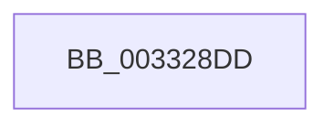

# sub_003328DD

- RVA: `0x003328DD`–`0x003328FE` (길이 `33` bytes)
- VA: `0x00000001403328DD`
- 실행 섹션: `.text`
- PDB 이름 있음: `아니요`; PDB Function 태그: `아니요`
- unwind 정보 RVA: `0x00076650`
- 디코드: `7`개 명령, `33/33` bytes 표시
- 미해석 바이트: `0` (있으면 어셈블리에 `.byte`로 보존)

> 이 문서는 커널 이미지의 기계어와 PDB 기호를 분석해 생성했습니다. 4번과 5번은 함수 원형과 자료형을 바이너리 사용 방식에서 추정한 C 해석이며 원본 소스 복구 결과는 아닙니다.

## 1. Dependencies

- 직접 호출 지점: **1**; 고유 호출 대상: **1**
- 직접 호출자로 확인된 함수: **0**
- RIP 상대 이미지 참조: **1**

### Outgoing calls
- `0x003328F4` → [MiFlushSingleTbEntry](../28/MiFlushSingleTbEntry_function_0028E730.md) (function, `0x0028E730`)

### Direct callers
- 이 함수 시작 RVA로 연결되는 직접 call은 확인되지 않았습니다. 간접 호출은 완전히 역산할 수 없습니다.

### Static image references
- `0x003328DD` → RVA `0x00010880` (`.rdata`; read)

## 2. Other-region calls and transfers

- 다른 실행 섹션으로 향하는 call: **0**
- call이 아닌 외부 분기/꼬리 이동: **1**
  - `0x003328F9` → [sub_00332714 + 0x68](Unknown_function_00332714.md) (`tail-transfer`)

## 3. Assembly (complete function range)

```asm
003328DD  48 8B 05 9C DF CD FF            mov rax, qword ptr [rip - 0x322064]
003328E4  BA 02 00 00 00                  mov edx, 2
003328E9  48 8B CF                        mov rcx, rdi
003328EC  49 89 04 24                     mov qword ptr [r12], rax
003328F0  44 8D 42 FF                     lea r8d, [rdx - 1]
003328F4  E8 37 BE F5 FF                  call 0x14028e730
003328F9  E9 7E FE FF FF                  jmp 0x14033277c
```

## 4. C-style interpretation (structured pseudocode)

```c
__int64 __fastcall sub_003328DD(void)
{
    __int64 result;

    *(unsigned __int64 *)(v_r12) = *(unsigned __int64 *)(v_rip - 3285092);
    result = MiFlushSingleTbEntry(v_rdi, 2, 2 - 1, a4);
}
```

## 5. (Beta) C Style

```c
void sub_003328DD(void)
{
    int64_t result;

    *(uint64_t *)(local_r12) = *(uint64_t *)(v_rip - 0x322064);
    result = MiFlushSingleTbEntry(local_rdi, 2, 2 - 1, a4);
}
```

## 6. Execution-region graph

[열기: 2D/3D 그래프와 함수 탐색 컨트롤 패널](../../../control-panel.html?section=text&rva=0x003328DD&view=graph)

- 2D 그래프는 위에서 아래로 흐르고, 3D 그래프는 빈 공간을 드래그해 회전합니다. Shift+드래그는 이동, 휠은 확대·축소, 함수 노드 선택은 대상 보고서 이동입니다.

### Static fallback


