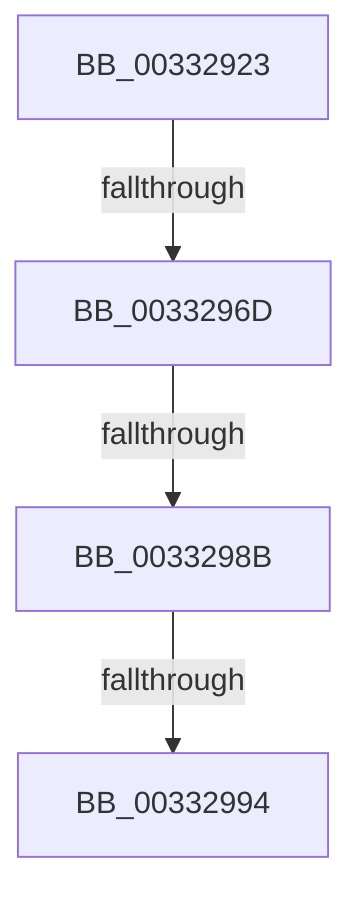

# sub_00332923

- RVA: `0x00332923`–`0x003329BC` (길이 `153` bytes)
- VA: `0x0000000140332923`
- 실행 섹션: `.text`
- PDB 이름 있음: `아니요`; PDB Function 태그: `아니요`
- unwind 정보 RVA: `0x00076674`
- 디코드: `31`개 명령, `153/153` bytes 표시
- 미해석 바이트: `0` (있으면 어셈블리에 `.byte`로 보존)

> 이 문서는 커널 이미지의 기계어와 PDB 기호를 분석해 생성했습니다. 4번과 5번은 함수 원형과 자료형을 바이너리 사용 방식에서 추정한 C 해석이며 원본 소스 복구 결과는 아닙니다.

## 1. Dependencies

- 직접 호출 지점: **2**; 고유 호출 대상: **2**
- 직접 호출자로 확인된 함수: **0**
- RIP 상대 이미지 참조: **0**

### Outgoing calls
- `0x0033297A` → [MiMapPageInHyperSpaceWorker](MiMapPageInHyperSpaceWorker_function_00332B10.md) (function, `0x00332B10`)
- `0x0033299C` → [KeZeroPages](../6B/KeZeroPages_function_006BA070.md) (function, `0x006BA070`)

### Direct callers
- 이 함수 시작 RVA로 연결되는 직접 call은 확인되지 않았습니다. 간접 호출은 완전히 역산할 수 없습니다.

### Static image references
- 디코드된 RIP-relative 메모리 참조가 없습니다.

## 2. Other-region calls and transfers

- 다른 실행 섹션으로 향하는 call: **0**
- call이 아닌 외부 분기/꼬리 이동: **4**
  - `0x00332967` → [sub_00332A20 + 0x54](Unknown_function_00332A20.md) (`tail-transfer`)
  - `0x00332985` → [sub_00332A20 + 0x41](Unknown_function_00332A20.md) (`tail-transfer`)
  - `0x0033298E` → [sub_00332A20](Unknown_function_00332A20.md) (`tail-transfer`)
  - `0x003329B6` → [sub_00332AE1](Unknown_function_00332AE1.md) (`tail-transfer`)

## 3. Assembly (complete function range)

```asm
00332923  49 89 6B 08                     mov qword ptr [r11 + 8], rbp
00332927  45 33 FF                        xor r15d, r15d
0033292A  41 C6 43 18 11                  mov byte ptr [r11 + 0x18], 0x11
0033292F  49 8B E9                        mov rbp, r9
00332932  65 48 8B 04 25 20 00 00 00      mov rax, qword ptr gs:[0x20]
0033293B  48 8B FA                        mov rdi, rdx
0033293E  49 89 73 10                     mov qword ptr [r11 + 0x10], rsi
00332942  49 BD F8 FF FF FF 7F 00 00 00   movabs r13, 0x7ffffffff8
0033294C  4D 89 73 20                     mov qword ptr [r11 + 0x20], r14
00332950  4C 8B F1                        mov r14, rcx
00332953  49 BC 00 00 00 00 80 F6 FF FF   movabs r12, 0xfffff68000000000
0033295D  48 8B B0 38 88 00 00            mov rsi, qword ptr [rax + 0x8838]
00332964  48 85 F6                        test rsi, rsi
00332967  0F 84 07 01 00 00               je 0x140332a74
0033296D  41 B8 00 00 00 80               mov r8d, 0x80000000
00332973  49 8D 53 18                     lea rdx, [r11 + 0x18]
00332977  48 8B CF                        mov rcx, rdi
0033297A  E8 91 01 00 00                  call 0x140332b10
0033297F  48 8B D8                        mov rbx, rax
00332982  48 85 ED                        test rbp, rbp
00332985  0F 85 D6 00 00 00               jne 0x140332a61
0033298B  4D 85 F6                        test r14, r14
0033298E  0F 85 8C 00 00 00               jne 0x140332a20
00332994  BA 00 10 00 00                  mov edx, 0x1000
00332999  48 8B CB                        mov rcx, rbx
0033299C  E8 CF 76 38 00                  call 0x1406ba070
003329A1  4C 8B B4 24 88 00 00 00         mov r14, qword ptr [rsp + 0x88]
003329A9  48 85 F6                        test rsi, rsi
003329AC  48 8B 74 24 78                  mov rsi, qword ptr [rsp + 0x78]
003329B1  48 8B 6C 24 70                  mov rbp, qword ptr [rsp + 0x70]
003329B6  0F 84 25 01 00 00               je 0x140332ae1
```

## 4. C-style interpretation (structured pseudocode)

```c
__int64 __fastcall sub_00332923(__int64 a1, __int64 a2, __int64 a3, __int64 a4, __int64 a5, __int64 a6, __int64 a7, __int64 a8, __int64 a9, __int64 a10, __int64 a11, __int64 a12, __int64 a13, __int64 a14, __int64 a15, __int64 a16, __int64 a17)
{
    __int64 result;
    __int64 v_r15;

    *(unsigned __int64 *)(v_r11 + 8) = v_rbp;
    v_r15 = 0;
    *(unsigned __int8 *)(v_r11 + 24) = 17;
    *(unsigned __int64 *)(v_r11 + 16) = v_rsi;
    *(unsigned __int64 *)(v_r11 + 32) = v_r14;
    result = MiMapPageInHyperSpaceWorker(a2, v_r11 + 24, (unsigned int)(0x80000000ULL), a4);
    result = KeZeroPages(result, (unsigned int)(0x1000ULL), (unsigned int)(0x80000000ULL), a4);
}
```

## 5. (Beta) C Style

```c
int64_t sub_00332923(int64_t Arg1, int64_t Arg2, int64_t Arg3, int64_t Arg4, uint64_t Arg5, uint64_t Arg6, uint64_t Arg7, uint64_t Arg8, uint64_t Arg9, uint64_t Arg10, uint64_t Arg11, uint64_t Arg12, uint64_t Arg13, int64_t Arg14, int64_t Arg15, uint64_t Arg16, int64_t Arg17)
{
    int64_t result;
    int64_t local_r15;

    *(uint64_t *)(local_r11 + 0x8) = local_rbp;
    local_r15 = 0;
    *(uint8_t *)(local_r11 + 0x18) = 17;
    *(uint64_t *)(local_r11 + 0x10) = local_rsi;
    *(uint64_t *)(local_r11 + 0x20) = local_r14;
    result = MiMapPageInHyperSpaceWorker(Arg2, local_r11 + 24, (uint32_t)(0x80000000ULL), Arg4);
    result = KeZeroPages(result, (uint32_t)(0x1000ULL), (uint32_t)(0x80000000ULL), Arg4);
}
```

## 6. Execution-region graph

[열기: 2D/3D 그래프와 함수 탐색 컨트롤 패널](../../../control-panel.html?section=text&rva=0x00332923&view=graph)

- 2D 그래프는 위에서 아래로 흐르고, 3D 그래프는 빈 공간을 드래그해 회전합니다. Shift+드래그는 이동, 휠은 확대·축소, 함수 노드 선택은 대상 보고서 이동입니다.

### Static fallback


