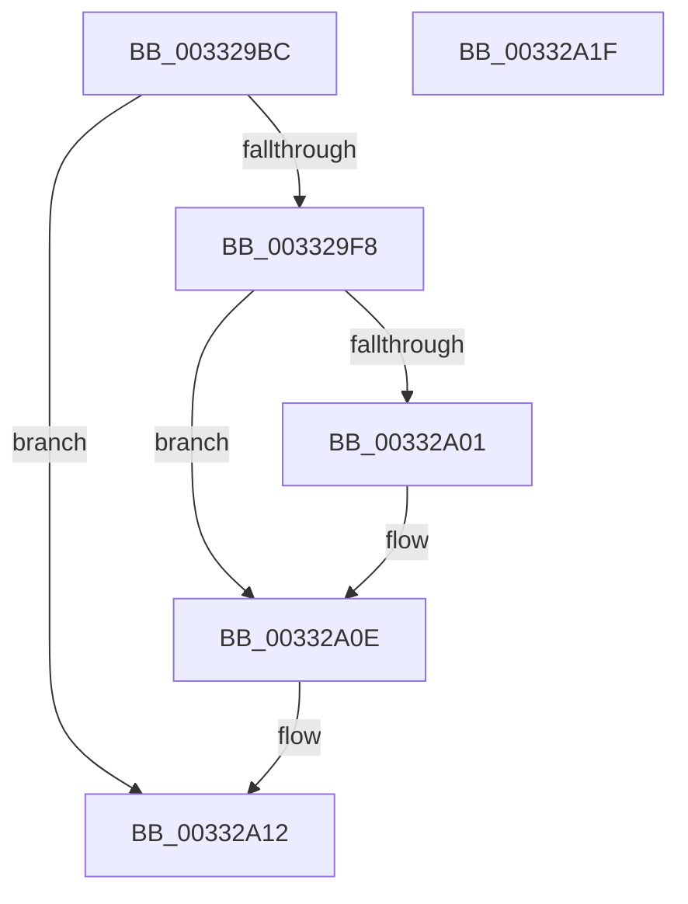

# sub_003329BC

- RVA: `0x003329BC`–`0x00332A20` (길이 `100` bytes)
- VA: `0x00000001403329BC`
- 실행 섹션: `.text`
- PDB 이름 있음: `아니요`; PDB Function 태그: `아니요`
- unwind 정보 RVA: `0x00076690`
- 디코드: `26`개 명령, `100/100` bytes 표시
- 미해석 바이트: `0` (있으면 어셈블리에 `.byte`로 보존)

> 이 문서는 커널 이미지의 기계어와 PDB 기호를 분석해 생성했습니다. 4번과 5번은 함수 원형과 자료형을 바이너리 사용 방식에서 추정한 C 해석이며 원본 소스 복구 결과는 아닙니다.

## 1. Dependencies

- 직접 호출 지점: **1**; 고유 호출 대상: **1**
- 직접 호출자로 확인된 함수: **0**
- RIP 상대 이미지 참조: **2**

### Outgoing calls
- `0x00332A09` → [KiLowerIrqlProcessIrqlFlags](../4F/KiLowerIrqlProcessIrqlFlags_function_004F5698.md) (function, `0x004F5698`)

### Direct callers
- 이 함수 시작 RVA로 연결되는 직접 call은 확인되지 않았습니다. 간접 호출은 완전히 역산할 수 없습니다.

### Static image references
- `0x003329E1` → RVA `0x00010880` (`.rdata`; read)
- `0x003329F8` → RVA `0x00FC6D20` (`ALMOSTRO`; read)

## 2. Other-region calls and transfers

- 다른 실행 섹션으로 향하는 call: **0**
- 별도 외부 분기/꼬리 이동을 확인하지 못했습니다.

## 3. Assembly (complete function range)

```asm
003329BC  0F B6 BC 24 80 00 00 00         movzx edi, byte ptr [rsp + 0x80]
003329C4  48 C1 EB 09                     shr rbx, 9
003329C8  49 23 DD                        and rbx, r13
003329CB  49 8B C4                        mov rax, r12
003329CE  48 03 D8                        add rbx, rax
003329D1  65 48 8B 04 25 20 00 00 00      mov rax, qword ptr gs:[0x20]
003329DA  48 8B 88 38 88 00 00            mov rcx, qword ptr [rax + 0x8838]
003329E1  48 8B 05 98 DE CD FF            mov rax, qword ptr [rip - 0x322168]
003329E8  48 C7 01 00 00 00 00            mov qword ptr [rcx], 0
003329EF  48 89 03                        mov qword ptr [rbx], rax
003329F2  40 80 FF 11                     cmp dil, 0x11
003329F6  74 1A                           je 0x140332a12
003329F8  83 3D 21 43 C9 00 00            cmp dword ptr [rip + 0xc94321], 0
003329FF  74 0D                           je 0x140332a0e
00332A01  44 0F 20 C1                     mov rcx, cr8
00332A05  40 0F B6 D7                     movzx edx, dil
00332A09  E8 8A 2C 1C 00                  call 0x1404f5698
00332A0E  44 0F 22 C7                     mov cr8, rdi
00332A12  48 83 C4 40                     add rsp, 0x40
00332A16  41 5F                           pop r15
00332A18  41 5D                           pop r13
00332A1A  41 5C                           pop r12
00332A1C  5F                              pop rdi
00332A1D  5B                              pop rbx
00332A1E  C3                              ret
00332A1F  CC                              int3
```

## 4. C-style interpretation (structured pseudocode)

```c
__int64 __fastcall sub_003329BC(__int64 a1, __int64 a2, __int64 a3, __int64 a4, __int64 a5, __int64 a6, __int64 a7, __int64 a8, __int64 a9, __int64 a10, __int64 a11, __int64 a12, __int64 a13, __int64 a14, __int64 a15, unsigned __int8 a16)
{
    __int64 result;
    __int64 v_rbx;
    __int64 v_rsp;

    v_rbx = (v_rbx) >> (9);
    v_rbx = (v_rbx) & (v_r13);
    v_rbx = (v_rbx) + (v_r12);
    *(unsigned __int64 *)(*(unsigned __int64 *)(*(unsigned __int64 *)(gs_base + (0 + 32)) + 34872)) = 0;
    *(unsigned __int64 *)(v_rbx) = *(unsigned __int64 *)(v_rip - 3285352);
    if (a16 == 17) goto loc_00332A12;
    result = *(unsigned __int64 *)(v_rip - 3285352);
    if ((*(unsigned int *)(v_rip + 13189921)) != 0) {
        a1 = v_cr8;
        a2 = a16;
        result = KiLowerIrqlProcessIrqlFlags(a1, a2, a3, a4);
    }
loc_00332A12:
    v_rsp = (v_rsp) + (64);
    return result;
}
```

## 5. (Beta) C Style

```c
int64_t sub_003329BC(int64_t Arg1, int64_t Arg2, int64_t Arg3, int64_t Arg4, uint64_t Arg5, uint64_t Arg6, uint64_t Arg7, uint64_t Arg8, uint64_t Arg9, uint64_t Arg10, uint64_t Arg11, uint64_t Arg12, uint64_t Arg13, uint64_t Arg14, uint64_t Arg15, uint8_t Arg16)
{
    int64_t result;
    int64_t local_rbx;
    int64_t local_rsp;

    local_rbx = (local_rbx) >> (9);
    local_rbx = (local_rbx) & (local_r13);
    local_rbx = (local_rbx) + (local_r12);
    *(uint64_t *)(*(uint64_t *)(*(uint64_t *)(gs_base + (0 + 0x20)) + 0x8838)) = 0;
    *(uint64_t *)(local_rbx) = *(uint64_t *)(v_rip - 0x322168);
    if (Arg16 == 17) goto loc_00332A12;
    result = *(uint64_t *)(v_rip - 0x322168);
    if ((*(uint32_t *)(v_rip + 0xC94321)) != 0) {
        Arg1 = v_cr8;
        Arg2 = Arg16;
        result = KiLowerIrqlProcessIrqlFlags(Arg1, Arg2, Arg3, Arg4);
    }
loc_00332A12:
    local_rsp = (local_rsp) + (64);
    return result;
}
```

## 6. Execution-region graph

[열기: 2D/3D 그래프와 함수 탐색 컨트롤 패널](../../../control-panel.html?section=text&rva=0x003329BC&view=graph)

- 2D 그래프는 위에서 아래로 흐르고, 3D 그래프는 빈 공간을 드래그해 회전합니다. Shift+드래그는 이동, 휠은 확대·축소, 함수 노드 선택은 대상 보고서 이동입니다.

### Static fallback


