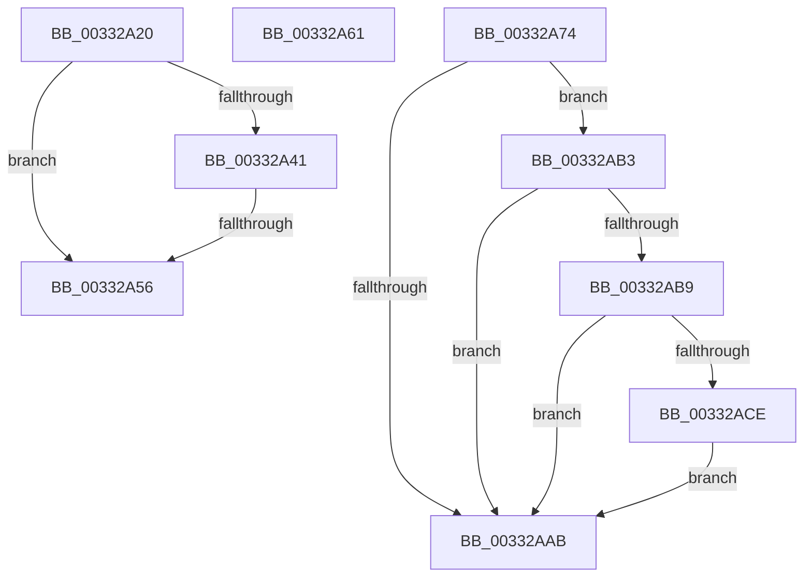

# sub_00332A20

- RVA: `0x00332A20`–`0x00332AE1` (길이 `193` bytes)
- VA: `0x0000000140332A20`
- 실행 섹션: `.text`
- PDB 이름 있음: `아니요`; PDB Function 태그: `아니요`
- unwind 정보 RVA: `0x000766A4`
- 디코드: `48`개 명령, `193/193` bytes 표시
- 미해석 바이트: `0` (있으면 어셈블리에 `.byte`로 보존)

> 이 문서는 커널 이미지의 기계어와 PDB 기호를 분석해 생성했습니다. 4번과 5번은 함수 원형과 자료형을 바이너리 사용 방식에서 추정한 C 해석이며 원본 소스 복구 결과는 아닙니다.

## 1. Dependencies

- 직접 호출 지점: **5**; 고유 호출 대상: **5**
- 직접 호출자로 확인된 함수: **0**
- RIP 상대 이미지 참조: **2**

### Outgoing calls
- `0x00332A38` → [AccelBuildDescriptorMemoryFill](../2C/AccelBuildDescriptorMemoryFill_function_002C7CBC.md) (function, `0x002C7CBC`)
- `0x00332A49` → [AccelpSubmitWork](../2C/AccelpSubmitWork_function_002C8190.md) (function, `0x002C8190`)
- `0x00332A74` → [MxGetPhase0Mapping](../../init/BE/MxGetPhase0Mapping_function_00BEF000.md) (function, `0x00BEF000`)
- `0x00332A98` → [MiMakeValidPte](../2C/MiMakeValidPte_function_002C5590.md) (function, `0x002C5590`)
- `0x00332ADA` → [MiCheckLinearProtectedPteAccessedBit](../29/MiCheckLinearProtectedPteAccessedBit_function_00292D80.md) (function, `0x00292D80`)

### Direct callers
- 이 함수 시작 RVA로 연결되는 직접 call은 확인되지 않았습니다. 간접 호출은 완전히 역산할 수 없습니다.

### Static image references
- `0x00332A56` → RVA `0x00EF508C` (`.data`; read/write)
- `0x00332A9D` → RVA `0x00FC6A88` (`ALMOSTRO`; read)

## 2. Other-region calls and transfers

- 다른 실행 섹션으로 향하는 call: **1**
  - `0x00332A74` → [MxGetPhase0Mapping](../../init/BE/MxGetPhase0Mapping_function_00BEF000.md) (`.text` → `INIT`)
- call이 아닌 외부 분기/꼬리 이동: **4**
  - `0x00332A50` → [sub_00332923 + 0x7E](Unknown_function_00332923.md) (`tail-transfer`)
  - `0x00332A5C` → [sub_00332923 + 0x71](Unknown_function_00332923.md) (`tail-transfer`)
  - `0x00332A6F` → [sub_00332923 + 0x7E](Unknown_function_00332923.md) (`tail-transfer`)
  - `0x00332AAE` → [sub_00332923 + 0x5F](Unknown_function_00332923.md) (`tail-transfer`)

## 3. Assembly (complete function range)

```asm
00332A20  45 33 C9                        xor r9d, r9d
00332A23  48 C7 44 24 20 03 00 00 00      mov qword ptr [rsp + 0x20], 3
00332A2C  41 B8 00 10 00 00               mov r8d, 0x1000
00332A32  48 8B D3                        mov rdx, rbx
00332A35  49 8B CE                        mov rcx, r14
00332A38  E8 7F 52 F9 FF                  call 0x1402c7cbc
00332A3D  85 C0                           test eax, eax
00332A3F  78 15                           js 0x140332a56
00332A41  BA 03 00 00 00                  mov edx, 3
00332A46  49 8B CE                        mov rcx, r14
00332A49  E8 42 57 F9 FF                  call 0x1402c8190
00332A4E  85 C0                           test eax, eax
00332A50  0F 89 4B FF FF FF               jns 0x1403329a1
00332A56  FF 05 30 26 BC 00               inc dword ptr [rip + 0xbc2630]
00332A5C  E9 33 FF FF FF                  jmp 0x140332994
00332A61  48 8B FB                        mov rdi, rbx
00332A64  48 8B C5                        mov rax, rbp
00332A67  B9 00 02 00 00                  mov ecx, 0x200
00332A6C  F3 48 AB                        rep stosq qword ptr [rdi], rax
00332A6F  E9 2D FF FF FF                  jmp 0x1403329a1
00332A74  E8 87 C5 8B 00                  call 0x140bef000
00332A79  4C 8B F8                        mov r15, rax
00332A7C  48 8B D8                        mov rbx, rax
00332A7F  49 C1 EF 09                     shr r15, 9
00332A83  4D 23 FD                        and r15, r13
00332A86  49 8B C4                        mov rax, r12
00332A89  4C 03 F8                        add r15, rax
00332A8C  41 B8 04 00 00 A0               mov r8d, 0xa0000004
00332A92  49 8B CF                        mov rcx, r15
00332A95  48 8B D7                        mov rdx, rdi
00332A98  E8 F3 2A F9 FF                  call 0x1402c5590
00332A9D  48 0F BA 25 E2 3F C9 00 24      bt qword ptr [rip + 0xc93fe2], 0x24
00332AA6  48 8B F8                        mov rdi, rax
00332AA9  72 08                           jb 0x140332ab3
00332AAB  49 89 3F                        mov qword ptr [r15], rdi
00332AAE  E9 CF FE FF FF                  jmp 0x140332982
00332AB3  40 F6 C7 20                     test dil, 0x20
00332AB7  75 F2                           jne 0x140332aab
00332AB9  49 8B C4                        mov rax, r12
00332ABC  48 B9 00 00 00 00 40 00 00 00   movabs rcx, 0x4000000000
00332AC6  48 03 C1                        add rax, rcx
00332AC9  4C 3B F8                        cmp r15, rax
00332ACC  72 DD                           jb 0x140332aab
00332ACE  41 B8 80 00 00 00               mov r8d, 0x80
00332AD4  48 8B D7                        mov rdx, rdi
00332AD7  49 8B CF                        mov rcx, r15
00332ADA  E8 A1 02 F6 FF                  call 0x140292d80
00332ADF  EB CA                           jmp 0x140332aab
```

## 4. C-style interpretation (structured pseudocode)

```c
__int64 __fastcall sub_00332A20(__int64 a1, __int64 a2, __int64 a3, int a4)
{
    __int64 result;
    unsigned __int64 v_stack_p20;

    a4 = 0;
    v_stack_p20 = 3;
    result = AccelBuildDescriptorMemoryFill(v_r14, v_rbx, (unsigned int)(0x1000ULL), a4);
    if (sign_flag) goto loc_00332A56;
    result = AccelpSubmitWork(v_r14, 3, (unsigned int)(0x1000ULL), a4);
loc_00332A56:
}
```

## 5. (Beta) C Style

```c
int64_t sub_00332A20(int64_t Arg1, int64_t Arg2, int64_t Arg3, int32_t Arg4)
{
    int64_t result;
    uint64_t v_stack_p20;

    Arg4 = 0;
    v_stack_p20 = 3;
    result = AccelBuildDescriptorMemoryFill(local_r14, local_rbx, (uint32_t)(0x1000ULL), Arg4);
    if (sign_flag) goto loc_00332A56;
    result = AccelpSubmitWork(local_r14, 3, (uint32_t)(0x1000ULL), Arg4);
loc_00332A56:
}
```

## 6. Execution-region graph

[열기: 2D/3D 그래프와 함수 탐색 컨트롤 패널](../../../control-panel.html?section=text&rva=0x00332A20&view=graph)

- 2D 그래프는 위에서 아래로 흐르고, 3D 그래프는 빈 공간을 드래그해 회전합니다. Shift+드래그는 이동, 휠은 확대·축소, 함수 노드 선택은 대상 보고서 이동입니다.

### Static fallback


