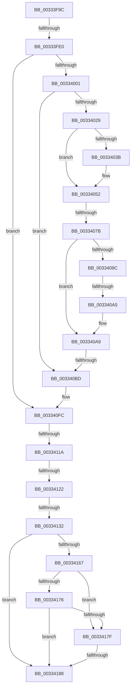

# sub_00333F9C

- RVA: `0x00333F9C`–`0x003341DA` (길이 `574` bytes)
- VA: `0x0000000140333F9C`
- 실행 섹션: `.text`
- PDB 이름 있음: `아니요`; PDB Function 태그: `아니요`
- unwind 정보 RVA: `0x00076744`
- 디코드: `132`개 명령, `574/574` bytes 표시
- 미해석 바이트: `0` (있으면 어셈블리에 `.byte`로 보존)

> 이 문서는 커널 이미지의 기계어와 PDB 기호를 분석해 생성했습니다. 4번과 5번은 함수 원형과 자료형을 바이너리 사용 방식에서 추정한 C 해석이며 원본 소스 복구 결과는 아닙니다.

## 1. Dependencies

- 직접 호출 지점: **2**; 고유 호출 대상: **2**
- 직접 호출자로 확인된 함수: **0**
- RIP 상대 이미지 참조: **3**

### Outgoing calls
- `0x0033404A` → [MiMapPageInHyperSpaceWorker](MiMapPageInHyperSpaceWorker_function_00332B10.md) (function, `0x00332B10`)
- `0x003341A5` → [MiInsertPageInFreeOrZeroedList](MiInsertPageInFreeOrZeroedList_function_00334D20.md) (function, `0x00334D20`)

### Direct callers
- 이 함수 시작 RVA로 연결되는 직접 call은 확인되지 않았습니다. 간접 호출은 완전히 역산할 수 없습니다.

### Static image references
- `0x0033407B` → RVA `0x00E2DC80` (`.data`; read)
- `0x003340EB` → RVA `0x00010880` (`.rdata`; read)
- `0x00334140` → RVA `0x00E30088` (`.data`; read)

## 2. Other-region calls and transfers

- 다른 실행 섹션으로 향하는 call: **0**
- call이 아닌 외부 분기/꼬리 이동: **8**
  - `0x00333FDA` → [sub_003341DB + 0x21](Unknown_function_003341DB.md) (`tail-transfer`)
  - `0x00334075` → [sub_003341DB + 0x154](Unknown_function_003341DB.md) (`tail-transfer`)
  - `0x0033409F` → [sub_003341DB + 0x19](Unknown_function_003341DB.md) (`tail-transfer`)
  - `0x003340B7` → [sub_003341DB](Unknown_function_003341DB.md) (`tail-transfer`)
  - `0x00334114` → [sub_003341DB + 0x9C](Unknown_function_003341DB.md) (`tail-transfer`)
  - `0x0033411C` → [sub_003341DB + 0x2C](Unknown_function_003341DB.md) (`tail-transfer`)
  - `0x0033412C` → [sub_00334363](Unknown_function_00334363.md) (`tail-transfer`)
  - `0x00334182` → [sub_003341DB + 0xE6](Unknown_function_003341DB.md) (`tail-transfer`)

## 3. Assembly (complete function range)

```asm
00333F9C  49 89 6B 10                     mov qword ptr [r11 + 0x10], rbp
00333FA0  48 8B D0                        mov rdx, rax
00333FA3  48 23 D1                        and rdx, rcx
00333FA6  49 89 73 E8                     mov qword ptr [r11 - 0x18], rsi
00333FAA  48 FF CA                        dec rdx
00333FAD  49 89 7B E0                     mov qword ptr [r11 - 0x20], rdi
00333FB1  4D 89 63 D8                     mov qword ptr [r11 - 0x28], r12
00333FB5  48 8B CA                        mov rcx, rdx
00333FB8  48 33 C8                        xor rcx, rax
00333FBB  4D 89 6B D0                     mov qword ptr [r11 - 0x30], r13
00333FBF  48 B8 00 00 00 00 00 00 00 C0   movabs rax, 0xc000000000000000
00333FC9  4D 89 73 C8                     mov qword ptr [r11 - 0x38], r14
00333FCD  48 23 C8                        and rcx, rax
00333FD0  48 33 CA                        xor rcx, rdx
00333FD3  48 89 4B 18                     mov qword ptr [rbx + 0x18], rcx
00333FD7  48 85 D2                        test rdx, rdx
00333FDA  0F 85 1C 02 00 00               jne 0x1403341fc
00333FE0  8B 43 20                        mov eax, dword ptr [rbx + 0x20]
00333FE3  89 84 24 80 00 00 00            mov dword ptr [rsp + 0x80], eax
00333FEA  48 8B 43 28                     mov rax, qword ptr [rbx + 0x28]
00333FEE  49 BD 00 00 00 00 00 DE FF FF   movabs r13, 0xffffde0000000000
00333FF8  48 85 C0                        test rax, rax
00333FFB  0F 89 FB 00 00 00               jns 0x1403340fc
00334001  4C 8B 73 10                     mov r14, qword ptr [rbx + 0x10]
00334005  45 33 C0                        xor r8d, r8d
00334008  48 8B 43 28                     mov rax, qword ptr [rbx + 0x28]
0033400C  48 8B FB                        mov rdi, rbx
0033400F  49 C1 EE 05                     shr r14, 5
00334013  49 BC FF FF FF FF FF 00 00 00   movabs r12, 0xffffffffff
0033401D  33 ED                           xor ebp, ebp
0033401F  48 83 FD 01                     cmp rbp, 1
00334023  0F 83 94 00 00 00               jae 0x1403340bd
00334029  48 8B 77 08                     mov rsi, qword ptr [rdi + 8]
0033402D  C1 EE 03                        shr esi, 3
00334030  81 E6 FF 01 00 00               and esi, 0x1ff
00334036  4D 85 C0                        test r8, r8
00334039  75 17                           jne 0x140334052
0033403B  48 8B 4F 28                     mov rcx, qword ptr [rdi + 0x28]
0033403F  33 D2                           xor edx, edx
00334041  49 23 CC                        and rcx, r12
00334044  41 B8 00 00 00 80               mov r8d, 0x80000000
0033404A  E8 C1 EA FF FF                  call 0x140332b10
0033404F  4C 8B C0                        mov r8, rax
00334052  49 8B 0C F0                     mov rcx, qword ptr [r8 + rsi*8]
00334056  4D 8D 14 F0                     lea r10, [r8 + rsi*8]
0033405A  4C 8B C9                        mov r9, rcx
0033405D  49 C1 E9 0C                     shr r9, 0xc
00334061  4D 23 CC                        and r9, r12
00334064  4B 8D 14 49                     lea rdx, [r9 + r9*2]
00334068  48 C1 E2 04                     shl rdx, 4
0033406C  49 8B C5                        mov rax, r13
0033406F  48 03 D0                        add rdx, rax
00334072  48 3B D7                        cmp rdx, rdi
00334075  0F 85 B4 02 00 00               jne 0x14033432f
0033407B  48 8B 15 FE 9B AF 00            mov rdx, qword ptr [rip + 0xaf9bfe]
00334082  41 8B C6                        mov eax, r14d
00334085  83 E0 1F                        and eax, 0x1f
00334088  49 C1 E1 07                     shl r9, 7
0033408C  49 0B C1                        or rax, r9
0033408F  48 83 C8 40                     or rax, 0x40
00334093  48 C1 E0 05                     shl rax, 5
00334097  48 85 D2                        test rdx, rdx
0033409A  74 0D                           je 0x1403340a9
0033409C  48 85 C2                        test rdx, rax
0033409F  0F 84 4F 01 00 00               je 0x1403341f4
003340A5  48 83 C8 10                     or rax, 0x10
003340A9  49 89 02                        mov qword ptr [r10], rax
003340AC  48 8D 45 01                     lea rax, [rbp + 1]
003340B0  48 8B E8                        mov rbp, rax
003340B3  48 83 F8 01                     cmp rax, 1
003340B7  0F 85 1E 01 00 00               jne 0x1403341db
003340BD  49 C1 E8 09                     shr r8, 9
003340C1  48 B8 F8 FF FF FF 7F 00 00 00   movabs rax, 0x7ffffffff8
003340CB  4C 23 C0                        and r8, rax
003340CE  48 B8 00 00 00 00 80 F6 FF FF   movabs rax, 0xfffff68000000000
003340D8  4C 03 C0                        add r8, rax
003340DB  65 48 8B 04 25 20 00 00 00      mov rax, qword ptr gs:[0x20]
003340E4  48 8B 88 38 88 00 00            mov rcx, qword ptr [rax + 0x8838]
003340EB  48 8B 05 8E C7 CD FF            mov rax, qword ptr [rip - 0x323872]
003340F2  48 C7 01 00 00 00 00            mov qword ptr [rcx], 0
003340F9  49 89 00                        mov qword ptr [r8], rax
003340FC  48 8B 43 18                     mov rax, qword ptr [rbx + 0x18]
00334100  B9 FF FF 00 00                  mov ecx, 0xffff
00334105  48 C1 E8 3E                     shr rax, 0x3e
00334109  83 E0 01                        and eax, 1
0033410C  66 01 8C 24 80 00 00 00         add word ptr [rsp + 0x80], cx
00334114  0F 85 5D 01 00 00               jne 0x140334277
0033411A  85 C0                           test eax, eax
0033411C  0F 84 E5 00 00 00               je 0x140334207
00334122  0F B6 84 24 83 00 00 00         movzx eax, byte ptr [rsp + 0x83]
0033412A  A8 10                           test al, 0x10
0033412C  0F 85 31 02 00 00               jne 0x140334363
00334132  8B 84 24 80 00 00 00            mov eax, dword ptr [rsp + 0x80]
00334139  89 43 20                        mov dword ptr [rbx + 0x20], eax
0033413C  48 8B 43 28                     mov rax, qword ptr [rbx + 0x28]
00334140  48 8B 0D 41 BF AF 00            mov rcx, qword ptr [rip + 0xafbf41]
00334147  48 C1 E8 2B                     shr rax, 0x2b
0033414B  25 FF 03 00 00                  and eax, 0x3ff
00334150  48 8B 0C C1                     mov rcx, qword ptr [rcx + rax*8]
00334154  48 8B 43 10                     mov rax, qword ptr [rbx + 0x10]
00334158  48 89 84 24 90 00 00 00         mov qword ptr [rsp + 0x90], rax
00334160  48 0F BA E0 0A                  bt rax, 0xa
00334165  72 21                           jb 0x140334188
00334167  48 8B 94 24 90 00 00 00         mov rdx, qword ptr [rsp + 0x90]
0033416F  C0 E8 02                        shr al, 2
00334172  A8 01                           test al, 1
00334174  75 09                           jne 0x14033417f
00334176  0F B6 C2                        movzx eax, dl
00334179  D0 E8                           shr al, 1
0033417B  A8 01                           test al, 1
0033417D  74 09                           je 0x140334188
0033417F  48 85 D2                        test rdx, rdx
00334182  0F 85 39 01 00 00               jne 0x1403342c1
00334188  49 8B C5                        mov rax, r13
0033418B  48 2B D8                        sub rbx, rax
0033418E  48 B9 AB AA AA AA AA AA AA AA   movabs rcx, 0xaaaaaaaaaaaaaaab
00334198  48 C1 FB 04                     sar rbx, 4
0033419C  BA 02 00 00 00                  mov edx, 2
003341A1  48 0F AF CB                     imul rcx, rbx
003341A5  E8 76 0B 00 00                  call 0x140334d20
003341AA  BF 04 00 00 00                  mov edi, 4
003341AF  4C 8B 6C 24 48                  mov r13, qword ptr [rsp + 0x48]
003341B4  8B C7                           mov eax, edi
003341B6  48 8B 7C 24 58                  mov rdi, qword ptr [rsp + 0x58]
003341BB  4C 8B 64 24 50                  mov r12, qword ptr [rsp + 0x50]
003341C0  48 8B 74 24 60                  mov rsi, qword ptr [rsp + 0x60]
003341C5  48 8B AC 24 88 00 00 00         mov rbp, qword ptr [rsp + 0x88]
003341CD  4C 8B 74 24 40                  mov r14, qword ptr [rsp + 0x40]
003341D2  48 83 C4 68                     add rsp, 0x68
003341D6  41 5F                           pop r15
003341D8  5B                              pop rbx
003341D9  C3                              ret
```

## 4. C-style interpretation (structured pseudocode)

```c
__int64 __fastcall sub_00333F9C(__int64 a1, __int64 a2, int a3, __int64 a4, __int64 a5, __int64 a6, __int64 a7, __int64 a8, __int64 a9, __int64 a10, __int64 a11, __int64 a12, __int64 a13, __int64 a14, __int64 a15, unsigned __int16 a16, __int64 a17, __int64 a18)
{
    __int64 result;
    __int64 v_r14;
    __int64 v_rbp;
    __int64 v_rbx;
    __int64 v_rsi;
    __int64 v_rsp;
    unsigned int v_stack_p80;
    unsigned __int8 v_stack_p83;
    unsigned __int64 v_stack_p90;

    *(unsigned __int64 *)(v_r11 + 16) = v_rbp;
    a2 = (result) & (a1);
    *(unsigned __int64 *)(v_r11 - 24) = v_rsi;
    a2 = (a2) - 1;
    *(unsigned __int64 *)(v_r11 - 32) = v_rdi;
    *(unsigned __int64 *)(v_r11 - 40) = v_r12;
    a1 = (a2) ^ (result);
    *(unsigned __int64 *)(v_r11 - 48) = v_r13;
    *(unsigned __int64 *)(v_r11 - 56) = v_r14;
    a1 = (a1) & (result);
    a1 = (a1) ^ (a2);
    *(unsigned __int64 *)(v_rbx + 24) = a1;
    v_stack_p80 = (unsigned int)((unsigned int)(*(unsigned int *)(v_rbx + 32)));
    if (!sign_flag) goto loc_003340FC;
    a3 = 0;
    v_r14 = (*(unsigned __int64 *)(v_rbx + 16)) >> (5);
    v_rbp = 0;
    if (0 >= 1) goto loc_003340BD;
    v_rsi = (unsigned int)((*(unsigned __int64 *)(v_rbx + 8)) >> (3));
    v_rsi = (unsigned int)((v_rsi) & (511));
    result = *(unsigned __int64 *)(v_rbx + 40);
    if (0 == 0) {
        a1 = *(unsigned __int64 *)(v_rbx + 40);
        a2 = 0;
        a1 = (a1) & (v_r12);
        a3 = 0x80000000ULL;
        result = MiMapPageInHyperSpaceWorker(a1, a2, a3, a4);
        a3 = result;
    }
    a4 = (*(unsigned __int64 *)(a3 + v_rsi * 8)) >> (12);
    a4 = (a4) & (v_r12);
    a2 = (a4 + a4 * 2) << (4);
    a2 = (a2) + (v_r13);
    result = (unsigned int)(((unsigned int)((unsigned int)(v_r14))) & (31));
    a4 = (a4) << (7);
    result = (result) | (a4);
    result = (result) | (64);
    result = (result) << (5);
    if (*(unsigned __int64 *)(v_rip + 11508734) == 0) goto loc_003340A9;
    result = (result) | (16);
loc_003340A9:
    *(unsigned __int64 *)(a3 + v_rsi * 8) = result;
loc_003340BD:
    a3 = (a3) >> (9);
    a3 = (a3) & (v_rbp + 1);
    a3 = (a3) + (v_rbp + 1);
    *(unsigned __int64 *)(*(unsigned __int64 *)(*(unsigned __int64 *)(gs_base + (0 + 32)) + 34872)) = 0;
    *(unsigned __int64 *)(a3) = *(unsigned __int64 *)(v_rip - 3291250);
loc_003340FC:
    result = (*(unsigned __int64 *)(v_rbx + 24)) >> (62);
    result = (unsigned int)((result) & (1));
    *(unsigned int *)(v_rbx + 32) = (unsigned int)((unsigned int)(a16));
    result = (*(unsigned __int64 *)(v_rbx + 40)) >> (43);
    result = (unsigned int)((result) & (0x3FFULL));
    v_stack_p90 = *(unsigned __int64 *)(v_rbx + 16);
    if (condition_is_below) goto loc_00334188;
    result = (unsigned __int8)((*(unsigned __int64 *)(v_rbx + 16)) >> (2));
    if ((((unsigned __int8)(result)) & (1)) != 0) goto loc_0033417F;
    result = (unsigned __int8)(((unsigned __int8)(a18)) >> (1));
    if ((((unsigned __int8)(result)) & (1)) == 0) goto loc_00334188;
loc_0033417F:
loc_00334188:
    v_rbx = (v_rbx) - (v_r13);
    v_rbx = (v_rbx) >> (4);
    a1 = (*(unsigned __int64 *)(*(unsigned __int64 *)(v_rip + 11517761) + result * 8)) * (v_rbx);
    result = MiInsertPageInFreeOrZeroedList(a1, 2, a3, a4);
    v_rsp = (v_rsp) + (104);
    return 4;
}
```

## 5. (Beta) C Style

```c
int64_t sub_00333F9C(int64_t Arg1, int64_t Arg2, int32_t Arg3, int64_t Arg4, uint64_t Arg5, uint64_t Arg6, uint64_t Arg7, int64_t Arg8, int64_t Arg9, int64_t Arg10, int64_t Arg11, int64_t Arg12, uint64_t Arg13, uint64_t Arg14, uint64_t Arg15, uint16_t Arg16, int64_t Arg17, int64_t Arg18)
{
    int64_t result;
    int64_t local_r14;
    int64_t local_rbp;
    int64_t local_rbx;
    int64_t local_rsi;
    int64_t local_rsp;
    uint32_t v_stack_p80;
    uint8_t v_stack_p83;
    uint64_t v_stack_p90;

    *(uint64_t *)(local_r11 + 0x10) = local_rbp;
    Arg2 = (result) & (Arg1);
    *(uint64_t *)(local_r11 - 0x18) = local_rsi;
    Arg2 = (Arg2) - 1;
    *(uint64_t *)(local_r11 - 0x20) = local_rdi;
    *(uint64_t *)(local_r11 - 0x28) = local_r12;
    Arg1 = (Arg2) ^ (result);
    *(uint64_t *)(local_r11 - 0x30) = local_r13;
    *(uint64_t *)(local_r11 - 0x38) = local_r14;
    Arg1 = (Arg1) & (result);
    Arg1 = (Arg1) ^ (Arg2);
    *(uint64_t *)(local_rbx + 0x18) = Arg1;
    v_stack_p80 = (uint32_t)((uint32_t)(*(uint32_t *)(local_rbx + 0x20)));
    if (!sign_flag) goto loc_003340FC;
    Arg3 = 0;
    local_r14 = (*(uint64_t *)(local_rbx + 0x10)) >> (5);
    local_rbp = 0;
    if (0 >= 1) goto loc_003340BD;
    local_rsi = (uint32_t)((*(uint64_t *)(local_rbx + 0x8)) >> (3));
    local_rsi = (uint32_t)((local_rsi) & (511));
    result = *(uint64_t *)(local_rbx + 0x28);
    if (0 == 0) {
        Arg1 = *(uint64_t *)(local_rbx + 0x28);
        Arg2 = 0;
        Arg1 = (Arg1) & (local_r12);
        Arg3 = 0x80000000ULL;
        result = MiMapPageInHyperSpaceWorker(Arg1, Arg2, Arg3, Arg4);
        Arg3 = result;
    }
    Arg4 = (*(uint64_t *)(Arg3 + local_rsi * 8)) >> (12);
    Arg4 = (Arg4) & (local_r12);
    Arg2 = (Arg4 + Arg4 * 2) << (4);
    Arg2 = (Arg2) + (local_r13);
    result = (uint32_t)(((uint32_t)((uint32_t)(local_r14))) & (31));
    Arg4 = (Arg4) << (7);
    result = (result) | (Arg4);
    result = (result) | (64);
    result = (result) << (5);
    if (*(uint64_t *)(v_rip + 0xAF9BFE) == 0) goto loc_003340A9;
    result = (result) | (16);
loc_003340A9:
    *(uint64_t *)(Arg3 + local_rsi * 8) = result;
loc_003340BD:
    Arg3 = (Arg3) >> (9);
    Arg3 = (Arg3) & (local_rbp + 1);
    Arg3 = (Arg3) + (local_rbp + 1);
    *(uint64_t *)(*(uint64_t *)(*(uint64_t *)(gs_base + (0 + 0x20)) + 0x8838)) = 0;
    *(uint64_t *)(Arg3) = *(uint64_t *)(v_rip - 0x323872);
loc_003340FC:
    result = (*(uint64_t *)(local_rbx + 0x18)) >> (62);
    result = (uint32_t)((result) & (1));
    *(uint32_t *)(local_rbx + 0x20) = (uint32_t)((uint32_t)(Arg16));
    result = (*(uint64_t *)(local_rbx + 0x28)) >> (43);
    result = (uint32_t)((result) & (0x3FFULL));
    v_stack_p90 = *(uint64_t *)(local_rbx + 0x10);
    if (condition_is_below) goto loc_00334188;
    result = (uint8_t)((*(uint64_t *)(local_rbx + 0x10)) >> (2));
    if ((((uint8_t)(result)) & (1)) != 0) goto loc_0033417F;
    result = (uint8_t)(((uint8_t)(Arg18)) >> (1));
    if ((((uint8_t)(result)) & (1)) == 0) goto loc_00334188;
loc_0033417F:
loc_00334188:
    local_rbx = (local_rbx) - (local_r13);
    local_rbx = (local_rbx) >> (4);
    Arg1 = (*(uint64_t *)(*(uint64_t *)(v_rip + 0xAFBF41) + result * 8)) * (local_rbx);
    result = MiInsertPageInFreeOrZeroedList(Arg1, 2, Arg3, Arg4);
    local_rsp = (local_rsp) + (104);
    return 4;
}
```

## 6. Execution-region graph

[열기: 2D/3D 그래프와 함수 탐색 컨트롤 패널](../../../control-panel.html?section=text&rva=0x00333F9C&view=graph)

- 2D 그래프는 위에서 아래로 흐르고, 3D 그래프는 빈 공간을 드래그해 회전합니다. Shift+드래그는 이동, 휠은 확대·축소, 함수 노드 선택은 대상 보고서 이동입니다.

### Static fallback


