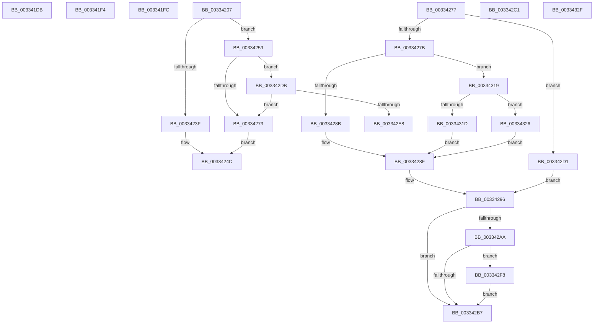

# sub_003341DB

- RVA: `0x003341DB`–`0x0033435D` (길이 `386` bytes)
- VA: `0x00000001403341DB`
- 실행 섹션: `.text`
- PDB 이름 있음: `아니요`; PDB Function 태그: `아니요`
- unwind 정보 RVA: `0x00076780`
- 디코드: `97`개 명령, `386/386` bytes 표시
- 미해석 바이트: `0` (있으면 어셈블리에 `.byte`로 보존)

> 이 문서는 커널 이미지의 기계어와 PDB 기호를 분석해 생성했습니다. 4번과 5번은 함수 원형과 자료형을 바이너리 사용 방식에서 추정한 C 해석이며 원본 소스 복구 결과는 아닙니다.

## 1. Dependencies

- 직접 호출 지점: **7**; 고유 호출 대상: **7**
- 직접 호출자로 확인된 함수: **0**
- RIP 상대 이미지 참조: **1**

### Outgoing calls
- `0x0033420B` → [MI_READ_PTE_LOCK_FREE](../28/MI_READ_PTE_LOCK_FREE_function_002828A0.md) (function, `0x002828A0`)
- `0x0033424F` → [MiInsertPageInList](../2B/MiInsertPageInList_function_002BA000.md) (function, `0x002BA000`)
- `0x003342AE` → [MiGetPagingFileOffset](../36/MiGetPagingFileOffset_function_0036F530.md) (function, `0x0036F530`)
- `0x003342C7` → [MiReleasePageFileInfo](../28/MiReleasePageFileInfo_function_00283FD0.md) (function, `0x00283FD0`)
- `0x003342DE` → [MiGetPfnPriority](../32/MiGetPfnPriority_function_003226F0.md) (function, `0x003226F0`)
- `0x003342EE` → [MiInsertProtectedStandbyPage](../45/MiInsertProtectedStandbyPage_function_004527D8.md) (function, `0x004527D8`)
- `0x00334357` → [KeBugCheckEx](../4F/KeBugCheckEx_function_004FD660.md) (function, `0x004FD660`)

### Direct callers
- 이 함수 시작 RVA로 연결되는 직접 call은 확인되지 않았습니다. 간접 호출은 완전히 역산할 수 없습니다.

### Static image references
- `0x003342FC` → RVA `0x00E30088` (`.data`; read)

## 2. Other-region calls and transfers

- 다른 실행 섹션으로 향하는 call: **0**
- call이 아닌 외부 분기/꼬리 이동: **7**
  - `0x003341EF` → [sub_00333F9C + 0x83](Unknown_function_00333F9C.md) (`tail-transfer`)
  - `0x003341F7` → [sub_00333F9C + 0x10D](Unknown_function_00333F9C.md) (`tail-transfer`)
  - `0x00334205` → [sub_00333F9C + 0x213](Unknown_function_00333F9C.md) (`tail-transfer`)
  - `0x00334254` → [sub_00333F9C + 0x213](Unknown_function_00333F9C.md) (`tail-transfer`)
  - `0x003342BC` → [sub_00333F9C + 0x213](Unknown_function_00333F9C.md) (`tail-transfer`)
  - `0x003342CC` → [sub_00333F9C + 0x1EC](Unknown_function_00333F9C.md) (`tail-transfer`)
  - `0x003342F3` → [sub_00333F9C + 0x213](Unknown_function_00333F9C.md) (`tail-transfer`)

## 3. Assembly (complete function range)

```asm
003341DB  48 8B 07                        mov rax, qword ptr [rdi]
003341DE  49 23 C4                        and rax, r12
003341E1  48 8D 3C 40                     lea rdi, [rax + rax*2]
003341E5  48 C1 E7 04                     shl rdi, 4
003341E9  49 8B C5                        mov rax, r13
003341EC  48 03 F8                        add rdi, rax
003341EF  E9 2B FE FF FF                  jmp 0x14033401f
003341F4  48 0B C2                        or rax, rdx
003341F7  E9 AD FE FF FF                  jmp 0x1403340a9
003341FC  48 8B 43 08                     mov rax, qword ptr [rbx + 8]
00334200  BF 02 00 00 00                  mov edi, 2
00334205  EB A8                           jmp 0x1403341af
00334207  48 8D 4B 10                     lea rcx, [rbx + 0x10]
0033420B  E8 90 E6 F4 FF                  call 0x1402828a0
00334210  48 0F BA E0 0A                  bt rax, 0xa
00334215  48 C7 C1 F7 FF FF FF            mov rcx, 0xfffffffffffffff7
0033421C  48 C7 C2 FF F7 FF FF            mov rdx, 0xfffffffffffff7ff
00334223  BF 04 00 00 00                  mov edi, 4
00334228  48 0F 42 CA                     cmovb rcx, rdx
0033422C  48 23 C8                        and rcx, rax
0033422F  0F B6 84 24 82 00 00 00         movzx eax, byte ptr [rsp + 0x82]
00334237  48 89 4B 10                     mov qword ptr [rbx + 0x10], rcx
0033423B  A8 10                           test al, 0x10
0033423D  74 1A                           je 0x140334259
0033423F  8B 84 24 80 00 00 00            mov eax, dword ptr [rsp + 0x80]
00334246  8D 57 04                        lea edx, [rdi + 4]
00334249  89 43 20                        mov dword ptr [rbx + 0x20], eax
0033424C  48 8B CB                        mov rcx, rbx
0033424F  E8 AC 5D F8 FF                  call 0x1402ba000
00334254  E9 56 FF FF FF                  jmp 0x1403341af
00334259  24 FA                           and al, 0xfa
0033425B  0C 02                           or al, 2
0033425D  88 84 24 82 00 00 00            mov byte ptr [rsp + 0x82], al
00334264  8B 84 24 80 00 00 00            mov eax, dword ptr [rsp + 0x80]
0033426B  89 43 20                        mov dword ptr [rbx + 0x20], eax
0033426E  4D 85 FF                        test r15, r15
00334271  75 68                           jne 0x1403342db
00334273  8B D7                           mov edx, edi
00334275  EB D5                           jmp 0x14033424c
00334277  85 C0                           test eax, eax
00334279  75 56                           jne 0x1403342d1
0033427B  0F B6 84 24 82 00 00 00         movzx eax, byte ptr [rsp + 0x82]
00334283  A8 10                           test al, 0x10
00334285  0F 84 8E 00 00 00               je 0x140334319
0033428B  24 FB                           and al, 0xfb
0033428D  0C 03                           or al, 3
0033428F  88 84 24 82 00 00 00            mov byte ptr [rsp + 0x82], al
00334296  8B 84 24 80 00 00 00            mov eax, dword ptr [rsp + 0x80]
0033429D  89 43 20                        mov dword ptr [rbx + 0x20], eax
003342A0  8B 43 10                        mov eax, dword ptr [rbx + 0x10]
003342A3  48 0F BA E0 0A                  bt rax, 0xa
003342A8  72 0D                           jb 0x1403342b7
003342AA  48 8B 4B 10                     mov rcx, qword ptr [rbx + 0x10]
003342AE  E8 7D B2 03 00                  call 0x14036f530
003342B3  85 C0                           test eax, eax
003342B5  75 41                           jne 0x1403342f8
003342B7  BF 03 00 00 00                  mov edi, 3
003342BC  E9 EE FE FF FF                  jmp 0x1403341af
003342C1  41 B8 01 00 00 00               mov r8d, 1
003342C7  E8 04 FD F4 FF                  call 0x140283fd0
003342CC  E9 B7 FE FF FF                  jmp 0x140334188
003342D1  80 8C 24 82 00 00 00 07         or byte ptr [rsp + 0x82], 7
003342D9  EB BB                           jmp 0x140334296
003342DB  48 8B CB                        mov rcx, rbx
003342DE  E8 0D E4 FE FF                  call 0x1403226f0
003342E3  83 F8 05                        cmp eax, 5
003342E6  73 8B                           jae 0x140334273
003342E8  48 8B D3                        mov rdx, rbx
003342EB  49 8B CF                        mov rcx, r15
003342EE  E8 E5 E4 11 00                  call 0x1404527d8
003342F3  E9 B7 FE FF FF                  jmp 0x1403341af
003342F8  48 8B 43 28                     mov rax, qword ptr [rbx + 0x28]
003342FC  48 8B 0D 85 BD AF 00            mov rcx, qword ptr [rip + 0xafbd85]
00334303  48 C1 E8 2B                     shr rax, 0x2b
00334307  25 FF 03 00 00                  and eax, 0x3ff
0033430C  48 8B 14 C1                     mov rdx, qword ptr [rcx + rax*8]
00334310  C6 82 D3 02 00 00 01            mov byte ptr [rdx + 0x2d3], 1
00334317  EB 9E                           jmp 0x1403342b7
00334319  A8 08                           test al, 8
0033431B  75 09                           jne 0x140334326
0033431D  24 FA                           and al, 0xfa
0033431F  0C 02                           or al, 2
00334321  E9 69 FF FF FF                  jmp 0x14033428f
00334326  24 FB                           and al, 0xfb
00334328  0C 03                           or al, 3
0033432A  E9 60 FF FF FF                  jmp 0x14033428f
0033432F  49 8B C5                        mov rax, r13
00334332  48 2B F8                        sub rdi, rax
00334335  48 89 4C 24 20                  mov qword ptr [rsp + 0x20], rcx
0033433A  48 C1 FF 04                     sar rdi, 4
0033433E  BA 06 00 00 00                  mov edx, 6
00334343  49 B8 AB AA AA AA AA AA AA AA   movabs r8, 0xaaaaaaaaaaaaaaab
0033434D  4D 8B CA                        mov r9, r10
00334350  4C 0F AF C7                     imul r8, rdi
00334354  8D 4A 48                        lea ecx, [rdx + 0x48]
00334357  E8 04 93 1C 00                  call 0x1404fd660
0033435C  CC                              int3
```

## 4. C-style interpretation (structured pseudocode)

```c
__int64 __fastcall sub_003341DB(__int64 a1, __int64 a2)
{
    __int64 result;
    __int64 v_rdi;
    unsigned __int64 v_stack_p20;
    unsigned int v_stack_p80;
    unsigned __int8 v_stack_p82;

    result = (*(unsigned __int64 *)(v_rdi)) & (v_r12);
    v_rdi = (result + result * 2) << (4);
    v_rdi = (v_rdi) + (v_r13);
}
```

## 5. (Beta) C Style

```c
int64_t sub_003341DB(int64_t Arg1, int64_t Arg2)
{
    int64_t result;
    int64_t local_rdi;
    uint64_t v_stack_p20;
    uint32_t v_stack_p80;
    uint8_t v_stack_p82;

    result = (*(uint64_t *)(local_rdi)) & (local_r12);
    local_rdi = (result + result * 2) << (4);
    local_rdi = (local_rdi) + (local_r13);
}
```

## 6. Execution-region graph

[열기: 2D/3D 그래프와 함수 탐색 컨트롤 패널](../../../control-panel.html?section=text&rva=0x003341DB&view=graph)

- 2D 그래프는 위에서 아래로 흐르고, 3D 그래프는 빈 공간을 드래그해 회전합니다. Shift+드래그는 이동, 휠은 확대·축소, 함수 노드 선택은 대상 보고서 이동입니다.

### Static fallback


