# sub_00334D90

- RVA: `0x00334D90`–`0x003352E8` (길이 `1,368` bytes)
- VA: `0x0000000140334D90`
- 실행 섹션: `.text`
- PDB 이름 있음: `아니요`; PDB Function 태그: `아니요`
- unwind 정보 RVA: `0x00076858`
- 디코드: `330`개 명령, `1,368/1,368` bytes 표시
- 미해석 바이트: `0` (있으면 어셈블리에 `.byte`로 보존)

> 이 문서는 커널 이미지의 기계어와 PDB 기호를 분석해 생성했습니다. 4번과 5번은 함수 원형과 자료형을 바이너리 사용 방식에서 추정한 C 해석이며 원본 소스 복구 결과는 아닙니다.

## 1. Dependencies

- 직접 호출 지점: **1**; 고유 호출 대상: **1**
- 직접 호출자로 확인된 함수: **0**
- RIP 상대 이미지 참조: **14**

### Outgoing calls
- `0x00335189` → [MiCoalesceFreeSmallPages](MiCoalesceFreeSmallPages_function_00336340.md) (function, `0x00336340`)

### Direct callers
- 이 함수 시작 RVA로 연결되는 직접 call은 확인되지 않았습니다. 간접 호출은 완전히 역산할 수 없습니다.

### Static image references
- `0x00334DA1` → RVA `0x00011C60` (`.rdata`; read)
- `0x00334DBF` → RVA `0x00E30088` (`.data`; read)
- `0x00334DF1` → RVA `0x00FC6A88` (`ALMOSTRO`; read)
- `0x00334E54` → RVA `0x00FCF080` (`CACHEALI`; read)
- `0x00334F5E` → RVA `0x00E3CBE6` (`.data`; read)
- `0x00334F6F` → RVA `0x00E3D240` (`.data`; read)
- `0x00334FA8` → RVA `0x00E2DBC0` (`.data`; read)
- `0x00334FB2` → RVA `0x00E2DBC4` (`.data`; read)
- `0x00334FC3` → RVA `0x00E2DC20` (`.data`; read)
- `0x0033500B` → RVA `0x00E2DBC0` (`.data`; write)
- `0x00335011` → RVA `0x00E2DC28` (`.data`; read)
- `0x00335053` → RVA `0x00E2DCC0` (`.data`; read)
- `0x00335101` → RVA `0x00E2DC80` (`.data`; read)
- `0x00335243` → RVA `0x00FC5002` (`ALMOSTRO`; read)

## 2. Other-region calls and transfers

- 다른 실행 섹션으로 향하는 call: **0**
- call이 아닌 외부 분기/꼬리 이동: **27**
  - `0x00334D98` → [sub_00335339](Unknown_function_00335339.md) (`tail-transfer`)
  - `0x00334DE4` → [sub_00335309](Unknown_function_00335309.md) (`tail-transfer`)
  - `0x00334DFF` → [sub_00336291](Unknown_function_00336291.md) (`tail-transfer`)
  - `0x00334E2B` → [sub_003354FB + 0xA39](Unknown_function_003354FB.md) (`tail-transfer`)
  - `0x00334E35` → [sub_00335309 + 0x27](Unknown_function_00335309.md) (`tail-transfer`)
  - `0x00334F58` → [sub_003354FB + 0x893](Unknown_function_003354FB.md) (`tail-transfer`)
  - `0x00334F88` → [sub_003354FB + 0x751](Unknown_function_003354FB.md) (`tail-transfer`)
  - `0x00334F97` → [sub_00336291 + 0x57](Unknown_function_00336291.md) (`tail-transfer`)
  - `0x00334FDD` → [sub_003354FB + 0x45F](Unknown_function_003354FB.md) (`tail-transfer`)
  - `0x00334FF9` → [sub_003354FB + 0x800](Unknown_function_003354FB.md) (`tail-transfer`)
  - `0x00335005` → [sub_003354FB + 0x5C3](Unknown_function_003354FB.md) (`tail-transfer`)
  - `0x0033501B` → [sub_003354FB + 0x7D3](Unknown_function_003354FB.md) (`tail-transfer`)
  - `0x0033502D` → [sub_003354FB + 0x43F](Unknown_function_003354FB.md) (`tail-transfer`)
  - `0x0033508F` → [sub_003354FB + 0x87D](Unknown_function_003354FB.md) (`tail-transfer`)
  - `0x003350FB` → [sub_003354FB + 0x7CB](Unknown_function_003354FB.md) (`tail-transfer`)
  - `0x0033510F` → [sub_003354FB + 0x589](Unknown_function_003354FB.md) (`tail-transfer`)
  - `0x00335144` → [sub_003354FB + 0x581](Unknown_function_003354FB.md) (`tail-transfer`)
  - `0x0033516B` → [sub_003354FB + 0x9](Unknown_function_003354FB.md) (`tail-transfer`)
  - `0x00335175` → [sub_003354FB + 0x9](Unknown_function_003354FB.md) (`tail-transfer`)
  - `0x00335190` → [sub_0033535B + 0x17E](Unknown_function_0033535B.md) (`tail-transfer`)
  - `0x003351A7` → [sub_003354FB + 0x9](Unknown_function_003354FB.md) (`tail-transfer`)
  - `0x003351B9` → [sub_003354FB + 0x9](Unknown_function_003354FB.md) (`tail-transfer`)
  - `0x003351CB` → [sub_003354FB + 0x9](Unknown_function_003354FB.md) (`tail-transfer`)
  - `0x003351DE` → [sub_003354FB + 0x9](Unknown_function_003354FB.md) (`tail-transfer`)
  - `0x00335208` → [sub_003354FB + 0x9](Unknown_function_003354FB.md) (`tail-transfer`)
  - `0x0033524A` → [sub_003354FB + 0x94B](Unknown_function_003354FB.md) (`tail-transfer`)
  - `0x003352E3` → [sub_003354FB + 0xF](Unknown_function_003354FB.md) (`tail-transfer`)

## 3. Assembly (complete function range)

```asm
00334D90  48 89 9C 24 30 01 00 00         mov qword ptr [rsp + 0x130], rbx
00334D98  0F 82 9B 05 00 00               jb 0x140335339
00334D9E  41 8B C5                        mov eax, r13d
00334DA1  48 8D 0D B8 CE CD FF            lea rcx, [rip - 0x323148]
00334DA8  33 DB                           xor ebx, ebx
00334DAA  4C 89 A4 24 28 01 00 00         mov qword ptr [rsp + 0x128], r12
00334DB2  48 89 5C 24 50                  mov qword ptr [rsp + 0x50], rbx
00334DB7  4C 8B 04 C1                     mov r8, qword ptr [rcx + rax*8]
00334DBB  49 8B 46 28                     mov rax, qword ptr [r14 + 0x28]
00334DBF  48 8B 0D C2 B2 AF 00            mov rcx, qword ptr [rip + 0xafb2c2]
00334DC6  48 C1 E8 2B                     shr rax, 0x2b
00334DCA  25 FF 03 00 00                  and eax, 0x3ff
00334DCF  4C 89 44 24 68                  mov qword ptr [rsp + 0x68], r8
00334DD4  48 8B 04 C1                     mov rax, qword ptr [rcx + rax*8]
00334DD8  B9 01 00 00 00                  mov ecx, 1
00334DDD  48 89 44 24 38                  mov qword ptr [rsp + 0x38], rax
00334DE2  84 D1                           test cl, dl
00334DE4  0F 84 1F 05 00 00               je 0x140335309
00334DEA  48 8D 90 40 0B 00 00            lea rdx, [rax + 0xb40]
00334DF1  0F B6 05 90 1C C9 00            movzx eax, byte ptr [rip + 0xc91c90]
00334DF8  48 89 54 24 78                  mov qword ptr [rsp + 0x78], rdx
00334DFD  84 C0                           test al, al
00334DFF  0F 88 8C 14 00 00               js 0x140336291
00334E05  44 8B E3                        mov r12d, ebx
00334E08  89 9D 88 00 00 00               mov dword ptr [rbp + 0x88], ebx
00334E0E  49 8B 46 28                     mov rax, qword ptr [r14 + 0x28]
00334E12  0F 57 C0                        xorps xmm0, xmm0
00334E15  48 C1 E8 3C                     shr rax, 0x3c
00334E19  49 B8 AB AA AA AA AA AA AA AA   movabs r8, 0xaaaaaaaaaaaaaaab
00334E23  24 07                           and al, 7
00334E25  0F 11 45 A8                     movups xmmword ptr [rbp - 0x58], xmm0
00334E29  3C 03                           cmp al, 3
00334E2B  0F 84 03 11 00 00               je 0x140335f34
00334E31  41 83 FC 01                     cmp r12d, 1
00334E35  0F 84 F5 04 00 00               je 0x140335330
00334E3B  49 8B 46 18                     mov rax, qword ptr [r14 + 0x18]
00334E3F  48 B9 FF FF FF FF FF FF FF BF   movabs rcx, 0xbfffffffffffffff
00334E49  48 23 C1                        and rax, rcx
00334E4C  49 89 46 18                     mov qword ptr [r14 + 0x18], rax
00334E50  F0 09 1C 24                     lock or dword ptr [rsp], ebx
00334E54  8B 15 26 A2 C9 00               mov edx, dword ptr [rip + 0xc9a226]
00334E5A  0F 57 C0                        xorps xmm0, xmm0
00334E5D  49 8B 46 18                     mov rax, qword ptr [r14 + 0x18]
00334E61  48 B9 FF FF FF FF FF FF FF C7   movabs rcx, 0xc7ffffffffffffff
00334E6B  48 C1 E2 3B                     shl rdx, 0x3b
00334E6F  0F 57 C9                        xorps xmm1, xmm1
00334E72  48 33 C2                        xor rax, rdx
00334E75  49 BB FF FF FF FF FF FF FF 8F   movabs r11, 0x8fffffffffffffff
00334E7F  48 23 C1                        and rax, rcx
00334E82  48 33 C2                        xor rax, rdx
00334E85  49 89 46 18                     mov qword ptr [r14 + 0x18], rax
00334E89  41 8B 46 20                     mov eax, dword ptr [r14 + 0x20]
00334E8D  89 44 24 40                     mov dword ptr [rsp + 0x40], eax
00334E91  C1 E8 18                        shr eax, 0x18
00334E94  24 F8                           and al, 0xf8
00334E96  48 89 5D B8                     mov qword ptr [rbp - 0x48], rbx
00334E9A  88 44 24 43                     mov byte ptr [rsp + 0x43], al
00334E9E  8B 44 24 40                     mov eax, dword ptr [rsp + 0x40]
00334EA2  41 89 46 20                     mov dword ptr [r14 + 0x20], eax
00334EA6  48 B8 00 00 00 00 00 00 00 80   movabs rax, 0x8000000000000000
00334EB0  49 09 46 08                     or qword ptr [r14 + 8], rax
00334EB4  49 8B 56 28                     mov rdx, qword ptr [r14 + 0x28]
00334EB8  48 8B CA                        mov rcx, rdx
00334EBB  48 89 55 E0                     mov qword ptr [rbp - 0x20], rdx
00334EBF  49 23 CB                        and rcx, r11
00334EC2  48 8B C2                        mov rax, rdx
00334EC5  F3 0F 7F 45 C0                  movdqu xmmword ptr [rbp - 0x40], xmm0
00334ECA  F3 0F 7F 4D D0                  movdqu xmmword ptr [rbp - 0x30], xmm1
00334ECF  0F 11 45 E8                     movups xmmword ptr [rbp - 0x18], xmm0
00334ED3  0F 11 45 F8                     movups xmmword ptr [rbp - 8], xmm0
00334ED7  0F 11 45 08                     movups xmmword ptr [rbp + 8], xmm0
00334EDB  F0 49 0F B1 4E 28               lock cmpxchg qword ptr [r14 + 0x28], rcx
00334EE1  48 89 45 10                     mov qword ptr [rbp + 0x10], rax
00334EE5  48 3B D0                        cmp rdx, rax
00334EE8  74 1C                           je 0x140334f06
00334EEA  48 8B C8                        mov rcx, rax
00334EED  48 89 45 E0                     mov qword ptr [rbp - 0x20], rax
00334EF1  49 23 CB                        and rcx, r11
00334EF4  48 8B D0                        mov rdx, rax
00334EF7  F0 49 0F B1 4E 28               lock cmpxchg qword ptr [r14 + 0x28], rcx
00334EFD  48 89 45 10                     mov qword ptr [rbp + 0x10], rax
00334F01  48 3B D0                        cmp rdx, rax
00334F04  75 E4                           jne 0x140334eea
00334F06  41 8B 4E 20                     mov ecx, dword ptr [r14 + 0x20]
00334F0A  48 BA FF FF FF FF FF FF FF 7F   movabs rdx, 0x7fffffffffffffff
00334F14  49 8B 46 28                     mov rax, qword ptr [r14 + 0x28]
00334F18  89 4C 24 40                     mov dword ptr [rsp + 0x40], ecx
00334F1C  48 23 C2                        and rax, rdx
00334F1F  80 64 24 43 D7                  and byte ptr [rsp + 0x43], 0xd7
00334F24  C1 E9 10                        shr ecx, 0x10
00334F27  80 E1 C7                        and cl, 0xc7
00334F2A  49 89 46 28                     mov qword ptr [r14 + 0x28], rax
00334F2E  88 4C 24 42                     mov byte ptr [rsp + 0x42], cl
00334F32  8B CB                           mov ecx, ebx
00334F34  8B 44 24 40                     mov eax, dword ptr [rsp + 0x40]
00334F38  41 89 46 20                     mov dword ptr [r14 + 0x20], eax
00334F3C  49 8B 46 28                     mov rax, qword ptr [r14 + 0x28]
00334F40  49 85 C1                        test r9, rax
00334F43  74 0A                           je 0x140334f4f
00334F45  41 8B 4E 24                     mov ecx, dword ptr [r14 + 0x24]
00334F49  81 E1 00 00 00 18               and ecx, 0x18000000
00334F4F  41 89 4E 24                     mov dword ptr [r14 + 0x24], ecx
00334F53  41 0F BA E2 0C                  bt r10d, 0xc
00334F58  0F 82 30 0E 00 00               jb 0x140335d8e
00334F5E  38 1D 82 7C B0 00               cmp byte ptr [rip + 0xb07c82], bl
00334F64  74 28                           je 0x140334f8e
00334F66  48 8B C6                        mov rax, rsi
00334F69  49 8B CE                        mov rcx, r14
00334F6C  48 2B C8                        sub rcx, rax
00334F6F  48 8B 05 CA 82 B0 00            mov rax, qword ptr [rip + 0xb082ca]
00334F76  48 C1 F9 04                     sar rcx, 4
00334F7A  49 0F AF C8                     imul rcx, r8
00334F7E  48 C1 E9 09                     shr rcx, 9
00334F82  0F B6 3C 48                     movzx edi, byte ptr [rax + rcx*2]
00334F86  85 FF                           test edi, edi
00334F88  0F 85 BE 0C 00 00               jne 0x140335c4c
00334F8E  41 8B 46 20                     mov eax, dword ptr [r14 + 0x20]
00334F92  C1 E8 18                        shr eax, 0x18
00334F95  A8 40                           test al, 0x40
00334F97  0F 85 4B 13 00 00               jne 0x1403362e8
00334F9D  4B 8D 3C 7F                     lea rdi, [r15 + r15*2]
00334FA1  48 C1 E7 04                     shl rdi, 4
00334FA5  48 8B C6                        mov rax, rsi
00334FA8  48 63 0D 11 8C AF 00            movsxd rcx, dword ptr [rip + 0xaf8c11]
00334FAF  48 03 F8                        add rdi, rax
00334FB2  8B 05 0C 8C AF 00               mov eax, dword ptr [rip + 0xaf8c0c]
00334FB8  3B C8                           cmp ecx, eax
00334FBA  77 1D                           ja 0x140334fd9
00334FBC  48 8B F1                        mov rsi, rcx
00334FBF  48 C1 E6 04                     shl rsi, 4
00334FC3  48 03 35 56 8C AF 00            add rsi, qword ptr [rip + 0xaf8c56]
00334FCA  4C 3B 3E                        cmp r15, qword ptr [rsi]
00334FCD  72 0A                           jb 0x140334fd9
00334FCF  3B C8                           cmp ecx, eax
00334FD1  74 3E                           je 0x140335011
00334FD3  4C 3B 7E 10                     cmp r15, qword ptr [rsi + 0x10]
00334FD7  72 38                           jb 0x140335011
00334FD9  8B CB                           mov ecx, ebx
00334FDB  3B C1                           cmp eax, ecx
00334FDD  0F 8C 77 09 00 00               jl 0x14033595a
00334FE3  8D 14 01                        lea edx, [rcx + rax]
00334FE6  D1 FA                           sar edx, 1
00334FE8  48 63 F2                        movsxd rsi, edx
00334FEB  48 C1 E6 04                     shl rsi, 4
00334FEF  48 03 35 2A 8C AF 00            add rsi, qword ptr [rip + 0xaf8c2a]
00334FF6  4C 3B 3E                        cmp r15, qword ptr [rsi]
00334FF9  0F 82 FC 0C 00 00               jb 0x140335cfb
00334FFF  3B 15 BF 8B AF 00               cmp edx, dword ptr [rip + 0xaf8bbf]
00335005  0F 85 B3 0A 00 00               jne 0x140335abe
0033500B  89 15 AF 8B AF 00               mov dword ptr [rip + 0xaf8baf], edx
00335011  48 39 1D 10 8C AF 00            cmp qword ptr [rip + 0xaf8c10], rbx
00335018  8B 76 08                        mov esi, dword ptr [rsi + 8]
0033501B  0F 85 AD 0C 00 00               jne 0x140335cce
00335021  45 32 C9                        xor r9b, r9b
00335024  48 8B 47 28                     mov rax, qword ptr [rdi + 0x28]
00335028  48 0F BA E0 28                  bt rax, 0x28
0033502D  0F 82 07 09 00 00               jb 0x14033593a
00335033  41 B8 03 00 00 00               mov r8d, 3
00335039  33 D2                           xor edx, edx
0033503B  41 8B C8                        mov ecx, r8d
0033503E  49 8B C7                        mov rax, r15
00335041  4C 8D 1D 18 CC CD FF            lea r11, [rip - 0x3233e8]
00335048  83 E6 3F                        and esi, 0x3f
0033504B  41 83 E1 01                     and r9d, 1
0033504F  49 F7 34 CB                     div qword ptr [r11 + rcx*8]
00335053  48 8D 15 66 8C AF 00            lea rdx, [rip + 0xaf8c66]
0033505A  8B 0C 8A                        mov ecx, dword ptr [rdx + rcx*4]
0033505D  33 D2                           xor edx, edx
0033505F  48 F7 F1                        div rcx
00335062  8B 47 20                        mov eax, dword ptr [rdi + 0x20]
00335065  C1 E8 10                        shr eax, 0x10
00335068  0F B6 F8                        movzx edi, al
0033506B  41 8B C0                        mov eax, r8d
0033506E  83 E7 C0                        and edi, 0xffffffc0
00335071  83 E0 03                        and eax, 3
00335074  C1 E0 04                        shl eax, 4
00335077  0B F8                           or edi, eax
00335079  0F B6 C2                        movzx eax, dl
0033507C  C1 E7 03                        shl edi, 3
0033507F  0B FE                           or edi, esi
00335081  03 FF                           add edi, edi
00335083  41 0B F9                        or edi, r9d
00335086  C1 E7 08                        shl edi, 8
00335089  0B F8                           or edi, eax
0033508B  41 83 F8 03                     cmp r8d, 3
0033508F  0F 85 E3 0C 00 00               jne 0x140335d78
00335095  41 8B 46 20                     mov eax, dword ptr [r14 + 0x20]
00335099  8B CF                           mov ecx, edi
0033509B  48 8B 74 24 38                  mov rsi, qword ptr [rsp + 0x38]
003350A0  45 8B C2                        mov r8d, r10d
003350A3  C1 E8 10                        shr eax, 0x10
003350A6  41 81 E0 00 04 00 00            and r8d, 0x400
003350AD  0F B6 C0                        movzx eax, al
003350B0  44 8B DB                        mov r11d, ebx
003350B3  C1 E8 06                        shr eax, 6
003350B6  89 44 24 70                     mov dword ptr [rsp + 0x70], eax
003350BA  41 8B 46 20                     mov eax, dword ptr [r14 + 0x20]
003350BE  89 44 24 40                     mov dword ptr [rsp + 0x40], eax
003350C2  C1 E8 10                        shr eax, 0x10
003350C5  24 F8                           and al, 0xf8
003350C7  C1 E9 09                        shr ecx, 9
003350CA  41 0A C4                        or al, r12b
003350CD  89 7C 24 58                     mov dword ptr [rsp + 0x58], edi
003350D1  88 44 24 42                     mov byte ptr [rsp + 0x42], al
003350D5  83 E1 3F                        and ecx, 0x3f
003350D8  8B 44 24 40                     mov eax, dword ptr [rsp + 0x40]
003350DC  4C 69 C9 80 DF 00 00            imul r9, rcx, 0xdf80
003350E3  4C 03 4E 10                     add r9, qword ptr [rsi + 0x10]
003350E7  41 89 46 20                     mov dword ptr [r14 + 0x20], eax
003350EB  49 8B 46 28                     mov rax, qword ptr [r14 + 0x28]
003350EF  49 8B 46 10                     mov rax, qword ptr [r14 + 0x10]
003350F3  4C 89 4C 24 48                  mov qword ptr [rsp + 0x48], r9
003350F8  48 85 C0                        test rax, rax
003350FB  0F 84 C5 0B 00 00               je 0x140335cc6
00335101  48 8B 0D 78 8B AF 00            mov rcx, qword ptr [rip + 0xaf8b78]
00335108  48 85 C9                        test rcx, rcx
0033510B  74 0E                           je 0x14033511b
0033510D  A8 10                           test al, 0x10
0033510F  0F 85 6F 09 00 00               jne 0x140335a84
00335115  48 F7 D1                        not rcx
00335118  48 23 C1                        and rax, rcx
0033511B  8B D0                           mov edx, eax
0033511D  48 B9 00 00 00 00 FD FF FF FF   movabs rcx, 0xfffffffd00000000
00335127  41 8B C0                        mov eax, r8d
0033512A  F7 D8                           neg eax
0033512C  48 1B C0                        sbb rax, rax
0033512F  48 23 C1                        and rax, rcx
00335132  48 8B 0D 47 8B AF 00            mov rcx, qword ptr [rip + 0xaf8b47]
00335139  48 0B C2                        or rax, rdx
0033513C  48 85 C9                        test rcx, rcx
0033513F  74 22                           je 0x140335163
00335141  48 85 C8                        test rax, rcx
00335144  0F 84 32 09 00 00               je 0x140335a7c
0033514A  45 85 C0                        test r8d, r8d
0033514D  48 B8 10 00 00 00 FD FF FF FF   movabs rax, 0xfffffffd00000010
00335157  B9 10 00 00 00                  mov ecx, 0x10
0033515C  48 0F 44 C1                     cmove rax, rcx
00335160  48 0B C2                        or rax, rdx
00335163  49 89 46 10                     mov qword ptr [r14 + 0x10], rax
00335167  41 F6 C2 40                     test r10b, 0x40
0033516B  0F 85 93 03 00 00               jne 0x140335504
00335171  41 83 FD 03                     cmp r13d, 3
00335175  0F 85 89 03 00 00               jne 0x140335504
0033517B  41 0F BA E2 09                  bt r10d, 9
00335180  72 20                           jb 0x1403351a2
00335182  41 8D 55 FE                     lea edx, [r13 - 2]
00335186  49 8B CF                        mov rcx, r15
00335189  E8 B2 11 00 00                  call 0x140336340
0033518E  A8 01                           test al, 1
00335190  0F 85 43 03 00 00               jne 0x1403354d9
00335196  4C 8B 4C 24 48                  mov r9, qword ptr [rsp + 0x48]
0033519B  44 8B DB                        mov r11d, ebx
0033519E  44 8B 55 78                     mov r10d, dword ptr [rbp + 0x78]
003351A2  41 0F BA E2 0A                  bt r10d, 0xa
003351A7  0F 82 57 03 00 00               jb 0x140335504
003351AD  8B C7                           mov eax, edi
003351AF  25 00 00 03 00                  and eax, 0x30000
003351B4  3D 00 00 03 00                  cmp eax, 0x30000
003351B9  0F 85 45 03 00 00               jne 0x140335504
003351BF  8B C7                           mov eax, edi
003351C1  25 00 00 0C 00                  and eax, 0xc0000
003351C6  3D 00 00 04 00                  cmp eax, 0x40000
003351CB  0F 85 33 03 00 00               jne 0x140335504
003351D1  4D 8B 81 88 3A 00 00            mov r8, qword ptr [r9 + 0x3a88]
003351D8  41 8B 40 04                     mov eax, dword ptr [r8 + 4]
003351DC  A8 10                           test al, 0x10
003351DE  0F 85 20 03 00 00               jne 0x140335504
003351E4  41 8B D4                        mov edx, r12d
003351E7  44 8B D7                        mov r10d, edi
003351EA  40 0F B6 CF                     movzx ecx, dil
003351EE  48 03 C9                        add rcx, rcx
003351F1  41 C1 EA 08                     shr r10d, 8
003351F5  49 8B 84 D1 60 3A 00 00         mov rax, qword ptr [r9 + rdx*8 + 0x3a60]
003351FD  0F B7 0C C8                     movzx ecx, word ptr [rax + rcx*8]
00335201  41 3B 88 50 42 00 00            cmp ecx, dword ptr [r8 + 0x4250]
00335208  0F 8D F6 02 00 00               jge 0x140335504
0033520E  8B 85 88 00 00 00               mov eax, dword ptr [rbp + 0x88]
00335214  4C 8B E3                        mov r12, rbx
00335217  83 F0 01                        xor eax, 1
0033521A  4C 8B EB                        mov r13, rbx
0033521D  6B C0 F0                        imul eax, eax, -0x10
00335220  BF 03 00 00 00                  mov edi, 3
00335225  F7 D0                           not eax
00335227  48 C1 E8 04                     shr rax, 4
0033522B  83 E0 01                        and eax, 1
0033522E  41 83 E2 01                     and r10d, 1
00335232  48 89 44 24 40                  mov qword ptr [rsp + 0x40], rax
00335237  4C 89 55 88                     mov qword ptr [rbp - 0x78], r10
0033523B  4D 8D 72 74                     lea r14, [r10 + 0x74]
0033523F  4F 8D 34 F1                     lea r14, [r9 + r14*8]
00335243  80 3D B8 FD C8 00 01            cmp byte ptr [rip + 0xc8fdb8], 1
0033524A  0F 87 F6 0B 00 00               ja 0x140335e46
00335250  4B 8B 84 E9 08 0F 00 00         mov rax, qword ptr [r9 + r13*8 + 0xf08]
00335258  4C 03 E0                        add r12, rax
0033525B  4C 8B D3                        mov r10, rbx
0033525E  48 8D 15 FB C9 CD FF            lea rdx, [rip - 0x323605]
00335265  4D 8B C6                        mov r8, r14
00335268  4C 8B DF                        mov r11, rdi
0033526B  0F 1F 44 00 00                  nop dword ptr [rax + rax]
00335270  48 8B 02                        mov rax, qword ptr [rdx]
00335273  4C 8B CB                        mov r9, rbx
00335276  49 8B F0                        mov rsi, r8
00335279  41 BF 02 00 00 00               mov r15d, 2
0033527F  48 8B 0E                        mov rcx, qword ptr [rsi]
00335282  48 8D 76 20                     lea rsi, [rsi + 0x20]
00335286  4C 03 C9                        add r9, rcx
00335289  49 83 EF 01                     sub r15, 1
0033528D  75 F0                           jne 0x14033527f
0033528F  49 0F AF C1                     imul rax, r9
00335293  48 83 C2 08                     add rdx, 8
00335297  49 81 C0 00 05 00 00            add r8, 0x500
0033529E  4C 03 D0                        add r10, rax
003352A1  49 83 EB 01                     sub r11, 1
003352A5  75 C9                           jne 0x140335270
003352A7  4C 8B 4C 24 48                  mov r9, qword ptr [rsp + 0x48]
003352AC  4D 03 E2                        add r12, r10
003352AF  4C 8B 55 88                     mov r10, qword ptr [rbp - 0x78]
003352B3  49 FF C5                        inc r13
003352B6  49 83 C6 10                     add r14, 0x10
003352BA  4C 3B 6C 24 40                  cmp r13, qword ptr [rsp + 0x40]
003352BF  7E 82                           jle 0x140335243
003352C1  8B 7C 24 58                     mov edi, dword ptr [rsp + 0x58]
003352C5  49 83 FC 40                     cmp r12, 0x40
003352C9  4C 8B 75 90                     mov r14, qword ptr [rbp - 0x70]
003352CD  44 8B DB                        mov r11d, ebx
003352D0  4C 8B 7D 70                     mov r15, qword ptr [rbp + 0x70]
003352D4  41 B8 01 00 00 00               mov r8d, 1
003352DA  44 8B 6C 24 30                  mov r13d, dword ptr [rsp + 0x30]
003352DF  45 0F 47 D8                     cmova r11d, r8d
003352E3  E9 22 02 00 00                  jmp 0x14033550a
```

## 4. C-style interpretation (structured pseudocode)

```c
__int64 __fastcall sub_00334D90(__int64 a1, unsigned __int8 a2, __int64 a3, __int64 a4, __int64 a5, unsigned int a6, __int64 a7, unsigned int a8, __int64 a9, __int64 a10, unsigned int a11)
{
    __int64 result;
    __int64 v_r10;
    __int64 v_r11;
    __int64 v_r12;
    __int64 v_r13;
    __int64 v_r14;
    __int64 v_r15;
    __int64 v_rbx;
    __int64 v_rdi;
    __int64 v_rsi;
    unsigned int v_stack_p0;
    unsigned __int64 v_stack_p128;
    unsigned __int64 v_stack_p130;
    unsigned __int64 v_stack_p38;
    unsigned int v_stack_p40;
    unsigned __int8 v_stack_p42;
    unsigned __int8 v_stack_p43;
    unsigned __int64 v_stack_p48;
    unsigned __int64 v_stack_p50;
    unsigned int v_stack_p58;
    unsigned __int64 v_stack_p68;
    unsigned int v_stack_p70;
    unsigned __int64 v_stack_p78;

    v_stack_p130 = v_rbx;
    v_rbx = 0;
    v_stack_p128 = v_r12;
    v_stack_p50 = 0;
    result = (*(unsigned __int64 *)(v_r14 + 40)) >> (43);
    result = (unsigned int)((result) & (0x3FFULL));
    v_stack_p68 = *(unsigned __int64 *)(v_rip - 3289416 + (unsigned int)((unsigned int)(v_r13)) * 8);
    v_stack_p38 = *(unsigned __int64 *)(*(unsigned __int64 *)(v_rip + 11514562) + result * 8);
    v_stack_p78 = *(unsigned __int64 *)(*(unsigned __int64 *)(v_rip + 11514562) + result * 8) + 2880;
    *(unsigned int *)(v_rbp + 136) = 0;
    result = (*(unsigned __int64 *)(v_r14 + 40)) >> (60);
    result = (unsigned __int8)((result) & (7));
    *(unsigned __int64 *)(v_rbp - 88) = v_xmm0;
    result = (*(unsigned __int64 *)(v_r14 + 24)) & (1);
    *(unsigned __int64 *)(v_r14 + 24) = result;
    a2 = ((unsigned int)(*(unsigned int *)(v_rip + 13214246))) << (59);
    result = (*(unsigned __int64 *)(v_r14 + 24)) ^ (a2);
    result = (result) & (1);
    result = (result) ^ (a2);
    *(unsigned __int64 *)(v_r14 + 24) = result;
    v_stack_p40 = (unsigned int)((unsigned int)(*(unsigned int *)(v_r14 + 32)));
    result = (unsigned int)(((unsigned int)(*(unsigned int *)(v_r14 + 32))) >> (24));
    result = (unsigned __int8)((result) & (248));
    *(unsigned __int64 *)(v_rbp - 72) = 0;
    v_stack_p43 = (unsigned __int8)(result);
    *(unsigned int *)(v_r14 + 32) = (unsigned int)((unsigned int)(a8));
    *(unsigned __int64 *)(v_rbp - 32) = *(unsigned __int64 *)(v_r14 + 40);
    a1 = (*(unsigned __int64 *)(v_r14 + 40)) & (v_r11);
    *(unsigned __int64 *)(v_rbp - 64) = v_xmm0;
    *(unsigned __int64 *)(v_rbp - 48) = v_xmm1;
    *(unsigned __int64 *)(v_rbp - 24) = v_xmm0;
    *(unsigned __int64 *)(v_rbp - 8) = v_xmm0;
    *(unsigned __int64 *)(v_rbp + 8) = v_xmm0;
    *(unsigned __int64 *)(v_rbp + 16) = *(unsigned __int64 *)(v_r14 + 40);
    if ((*(unsigned __int64 *)(v_r14 + 40)) == (*(unsigned __int64 *)(v_r14 + 40))) goto loc_00334F06;
loc_00334EEA:
    *(unsigned __int64 *)(v_rbp - 32) = *(unsigned __int64 *)(v_r14 + 40);
    a1 = (*(unsigned __int64 *)(v_r14 + 40)) & (v_r11);
    *(unsigned __int64 *)(v_rbp + 16) = *(unsigned __int64 *)(v_r14 + 40);
    if ((*(unsigned __int64 *)(v_r14 + 40)) != (*(unsigned __int64 *)(v_r14 + 40))) goto loc_00334EEA;
loc_00334F06:
    v_stack_p40 = (unsigned int)((unsigned int)(*(unsigned int *)(v_r14 + 32)));
    result = (*(unsigned __int64 *)(v_r14 + 40)) & (*(unsigned __int64 *)(v_r14 + 40));
    a1 = (unsigned int)(((unsigned int)(*(unsigned int *)(v_r14 + 32))) >> (16));
    a1 = (unsigned __int8)((a1) & (199));
    *(unsigned __int64 *)(v_r14 + 40) = result;
    v_stack_p42 = (unsigned __int8)(a1);
    *(unsigned int *)(v_r14 + 32) = (unsigned int)((unsigned int)(a8));
    if (((a4) & (*(unsigned __int64 *)(v_r14 + 40))) != 0) {
        a1 = *(unsigned int *)(v_r14 + 36);
        a1 = (unsigned int)((a1) & (0x18000000ULL));
    }
    *(unsigned int *)(v_r14 + 36) = (unsigned int)(a1);
    if ((*(unsigned __int8 *)(v_rip + 11566210)) == 0) goto loc_00334F8E;
    a1 = (v_r14) - (v_rsi);
    a1 = (a1) >> (4);
    a1 = (a1) * (*(unsigned __int64 *)(v_rip - 3289416 + (unsigned int)((unsigned int)(v_r13)) * 8));
    a1 = (a1) >> (9);
loc_00334F8E:
    result = (unsigned int)(((unsigned int)(*(unsigned int *)(v_r14 + 32))) >> (24));
    v_rdi = (v_r15 + v_r15 * 2) << (4);
    v_rdi = (v_rdi) + (v_rsi);
    if (((unsigned int)((int)(*(unsigned int *)(v_rip + 11504657)))) > ((unsigned int)((unsigned int)(*(unsigned int *)(v_rip + 11504652))))) goto loc_00334FD9;
    v_rsi = ((int)(*(unsigned int *)(v_rip + 11504657))) << (4);
    v_rsi = (v_rsi) + (*(unsigned __int64 *)(v_rip + 11504726));
    if (v_r15 < (*(unsigned __int64 *)(v_rsi))) goto loc_00334FD9;
    if (((unsigned int)((int)(*(unsigned int *)(v_rip + 11504657)))) == ((unsigned int)((unsigned int)(*(unsigned int *)(v_rip + 11504652))))) goto loc_00335011;
    if (v_r15 < (*(unsigned __int64 *)(v_rsi + 16))) goto loc_00335011;
loc_00334FD9:
    a2 = (unsigned int)((0 + (unsigned int)(*(unsigned int *)(v_rip + 11504652)) * 1) >> (1));
    v_rsi = ((int)(a2)) << (4);
    v_rsi = (v_rsi) + (*(unsigned __int64 *)(v_rip + 11504682));
    *(unsigned int *)(v_rip + 11504559) = a2;
loc_00335011:
    a4 = 0;
    a2 = 0;
    v_rsi = (unsigned int)(((unsigned int)(*(unsigned int *)(v_rsi + 8))) & (63));
    a4 = (unsigned int)((a4) & (1));
    a2 = 0;
    result = (unsigned int)(((unsigned int)(*(unsigned int *)(v_rdi + 32))) >> (16));
    v_rdi = (unsigned int)(((unsigned __int8)(result)) & (0xFFFFFFC0ULL));
    result = (unsigned int)((3) & (3));
    result = (unsigned int)((result) << (4));
    v_rdi = (unsigned int)((v_rdi) | ((unsigned int)(result)));
    v_rdi = (unsigned int)((v_rdi) << (3));
    v_rdi = (unsigned int)((v_rdi) | ((unsigned int)(v_rsi)));
    v_rdi = (unsigned int)((v_rdi) + ((unsigned int)(v_rdi)));
    v_rdi = (unsigned int)((v_rdi) | ((unsigned int)(a4)));
    v_rdi = (unsigned int)((v_rdi) << (8));
    v_rdi = (unsigned int)((v_rdi) | (0));
    result = (unsigned int)(((unsigned int)(*(unsigned int *)(v_r14 + 32))) >> (16));
    a3 = (unsigned int)(((unsigned int)((unsigned int)(v_r10))) & (0x400ULL));
    result = (unsigned int)(((unsigned __int8)(result)) >> (6));
    v_stack_p70 = (unsigned int)(result);
    v_stack_p40 = (unsigned int)((unsigned int)(*(unsigned int *)(v_r14 + 32)));
    result = (unsigned int)(((unsigned int)(*(unsigned int *)(v_r14 + 32))) >> (16));
    result = (unsigned __int8)((result) & (248));
    a1 = (unsigned int)(((unsigned int)((unsigned int)(v_rdi))) >> (9));
    result = (unsigned __int8)((result) | (0));
    v_stack_p58 = (unsigned int)(v_rdi);
    v_stack_p42 = (unsigned __int8)(result);
    a1 = (unsigned int)((a1) & (63));
    a4 = (a4) * (a1);
    a4 = (a4) + (*(unsigned __int64 *)(a7 + 16));
    *(unsigned int *)(v_r14 + 32) = (unsigned int)((unsigned int)(a8));
    v_stack_p48 = a4;
    if (*(unsigned __int64 *)(v_rip + 11504504) == 0) goto loc_0033511B;
    a1 = ~(*(unsigned __int64 *)(v_rip + 11504504));
    result = (*(unsigned __int64 *)(v_r14 + 16)) & (a1);
loc_0033511B:
    result = (unsigned int)(-((unsigned int)((unsigned int)(a3))));
    result = (result) & (a1);
    result = (result) | ((unsigned int)((unsigned int)(result)));
    if (*(unsigned __int64 *)(v_rip + 11504455) == 0) goto loc_00335163;
    if ((unsigned int)(a3) == 0) { result = 16; }
    result = (result) | ((unsigned int)((unsigned int)(result)));
loc_00335163:
    *(unsigned __int64 *)(v_r14 + 16) = result;
    if (((unsigned int)(v_r13)) < 3) goto loc_003351A2;
    result = MiCoalesceFreeSmallPages(v_r15, v_r13 - 2, a3, a4);
loc_003351A2:
    result = (unsigned int)(((unsigned int)((unsigned int)(v_rdi))) & (0x30000ULL));
    result = (unsigned int)(((unsigned int)((unsigned int)(v_rdi))) & (0xC0000ULL));
    a1 = ((unsigned __int8)(v_rdi)) + ((unsigned __int8)(v_rdi));
    v_r10 = (unsigned int)(((unsigned int)((unsigned int)(v_rdi))) >> (8));
    result = (unsigned int)(((unsigned int)(*(unsigned int *)(v_rbp + 136))) ^ (1));
    result = (unsigned int)((result) * ((unsigned int)(result)));
    result = (unsigned int)(~(result));
    result = (result) >> (4);
    result = (unsigned int)((result) & (1));
    v_r10 = (unsigned int)((v_r10) & (1));
    v_stack_p40 = result;
    *(unsigned __int64 *)(v_rbp - 120) = v_r10;
loc_00335243:
    v_r12 = (0) + (*(unsigned __int64 *)(a9 + 0 * 8 + 3848));
loc_00335270:
loc_0033527F:
    a4 = (0) + (*(unsigned __int64 *)(a9 + v_r10 + 116 * 8));
    v_r15 = (2) - (1);
    if (condition_is_not_equal) goto loc_0033527F;
    result = (*(unsigned __int64 *)(v_rip - 3290629)) * (a4);
    a2 = (v_rip - 3290629) + (8);
    a3 = (a9 + v_r10 + 116 * 8) + (0x500ULL);
    v_r10 = (0) + (result);
    v_r11 = (3) - (1);
    if (condition_is_not_equal) goto loc_00335270;
    v_r12 = (v_r12) + (v_r10);
    v_r13 = (0) + 1;
    v_r14 = (a9 + v_r10 + 116 * 8) + (16);
    if (v_r13 <= a8) goto loc_00335243;
    v_r11 = 0;
    if (v_r12 > 64) { v_r11 = 1; }
}
```

## 5. (Beta) C Style

```c
int64_t sub_00334D90(int64_t Arg1, uint8_t Arg2, int64_t Arg3, int64_t Arg4, uint64_t Arg5, uint32_t Arg6, void *Arg7, uint32_t Arg8, int64_t Arg9, uint64_t Arg10, uint32_t Arg11)
{
    uint8_t *arg7 = (uint8_t *)Arg7;

    int64_t result;
    int64_t local_r10;
    int64_t local_r11;
    int64_t local_r12;
    int64_t local_r13;
    int64_t local_r14;
    int64_t local_r15;
    int64_t local_rbx;
    int64_t local_rdi;
    int64_t local_rsi;
    uint32_t v_stack_p0;
    uint64_t v_stack_p128;
    uint64_t v_stack_p130;
    uint64_t v_stack_p38;
    uint32_t v_stack_p40;
    uint8_t v_stack_p42;
    uint8_t v_stack_p43;
    uint64_t v_stack_p48;
    uint64_t v_stack_p50;
    uint32_t v_stack_p58;
    uint64_t v_stack_p68;
    uint32_t v_stack_p70;
    uint64_t v_stack_p78;

    v_stack_p130 = local_rbx;
    local_rbx = 0;
    v_stack_p128 = local_r12;
    v_stack_p50 = 0;
    result = (*(uint64_t *)(local_r14 + 0x28)) >> (43);
    result = (uint32_t)((result) & (0x3FFULL));
    v_stack_p68 = *(uint64_t *)(v_rip - 0x323148 + (uint32_t)((uint32_t)(local_r13)) * 8);
    v_stack_p38 = *(uint64_t *)(*(uint64_t *)(v_rip + 0xAFB2C2) + result * 8);
    v_stack_p78 = *(uint64_t *)(*(uint64_t *)(v_rip + 0xAFB2C2) + result * 8) + 2880;
    *(uint32_t *)(local_rbp + 0x88) = 0;
    result = (*(uint64_t *)(local_r14 + 0x28)) >> (60);
    result = (uint8_t)((result) & (7));
    *(uint64_t *)(local_rbp - 0x58) = v_xmm0;
    result = (*(uint64_t *)(local_r14 + 0x18)) & (1);
    *(uint64_t *)(local_r14 + 0x18) = result;
    Arg2 = ((uint32_t)(*(uint32_t *)(v_rip + 0xC9A226))) << (59);
    result = (*(uint64_t *)(local_r14 + 0x18)) ^ (Arg2);
    result = (result) & (1);
    result = (result) ^ (Arg2);
    *(uint64_t *)(local_r14 + 0x18) = result;
    v_stack_p40 = (uint32_t)((uint32_t)(*(uint32_t *)(local_r14 + 0x20)));
    result = (uint32_t)(((uint32_t)(*(uint32_t *)(local_r14 + 0x20))) >> (24));
    result = (uint8_t)((result) & (248));
    *(uint64_t *)(local_rbp - 0x48) = 0;
    v_stack_p43 = (uint8_t)(result);
    *(uint32_t *)(local_r14 + 0x20) = (uint32_t)((uint32_t)(Arg8));
    *(uint64_t *)(local_rbp - 0x20) = *(uint64_t *)(local_r14 + 0x28);
    Arg1 = (*(uint64_t *)(local_r14 + 0x28)) & (local_r11);
    *(uint64_t *)(local_rbp - 0x40) = v_xmm0;
    *(uint64_t *)(local_rbp - 0x30) = v_xmm1;
    *(uint64_t *)(local_rbp - 0x18) = v_xmm0;
    *(uint64_t *)(local_rbp - 0x8) = v_xmm0;
    *(uint64_t *)(local_rbp + 0x8) = v_xmm0;
    *(uint64_t *)(local_rbp + 0x10) = *(uint64_t *)(local_r14 + 0x28);
    if ((*(uint64_t *)(local_r14 + 0x28)) == (*(uint64_t *)(local_r14 + 0x28))) goto loc_00334F06;
loc_00334EEA:
    *(uint64_t *)(local_rbp - 0x20) = *(uint64_t *)(local_r14 + 0x28);
    Arg1 = (*(uint64_t *)(local_r14 + 0x28)) & (local_r11);
    *(uint64_t *)(local_rbp + 0x10) = *(uint64_t *)(local_r14 + 0x28);
    if ((*(uint64_t *)(local_r14 + 0x28)) != (*(uint64_t *)(local_r14 + 0x28))) goto loc_00334EEA;
loc_00334F06:
    v_stack_p40 = (uint32_t)((uint32_t)(*(uint32_t *)(local_r14 + 0x20)));
    result = (*(uint64_t *)(local_r14 + 0x28)) & (*(uint64_t *)(local_r14 + 0x28));
    Arg1 = (uint32_t)(((uint32_t)(*(uint32_t *)(local_r14 + 0x20))) >> (16));
    Arg1 = (uint8_t)((Arg1) & (199));
    *(uint64_t *)(local_r14 + 0x28) = result;
    v_stack_p42 = (uint8_t)(Arg1);
    *(uint32_t *)(local_r14 + 0x20) = (uint32_t)((uint32_t)(Arg8));
    if (((Arg4) & (*(uint64_t *)(local_r14 + 0x28))) != 0) {
        Arg1 = *(uint32_t *)(local_r14 + 0x24);
        Arg1 = (uint32_t)((Arg1) & (0x18000000ULL));
    }
    *(uint32_t *)(local_r14 + 0x24) = (uint32_t)(Arg1);
    if ((*(uint8_t *)(v_rip + 0xB07C82)) == 0) goto loc_00334F8E;
    Arg1 = (local_r14) - (local_rsi);
    Arg1 = (Arg1) >> (4);
    Arg1 = (Arg1) * (*(uint64_t *)(v_rip - 0x323148 + (uint32_t)((uint32_t)(local_r13)) * 8));
    Arg1 = (Arg1) >> (9);
loc_00334F8E:
    result = (uint32_t)(((uint32_t)(*(uint32_t *)(local_r14 + 0x20))) >> (24));
    local_rdi = (local_r15 + local_r15 * 2) << (4);
    local_rdi = (local_rdi) + (local_rsi);
    if (((uint32_t)((int32_t)(*(uint32_t *)(v_rip + 0xAF8C11)))) > ((uint32_t)((uint32_t)(*(uint32_t *)(v_rip + 0xAF8C0C))))) goto loc_00334FD9;
    local_rsi = ((int32_t)(*(uint32_t *)(v_rip + 0xAF8C11))) << (4);
    local_rsi = (local_rsi) + (*(uint64_t *)(v_rip + 0xAF8C56));
    if (local_r15 < (*(uint64_t *)(local_rsi))) goto loc_00334FD9;
    if (((uint32_t)((int32_t)(*(uint32_t *)(v_rip + 0xAF8C11)))) == ((uint32_t)((uint32_t)(*(uint32_t *)(v_rip + 0xAF8C0C))))) goto loc_00335011;
    if (local_r15 < (*(uint64_t *)(local_rsi + 0x10))) goto loc_00335011;
loc_00334FD9:
    Arg2 = (uint32_t)((0 + (uint32_t)(*(uint32_t *)(v_rip + 0xAF8C0C)) * 1) >> (1));
    local_rsi = ((int32_t)(Arg2)) << (4);
    local_rsi = (local_rsi) + (*(uint64_t *)(v_rip + 0xAF8C2A));
    *(uint32_t *)(v_rip + 0xAF8BAF) = Arg2;
loc_00335011:
    Arg4 = 0;
    Arg2 = 0;
    local_rsi = (uint32_t)(((uint32_t)(*(uint32_t *)(local_rsi + 0x8))) & (63));
    Arg4 = (uint32_t)((Arg4) & (1));
    Arg2 = 0;
    result = (uint32_t)(((uint32_t)(*(uint32_t *)(local_rdi + 0x20))) >> (16));
    local_rdi = (uint32_t)(((uint8_t)(result)) & (0xFFFFFFC0ULL));
    result = (uint32_t)((3) & (3));
    result = (uint32_t)((result) << (4));
    local_rdi = (uint32_t)((local_rdi) | ((uint32_t)(result)));
    local_rdi = (uint32_t)((local_rdi) << (3));
    local_rdi = (uint32_t)((local_rdi) | ((uint32_t)(local_rsi)));
    local_rdi = (uint32_t)((local_rdi) + ((uint32_t)(local_rdi)));
    local_rdi = (uint32_t)((local_rdi) | ((uint32_t)(Arg4)));
    local_rdi = (uint32_t)((local_rdi) << (8));
    local_rdi = (uint32_t)((local_rdi) | (0));
    result = (uint32_t)(((uint32_t)(*(uint32_t *)(local_r14 + 0x20))) >> (16));
    Arg3 = (uint32_t)(((uint32_t)((uint32_t)(local_r10))) & (0x400ULL));
    result = (uint32_t)(((uint8_t)(result)) >> (6));
    v_stack_p70 = (uint32_t)(result);
    v_stack_p40 = (uint32_t)((uint32_t)(*(uint32_t *)(local_r14 + 0x20)));
    result = (uint32_t)(((uint32_t)(*(uint32_t *)(local_r14 + 0x20))) >> (16));
    result = (uint8_t)((result) & (248));
    Arg1 = (uint32_t)(((uint32_t)((uint32_t)(local_rdi))) >> (9));
    result = (uint8_t)((result) | (0));
    v_stack_p58 = (uint32_t)(local_rdi);
    v_stack_p42 = (uint8_t)(result);
    Arg1 = (uint32_t)((Arg1) & (63));
    Arg4 = (Arg4) * (Arg1);
    Arg4 = (Arg4) + (*(uint64_t *)(arg7 + 0x10));
    *(uint32_t *)(local_r14 + 0x20) = (uint32_t)((uint32_t)(Arg8));
    v_stack_p48 = Arg4;
    if (*(uint64_t *)(v_rip + 0xAF8B78) == 0) goto loc_0033511B;
    Arg1 = ~(*(uint64_t *)(v_rip + 0xAF8B78));
    result = (*(uint64_t *)(local_r14 + 0x10)) & (Arg1);
loc_0033511B:
    result = (uint32_t)(-((uint32_t)((uint32_t)(Arg3))));
    result = (result) & (Arg1);
    result = (result) | ((uint32_t)((uint32_t)(result)));
    if (*(uint64_t *)(v_rip + 0xAF8B47) == 0) goto loc_00335163;
    if ((uint32_t)(Arg3) == 0) { result = 16; }
    result = (result) | ((uint32_t)((uint32_t)(result)));
loc_00335163:
    *(uint64_t *)(local_r14 + 0x10) = result;
    if (((uint32_t)(local_r13)) < 3) goto loc_003351A2;
    result = MiCoalesceFreeSmallPages(local_r15, local_r13 - 2, Arg3, Arg4);
loc_003351A2:
    result = (uint32_t)(((uint32_t)((uint32_t)(local_rdi))) & (0x30000ULL));
    result = (uint32_t)(((uint32_t)((uint32_t)(local_rdi))) & (0xC0000ULL));
    Arg1 = ((uint8_t)(local_rdi)) + ((uint8_t)(local_rdi));
    local_r10 = (uint32_t)(((uint32_t)((uint32_t)(local_rdi))) >> (8));
    result = (uint32_t)(((uint32_t)(*(uint32_t *)(local_rbp + 0x88))) ^ (1));
    result = (uint32_t)((result) * ((uint32_t)(result)));
    result = (uint32_t)(~(result));
    result = (result) >> (4);
    result = (uint32_t)((result) & (1));
    local_r10 = (uint32_t)((local_r10) & (1));
    v_stack_p40 = result;
    *(uint64_t *)(local_rbp - 0x78) = local_r10;
loc_00335243:
    local_r12 = (0) + (*(uint64_t *)(Arg9 + 0x0 * 8 + 0xF08));
loc_00335270:
loc_0033527F:
    Arg4 = (0) + (*(uint64_t *)(Arg9 + local_r10 + 0x74 * 8));
    local_r15 = (2) - (1);
    if (condition_is_not_equal) goto loc_0033527F;
    result = (*(uint64_t *)(v_rip - 0x323605)) * (Arg4);
    Arg2 = (v_rip - 3290629) + (8);
    Arg3 = (Arg9 + local_r10 + 116 * 8) + (0x500ULL);
    local_r10 = (0) + (result);
    local_r11 = (3) - (1);
    if (condition_is_not_equal) goto loc_00335270;
    local_r12 = (local_r12) + (local_r10);
    local_r13 = (0) + 1;
    local_r14 = (Arg9 + local_r10 + 116 * 8) + (16);
    if (local_r13 <= Arg8) goto loc_00335243;
    local_r11 = 0;
    if (local_r12 > 64) { local_r11 = 1; }
}
```

### 관측된 메모리 오프셋

구조체 형식이 확인되지 않은 접근은 인자 기준의 오프셋으로만 기록했습니다.

| 기준 인자 | 오프셋 표현 | 폭 (bit) | 접근 |
|---|---:|---:|---|
| `Arg7` | `+ 0x10` | `64` | `R` |

## 6. Execution-region graph

[열기: 2D/3D 그래프와 함수 탐색 컨트롤 패널](../../../control-panel.html?section=text&rva=0x00334D90&view=graph)

- 2D 그래프는 위에서 아래로 흐르고, 3D 그래프는 빈 공간을 드래그해 회전합니다. Shift+드래그는 이동, 휠은 확대·축소, 함수 노드 선택은 대상 보고서 이동입니다.

### Static fallback

```mermaid
flowchart TD
  bb_00334D90[BB_00334D90]
  bb_00334D9E[BB_00334D9E]
  bb_00334DEA[BB_00334DEA]
  bb_00334E05[BB_00334E05]
  bb_00334E31[BB_00334E31]
  bb_00334E3B[BB_00334E3B]
  bb_00334EEA[BB_00334EEA]
  bb_00334F06[BB_00334F06]
  bb_00334F45[BB_00334F45]
  bb_00334F4F[BB_00334F4F]
  bb_00334F5E[BB_00334F5E]
  bb_00334F66[BB_00334F66]
  bb_00334F8E[BB_00334F8E]
  bb_00334F9D[BB_00334F9D]
  bb_00334FBC[BB_00334FBC]
  bb_00334FCF[BB_00334FCF]
  bb_00334FD3[BB_00334FD3]
  bb_00334FD9[BB_00334FD9]
  bb_00334FE3[BB_00334FE3]
  bb_00334FFF[BB_00334FFF]
  bb_0033500B[BB_0033500B]
  bb_00335011[BB_00335011]
  bb_00335021[BB_00335021]
  bb_00335033[BB_00335033]
  bb_00335095[BB_00335095]
  bb_00335101[BB_00335101]
  bb_0033510D[BB_0033510D]
  bb_00335115[BB_00335115]
  bb_0033511B[BB_0033511B]
  bb_00335141[BB_00335141]
  bb_0033514A[BB_0033514A]
  bb_00335163[BB_00335163]
  bb_00335171[BB_00335171]
  bb_0033517B[BB_0033517B]
  bb_00335182[BB_00335182]
  bb_00335196[BB_00335196]
  bb_003351A2[BB_003351A2]
  bb_003351AD[BB_003351AD]
  bb_003351BF[BB_003351BF]
  bb_003351D1[BB_003351D1]
  bb_003351E4[BB_003351E4]
  bb_0033520E[BB_0033520E]
  bb_00335243[BB_00335243]
  bb_00335250[BB_00335250]
  bb_00335270[BB_00335270]
  bb_0033527F[BB_0033527F]
  bb_0033528F[BB_0033528F]
  bb_003352A7[BB_003352A7]
  bb_003352C1[BB_003352C1]
  bb_00334D90 -->|fallthrough| bb_00334D9E
  bb_00334D9E -->|fallthrough| bb_00334DEA
  bb_00334DEA -->|fallthrough| bb_00334E05
  bb_00334E05 -->|fallthrough| bb_00334E31
  bb_00334E31 -->|fallthrough| bb_00334E3B
  bb_00334E3B -->|branch| bb_00334F06
  bb_00334E3B -->|fallthrough| bb_00334EEA
  bb_00334EEA -->|branch| bb_00334EEA
  bb_00334EEA -->|fallthrough| bb_00334F06
  bb_00334F06 -->|branch| bb_00334F4F
  bb_00334F06 -->|fallthrough| bb_00334F45
  bb_00334F45 -->|flow| bb_00334F4F
  bb_00334F4F -->|fallthrough| bb_00334F5E
  bb_00334F5E -->|branch| bb_00334F8E
  bb_00334F5E -->|fallthrough| bb_00334F66
  bb_00334F66 -->|fallthrough| bb_00334F8E
  bb_00334F8E -->|fallthrough| bb_00334F9D
  bb_00334F9D -->|branch| bb_00334FD9
  bb_00334F9D -->|fallthrough| bb_00334FBC
  bb_00334FBC -->|branch| bb_00334FD9
  bb_00334FBC -->|fallthrough| bb_00334FCF
  bb_00334FCF -->|branch| bb_00335011
  bb_00334FCF -->|fallthrough| bb_00334FD3
  bb_00334FD3 -->|branch| bb_00335011
  bb_00334FD3 -->|fallthrough| bb_00334FD9
  bb_00334FD9 -->|fallthrough| bb_00334FE3
  bb_00334FE3 -->|fallthrough| bb_00334FFF
  bb_00334FFF -->|fallthrough| bb_0033500B
  bb_0033500B -->|flow| bb_00335011
  bb_00335011 -->|fallthrough| bb_00335021
  bb_00335021 -->|fallthrough| bb_00335033
  bb_00335033 -->|fallthrough| bb_00335095
  bb_00335095 -->|fallthrough| bb_00335101
  bb_00335101 -->|branch| bb_0033511B
  bb_00335101 -->|fallthrough| bb_0033510D
  bb_0033510D -->|fallthrough| bb_00335115
  bb_00335115 -->|flow| bb_0033511B
  bb_0033511B -->|branch| bb_00335163
  bb_0033511B -->|fallthrough| bb_00335141
  bb_00335141 -->|fallthrough| bb_0033514A
  bb_0033514A -->|flow| bb_00335163
  bb_00335163 -->|fallthrough| bb_00335171
  bb_00335171 -->|fallthrough| bb_0033517B
  bb_0033517B -->|branch| bb_003351A2
  bb_0033517B -->|fallthrough| bb_00335182
  bb_00335182 -->|fallthrough| bb_00335196
  bb_00335196 -->|flow| bb_003351A2
  bb_003351A2 -->|fallthrough| bb_003351AD
  bb_003351AD -->|fallthrough| bb_003351BF
  bb_003351BF -->|fallthrough| bb_003351D1
  bb_003351D1 -->|fallthrough| bb_003351E4
  bb_003351E4 -->|fallthrough| bb_0033520E
  bb_0033520E -->|flow| bb_00335243
  bb_00335243 -->|fallthrough| bb_00335250
  bb_00335250 -->|flow| bb_00335270
  bb_00335270 -->|flow| bb_0033527F
  bb_0033527F -->|branch| bb_0033527F
  bb_0033527F -->|fallthrough| bb_0033528F
  bb_0033528F -->|branch| bb_00335270
  bb_0033528F -->|fallthrough| bb_003352A7
  bb_003352A7 -->|branch| bb_00335243
  bb_003352A7 -->|fallthrough| bb_003352C1
```


