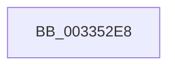

# sub_003352E8

- RVA: `0x003352E8`–`0x00335309` (길이 `33` bytes)
- VA: `0x00000001403352E8`
- 실행 섹션: `.text`
- PDB 이름 있음: `아니요`; PDB Function 태그: `아니요`
- unwind 정보 RVA: `0x00076870`
- 디코드: `9`개 명령, `33/33` bytes 표시
- 미해석 바이트: `0` (있으면 어셈블리에 `.byte`로 보존)

> 이 문서는 커널 이미지의 기계어와 PDB 기호를 분석해 생성했습니다. 4번과 5번은 함수 원형과 자료형을 바이너리 사용 방식에서 추정한 C 해석이며 원본 소스 복구 결과는 아닙니다.

## 1. Dependencies

- 직접 호출 지점: **0**; 고유 호출 대상: **0**
- 직접 호출자로 확인된 함수: **0**
- RIP 상대 이미지 참조: **0**

### Outgoing calls
- 직접 디코드된 call 명령이 없습니다.

### Direct callers
- 이 함수 시작 RVA로 연결되는 직접 call은 확인되지 않았습니다. 간접 호출은 완전히 역산할 수 없습니다.

### Static image references
- 디코드된 RIP-relative 메모리 참조가 없습니다.

## 2. Other-region calls and transfers

- 다른 실행 섹션으로 향하는 call: **0**
- call이 아닌 외부 분기/꼬리 이동: **1**
  - `0x00335304` → [MiInsertPageInFreeOrZeroedList + 0x62](MiInsertPageInFreeOrZeroedList_function_00334D20.md) (`tail-transfer`)

## 3. Assembly (complete function range)

```asm
003352E8  41 8B 46 24                     mov eax, dword ptr [r14 + 0x24]
003352EC  B9 03 00 00 00                  mov ecx, 3
003352F1  C1 E8 1B                        shr eax, 0x1b
003352F4  44 8B E9                        mov r13d, ecx
003352F7  83 E0 03                        and eax, 3
003352FA  44 2B E8                        sub r13d, eax
003352FD  44 3B E9                        cmp r13d, ecx
00335300  44 0F 44 E9                     cmove r13d, ecx
00335304  E9 79 FA FF FF                  jmp 0x140334d82
```

## 4. C-style interpretation (structured pseudocode)

```c
__int64 __fastcall sub_003352E8(void)
{
    __int64 result;
    __int64 v_r13;

    result = (unsigned int)(((unsigned int)(*(unsigned int *)(v_r14 + 36))) >> (27));
    result = (unsigned int)((result) & (3));
    v_r13 = (unsigned int)((3) - ((unsigned int)(result)));
    if (((unsigned int)(v_r13)) == 3) { v_r13 = 3; }
}
```

## 5. (Beta) C Style

```c
void sub_003352E8(void)
{
    int64_t result;
    int64_t local_r13;

    result = (uint32_t)(((uint32_t)(*(uint32_t *)(local_r14 + 0x24))) >> (27));
    result = (uint32_t)((result) & (3));
    local_r13 = (uint32_t)((3) - ((uint32_t)(result)));
    if (((uint32_t)(local_r13)) == 3) { local_r13 = 3; }
}
```

## 6. Execution-region graph

[열기: 2D/3D 그래프와 함수 탐색 컨트롤 패널](../../../control-panel.html?section=text&rva=0x003352E8&view=graph)

- 2D 그래프는 위에서 아래로 흐르고, 3D 그래프는 빈 공간을 드래그해 회전합니다. Shift+드래그는 이동, 휠은 확대·축소, 함수 노드 선택은 대상 보고서 이동입니다.

### Static fallback


