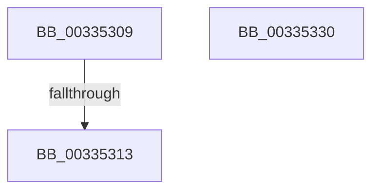

# sub_00335309

- RVA: `0x00335309`–`0x00335339` (길이 `48` bytes)
- VA: `0x0000000140335309`
- 실행 섹션: `.text`
- PDB 이름 있음: `아니요`; PDB Function 태그: `아니요`
- unwind 정보 RVA: `0x00076880`
- 디코드: `10`개 명령, `48/48` bytes 표시
- 미해석 바이트: `0` (있으면 어셈블리에 `.byte`로 보존)

> 이 문서는 커널 이미지의 기계어와 PDB 기호를 분석해 생성했습니다. 4번과 5번은 함수 원형과 자료형을 바이너리 사용 방식에서 추정한 C 해석이며 원본 소스 복구 결과는 아닙니다.

## 1. Dependencies

- 직접 호출 지점: **0**; 고유 호출 대상: **0**
- 직접 호출자로 확인된 함수: **0**
- RIP 상대 이미지 참조: **0**

### Outgoing calls
- 직접 디코드된 call 명령이 없습니다.

### Direct callers
- 이 함수 시작 RVA로 연결되는 직접 call은 확인되지 않았습니다. 간접 호출은 완전히 역산할 수 없습니다.

### Static image references
- 디코드된 RIP-relative 메모리 참조가 없습니다.

## 2. Other-region calls and transfers

- 다른 실행 섹션으로 향하는 call: **0**
- call이 아닌 외부 분기/꼬리 이동: **3**
  - `0x0033530D` → [sub_006E1F48](../6E/Unknown_function_006E1F48.md) (`tail-transfer`)
  - `0x0033532B` → [sub_00334D90 + 0x7E](Unknown_function_00334D90.md) (`tail-transfer`)
  - `0x00335334` → [sub_00334D90 + 0xAB](Unknown_function_00334D90.md) (`tail-transfer`)

## 3. Assembly (complete function range)

```asm
00335309  0F BA E2 08                     bt edx, 8
0033530D  0F 82 35 CC 3A 00               jb 0x1406e1f48
00335313  48 05 C0 0B 00 00               add rax, 0xbc0
00335319  89 8D 88 00 00 00               mov dword ptr [rbp + 0x88], ecx
0033531F  48 89 44 24 78                  mov qword ptr [rsp + 0x78], rax
00335324  44 8B E1                        mov r12d, ecx
00335327  41 8B 46 20                     mov eax, dword ptr [r14 + 0x20]
0033532B  E9 DE FA FF FF                  jmp 0x140334e0e
00335330  41 8B 46 20                     mov eax, dword ptr [r14 + 0x20]
00335334  E9 02 FB FF FF                  jmp 0x140334e3b
```

## 4. C-style interpretation (structured pseudocode)

```c
__int64 __fastcall sub_00335309(int a1, int a2)
{
    __int64 result;
    unsigned __int64 v_stack_p78;

    result = (result) + (0xBC0ULL);
    *(unsigned int *)(v_rbp + 136) = a1;
    v_stack_p78 = result;
}
```

## 5. (Beta) C Style

```c
int64_t sub_00335309(int32_t Arg1, int32_t Arg2)
{
    int64_t result;
    uint64_t v_stack_p78;

    result = (result) + (0xBC0ULL);
    *(uint32_t *)(local_rbp + 0x88) = Arg1;
    v_stack_p78 = result;
}
```

## 6. Execution-region graph

[열기: 2D/3D 그래프와 함수 탐색 컨트롤 패널](../../../control-panel.html?section=text&rva=0x00335309&view=graph)

- 2D 그래프는 위에서 아래로 흐르고, 3D 그래프는 빈 공간을 드래그해 회전합니다. Shift+드래그는 이동, 휠은 확대·축소, 함수 노드 선택은 대상 보고서 이동입니다.

### Static fallback


