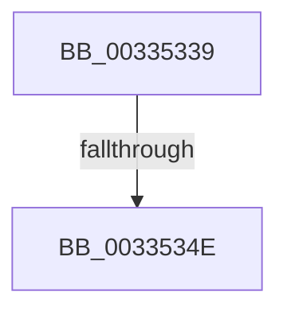

# sub_00335339

- RVA: `0x00335339`–`0x0033535B` (길이 `34` bytes)
- VA: `0x0000000140335339`
- 실행 섹션: `.text`
- PDB 이름 있음: `아니요`; PDB Function 태그: `아니요`
- unwind 정보 RVA: `0x00076898`
- 디코드: `9`개 명령, `34/34` bytes 표시
- 미해석 바이트: `0` (있으면 어셈블리에 `.byte`로 보존)

> 이 문서는 커널 이미지의 기계어와 PDB 기호를 분석해 생성했습니다. 4번과 5번은 함수 원형과 자료형을 바이너리 사용 방식에서 추정한 C 해석이며 원본 소스 복구 결과는 아닙니다.

## 1. Dependencies

- 직접 호출 지점: **1**; 고유 호출 대상: **1**
- 직접 호출자로 확인된 함수: **0**
- RIP 상대 이미지 참조: **0**

### Outgoing calls
- `0x00335351` → [MiClearFileOnlyPfn](../4D/MiClearFileOnlyPfn_function_004D1B84.md) (function, `0x004D1B84`)

### Direct callers
- 이 함수 시작 RVA로 연결되는 직접 call은 확인되지 않았습니다. 간접 호출은 완전히 역산할 수 없습니다.

### Static image references
- 디코드된 RIP-relative 메모리 참조가 없습니다.

## 2. Other-region calls and transfers

- 다른 실행 섹션으로 향하는 call: **0**
- call이 아닌 외부 분기/꼬리 이동: **2**
  - `0x00335348` → [sub_0033603B](Unknown_function_0033603B.md) (`tail-transfer`)
  - `0x00335356` → [sub_003354E1](Unknown_function_003354E1.md) (`tail-transfer`)

## 3. Assembly (complete function range)

```asm
00335339  48 C1 E8 3C                     shr rax, 0x3c
0033533D  0F 57 C0                        xorps xmm0, xmm0
00335340  24 07                           and al, 7
00335342  0F 11 45 98                     movups xmmword ptr [rbp - 0x68], xmm0
00335346  3C 03                           cmp al, 3
00335348  0F 84 ED 0C 00 00               je 0x14033603b
0033534E  49 8B CE                        mov rcx, r14
00335351  E8 2E C8 19 00                  call 0x1404d1b84
00335356  E9 86 01 00 00                  jmp 0x1403354e1
```

## 4. C-style interpretation (structured pseudocode)

```c
__int64 __fastcall sub_00335339(void)
{
    __int64 result;

    result = (result) >> (60);
    result = (unsigned __int8)((result) & (7));
    *(unsigned __int64 *)(v_rbp - 104) = v_xmm0;
    result = MiClearFileOnlyPfn(v_r14, a2, a3, a4);
}
```

## 5. (Beta) C Style

```c
void sub_00335339(void)
{
    int64_t result;

    result = (result) >> (60);
    result = (uint8_t)((result) & (7));
    *(uint64_t *)(local_rbp - 0x68) = v_xmm0;
    result = MiClearFileOnlyPfn(local_r14, a2, a3, a4);
}
```

## 6. Execution-region graph

[열기: 2D/3D 그래프와 함수 탐색 컨트롤 패널](../../../control-panel.html?section=text&rva=0x00335339&view=graph)

- 2D 그래프는 위에서 아래로 흐르고, 3D 그래프는 빈 공간을 드래그해 회전합니다. Shift+드래그는 이동, 휠은 확대·축소, 함수 노드 선택은 대상 보고서 이동입니다.

### Static fallback


