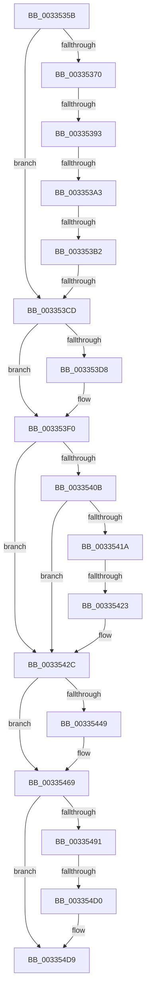

# sub_0033535B

- RVA: `0x0033535B`–`0x003354E1` (길이 `390` bytes)
- VA: `0x000000014033535B`
- 실행 섹션: `.text`
- PDB 이름 있음: `아니요`; PDB Function 태그: `아니요`
- unwind 정보 RVA: `0x000768AC`
- 디코드: `98`개 명령, `390/390` bytes 표시
- 미해석 바이트: `0` (있으면 어셈블리에 `.byte`로 보존)

> 이 문서는 커널 이미지의 기계어와 PDB 기호를 분석해 생성했습니다. 4번과 5번은 함수 원형과 자료형을 바이너리 사용 방식에서 추정한 C 해석이며 원본 소스 복구 결과는 아닙니다.

## 1. Dependencies

- 직접 호출 지점: **1**; 고유 호출 대상: **1**
- 직접 호출자로 확인된 함수: **0**
- RIP 상대 이미지 참조: **3**

### Outgoing calls
- `0x00335487` → [ExpInterlockedPushEntrySList](../6B/ExpInterlockedPushEntrySList_function_006BA5B0.md) (function, `0x006BA5B0`)

### Direct callers
- 이 함수 시작 RVA로 연결되는 직접 call은 확인되지 않았습니다. 간접 호출은 완전히 역산할 수 없습니다.

### Static image references
- `0x00335376` → RVA `0x00E2DCCC` (`.data`; read)
- `0x00335384` → RVA `0x00FC5000` (`ALMOSTRO`; read)
- `0x0033540B` → RVA `0x00E2DC80` (`.data`; read)

## 2. Other-region calls and transfers

- 다른 실행 섹션으로 향하는 call: **0**
- call이 아닌 외부 분기/꼬리 이동: **6**
  - `0x0033538D` → [sub_003354FB + 0xAFF](Unknown_function_003354FB.md) (`tail-transfer`)
  - `0x0033539D` → [sub_003354FB + 0xA07](Unknown_function_003354FB.md) (`tail-transfer`)
  - `0x003353AC` → [sub_003354FB + 0x9D4](Unknown_function_003354FB.md) (`tail-transfer`)
  - `0x003353C7` → [sub_003354FB + 0x875](Unknown_function_003354FB.md) (`tail-transfer`)
  - `0x0033541D` → [sub_003354FB](Unknown_function_003354FB.md) (`tail-transfer`)
  - `0x003354CA` → [sub_003354FB + 0x8B0](Unknown_function_003354FB.md) (`tail-transfer`)

## 3. Assembly (complete function range)

```asm
0033535B  4C 8B 54 24 38                  mov r10, qword ptr [rsp + 0x38]
00335360  49 8B 92 00 49 00 00            mov rdx, qword ptr [r10 + 0x4900]
00335367  48 81 FA 20 04 00 00            cmp rdx, 0x420
0033536E  73 5D                           jae 0x1403353cd
00335370  4D 8B 62 10                     mov r12, qword ptr [r10 + 0x10]
00335374  8B C3                           mov eax, ebx
00335376  44 8B 2D 4F 89 AF 00            mov r13d, dword ptr [rip + 0xaf894f]
0033537D  49 81 C4 60 3A 00 00            add r12, 0x3a60
00335384  0F B7 35 75 FC C8 00            movzx esi, word ptr [rip + 0xc8fc75]
0033538B  3B C6                           cmp eax, esi
0033538D  0F 83 67 0C 00 00               jae 0x140335ffa
00335393  4C 8B D3                        mov r10, rbx
00335396  4D 8B DC                        mov r11, r12
00335399  49 83 FA 01                     cmp r10, 1
0033539D  0F 8F 5F 0B 00 00               jg 0x140335f02
003353A3  4D 8B 0B                        mov r9, qword ptr [r11]
003353A6  44 8B C3                        mov r8d, ebx
003353A9  45 3B C5                        cmp r8d, r13d
003353AC  0F 83 1D 0B 00 00               jae 0x140335ecf
003353B2  41 8B C8                        mov ecx, r8d
003353B5  48 03 C9                        add rcx, rcx
003353B8  41 0F B7 0C C9                  movzx ecx, word ptr [r9 + rcx*8]
003353BD  48 03 D1                        add rdx, rcx
003353C0  48 81 FA 20 04 00 00            cmp rdx, 0x420
003353C7  0F 82 A3 09 00 00               jb 0x140335d70
003353CD  41 0F B6 46 22                  movzx eax, byte ptr [r14 + 0x22]
003353D2  24 07                           and al, 7
003353D4  3C 05                           cmp al, 5
003353D6  74 18                           je 0x1403353f0
003353D8  41 8B 46 20                     mov eax, dword ptr [r14 + 0x20]
003353DC  89 45 70                        mov dword ptr [rbp + 0x70], eax
003353DF  C1 E8 10                        shr eax, 0x10
003353E2  24 FD                           and al, 0xfd
003353E4  0C 05                           or al, 5
003353E6  88 45 72                        mov byte ptr [rbp + 0x72], al
003353E9  8B 45 70                        mov eax, dword ptr [rbp + 0x70]
003353EC  41 89 46 20                     mov dword ptr [r14 + 0x20], eax
003353F0  8B B5 88 00 00 00               mov esi, dword ptr [rbp + 0x88]
003353F6  49 8B 46 10                     mov rax, qword ptr [r14 + 0x10]
003353FA  8B CE                           mov ecx, esi
003353FC  48 C1 E1 0C                     shl rcx, 0xc
00335400  48 25 FF 0F FF FF               and rax, 0xffffffffffff0fff
00335406  48 0B C8                        or rcx, rax
00335409  74 21                           je 0x14033542c
0033540B  48 8B 05 6E 88 AF 00            mov rax, qword ptr [rip + 0xaf886e]
00335412  48 8B D9                        mov rbx, rcx
00335415  48 85 C0                        test rax, rax
00335418  74 12                           je 0x14033542c
0033541A  F6 C1 10                        test cl, 0x10
0033541D  0F 85 D8 00 00 00               jne 0x1403354fb
00335423  48 8B D8                        mov rbx, rax
00335426  48 F7 D3                        not rbx
00335429  48 23 D9                        and rbx, rcx
0033542C  4C 8B 05 4D 88 AF 00            mov r8, qword ptr [rip + 0xaf884d]
00335433  49 B9 00 00 00 00 FE FF FF FF   movabs r9, 0xfffffffe00000000
0033543D  8B C3                           mov eax, ebx
0033543F  49 0B C1                        or rax, r9
00335442  8B D3                           mov edx, ebx
00335444  4D 85 C0                        test r8, r8
00335447  74 20                           je 0x140335469
00335449  49 8B C8                        mov rcx, r8
0033544C  48 0B CA                        or rcx, rdx
0033544F  49 0B C9                        or rcx, r9
00335452  49 B9 10 00 00 00 FE FF FF FF   movabs r9, 0xfffffffe00000010
0033545C  49 0B D1                        or rdx, r9
0033545F  4C 85 C0                        test rax, r8
00335462  48 0F 44 D1                     cmove rdx, rcx
00335466  48 8B C2                        mov rax, rdx
00335469  40 0F B6 DF                     movzx ebx, dil
0033546D  49 8B D6                        mov rdx, r14
00335470  48 8B 7C 24 48                  mov rdi, qword ptr [rsp + 0x48]
00335475  8B CB                           mov ecx, ebx
00335477  48 C1 E1 04                     shl rcx, 4
0033547B  49 89 46 10                     mov qword ptr [r14 + 0x10], rax
0033547F  48 03 8C F7 60 3A 00 00         add rcx, qword ptr [rdi + rsi*8 + 0x3a60]
00335487  E8 24 51 38 00                  call 0x1406ba5b0
0033548C  48 85 C0                        test rax, rax
0033548F  75 48                           jne 0x1403354d9
00335491  33 D2                           xor edx, edx
00335493  8B C3                           mov eax, ebx
00335495  F7 35 31 88 AF 00               div dword ptr [rip + 0xaf8831]
0033549B  48 8B C6                        mov rax, rsi
0033549E  41 BB 01 00 00 00               mov r11d, 1
003354A4  48 03 C0                        add rax, rax
003354A7  8B CA                           mov ecx, edx
003354A9  48 C1 E9 05                     shr rcx, 5
003354AD  45 8B D3                        mov r10d, r11d
003354B0  44 8B CA                        mov r9d, edx
003354B3  83 E2 1F                        and edx, 0x1f
003354B6  48 8B 84 C7 08 3A 00 00         mov rax, qword ptr [rdi + rax*8 + 0x3a08]
003354BE  4C 8D 04 88                     lea r8, [rax + rcx*4]
003354C2  48 8D 42 01                     lea rax, [rdx + 1]
003354C6  48 83 F8 20                     cmp rax, 0x20
003354CA  0F 87 DB 08 00 00               ja 0x140335dab
003354D0  8B CA                           mov ecx, edx
003354D2  41 D3 E3                        shl r11d, cl
003354D5  F0 45 09 18                     lock or dword ptr [r8], r11d
003354D9  4C 8B A4 24 28 01 00 00         mov r12, qword ptr [rsp + 0x128]
```

## 4. C-style interpretation (structured pseudocode)

```c
__int64 __fastcall sub_0033535B(__int64 a1, __int64 a2, __int64 a3, __int64 a4, __int64 a5, __int64 a6, __int64 a7, __int64 a8, __int64 a9, __int64 a10, __int64 a11, __int64 a12, __int64 a13, __int64 a14, __int64 a15, __int64 a16, __int64 a17, __int64 a18, __int64 a19, __int64 a20, __int64 a21, __int64 a22, __int64 a23, __int64 a24, __int64 a25, __int64 a26, __int64 a27, __int64 a28, __int64 a29, __int64 a30, __int64 a31, __int64 a32, __int64 a33, __int64 a34, __int64 a35, __int64 a36, __int64 a37)
{
    __int64 result;
    __int64 v_r11;
    __int64 v_r12;
    __int64 v_rbx;

    if ((*(unsigned __int64 *)(a7 + 18688)) >= 0x420ULL) goto loc_003353CD;
    v_r12 = (*(unsigned __int64 *)(a7 + 16)) + (0x3A60ULL);
    a1 = ((unsigned int)((unsigned int)((unsigned int)((unsigned int)(v_rbx))))) + ((unsigned int)((unsigned int)((unsigned int)((unsigned int)(v_rbx)))));
    a2 = (*(unsigned __int64 *)(a7 + 18688)) + (*(unsigned __int16 *)(*(unsigned __int64 *)(v_r12) + a1 * 8));
loc_003353CD:
    result = (unsigned __int8)((*(unsigned __int8 *)(v_r14 + 34)) & (7));
    if (((unsigned __int8)(result)) != 5) {
        result = *(unsigned int *)(v_r14 + 32);
        *(unsigned int *)(v_rbp + 112) = (unsigned int)(result);
        result = (unsigned int)((result) >> (16));
        result = (unsigned __int8)((result) & (253));
        result = (unsigned __int8)((result) | (5));
        *(unsigned __int8 *)(v_rbp + 114) = (unsigned __int8)(result);
        result = *(unsigned int *)(v_rbp + 112);
        *(unsigned int *)(v_r14 + 32) = (unsigned int)(result);
    }
    a1 = ((unsigned int)((unsigned int)((unsigned int)(*(unsigned int *)(v_rbp + 136))))) << (12);
    result = (*(unsigned __int64 *)(v_r14 + 16)) & (0xFFFFFFFFFFFF0FFFULL);
    a1 = (a1) | (result);
    if (condition_is_equal) goto loc_0033542C;
    if (*(unsigned __int64 *)(v_rip + 11503726) == 0) goto loc_0033542C;
    v_rbx = ~(*(unsigned __int64 *)(v_rip + 11503726));
    v_rbx = (v_rbx) & (a1);
loc_0033542C:
    result = ((unsigned int)((unsigned int)(v_rbx))) | (*(unsigned __int64 *)(v_r12));
    if (*(unsigned __int64 *)(v_rip + 11503693) != 0) {
        a1 = *(unsigned __int64 *)(v_rip + 11503693);
        a1 = (a1) | ((unsigned int)((unsigned int)(v_rbx)));
        a1 = (a1) | (*(unsigned __int64 *)(v_r12));
        a2 = ((unsigned int)((unsigned int)(v_rbx))) | (*(unsigned __int64 *)(v_r12));
        if (((result) & (*(unsigned __int64 *)(v_rip + 11503693))) == 0) { a2 = a1; }
        result = a2;
    }
    a1 = ((unsigned int)((unsigned int)((unsigned __int8)(v_rdi)))) << (4);
    *(unsigned __int64 *)(v_r14 + 16) = result;
    a1 = (a1) + (*(unsigned __int64 *)(a9 + (unsigned int)(*(unsigned int *)(v_rbp + 136)) * 8 + 14944));
    result = ExpInterlockedPushEntrySList(a1, v_r14, *(unsigned __int64 *)(v_rip + 11503693), *(unsigned __int64 *)(v_r12));
    if (result != 0) goto loc_003354D9;
    a2 = 0;
    result = ((unsigned int)(*(unsigned int *)(v_rbp + 136))) + ((unsigned int)(*(unsigned int *)(v_rbp + 136)));
    a1 = (0) >> (5);
    a2 = (unsigned int)((a2) & (31));
    v_r11 = (unsigned int)((1) << ((unsigned __int8)((unsigned int)((unsigned int)(a2)))));
loc_003354D9:
    return a2 + 1;
}
```

## 5. (Beta) C Style

```c
int64_t sub_0033535B(int64_t Arg1, int64_t Arg2, int64_t Arg3, int64_t Arg4, uint64_t Arg5, uint64_t Arg6, void *Arg7, uint64_t Arg8, void *Arg9, uint64_t Arg10, uint64_t Arg11, uint64_t Arg12, uint64_t Arg13, uint64_t Arg14, uint64_t Arg15, uint64_t Arg16, uint64_t Arg17, uint64_t Arg18, uint64_t Arg19, uint64_t Arg20, uint64_t Arg21, uint64_t Arg22, uint64_t Arg23, uint64_t Arg24, uint64_t Arg25, uint64_t Arg26, uint64_t Arg27, uint64_t Arg28, uint64_t Arg29, uint64_t Arg30, uint64_t Arg31, uint64_t Arg32, uint64_t Arg33, uint64_t Arg34, uint64_t Arg35, uint64_t Arg36, int64_t Arg37)
{
    uint8_t *arg7 = (uint8_t *)Arg7;
    uint8_t *arg9 = (uint8_t *)Arg9;

    int64_t result;
    int64_t local_r11;
    int64_t local_r12;
    int64_t local_rbx;

    if ((*(uint64_t *)(arg7 + 0x4900)) >= 0x420ULL) goto loc_003353CD;
    local_r12 = (*(uint64_t *)(arg7 + 0x10)) + (0x3A60ULL);
    Arg1 = ((uint32_t)((uint32_t)((uint32_t)((uint32_t)(local_rbx))))) + ((uint32_t)((uint32_t)((uint32_t)((uint32_t)(local_rbx)))));
    Arg2 = (*(uint64_t *)(arg7 + 0x4900)) + (*(uint16_t *)(*(uint64_t *)(local_r12) + Arg1 * 8));
loc_003353CD:
    result = (uint8_t)((*(uint8_t *)(local_r14 + 0x22)) & (7));
    if (((uint8_t)(result)) != 5) {
        result = *(uint32_t *)(local_r14 + 0x20);
        *(uint32_t *)(local_rbp + 0x70) = (uint32_t)(result);
        result = (uint32_t)((result) >> (16));
        result = (uint8_t)((result) & (253));
        result = (uint8_t)((result) | (5));
        *(uint8_t *)(local_rbp + 0x72) = (uint8_t)(result);
        result = *(uint32_t *)(local_rbp + 0x70);
        *(uint32_t *)(local_r14 + 0x20) = (uint32_t)(result);
    }
    Arg1 = ((uint32_t)((uint32_t)((uint32_t)(*(uint32_t *)(local_rbp + 0x88))))) << (12);
    result = (*(uint64_t *)(local_r14 + 0x10)) & (0xFFFFFFFFFFFF0FFFULL);
    Arg1 = (Arg1) | (result);
    if (condition_is_equal) goto loc_0033542C;
    if (*(uint64_t *)(v_rip + 0xAF886E) == 0) goto loc_0033542C;
    local_rbx = ~(*(uint64_t *)(v_rip + 0xAF886E));
    local_rbx = (local_rbx) & (Arg1);
loc_0033542C:
    result = ((uint32_t)((uint32_t)(local_rbx))) | (*(uint64_t *)(local_r12));
    if (*(uint64_t *)(v_rip + 0xAF884D) != 0) {
        Arg1 = *(uint64_t *)(v_rip + 0xAF884D);
        Arg1 = (Arg1) | ((uint32_t)((uint32_t)(local_rbx)));
        Arg1 = (Arg1) | (*(uint64_t *)(local_r12));
        Arg2 = ((uint32_t)((uint32_t)(local_rbx))) | (*(uint64_t *)(local_r12));
        if (((result) & (*(uint64_t *)(v_rip + 0xAF884D))) == 0) { Arg2 = Arg1; }
        result = Arg2;
    }
    Arg1 = ((uint32_t)((uint32_t)((uint8_t)(local_rdi)))) << (4);
    *(uint64_t *)(local_r14 + 0x10) = result;
    Arg1 = (Arg1) + (*(uint64_t *)(arg9 + (uint32_t)(*(uint32_t *)(local_rbp + 0x88)) * 8 + 0x3A60));
    result = ExpInterlockedPushEntrySList(Arg1, local_r14, *(uint64_t *)(v_rip + 0xAF884D), *(uint64_t *)(local_r12));
    if (result != 0) goto loc_003354D9;
    Arg2 = 0;
    result = ((uint32_t)(*(uint32_t *)(local_rbp + 0x88))) + ((uint32_t)(*(uint32_t *)(local_rbp + 0x88)));
    Arg1 = (0) >> (5);
    Arg2 = (uint32_t)((Arg2) & (31));
    local_r11 = (uint32_t)((1) << ((uint8_t)((uint32_t)((uint32_t)(Arg2)))));
loc_003354D9:
    return Arg2 + 1;
}
```

### 관측된 메모리 오프셋

구조체 형식이 확인되지 않은 접근은 인자 기준의 오프셋으로만 기록했습니다.

| 기준 인자 | 오프셋 표현 | 폭 (bit) | 접근 |
|---|---:|---:|---|
| `Arg7` | `+ 0x10` | `64` | `R` |
| `Arg7` | `+ 0x4900` | `64` | `R` |
| `Arg9` | `+ 0x3A08 + rax*8` | `64` | `R` |
| `Arg9` | `+ 0x3A60 + rsi*8` | `64` | `R` |

## 6. Execution-region graph

[열기: 2D/3D 그래프와 함수 탐색 컨트롤 패널](../../../control-panel.html?section=text&rva=0x0033535B&view=graph)

- 2D 그래프는 위에서 아래로 흐르고, 3D 그래프는 빈 공간을 드래그해 회전합니다. Shift+드래그는 이동, 휠은 확대·축소, 함수 노드 선택은 대상 보고서 이동입니다.

### Static fallback


