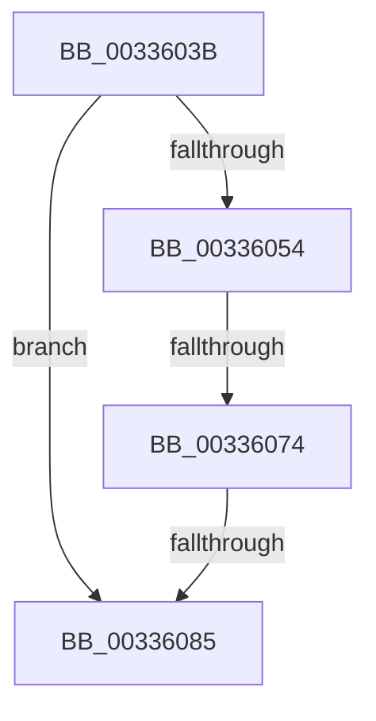

# sub_0033603B

- RVA: `0x0033603B`–`0x00336094` (길이 `89` bytes)
- VA: `0x000000014033603B`
- 실행 섹션: `.text`
- PDB 이름 있음: `아니요`; PDB Function 태그: `아니요`
- unwind 정보 RVA: `0x000768F4`
- 디코드: `22`개 명령, `89/89` bytes 표시
- 미해석 바이트: `0` (있으면 어셈블리에 `.byte`로 보존)

> 이 문서는 커널 이미지의 기계어와 PDB 기호를 분석해 생성했습니다. 4번과 5번은 함수 원형과 자료형을 바이너리 사용 방식에서 추정한 C 해석이며 원본 소스 복구 결과는 아닙니다.

## 1. Dependencies

- 직접 호출 지점: **3**; 고유 호출 대상: **3**
- 직접 호출자로 확인된 함수: **0**
- RIP 상대 이미지 참조: **0**

### Outgoing calls
- `0x0033604B` → [MiGetPagePrivilege](../28/MiGetPagePrivilege_function_00285420.md) (function, `0x00285420`)
- `0x00336078` → [VslRemoveProtectedPage](../40/VslRemoveProtectedPage_function_004079D0.md) (function, `0x004079D0`)
- `0x0033608A` → [MiSetPfnIdentity](../2A/MiSetPfnIdentity_function_002A2350.md) (function, `0x002A2350`)

### Direct callers
- 이 함수 시작 RVA로 연결되는 직접 call은 확인되지 않았습니다. 간접 호출은 완전히 역산할 수 없습니다.

### Static image references
- 디코드된 RIP-relative 메모리 참조가 없습니다.

## 2. Other-region calls and transfers

- 다른 실행 섹션으로 향하는 call: **0**
- call이 아닌 외부 분기/꼬리 이동: **3**
  - `0x0033606E` → [sub_00336206](Unknown_function_00336206.md) (`tail-transfer`)
  - `0x0033607F` → [sub_00336276](Unknown_function_00336276.md) (`tail-transfer`)
  - `0x0033608F` → [sub_00335339 + 0x15](Unknown_function_00335339.md) (`tail-transfer`)

## 3. Assembly (complete function range)

```asm
0033603B  49 8B 46 08                     mov rax, qword ptr [r14 + 8]
0033603F  4C 8D 45 98                     lea r8, [rbp - 0x68]
00336043  BA 01 00 00 00                  mov edx, 1
00336048  49 8B CE                        mov rcx, r14
0033604B  E8 D0 F3 F4 FF                  call 0x140285420
00336050  85 C0                           test eax, eax
00336052  74 31                           je 0x140336085
00336054  48 C1 FF 04                     sar rdi, 4
00336058  49 B8 AB AA AA AA AA AA AA AA   movabs r8, 0xaaaaaaaaaaaaaaab
00336062  49 0F AF F8                     imul rdi, r8
00336066  45 33 C0                        xor r8d, r8d
00336069  48 8B CF                        mov rcx, rdi
0033606C  A8 20                           test al, 0x20
0033606E  0F 85 92 01 00 00               jne 0x140336206
00336074  48 8D 55 98                     lea rdx, [rbp - 0x68]
00336078  E8 53 19 0D 00                  call 0x1404079d0
0033607D  85 C0                           test eax, eax
0033607F  0F 88 F1 01 00 00               js 0x140336276
00336085  33 D2                           xor edx, edx
00336087  49 8B CE                        mov rcx, r14
0033608A  E8 C1 C2 F6 FF                  call 0x1402a2350
0033608F  E9 BA F2 FF FF                  jmp 0x14033534e
```

## 4. C-style interpretation (structured pseudocode)

```c
__int64 __fastcall sub_0033603B(void)
{
    __int64 result;
    __int64 v_rdi;

    result = MiGetPagePrivilege(v_r14, 1, v_rbp - 104, a4);
    if ((unsigned int)(result) == 0) goto loc_00336085;
    v_rdi = (v_rdi) >> (4);
    v_rdi = (v_rdi) * (v_rbp - 104);
    a3 = 0;
    result = VslRemoveProtectedPage(v_rdi, v_rbp - 104, a3, a4);
loc_00336085:
    a2 = 0;
    result = MiSetPfnIdentity(v_r14, a2, a3, a4);
}
```

## 5. (Beta) C Style

```c
void sub_0033603B(void)
{
    int64_t result;
    int64_t local_rdi;

    result = MiGetPagePrivilege(local_r14, 1, local_rbp - 104, a4);
    if ((uint32_t)(result) == 0) goto loc_00336085;
    local_rdi = (local_rdi) >> (4);
    local_rdi = (local_rdi) * (local_rbp - 104);
    a3 = 0;
    result = VslRemoveProtectedPage(local_rdi, local_rbp - 104, a3, a4);
loc_00336085:
    a2 = 0;
    result = MiSetPfnIdentity(local_r14, a2, a3, a4);
}
```

## 6. Execution-region graph

[열기: 2D/3D 그래프와 함수 탐색 컨트롤 패널](../../../control-panel.html?section=text&rva=0x0033603B&view=graph)

- 2D 그래프는 위에서 아래로 흐르고, 3D 그래프는 빈 공간을 드래그해 회전합니다. Shift+드래그는 이동, 휠은 확대·축소, 함수 노드 선택은 대상 보고서 이동입니다.

### Static fallback


