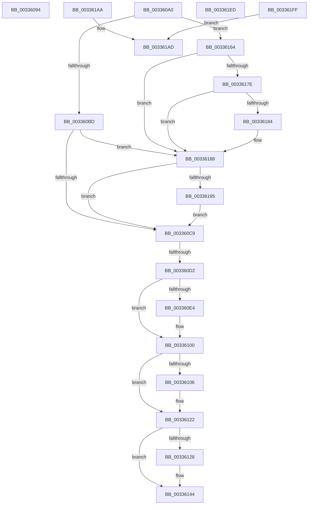

# sub_00336094

- RVA: `0x00336094`–`0x00336206` (길이 `370` bytes)
- VA: `0x0000000140336094`
- 실행 섹션: `.text`
- PDB 이름 있음: `아니요`; PDB Function 태그: `아니요`
- unwind 정보 RVA: `0x00076908`
- 디코드: `82`개 명령, `370/370` bytes 표시
- 미해석 바이트: `0` (있으면 어셈블리에 `.byte`로 보존)

> 이 문서는 커널 이미지의 기계어와 PDB 기호를 분석해 생성했습니다. 4번과 5번은 함수 원형과 자료형을 바이너리 사용 방식에서 추정한 C 해석이며 원본 소스 복구 결과는 아닙니다.

## 1. Dependencies

- 직접 호출 지점: **11**; 고유 호출 대상: **6**
- 직접 호출자로 확인된 함수: **0**
- RIP 상대 이미지 참조: **0**

### Outgoing calls
- `0x00336096` → [VslMakeProtectedPageExecutable](../40/VslMakeProtectedPageExecutable_function_00407A50.md) (function, `0x00407A50`)
- `0x003360D9` → [ExAcquireSpinLockExclusiveAtDpcLevel](../24/ExAcquireSpinLockExclusiveAtDpcLevel_function_00248E80.md) (function, `0x00248E80`)
- `0x003360F5` → [KeSetEvent](KeSetEvent_function_0033F310.md) (function, `0x0033F310`)
- `0x00336117` → [KeSetEvent](KeSetEvent_function_0033F310.md) (function, `0x0033F310`)
- `0x00336139` → [KeSetEvent](KeSetEvent_function_0033F310.md) (function, `0x0033F310`)
- `0x00336150` → [ExReleaseSpinLockExclusiveFromDpcLevel](../24/ExReleaseSpinLockExclusiveFromDpcLevel_function_002497E0.md) (function, `0x002497E0`)
- `0x0033619B` → [MiSlabDemotionLowMemoryConditionUpdate](../3B/MiSlabDemotionLowMemoryConditionUpdate_function_003BB7E0.md) (function, `0x003BB7E0`)
- `0x003361BF` → [ExAcquireSpinLockExclusiveAtDpcLevel](../24/ExAcquireSpinLockExclusiveAtDpcLevel_function_00248E80.md) (function, `0x00248E80`)
- `0x003361D0` → [KeSetEvent](KeSetEvent_function_0033F310.md) (function, `0x0033F310`)
- `0x003361DE` → [ExReleaseSpinLockExclusiveFromDpcLevel](../24/ExReleaseSpinLockExclusiveFromDpcLevel_function_002497E0.md) (function, `0x002497E0`)
- `0x003361F0` → [MiUpdateAvailableEventsAtDpc](../3B/MiUpdateAvailableEventsAtDpc_function_003BC804.md) (function, `0x003BC804`)

### Direct callers
- 이 함수 시작 RVA로 연결되는 직접 call은 확인되지 않았습니다. 간접 호출은 완전히 역산할 수 없습니다.

### Static image references
- 디코드된 RIP-relative 메모리 참조가 없습니다.

## 2. Other-region calls and transfers

- 다른 실행 섹션으로 향하는 call: **0**
- call이 아닌 외부 분기/꼬리 이동: **5**
  - `0x0033609B` → [sub_003354FB + 0xA78](Unknown_function_003354FB.md) (`tail-transfer`)
  - `0x003360CC` → [sub_003354FB + 0x906](Unknown_function_003354FB.md) (`tail-transfer`)
  - `0x0033615F` → [sub_003354FB + 0x906](Unknown_function_003354FB.md) (`tail-transfer`)
  - `0x003361E8` → [sub_003354FB + 0x56](Unknown_function_003354FB.md) (`tail-transfer`)
  - `0x003361FA` → [sub_003354FB + 0x73](Unknown_function_003354FB.md) (`tail-transfer`)

## 3. Assembly (complete function range)

```asm
00336094  33 D2                           xor edx, edx
00336096  E8 B5 19 0D 00                  call 0x140407a50
0033609B  E9 D3 FE FF FF                  jmp 0x140335f73
003360A0  49 81 FE 20 04 00 00            cmp r14, 0x420
003360A7  41 BC 04 00 00 00               mov r12d, 4
003360AD  44 0F 42 E3                     cmovb r12d, ebx
003360B1  48 3D A0 00 00 00               cmp rax, 0xa0
003360B7  0F 82 A7 00 00 00               jb 0x140336164
003360BD  48 3D 20 01 00 00               cmp rax, 0x120
003360C3  0F 82 BF 00 00 00               jb 0x140336188
003360C9  45 85 E4                        test r12d, r12d
003360CC  0F 84 2F FD FF FF               je 0x140335e01
003360D2  49 8D 8A 40 3F 00 00            lea rcx, [r10 + 0x3f40]
003360D9  E8 A2 2D F1 FF                  call 0x140248e80
003360DE  41 F6 C4 01                     test r12b, 1
003360E2  74 1C                           je 0x140336100
003360E4  48 8B 74 24 38                  mov rsi, qword ptr [rsp + 0x38]
003360E9  45 33 C0                        xor r8d, r8d
003360EC  33 D2                           xor edx, edx
003360EE  48 8D 8E 48 3F 00 00            lea rcx, [rsi + 0x3f48]
003360F5  E8 16 92 00 00                  call 0x14033f310
003360FA  FF 86 60 3F 00 00               inc dword ptr [rsi + 0x3f60]
00336100  41 F6 C4 02                     test r12b, 2
00336104  74 1C                           je 0x140336122
00336106  48 8B 74 24 38                  mov rsi, qword ptr [rsp + 0x38]
0033610B  45 33 C0                        xor r8d, r8d
0033610E  33 D2                           xor edx, edx
00336110  48 8D 8E 68 3F 00 00            lea rcx, [rsi + 0x3f68]
00336117  E8 F4 91 00 00                  call 0x14033f310
0033611C  FF 86 80 3F 00 00               inc dword ptr [rsi + 0x3f80]
00336122  41 F6 C4 04                     test r12b, 4
00336126  74 1C                           je 0x140336144
00336128  48 8B 74 24 38                  mov rsi, qword ptr [rsp + 0x38]
0033612D  45 33 C0                        xor r8d, r8d
00336130  33 D2                           xor edx, edx
00336132  48 8D 8E 88 3F 00 00            lea rcx, [rsi + 0x3f88]
00336139  E8 D2 91 00 00                  call 0x14033f310
0033613E  FF 86 A0 3F 00 00               inc dword ptr [rsi + 0x3fa0]
00336144  48 8B 4C 24 38                  mov rcx, qword ptr [rsp + 0x38]
00336149  48 81 C1 40 3F 00 00            add rcx, 0x3f40
00336150  E8 8B 36 F1 FF                  call 0x1402497e0
00336155  4C 8B 54 24 38                  mov r10, qword ptr [rsp + 0x38]
0033615A  48 8B 74 24 68                  mov rsi, qword ptr [rsp + 0x68]
0033615F  E9 9D FC FF FF                  jmp 0x140335e01
00336164  41 8B CC                        mov ecx, r12d
00336167  83 C9 02                        or ecx, 2
0033616A  49 81 FE A0 00 00 00            cmp r14, 0xa0
00336171  41 0F 42 CC                     cmovb ecx, r12d
00336175  44 8B E1                        mov r12d, ecx
00336178  48 83 F8 22                     cmp rax, 0x22
0033617C  73 0A                           jae 0x140336188
0033617E  49 83 FE 22                     cmp r14, 0x22
00336182  72 04                           jb 0x140336188
00336184  41 83 CC 01                     or r12d, 1
00336188  49 81 FE 20 01 00 00            cmp r14, 0x120
0033618F  0F 82 34 FF FF FF               jb 0x1403360c9
00336195  41 8B D0                        mov edx, r8d
00336198  49 8B CA                        mov rcx, r10
0033619B  E8 40 56 08 00                  call 0x1403bb7e0
003361A0  4C 8B 54 24 38                  mov r10, qword ptr [rsp + 0x38]
003361A5  E9 1F FF FF FF                  jmp 0x1403360c9
003361AA  48 8B C3                        mov rax, rbx
003361AD  48 C1 E0 05                     shl rax, 5
003361B1  4D 8D B2 40 3F 00 00            lea r14, [r10 + 0x3f40]
003361B8  49 8B CE                        mov rcx, r14
003361BB  4A 8D 34 10                     lea rsi, [rax + r10]
003361BF  E8 BC 2C F1 FF                  call 0x140248e80
003361C4  45 33 C0                        xor r8d, r8d
003361C7  48 8D 8E 48 3F 00 00            lea rcx, [rsi + 0x3f48]
003361CE  33 D2                           xor edx, edx
003361D0  E8 3B 91 00 00                  call 0x14033f310
003361D5  FF 86 60 3F 00 00               inc dword ptr [rsi + 0x3f60]
003361DB  49 8B CE                        mov rcx, r14
003361DE  E8 FD 35 F1 FF                  call 0x1402497e0
003361E3  4C 8B 54 24 38                  mov r10, qword ptr [rsp + 0x38]
003361E8  E9 64 F3 FF FF                  jmp 0x140335551
003361ED  49 8B CA                        mov rcx, r10
003361F0  E8 0F 66 08 00                  call 0x1403bc804
003361F5  4C 8B 54 24 38                  mov r10, qword ptr [rsp + 0x38]
003361FA  E9 6F F3 FF FF                  jmp 0x14033556e
003361FF  B8 02 00 00 00                  mov eax, 2
00336204  EB A7                           jmp 0x1403361ad
```

## 4. C-style interpretation (structured pseudocode)

```c
__int64 __fastcall sub_00336094(__int64 a1, int a2, int a3)
{
    __int64 result;
    unsigned __int64 v_stack_p38;
    unsigned __int64 v_stack_p68;

    a2 = 0;
    result = VslMakeProtectedPageExecutable(a1, a2, a3, a4);
}
```

## 5. (Beta) C Style

```c
int64_t sub_00336094(int64_t Arg1, int32_t Arg2, int32_t Arg3)
{
    int64_t result;
    uint64_t v_stack_p38;
    uint64_t v_stack_p68;

    Arg2 = 0;
    result = VslMakeProtectedPageExecutable(Arg1, Arg2, Arg3, a4);
}
```

## 6. Execution-region graph

[열기: 2D/3D 그래프와 함수 탐색 컨트롤 패널](../../../control-panel.html?section=text&rva=0x00336094&view=graph)

- 2D 그래프는 위에서 아래로 흐르고, 3D 그래프는 빈 공간을 드래그해 회전합니다. Shift+드래그는 이동, 휠은 확대·축소, 함수 노드 선택은 대상 보고서 이동입니다.

### Static fallback


