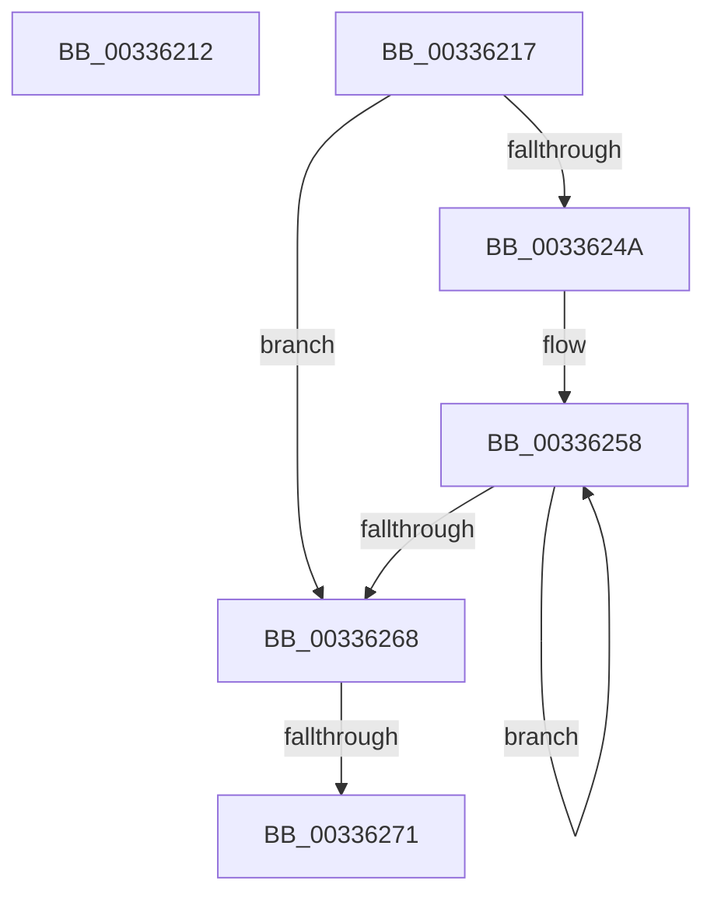

# sub_00336212

- RVA: `0x00336212`–`0x00336276` (길이 `100` bytes)
- VA: `0x0000000140336212`
- 실행 섹션: `.text`
- PDB 이름 있음: `아니요`; PDB Function 태그: `아니요`
- unwind 정보 RVA: `0x00076934`
- 디코드: `29`개 명령, `100/100` bytes 표시
- 미해석 바이트: `0` (있으면 어셈블리에 `.byte`로 보존)

> 이 문서는 커널 이미지의 기계어와 PDB 기호를 분석해 생성했습니다. 4번과 5번은 함수 원형과 자료형을 바이너리 사용 방식에서 추정한 C 해석이며 원본 소스 복구 결과는 아닙니다.

## 1. Dependencies

- 직접 호출 지점: **0**; 고유 호출 대상: **0**
- 직접 호출자로 확인된 함수: **0**
- RIP 상대 이미지 참조: **0**

### Outgoing calls
- 직접 디코드된 call 명령이 없습니다.

### Direct callers
- 이 함수 시작 RVA로 연결되는 직접 call은 확인되지 않았습니다. 간접 호출은 완전히 역산할 수 없습니다.

### Static image references
- 디코드된 RIP-relative 메모리 참조가 없습니다.

## 2. Other-region calls and transfers

- 다른 실행 섹션으로 향하는 call: **0**
- call이 아닌 외부 분기/꼬리 이동: **3**
  - `0x00336215` → [sub_00336094 + 0x119](Unknown_function_00336094.md) (`tail-transfer`)
  - `0x0033626B` → [sub_0033535B + 0x17E](Unknown_function_0033535B.md) (`tail-transfer`)
  - `0x00336271` → [sub_003354FB + 0x8B9](Unknown_function_003354FB.md) (`tail-transfer`)

## 3. Assembly (complete function range)

```asm
00336212  49 8B C0                        mov rax, r8
00336215  EB 96                           jmp 0x1403361ad
00336217  41 83 E1 1F                     and r9d, 0x1f
0033621B  41 BA 20 00 00 00               mov r10d, 0x20
00336221  45 2B D1                        sub r10d, r9d
00336224  41 8B C3                        mov eax, r11d
00336227  41 8B CA                        mov ecx, r10d
0033622A  D3 E0                           shl eax, cl
0033622C  48 8B CA                        mov rcx, rdx
0033622F  FF C8                           dec eax
00336231  D3 E0                           shl eax, cl
00336233  F0 41 09 00                     lock or dword ptr [r8], eax
00336237  41 8B C2                        mov eax, r10d
0033623A  49 83 C0 04                     add r8, 4
0033623E  4D 8B D3                        mov r10, r11
00336241  4C 2B D0                        sub r10, rax
00336244  49 83 FA 20                     cmp r10, 0x20
00336248  72 1E                           jb 0x140336268
0033624A  49 8B CA                        mov rcx, r10
0033624D  48 C1 E9 05                     shr rcx, 5
00336251  48 6B C1 E0                     imul rax, rcx, -0x20
00336255  4C 03 D0                        add r10, rax
00336258  41 C7 00 FF FF FF FF            mov dword ptr [r8], 0xffffffff
0033625F  49 83 C0 04                     add r8, 4
00336263  49 2B CB                        sub rcx, r11
00336266  75 F0                           jne 0x140336258
00336268  4D 85 D2                        test r10, r10
0033626B  0F 84 68 F2 FF FF               je 0x1403354d9
00336271  E9 3E FB FF FF                  jmp 0x140335db4
```

## 4. C-style interpretation (structured pseudocode)

```c
__int64 __fastcall sub_00336212(__int64 a1, __int64 a2, __int64 a3, int a4)
{
}
```

## 5. (Beta) C Style

```c
int64_t sub_00336212(int64_t Arg1, int64_t Arg2, int64_t Arg3, int32_t Arg4)
{
}
```

## 6. Execution-region graph

[열기: 2D/3D 그래프와 함수 탐색 컨트롤 패널](../../../control-panel.html?section=text&rva=0x00336212&view=graph)

- 2D 그래프는 위에서 아래로 흐르고, 3D 그래프는 빈 공간을 드래그해 회전합니다. Shift+드래그는 이동, 휠은 확대·축소, 함수 노드 선택은 대상 보고서 이동입니다.

### Static fallback


