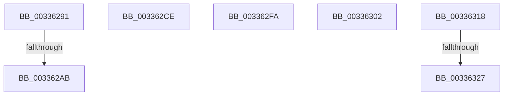

# sub_00336291

- RVA: `0x00336291`–`0x0033632C` (길이 `155` bytes)
- VA: `0x0000000140336291`
- 실행 섹션: `.text`
- PDB 이름 있음: `아니요`; PDB Function 태그: `아니요`
- unwind 정보 RVA: `0x00076960`
- 디코드: `32`개 명령, `155/155` bytes 표시
- 미해석 바이트: `0` (있으면 어셈블리에 `.byte`로 보존)

> 이 문서는 커널 이미지의 기계어와 PDB 기호를 분석해 생성했습니다. 4번과 5번은 함수 원형과 자료형을 바이너리 사용 방식에서 추정한 C 해석이며 원본 소스 복구 결과는 아닙니다.

## 1. Dependencies

- 직접 호출 지점: **3**; 고유 호출 대상: **3**
- 직접 호출자로 확인된 함수: **0**
- RIP 상대 이미지 참조: **4**

### Outgoing calls
- `0x003362B1` → [MiArePageContentsZero](../4D/MiArePageContentsZero_function_004D4278.md) (function, `0x004D4278`)
- `0x003362E2` → [KeBugCheckEx](../4F/KeBugCheckEx_function_004FD660.md) (function, `0x004FD660`)
- `0x003362F0` → [MiInsertPageInList](../2B/MiInsertPageInList_function_002BA000.md) (function, `0x002BA000`)

### Direct callers
- 이 함수 시작 RVA로 연결되는 직접 call은 확인되지 않았습니다. 간접 호출은 완전히 역산할 수 없습니다.

### Static image references
- `0x00336291` → RVA `0x00E30270` (`.data`; read)
- `0x00336299` → RVA `0x00FC5054` (`ALMOSTRO`; reference)
- `0x0033629F` → RVA `0x00E30270` (`.data`; write)
- `0x00336318` → RVA `0x00FC6B30` (`ALMOSTRO`; read)

## 2. Other-region calls and transfers

- 다른 실행 섹션으로 향하는 call: **0**
- call이 아닌 외부 분기/꼬리 이동: **7**
  - `0x003362A5` → [sub_00334D90 + 0x75](Unknown_function_00334D90.md) (`tail-transfer`)
  - `0x003362C9` → [sub_00334D90 + 0x75](Unknown_function_00334D90.md) (`tail-transfer`)
  - `0x003362F5` → [sub_0033535B + 0x17E](Unknown_function_0033535B.md) (`tail-transfer`)
  - `0x003362FD` → [sub_00334D90 + 0x24B](Unknown_function_00334D90.md) (`tail-transfer`)
  - `0x00336313` → [sub_003354FB + 0xDB](Unknown_function_003354FB.md) (`tail-transfer`)
  - `0x00336321` → [sub_0033535B + 0x17E](Unknown_function_0033535B.md) (`tail-transfer`)
  - `0x00336327` → [sub_003354FB + 0x422](Unknown_function_003354FB.md) (`tail-transfer`)

## 3. Assembly (complete function range)

```asm
00336291  8B 05 D9 9F AF 00               mov eax, dword ptr [rip + 0xaf9fd9]
00336297  FF C0                           inc eax
00336299  85 05 B5 ED C8 00               test dword ptr [rip + 0xc8edb5], eax
0033629F  89 05 CB 9F AF 00               mov dword ptr [rip + 0xaf9fcb], eax
003362A5  0F 85 5A EB FF FF               jne 0x140334e05
003362AB  49 8B D0                        mov rdx, r8
003362AE  49 8B CF                        mov rcx, r15
003362B1  E8 C2 DF 19 00                  call 0x1404d4278
003362B6  44 8B 55 78                     mov r10d, dword ptr [rbp + 0x78]
003362BA  B9 01 00 00 00                  mov ecx, 1
003362BF  49 B9 00 00 00 00 00 01 00 00   movabs r9, 0x10000000000
003362C9  E9 37 EB FF FF                  jmp 0x140334e05
003362CE  45 33 C9                        xor r9d, r9d
003362D1  48 89 5C 24 20                  mov qword ptr [rsp + 0x20], rbx
003362D6  4C 8B C7                        mov r8, rdi
003362D9  BA 0B 15 05 00                  mov edx, 0x5150b
003362DE  41 8D 49 1A                     lea ecx, [r9 + 0x1a]
003362E2  E8 79 73 1C 00                  call 0x1404fd660
003362E7  CC                              int3
003362E8  BA 20 00 00 00                  mov edx, 0x20
003362ED  49 8B CE                        mov rcx, r14
003362F0  E8 0B 3D F8 FF                  call 0x1402ba000
003362F5  E9 DF F1 FF FF                  jmp 0x1403354d9
003362FA  8D 42 FF                        lea eax, [rdx - 1]
003362FD  E9 D9 EC FF FF                  jmp 0x140334fdb
00336302  41 0F B6 C4                     movzx eax, r12b
00336306  49 8D 0C 41                     lea rcx, [r9 + rax*2]
0033630A  F0 49 FF 84 CB 30 3B 00 00      lock inc qword ptr [r11 + rcx*8 + 0x3b30]
00336313  E9 BE F2 FF FF                  jmp 0x1403355d6
00336318  48 0F BA 25 0F 08 C9 00 25      bt qword ptr [rip + 0xc9080f], 0x25
00336321  0F 83 B2 F1 FF FF               jae 0x1403354d9
00336327  E9 F1 F5 FF FF                  jmp 0x14033591d
```

## 4. C-style interpretation (structured pseudocode)

```c
__int64 __fastcall sub_00336291(__int64 a1, __int64 a2, __int64 a3)
{
    __int64 result;
    unsigned __int64 v_stack_p20;

    result = (unsigned int)(((unsigned int)(*(unsigned int *)(v_rip + 11509721))) + 1);
    *(unsigned int *)(v_rip + 11509707) = (unsigned int)(result);
    result = MiArePageContentsZero(v_r15, a3, a3, a4);
}
```

## 5. (Beta) C Style

```c
int64_t sub_00336291(int64_t Arg1, int64_t Arg2, int64_t Arg3)
{
    int64_t result;
    uint64_t v_stack_p20;

    result = (uint32_t)(((uint32_t)(*(uint32_t *)(v_rip + 0xAF9FD9))) + 1);
    *(uint32_t *)(v_rip + 0xAF9FCB) = (uint32_t)(result);
    result = MiArePageContentsZero(local_r15, Arg3, Arg3, a4);
}
```

## 6. Execution-region graph

[열기: 2D/3D 그래프와 함수 탐색 컨트롤 패널](../../../control-panel.html?section=text&rva=0x00336291&view=graph)

- 2D 그래프는 위에서 아래로 흐르고, 3D 그래프는 빈 공간을 드래그해 회전합니다. Shift+드래그는 이동, 휠은 확대·축소, 함수 노드 선택은 대상 보고서 이동입니다.

### Static fallback


