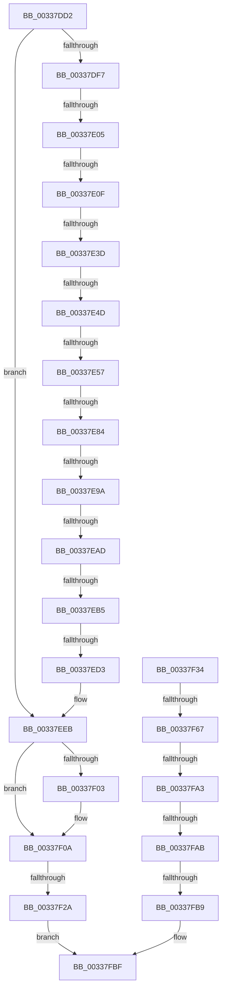

# sub_00337DD2

- RVA: `0x00337DD2`–`0x00337FDF` (길이 `525` bytes)
- VA: `0x0000000140337DD2`
- 실행 섹션: `.text`
- PDB 이름 있음: `아니요`; PDB Function 태그: `아니요`
- unwind 정보 RVA: `0x00076A40`
- 디코드: `109`개 명령, `525/525` bytes 표시
- 미해석 바이트: `0` (있으면 어셈블리에 `.byte`로 보존)

> 이 문서는 커널 이미지의 기계어와 PDB 기호를 분석해 생성했습니다. 4번과 5번은 함수 원형과 자료형을 바이너리 사용 방식에서 추정한 C 해석이며 원본 소스 복구 결과는 아닙니다.

## 1. Dependencies

- 직접 호출 지점: **1**; 고유 호출 대상: **1**
- 직접 호출자로 확인된 함수: **0**
- RIP 상대 이미지 참조: **6**

### Outgoing calls
- `0x00337EE5` → [KeBugCheckEx](../4F/KeBugCheckEx_function_004FD660.md) (function, `0x004FD660`)

### Direct callers
- 이 함수 시작 RVA로 연결되는 직접 call은 확인되지 않았습니다. 간접 호출은 완전히 역산할 수 없습니다.

### Static image references
- `0x00337E0F` → RVA `0x00E35FA4` (`.data`; read)
- `0x00337E3D` → RVA `0x00E38D00` (`.data`; read)
- `0x00337EC3` → RVA `0x00E37600` (`.data`; read)
- `0x00337EEB` → RVA `0x00FC5088` (`ALMOSTRO`; read)
- `0x00337F03` → RVA `0x00FC51B4` (`ALMOSTRO`; read)
- `0x00337FAB` → RVA `0x00FC6B04` (`ALMOSTRO`; read)

## 2. Other-region calls and transfers

- 다른 실행 섹션으로 향하는 call: **0**
- call이 아닌 외부 분기/꼬리 이동: **15**
  - `0x00337DFF` → [sub_0033800D + 0xD3](Unknown_function_0033800D.md) (`tail-transfer`)
  - `0x00337E09` → [sub_0033800D + 0x229](Unknown_function_0033800D.md) (`tail-transfer`)
  - `0x00337E37` → [sub_0033800D](Unknown_function_0033800D.md) (`tail-transfer`)
  - `0x00337E47` → [sub_0033800D](Unknown_function_0033800D.md) (`tail-transfer`)
  - `0x00337E51` → [sub_0033800D + 0x1DE](Unknown_function_0033800D.md) (`tail-transfer`)
  - `0x00337E7E` → [sub_0033800D](Unknown_function_0033800D.md) (`tail-transfer`)
  - `0x00337E94` → [sub_0033800D](Unknown_function_0033800D.md) (`tail-transfer`)
  - `0x00337EA7` → [sub_0033800D](Unknown_function_0033800D.md) (`tail-transfer`)
  - `0x00337EAF` → [sub_0033800D + 0xED](Unknown_function_0033800D.md) (`tail-transfer`)
  - `0x00337ECD` → [sub_0033800D + 0x1F1](Unknown_function_0033800D.md) (`tail-transfer`)
  - `0x00337F24` → [sub_0033827F + 0xA](Unknown_function_0033827F.md) (`tail-transfer`)
  - `0x00337F61` → [sub_0033827F + 0x3FF](Unknown_function_0033827F.md) (`tail-transfer`)
  - `0x00337F9D` → [sub_0033827F](Unknown_function_0033827F.md) (`tail-transfer`)
  - `0x00337FA5` → [sub_0033827F](Unknown_function_0033827F.md) (`tail-transfer`)
  - `0x00337FB3` → [sub_00338691](Unknown_function_00338691.md) (`tail-transfer`)

## 3. Assembly (complete function range)

```asm
00337DD2  4C 89 A4 24 B0 00 00 00         mov qword ptr [rsp + 0xb0], r12
00337DDA  4D 03 57 10                     add r10, qword ptr [r15 + 0x10]
00337DDE  45 8B E1                        mov r12d, r9d
00337DE1  4C 89 AC 24 A8 00 00 00         mov qword ptr [rsp + 0xa8], r13
00337DE9  4C 89 54 24 30                  mov qword ptr [rsp + 0x30], r10
00337DEE  41 84 E9                        test r9b, bpl
00337DF1  0F 85 F4 00 00 00               jne 0x140337eeb
00337DF7  41 8D 41 01                     lea eax, [r9 + 1]
00337DFB  40 F6 C5 20                     test bpl, 0x20
00337DFF  0F 85 DB 02 00 00               jne 0x1403380e0
00337E05  41 83 F8 05                     cmp r8d, 5
00337E09  0F 85 27 04 00 00               jne 0x140338236
00337E0F  44 0F B6 2D 8D E1 AF 00         movzx r13d, byte ptr [rip + 0xafe18d]
00337E17  45 8B F3                        mov r14d, r11d
00337E1A  44 89 9C 24 F8 00 00 00         mov dword ptr [rsp + 0xf8], r11d
00337E22  4C 89 AC 24 08 01 00 00         mov qword ptr [rsp + 0x108], r13
00337E2A  45 8B CD                        mov r9d, r13d
00337E2D  44 89 8C 24 F0 00 00 00         mov dword ptr [rsp + 0xf0], r9d
00337E35  85 D2                           test edx, edx
00337E37  0F 84 D0 01 00 00               je 0x14033800d
00337E3D  48 8D 05 BC 0E B0 00            lea rax, [rip + 0xb00ebc]
00337E44  4C 3B F8                        cmp r15, rax
00337E47  0F 85 C0 01 00 00               jne 0x14033800d
00337E4D  41 83 F8 05                     cmp r8d, 5
00337E51  0F 85 94 03 00 00               jne 0x1403381eb
00337E57  C7 84 24 F8 00 00 00 01 00 00 00  mov dword ptr [rsp + 0xf8], 1
00337E62  41 8B D3                        mov edx, r11d
00337E65  65 4C 8B 04 25 20 00 00 00      mov r8, qword ptr gs:[0x20]
00337E6E  49 8B 80 C0 00 00 00            mov rax, qword ptr [r8 + 0xc0]
00337E75  0F B7 88 8A 00 00 00            movzx ecx, word ptr [rax + 0x8a]
00337E7C  3B CB                           cmp ecx, ebx
00337E7E  0F 85 89 01 00 00               jne 0x14033800d
00337E84  8B C2                           mov eax, edx
00337E86  49 8D 0C C0                     lea rcx, [r8 + rax*8]
00337E8A  48 8B 81 30 87 00 00            mov rax, qword ptr [rcx + 0x8730]
00337E91  48 85 C0                        test rax, rax
00337E94  0F 84 73 01 00 00               je 0x14033800d
00337E9A  4D 8B F3                        mov r14, r11
00337E9D  4C 87 B1 30 87 00 00            xchg qword ptr [rcx + 0x8730], r14
00337EA4  4D 85 F6                        test r14, r14
00337EA7  0F 84 60 01 00 00               je 0x14033800d
00337EAD  85 D2                           test edx, edx
00337EAF  0F 85 45 02 00 00               jne 0x1403380fa
00337EB5  4D 8B 4E F0                     mov r9, qword ptr [r14 - 0x10]
00337EB9  49 81 C6 10 F0 FF FF            add r14, -0xff0
00337EC0  49 8B C6                        mov rax, r14
00337EC3  48 33 05 36 F7 AF 00            xor rax, qword ptr [rip + 0xaff736]
00337ECA  4C 3B C8                        cmp r9, rax
00337ECD  0F 84 2B 03 00 00               je 0x1403381fe
00337ED3  4D 8B C6                        mov r8, r14
00337ED6  48 89 44 24 20                  mov qword ptr [rsp + 0x20], rax
00337EDB  BA 70 34 00 00                  mov edx, 0x3470
00337EE0  B9 1A 00 00 00                  mov ecx, 0x1a
00337EE5  E8 76 57 1C 00                  call 0x1404fd660
00337EEA  CC                              int3
00337EEB  44 8B 2D 96 D1 C8 00            mov r13d, dword ptr [rip + 0xc8d196]
00337EF2  C7 84 24 F8 00 00 00 08 00 00 00  mov dword ptr [rsp + 0xf8], 8
00337EFD  40 F6 C5 04                     test bpl, 4
00337F01  75 07                           jne 0x140337f0a
00337F03  44 8B 2D AA D2 C8 00            mov r13d, dword ptr [rip + 0xc8d2aa]
00337F0A  44 8B 0D 77 D1 C8 00            mov r9d, dword ptr [rip + 0xc8d177]
00337F11  49 C1 ED 0C                     shr r13, 0xc
00337F15  41 C1 E9 0C                     shr r9d, 0xc
00337F19  44 89 8C 24 F0 00 00 00         mov dword ptr [rsp + 0xf0], r9d
00337F21  45 85 F6                        test r14d, r14d
00337F24  0F 84 5F 03 00 00               je 0x140338289
00337F2A  B8 D8 00 00 C0                  mov eax, 0xc00000d8
00337F2F  E9 8B 00 00 00                  jmp 0x140337fbf
00337F34  8B AC 24 00 01 00 00            mov ebp, dword ptr [rsp + 0x100]
00337F3B  4C 8B 74 24 38                  mov r14, qword ptr [rsp + 0x38]
00337F40  4C 8B AC 24 08 01 00 00         mov r13, qword ptr [rsp + 0x108]
00337F48  44 8B 8C 24 F0 00 00 00         mov r9d, dword ptr [rsp + 0xf0]
00337F50  4C 8B 54 24 30                  mov r10, qword ptr [rsp + 0x30]
00337F55  48 63 84 24 F8 00 00 00         movsxd rax, dword ptr [rsp + 0xf8]
00337F5D  48 83 F8 08                     cmp rax, 8
00337F61  0F 83 17 07 00 00               jae 0x14033867e
00337F67  48 8D 90 3F 01 00 00            lea rdx, [rax + 0x13f]
00337F6E  48 8D 14 52                     lea rdx, [rdx + rdx*2]
00337F72  48 C1 E2 04                     shl rdx, 4
00337F76  49 03 D2                        add rdx, r10
00337F79  41 BA 01 00 00 00               mov r10d, 1
00337F7F  45 8B C2                        mov r8d, r10d
00337F82  8B 42 24                        mov eax, dword ptr [rdx + 0x24]
00337F85  FF C0                           inc eax
00337F87  85 C0                           test eax, eax
00337F89  44 0F 4F C0                     cmovg r8d, eax
00337F8D  44 89 42 24                     mov dword ptr [rdx + 0x24], r8d
00337F91  8B 42 20                        mov eax, dword ptr [rdx + 0x20]
00337F94  8B C8                           mov ecx, eax
00337F96  8B 44 82 10                     mov eax, dword ptr [rdx + rax*4 + 0x10]
00337F9A  41 3B C0                        cmp eax, r8d
00337F9D  0F 82 DC 02 00 00               jb 0x14033827f
00337FA3  85 C0                           test eax, eax
00337FA5  0F 88 D4 02 00 00               js 0x14033827f
00337FAB  8B 05 53 EB C8 00               mov eax, dword ptr [rip + 0xc8eb53]
00337FB1  A8 01                           test al, 1
00337FB3  0F 85 D8 06 00 00               jne 0x140338691
00337FB9  4C 89 77 18                     mov qword ptr [rdi + 0x18], r14
00337FBD  33 C0                           xor eax, eax
00337FBF  4C 8B A4 24 B0 00 00 00         mov r12, qword ptr [rsp + 0xb0]
00337FC7  4C 8B AC 24 A8 00 00 00         mov r13, qword ptr [rsp + 0xa8]
00337FCF  48 81 C4 B8 00 00 00            add rsp, 0xb8
00337FD6  41 5F                           pop r15
00337FD8  41 5E                           pop r14
00337FDA  5F                              pop rdi
00337FDB  5E                              pop rsi
00337FDC  5D                              pop rbp
00337FDD  5B                              pop rbx
00337FDE  C3                              ret
```

## 4. C-style interpretation (structured pseudocode)

```c
__int64 __fastcall sub_00337DD2(__int64 a1, int a2, int a3, __int64 a4, __int64 a5, __int64 a6, __int64 a7, __int64 a8, __int64 a9, __int64 a10, __int64 a11, __int64 a12, __int64 a13, __int64 a14, __int64 a15, __int64 a16, __int64 a17, __int64 a18, __int64 a19, __int64 a20, __int64 a21, __int64 a22)
{
    __int64 result;
    __int64 v_r10;
    __int64 v_r13;
    __int64 v_r14;
    __int64 v_rsp;
    unsigned int v_stack_p100;
    unsigned __int64 v_stack_p108;
    unsigned __int64 v_stack_p20;
    unsigned __int64 v_stack_p30;
    unsigned __int64 v_stack_p38;
    unsigned __int64 v_stack_pA8;
    unsigned __int64 v_stack_pB0;
    unsigned int v_stack_pF0;
    unsigned int v_stack_pF8;

    v_stack_pB0 = v_r12;
    v_r10 = (v_r10) + (*(unsigned __int64 *)(v_r15 + 16));
    v_stack_pA8 = v_r13;
    v_stack_p30 = v_r10;
    if ((((unsigned __int8)(a4)) & ((unsigned __int8)(v_rbp))) != 0) goto loc_00337EEB;
    v_stack_pF8 = (unsigned int)(v_r11);
    v_stack_p108 = *(unsigned __int8 *)(v_rip + 11526541);
    v_stack_pF0 = (unsigned int)((unsigned int)((unsigned int)(*(unsigned __int8 *)(v_rip + 11526541))));
    v_stack_pF8 = 1;
    v_r14 = (v_r11) + (0xFFFFFFFFFFFFF010ULL);
    result = (v_r14) ^ (*(unsigned __int64 *)(v_rip + 11532086));
    v_stack_p20 = result;
    result = KeBugCheckEx(26, (unsigned int)(0x3470ULL), v_r14, *(unsigned __int64 *)(v_r11 - 16));
loc_00337EEB:
    v_stack_pF8 = 8;
    v_r13 = (unsigned int)(*(unsigned int *)(v_rip + 13160854));
    if ((((unsigned __int8)(v_rbp)) & (4)) == 0) {
        v_r13 = *(unsigned int *)(v_rip + 13161130);
    }
    v_r13 = (v_r13) >> (12);
    a4 = (unsigned int)(((unsigned int)(*(unsigned int *)(v_rip + 13160823))) >> (12));
    v_stack_pF0 = (unsigned int)(a4);
    goto loc_00337FBF;
loc_00337FBF:
    v_rsp = (v_rsp) + (184);
    return (unsigned int)(0xC00000D8ULL);
}
```

## 5. (Beta) C Style

```c
int64_t sub_00337DD2(int64_t Arg1, int32_t Arg2, int32_t Arg3, int64_t Arg4, uint64_t Arg5, uint64_t Arg6, uint64_t Arg7, uint64_t Arg8, uint64_t Arg9, uint64_t Arg10, uint64_t Arg11, uint64_t Arg12, uint64_t Arg13, uint64_t Arg14, uint64_t Arg15, uint64_t Arg16, uint64_t Arg17, uint64_t Arg18, uint64_t Arg19, uint64_t Arg20, int64_t Arg21, int64_t Arg22)
{
    int64_t result;
    int64_t local_r10;
    int64_t local_r13;
    int64_t local_r14;
    int64_t local_rsp;
    uint32_t v_stack_p100;
    uint64_t v_stack_p108;
    uint64_t v_stack_p20;
    uint64_t v_stack_p30;
    uint64_t v_stack_p38;
    uint64_t v_stack_pA8;
    uint64_t v_stack_pB0;
    uint32_t v_stack_pF0;
    uint32_t v_stack_pF8;

    v_stack_pB0 = local_r12;
    local_r10 = (local_r10) + (*(uint64_t *)(local_r15 + 0x10));
    v_stack_pA8 = local_r13;
    v_stack_p30 = local_r10;
    if ((((uint8_t)(Arg4)) & ((uint8_t)(local_rbp))) != 0) goto loc_00337EEB;
    v_stack_pF8 = (uint32_t)(local_r11);
    v_stack_p108 = *(uint8_t *)(v_rip + 0xAFE18D);
    v_stack_pF0 = (uint32_t)((uint32_t)((uint32_t)(*(uint8_t *)(v_rip + 0xAFE18D))));
    v_stack_pF8 = 1;
    local_r14 = (local_r11) + (0xFFFFFFFFFFFFF010ULL);
    result = (local_r14) ^ (*(uint64_t *)(v_rip + 0xAFF736));
    v_stack_p20 = result;
    result = KeBugCheckEx(26, (uint32_t)(0x3470ULL), local_r14, *(uint64_t *)(local_r11 - 0x10));
loc_00337EEB:
    v_stack_pF8 = 8;
    local_r13 = (uint32_t)(*(uint32_t *)(v_rip + 0xC8D196));
    if ((((uint8_t)(local_rbp)) & (4)) == 0) {
        local_r13 = *(uint32_t *)(v_rip + 0xC8D2AA);
    }
    local_r13 = (local_r13) >> (12);
    Arg4 = (uint32_t)(((uint32_t)(*(uint32_t *)(v_rip + 0xC8D177))) >> (12));
    v_stack_pF0 = (uint32_t)(Arg4);
    goto loc_00337FBF;
loc_00337FBF:
    local_rsp = (local_rsp) + (184);
    return (uint32_t)(0xC00000D8ULL);
}
```

## 6. Execution-region graph

[열기: 2D/3D 그래프와 함수 탐색 컨트롤 패널](../../../control-panel.html?section=text&rva=0x00337DD2&view=graph)

- 2D 그래프는 위에서 아래로 흐르고, 3D 그래프는 빈 공간을 드래그해 회전합니다. Shift+드래그는 이동, 휠은 확대·축소, 함수 노드 선택은 대상 보고서 이동입니다.

### Static fallback


