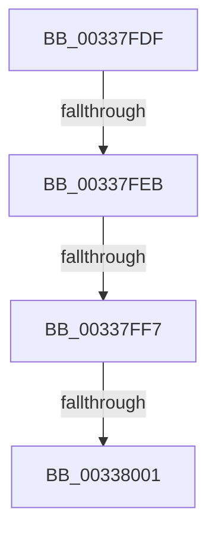

# sub_00337FDF

- RVA: `0x00337FDF`–`0x0033800D` (길이 `46` bytes)
- VA: `0x0000000140337FDF`
- 실행 섹션: `.text`
- PDB 이름 있음: `아니요`; PDB Function 태그: `아니요`
- unwind 정보 RVA: `0x00076A5C`
- 디코드: `11`개 명령, `46/46` bytes 표시
- 미해석 바이트: `0` (있으면 어셈블리에 `.byte`로 보존)

> 이 문서는 커널 이미지의 기계어와 PDB 기호를 분석해 생성했습니다. 4번과 5번은 함수 원형과 자료형을 바이너리 사용 방식에서 추정한 C 해석이며 원본 소스 복구 결과는 아닙니다.

## 1. Dependencies

- 직접 호출 지점: **0**; 고유 호출 대상: **0**
- 직접 호출자로 확인된 함수: **0**
- RIP 상대 이미지 참조: **0**

### Outgoing calls
- 직접 디코드된 call 명령이 없습니다.

### Direct callers
- 이 함수 시작 RVA로 연결되는 직접 call은 확인되지 않았습니다. 간접 호출은 완전히 역산할 수 없습니다.

### Static image references
- 디코드된 RIP-relative 메모리 참조가 없습니다.

## 2. Other-region calls and transfers

- 다른 실행 섹션으로 향하는 call: **0**
- call이 아닌 외부 분기/꼬리 이동: **4**
  - `0x00337FE5` → [sub_00338255 + 0x14](Unknown_function_00338255.md) (`tail-transfer`)
  - `0x00337FF1` → [MmCreateKernelStack + 0xA5](MmCreateKernelStack_function_00337D20.md) (`tail-transfer`)
  - `0x00337FFB` → [MmCreateKernelStack + 0xA5](MmCreateKernelStack_function_00337D20.md) (`tail-transfer`)
  - `0x00338008` → [MmCreateKernelStack + 0xA5](MmCreateKernelStack_function_00337D20.md) (`tail-transfer`)

## 3. Assembly (complete function range)

```asm
00337FDF  CC                              int3
00337FE0  8B C5                           mov eax, ebp
00337FE2  83 E0 40                        and eax, 0x40
00337FE5  0F 85 7E 02 00 00               jne 0x140338269
00337FEB  44 8B F0                        mov r14d, eax
00337FEE  48 85 F6                        test rsi, rsi
00337FF1  0F 85 CE FD FF FF               jne 0x140337dc5
00337FF7  41 83 F8 05                     cmp r8d, 5
00337FFB  0F 85 C4 FD FF FF               jne 0x140337dc5
00338001  48 C7 C6 F0 FF FF FF            mov rsi, 0xfffffffffffffff0
00338008  E9 B8 FD FF FF                  jmp 0x140337dc5
```

## 4. C-style interpretation (structured pseudocode)

```c
__int64 __fastcall sub_00337FDF(__int64 a1, __int64 a2, int a3)
{
    __int64 result;

    result = (unsigned int)(((unsigned int)((unsigned int)(v_rbp))) & (64));
}
```

## 5. (Beta) C Style

```c
int64_t sub_00337FDF(int64_t Arg1, int64_t Arg2, int32_t Arg3)
{
    int64_t result;

    result = (uint32_t)(((uint32_t)((uint32_t)(local_rbp))) & (64));
}
```

## 6. Execution-region graph

[열기: 2D/3D 그래프와 함수 탐색 컨트롤 패널](../../../control-panel.html?section=text&rva=0x00337FDF&view=graph)

- 2D 그래프는 위에서 아래로 흐르고, 3D 그래프는 빈 공간을 드래그해 회전합니다. Shift+드래그는 이동, 휠은 확대·축소, 함수 노드 선택은 대상 보고서 이동입니다.

### Static fallback


