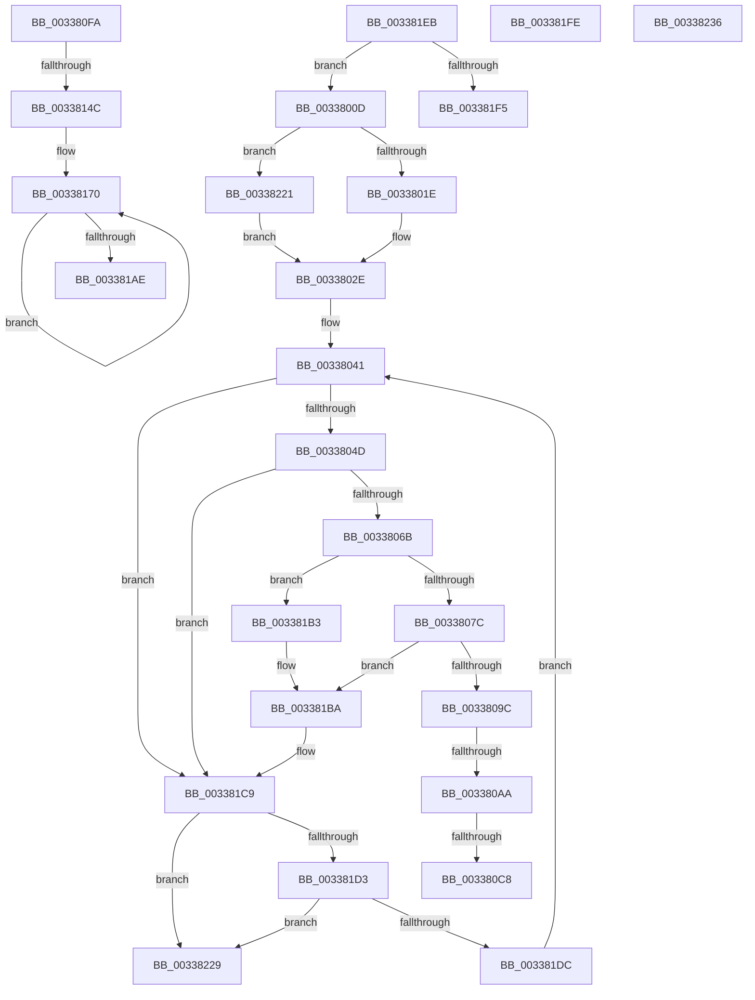

# sub_0033800D

- RVA: `0x0033800D`–`0x00338255` (길이 `584` bytes)
- VA: `0x000000014033800D`
- 실행 섹션: `.text`
- PDB 이름 있음: `아니요`; PDB Function 태그: `아니요`
- unwind 정보 RVA: `0x00076A6C`
- 디코드: `125`개 명령, `584/584` bytes 표시
- 미해석 바이트: `0` (있으면 어셈블리에 `.byte`로 보존)

> 이 문서는 커널 이미지의 기계어와 PDB 기호를 분석해 생성했습니다. 4번과 5번은 함수 원형과 자료형을 바이너리 사용 방식에서 추정한 C 해석이며 원본 소스 복구 결과는 아닙니다.

## 1. Dependencies

- 직접 호출 지점: **4**; 고유 호출 대상: **4**
- 직접 호출자로 확인된 함수: **0**
- RIP 상대 이미지 참조: **2**

### Outgoing calls
- `0x0033806E` → [FirstEntrySList](../6B/FirstEntrySList_function_006BA560.md) (function, `0x006BA560`)
- `0x00338081` → [ExpInterlockedPopEntrySList](../6B/ExpInterlockedPopEntrySList_function_006BA570.md) (function, `0x006BA570`)
- `0x003380DA` → [KeBugCheckEx](../4F/KeBugCheckEx_function_004FD660.md) (function, `0x004FD660`)
- `0x0033818E` → [MiValidateKernelShadowStackPage](MiValidateKernelShadowStackPage_function_00338D98.md) (function, `0x00338D98`)

### Direct callers
- 이 함수 시작 RVA로 연결되는 직접 call은 확인되지 않았습니다. 간접 호출은 완전히 역산할 수 없습니다.

### Static image references
- `0x003380B8` → RVA `0x00E37600` (`.data`; read)
- `0x003380E0` → RVA `0x00FC6CF8` (`ALMOSTRO`; read)

## 2. Other-region calls and transfers

- 다른 실행 섹션으로 향하는 call: **0**
- call이 아닌 외부 분기/꼬리 이동: **9**
  - `0x003380A4` → [sub_0033827F + 0x13C](Unknown_function_0033827F.md) (`tail-transfer`)
  - `0x003380C2` → [sub_0033827F + 0x1AB](Unknown_function_0033827F.md) (`tail-transfer`)
  - `0x003380F5` → [sub_00337DD2 + 0x50](Unknown_function_00337DD2.md) (`tail-transfer`)
  - `0x00338146` → [sub_00337DD2 + 0x17E](Unknown_function_00337DD2.md) (`tail-transfer`)
  - `0x003381AE` → [sub_00337DD2 + 0x162](Unknown_function_00337DD2.md) (`tail-transfer`)
  - `0x003381F9` → [sub_00337DD2 + 0x93](Unknown_function_00337DD2.md) (`tail-transfer`)
  - `0x0033821C` → [sub_00337DD2 + 0x183](Unknown_function_00337DD2.md) (`tail-transfer`)
  - `0x00338231` → [sub_00337DD2 + 0x14F](Unknown_function_00337DD2.md) (`tail-transfer`)
  - `0x00338250` → [sub_00337DD2 + 0x58](Unknown_function_00337DD2.md) (`tail-transfer`)

## 3. Assembly (complete function range)

```asm
0033800D  83 7F 04 05                     cmp dword ptr [rdi + 4], 5
00338011  8B 84 24 F8 00 00 00            mov eax, dword ptr [rsp + 0xf8]
00338018  0F 84 03 02 00 00               je 0x140338221
0033801E  83 F8 05                        cmp eax, 5
00338021  BA FF FF FF FF                  mov edx, 0xffffffff
00338026  B9 01 00 00 00                  mov ecx, 1
0033802B  0F 4E D1                        cmovle edx, ecx
0033802E  8B CD                           mov ecx, ebp
00338030  89 94 24 00 01 00 00            mov dword ptr [rsp + 0x100], edx
00338037  83 E1 40                        and ecx, 0x40
0033803A  89 8C 24 08 01 00 00            mov dword ptr [rsp + 0x108], ecx
00338041  44 8B F1                        mov r14d, ecx
00338044  83 FA FF                        cmp edx, -1
00338047  0F 84 7C 01 00 00               je 0x1403381c9
0033804D  48 98                           cdqe
0033804F  48 05 3F 01 00 00               add rax, 0x13f
00338055  48 8D 04 40                     lea rax, [rax + rax*2]
00338059  48 C1 E0 04                     shl rax, 4
0033805D  49 03 C2                        add rax, r10
00338060  48 89 44 24 38                  mov qword ptr [rsp + 0x38], rax
00338065  0F 84 5E 01 00 00               je 0x1403381c9
0033806B  48 8B C8                        mov rcx, rax
0033806E  E8 ED 24 38 00                  call 0x1406ba560
00338073  48 85 C0                        test rax, rax
00338076  0F 84 37 01 00 00               je 0x1403381b3
0033807C  48 8B 4C 24 38                  mov rcx, qword ptr [rsp + 0x38]
00338081  E8 EA 24 38 00                  call 0x1406ba570
00338086  8B 8C 24 08 01 00 00            mov ecx, dword ptr [rsp + 0x108]
0033808D  44 8B F1                        mov r14d, ecx
00338090  48 8B D0                        mov rdx, rax
00338093  48 85 C0                        test rax, rax
00338096  0F 84 1E 01 00 00               je 0x1403381ba
0033809C  83 BC 24 00 01 00 00 00         cmp dword ptr [rsp + 0x100], 0
003380A4  0F 85 11 03 00 00               jne 0x1403383bb
003380AA  4C 8B 48 F0                     mov r9, qword ptr [rax - 0x10]
003380AE  4C 8D A0 10 F0 FF FF            lea r12, [rax - 0xff0]
003380B5  49 8B C4                        mov rax, r12
003380B8  48 33 05 41 F5 AF 00            xor rax, qword ptr [rip + 0xaff541]
003380BF  4C 3B C8                        cmp r9, rax
003380C2  0F 84 62 03 00 00               je 0x14033842a
003380C8  4D 8B C4                        mov r8, r12
003380CB  48 89 44 24 20                  mov qword ptr [rsp + 0x20], rax
003380D0  BA 70 34 00 00                  mov edx, 0x3470
003380D5  B9 1A 00 00 00                  mov ecx, 0x1a
003380DA  E8 81 55 1C 00                  call 0x1404fd660
003380DF  CC                              int3
003380E0  44 8B 2D 11 EC C8 00            mov r13d, dword ptr [rip + 0xc8ec11]
003380E7  44 8B F0                        mov r14d, eax
003380EA  49 C1 ED 0C                     shr r13, 0xc
003380EE  89 84 24 F8 00 00 00            mov dword ptr [rsp + 0xf8], eax
003380F5  E9 28 FD FF FF                  jmp 0x140337e22
003380FA  4C 89 77 20                     mov qword ptr [rdi + 0x20], r14
003380FE  49 BA F8 FF FF FF 7F 00 00 00   movabs r10, 0x7ffffffff8
00338108  49 81 E6 00 F0 FF FF            and r14, 0xfffffffffffff000
0033810F  41 8B C4                        mov eax, r12d
00338112  49 81 C6 00 20 00 00            add r14, 0x2000
00338119  49 03 C1                        add rax, r9
0033811C  4D 8B FE                        mov r15, r14
0033811F  48 C1 E0 03                     shl rax, 3
00338123  49 C1 EF 09                     shr r15, 9
00338127  4D 23 FA                        and r15, r10
0033812A  4C 89 74 24 38                  mov qword ptr [rsp + 0x38], r14
0033812F  4C 2B F8                        sub r15, rax
00338132  48 B8 08 00 00 00 80 F6 FF FF   movabs rax, 0xfffff68000000008
0033813C  4C 03 F8                        add r15, rax
0033813F  4F 8D 24 CF                     lea r12, [r15 + r9*8]
00338143  4D 3B FC                        cmp r15, r12
00338146  0F 83 04 FE FF FF               jae 0x140337f50
0033814C  48 C1 EE 03                     shr rsi, 3
00338150  48 BD FF FF FF FF FF 00 00 00   movabs rbp, 0xffffffffff
0033815A  49 BD 00 00 00 00 00 DE FF FF   movabs r13, 0xffffde0000000000
00338164  49 BE 01 00 00 00 00 F0 FF FF   movabs r14, 0xfffff00000000001
0033816E  66 90                           nop
00338170  49 8B 07                        mov rax, qword ptr [r15]
00338173  48 C1 E8 0C                     shr rax, 0xc
00338177  48 23 C5                        and rax, rbp
0033817A  48 8D 1C 40                     lea rbx, [rax + rax*2]
0033817E  48 C1 E3 04                     shl rbx, 4
00338182  49 8B C5                        mov rax, r13
00338185  48 03 D8                        add rbx, rax
00338188  49 8B CF                        mov rcx, r15
0033818B  48 8B D3                        mov rdx, rbx
0033818E  E8 05 0C 00 00                  call 0x140338d98
00338193  48 8B 03                        mov rax, qword ptr [rbx]
00338196  48 8B CE                        mov rcx, rsi
00338199  48 33 C8                        xor rcx, rax
0033819C  49 83 C7 08                     add r15, 8
003381A0  49 23 CE                        and rcx, r14
003381A3  48 33 CE                        xor rcx, rsi
003381A6  48 89 0B                        mov qword ptr [rbx], rcx
003381A9  4D 3B FC                        cmp r15, r12
003381AC  72 C2                           jb 0x140338170
003381AE  E9 81 FD FF FF                  jmp 0x140337f34
003381B3  8B 8C 24 08 01 00 00            mov ecx, dword ptr [rsp + 0x108]
003381BA  4C 8B 54 24 30                  mov r10, qword ptr [rsp + 0x30]
003381BF  45 33 DB                        xor r11d, r11d
003381C2  8B 94 24 00 01 00 00            mov edx, dword ptr [rsp + 0x100]
003381C9  83 BC 24 F8 00 00 00 01         cmp dword ptr [rsp + 0xf8], 1
003381D1  75 56                           jne 0x140338229
003381D3  44 8B F5                        mov r14d, ebp
003381D6  41 83 E6 40                     and r14d, 0x40
003381DA  75 4D                           jne 0x140338229
003381DC  41 8B C3                        mov eax, r11d
003381DF  89 84 24 F8 00 00 00            mov dword ptr [rsp + 0xf8], eax
003381E6  E9 56 FE FF FF                  jmp 0x140338041
003381EB  41 83 FE 05                     cmp r14d, 5
003381EF  0F 85 18 FE FF FF               jne 0x14033800d
003381F5  41 8D 56 FC                     lea edx, [r14 - 4]
003381F9  E9 67 FC FF FF                  jmp 0x140337e65
003381FE  44 8B 8C 24 F0 00 00 00         mov r9d, dword ptr [rsp + 0xf0]
00338206  49 81 E6 00 F0 FF FF            and r14, 0xfffffffffffff000
0033820D  49 C1 E6 10                     shl r14, 0x10
00338211  49 81 C6 00 00 00 10            add r14, 0x10000000
00338218  49 C1 FE 10                     sar r14, 0x10
0033821C  E9 34 FD FF FF                  jmp 0x140337f55
00338221  41 8B D3                        mov edx, r11d
00338224  E9 05 FE FF FF                  jmp 0x14033802e
00338229  44 8B 8C 24 F0 00 00 00         mov r9d, dword ptr [rsp + 0xf0]
00338231  E9 EB FC FF FF                  jmp 0x140337f21
00338236  45 8D 70 03                     lea r14d, [r8 + 3]
0033823A  4C 89 8C 24 08 01 00 00         mov qword ptr [rsp + 0x108], r9
00338242  44 89 B4 24 F8 00 00 00         mov dword ptr [rsp + 0xf8], r14d
0033824A  44 8B E0                        mov r12d, eax
0033824D  4D 8B E9                        mov r13, r9
00338250  E9 D5 FB FF FF                  jmp 0x140337e2a
```

## 4. C-style interpretation (structured pseudocode)

```c
__int64 __fastcall sub_0033800D(__int64 a1, __int64 a2, __int64 a3, __int64 a4, __int64 a5, __int64 a6, __int64 a7, __int64 a8, __int64 a9, __int64 a10, __int64 a11, __int64 a12, __int64 a13, __int64 a14, __int64 a15, __int64 a16, __int64 a17, __int64 a18, __int64 a19, __int64 a20, __int64 a21, __int64 a22, __int64 a23, __int64 a24, __int64 a25, __int64 a26, __int64 a27, __int64 a28, __int64 a29, unsigned int a30, unsigned int a31, unsigned int a32, unsigned int a33)
{
    __int64 result;
    __int64 v_r11;
    __int64 v_r13;
    __int64 v_r14;
    unsigned int v_stack_p100;
    unsigned int v_stack_p108;
    unsigned __int64 v_stack_p20;
    unsigned __int64 v_stack_p38;
    unsigned int v_stack_pF0;
    unsigned int v_stack_pF8;

    if ((*(unsigned int *)(v_rdi + 4)) == 5) goto loc_00338221;
    a2 = (unsigned int)(0xFFFFFFFFULL);
    if (((unsigned int)((unsigned int)(a31))) <= 5) { a2 = 1; }
loc_0033802E:
    v_stack_p100 = (unsigned int)(a2);
    a1 = (unsigned int)(((unsigned int)((unsigned int)(v_rbp))) & (64));
    v_stack_p108 = (unsigned int)(a1);
loc_00338041:
    if (((unsigned int)(a2)) == -1) goto loc_003381C9;
    result = ((unsigned int)(a31)) + (319);
    result = (result + result * 2) << (4);
    result = (result) + (v_r10);
    v_stack_p38 = result;
    if (condition_is_equal) goto loc_003381C9;
    result = FirstEntrySList(result, a2, a3, a4);
    if (result == 0) goto loc_003381B3;
    result = ExpInterlockedPopEntrySList(a7, a2, a3, a4);
    if (result == 0) goto loc_003381BA;
    result = (result - 4080) ^ (*(unsigned __int64 *)(v_rip + 11531585));
    v_stack_p20 = result;
    result = KeBugCheckEx(26, (unsigned int)(0x3470ULL), result - 4080, *(unsigned __int64 *)(result - 16));
    v_r13 = ((unsigned int)(*(unsigned int *)(v_rip + 13167633))) >> (12);
    v_stack_pF8 = (unsigned int)(result);
loc_003381B3:
loc_003381BA:
    v_r11 = 0;
loc_003381C9:
    if (a31 != 1) goto loc_00338229;
    v_r14 = (unsigned int)(((unsigned int)((unsigned int)(v_rbp))) & (64));
    if (condition_is_not_equal) goto loc_00338229;
    v_stack_pF8 = 0;
    goto loc_00338041;
loc_00338221:
    goto loc_0033802E;
loc_00338229:
}
```

## 5. (Beta) C Style

```c
int64_t sub_0033800D(int64_t Arg1, int64_t Arg2, int64_t Arg3, int64_t Arg4, uint64_t Arg5, int64_t Arg6, int64_t Arg7, uint64_t Arg8, uint64_t Arg9, uint64_t Arg10, uint64_t Arg11, uint64_t Arg12, uint64_t Arg13, uint64_t Arg14, uint64_t Arg15, uint64_t Arg16, uint64_t Arg17, uint64_t Arg18, uint64_t Arg19, uint64_t Arg20, uint64_t Arg21, uint64_t Arg22, uint64_t Arg23, uint64_t Arg24, uint64_t Arg25, uint64_t Arg26, uint64_t Arg27, uint64_t Arg28, uint64_t Arg29, uint32_t Arg30, uint32_t Arg31, uint32_t Arg32, uint32_t Arg33)
{
    int64_t result;
    int64_t local_r11;
    int64_t local_r13;
    int64_t local_r14;
    uint32_t v_stack_p100;
    uint32_t v_stack_p108;
    uint64_t v_stack_p20;
    uint64_t v_stack_p38;
    uint32_t v_stack_pF0;
    uint32_t v_stack_pF8;

    if ((*(uint32_t *)(local_rdi + 0x4)) == 5) goto loc_00338221;
    Arg2 = (uint32_t)(0xFFFFFFFFULL);
    if (((uint32_t)((uint32_t)(Arg31))) <= 5) { Arg2 = 1; }
loc_0033802E:
    v_stack_p100 = (uint32_t)(Arg2);
    Arg1 = (uint32_t)(((uint32_t)((uint32_t)(local_rbp))) & (64));
    v_stack_p108 = (uint32_t)(Arg1);
loc_00338041:
    if (((uint32_t)(Arg2)) == -1) goto loc_003381C9;
    result = ((uint32_t)(Arg31)) + (319);
    result = (result + result * 2) << (4);
    result = (result) + (local_r10);
    v_stack_p38 = result;
    if (condition_is_equal) goto loc_003381C9;
    result = FirstEntrySList(result, Arg2, Arg3, Arg4);
    if (result == 0) goto loc_003381B3;
    result = ExpInterlockedPopEntrySList(Arg7, Arg2, Arg3, Arg4);
    if (result == 0) goto loc_003381BA;
    result = (result - 4080) ^ (*(uint64_t *)(v_rip + 0xAFF541));
    v_stack_p20 = result;
    result = KeBugCheckEx(26, (uint32_t)(0x3470ULL), result - 4080, *(uint64_t *)(result - 0x10));
    local_r13 = ((uint32_t)(*(uint32_t *)(v_rip + 0xC8EC11))) >> (12);
    v_stack_pF8 = (uint32_t)(result);
loc_003381B3:
loc_003381BA:
    local_r11 = 0;
loc_003381C9:
    if (Arg31 != 1) goto loc_00338229;
    local_r14 = (uint32_t)(((uint32_t)((uint32_t)(local_rbp))) & (64));
    if (condition_is_not_equal) goto loc_00338229;
    v_stack_pF8 = 0;
    goto loc_00338041;
loc_00338221:
    goto loc_0033802E;
loc_00338229:
}
```

## 6. Execution-region graph

[열기: 2D/3D 그래프와 함수 탐색 컨트롤 패널](../../../control-panel.html?section=text&rva=0x0033800D&view=graph)

- 2D 그래프는 위에서 아래로 흐르고, 3D 그래프는 빈 공간을 드래그해 회전합니다. Shift+드래그는 이동, 휠은 확대·축소, 함수 노드 선택은 대상 보고서 이동입니다.

### Static fallback


