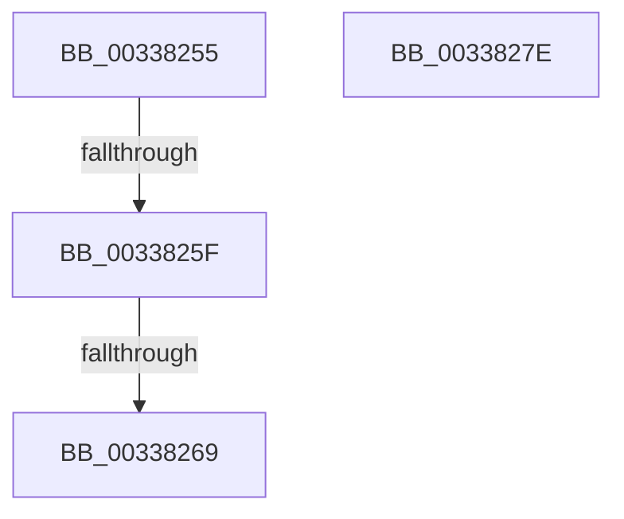

# sub_00338255

- RVA: `0x00338255`–`0x0033827F` (길이 `42` bytes)
- VA: `0x0000000140338255`
- 실행 섹션: `.text`
- PDB 이름 있음: `아니요`; PDB Function 태그: `아니요`
- unwind 정보 RVA: `0x00076A84`
- 디코드: `14`개 명령, `42/42` bytes 표시
- 미해석 바이트: `0` (있으면 어셈블리에 `.byte`로 보존)

> 이 문서는 커널 이미지의 기계어와 PDB 기호를 분석해 생성했습니다. 4번과 5번은 함수 원형과 자료형을 바이너리 사용 방식에서 추정한 C 해석이며 원본 소스 복구 결과는 아닙니다.

## 1. Dependencies

- 직접 호출 지점: **0**; 고유 호출 대상: **0**
- 직접 호출자로 확인된 함수: **0**
- RIP 상대 이미지 참조: **0**

### Outgoing calls
- 직접 디코드된 call 명령이 없습니다.

### Direct callers
- 이 함수 시작 RVA로 연결되는 직접 call은 확인되지 않았습니다. 간접 호출은 완전히 역산할 수 없습니다.

### Static image references
- 디코드된 RIP-relative 메모리 참조가 없습니다.

## 2. Other-region calls and transfers

- 다른 실행 섹션으로 향하는 call: **0**
- call이 아닌 외부 분기/꼬리 이동: **2**
  - `0x00338259` → [MmCreateKernelStack + 0x5B](MmCreateKernelStack_function_00337D20.md) (`tail-transfer`)
  - `0x00338263` → [MmCreateKernelStack + 0x5B](MmCreateKernelStack_function_00337D20.md) (`tail-transfer`)

## 3. Assembly (complete function range)

```asm
00338255  40 F6 C5 40                     test bpl, 0x40
00338259  0F 84 1C FB FF FF               je 0x140337d7b
0033825F  40 F6 C5 10                     test bpl, 0x10
00338263  0F 85 12 FB FF FF               jne 0x140337d7b
00338269  B8 0D 00 00 C0                  mov eax, 0xc000000d
0033826E  48 81 C4 B8 00 00 00            add rsp, 0xb8
00338275  41 5F                           pop r15
00338277  41 5E                           pop r14
00338279  5F                              pop rdi
0033827A  5E                              pop rsi
0033827B  5D                              pop rbp
0033827C  5B                              pop rbx
0033827D  C3                              ret
0033827E  CC                              int3
```

## 4. C-style interpretation (structured pseudocode)

```c
__int64 __fastcall sub_00338255(void)
{
    __int64 v_rsp;

    v_rsp = (v_rsp) + (184);
    return (unsigned int)(0xC000000DULL);
}
```

## 5. (Beta) C Style

```c
void sub_00338255(void)
{
    int64_t local_rsp;

    local_rsp = (local_rsp) + (184);
    return (uint32_t)(0xC000000DULL);
}
```

## 6. Execution-region graph

[열기: 2D/3D 그래프와 함수 탐색 컨트롤 패널](../../../control-panel.html?section=text&rva=0x00338255&view=graph)

- 2D 그래프는 위에서 아래로 흐르고, 3D 그래프는 빈 공간을 드래그해 회전합니다. Shift+드래그는 이동, 휠은 확대·축소, 함수 노드 선택은 대상 보고서 이동입니다.

### Static fallback


