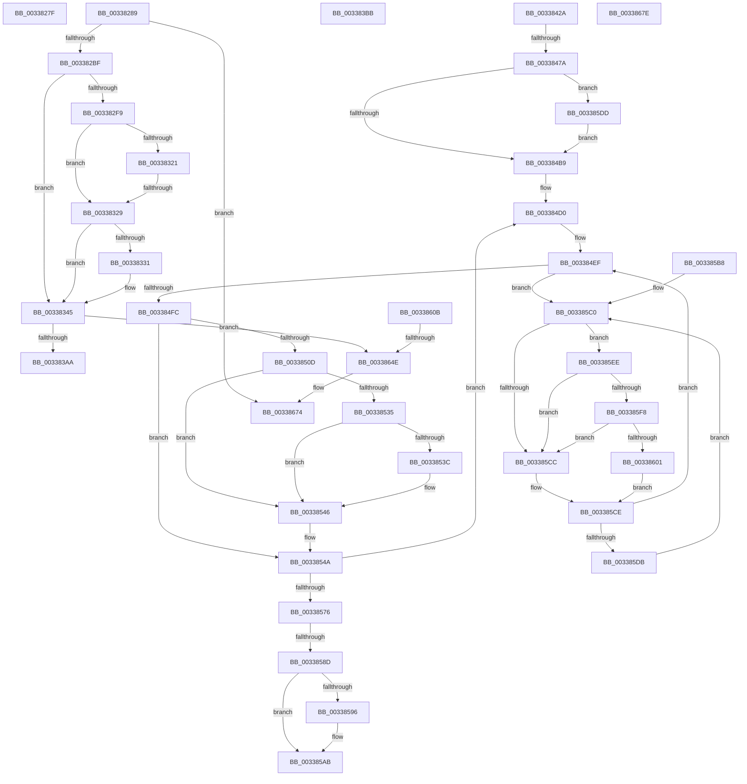

# sub_0033827F

- RVA: `0x0033827F`–`0x00338689` (길이 `1,034` bytes)
- VA: `0x000000014033827F`
- 실행 섹션: `.text`
- PDB 이름 있음: `아니요`; PDB Function 태그: `아니요`
- unwind 정보 RVA: `0x00076A98`
- 디코드: `222`개 명령, `1,034/1,034` bytes 표시
- 미해석 바이트: `0` (있으면 어셈블리에 `.byte`로 보존)

> 이 문서는 커널 이미지의 기계어와 PDB 기호를 분석해 생성했습니다. 4번과 5번은 함수 원형과 자료형을 바이너리 사용 방식에서 추정한 C 해석이며 원본 소스 복구 결과는 아닙니다.

## 1. Dependencies

- 직접 호출 지점: **10**; 고유 호출 대상: **10**
- 직접 호출자로 확인된 함수: **0**
- RIP 상대 이미지 참조: **9**

### Outgoing calls
- `0x003382AE` → [MiReservePtes](../31/MiReservePtes_function_00318D20.md) (function, `0x00318D20`)
- `0x0033839D` → [MiAllocateKernelStackPages](../2A/MiAllocateKernelStackPages_function_002A1BEC.md) (function, `0x002A1BEC`)
- `0x003383CA` → [ExpInterlockedPushEntrySList](../6B/ExpInterlockedPushEntrySList_function_006BA5B0.md) (function, `0x006BA5B0`)
- `0x00338420` → [MiUpdateKernelShadowStackOwnerData](../48/MiUpdateKernelShadowStackOwnerData_function_004837D4.md) (function, `0x004837D4`)
- `0x0033859E` → [KiLowerIrqlProcessIrqlFlags](../4F/KiLowerIrqlProcessIrqlFlags_function_004F5698.md) (function, `0x004F5698`)
- `0x003385E4` → [KiRaiseIrqlProcessIrqlFlags](../4F/KiRaiseIrqlProcessIrqlFlags_function_004F56FC.md) (function, `0x004F56FC`)
- `0x003385F8` → [KiCheckVpBackingLongSpinWaitHypercall](../30/KiCheckVpBackingLongSpinWaitHypercall_function_0030F490.md) (function, `0x0030F490`)
- `0x00338604` → [HvlNotifyLongSpinWait](../30/HvlNotifyLongSpinWait_function_0030F460.md) (function, `0x0030F460`)
- `0x00338641` → [MmKasanCommitRegion](../67/MmKasanCommitRegion_function_0067FCF4.md) (function, `0x0067FCF4`)
- `0x0033866F` → [MiReleasePtes](../24/MiReleasePtes_function_00247240.md) (function, `0x00247240`)

### Direct callers
- 이 함수 시작 RVA로 연결되는 직접 call은 확인되지 않았습니다. 간접 호출은 완전히 역산할 수 없습니다.

### Static image references
- `0x0033828D` → RVA `0x00E35F40` (`.data`; read)
- `0x00338298` → RVA `0x00E35EE0` (`.data`; read)
- `0x00338315` → RVA `0x00FCEC68` (`ALMOSTRO`; read)
- `0x00338331` → RVA `0x00FC5088` (`ALMOSTRO`; read)
- `0x00338337` → RVA `0x00FC51B4` (`ALMOSTRO`; read)
- `0x003384AC` → RVA `0x00FC6D20` (`ALMOSTRO`; read)
- `0x003385C3` → RVA `0x00FC52AC` (`ALMOSTRO`; reference)
- `0x003385EE` → RVA `0x00FC6AB8` (`ALMOSTRO`; read)
- `0x0033862C` → RVA `0x00FC6ED8` (`ALMOSTRO`; read)

## 2. Other-region calls and transfers

- 다른 실행 섹션으로 향하는 call: **0**
- call이 아닌 외부 분기/꼬리 이동: **10**
  - `0x00338284` → [sub_00337DD2 + 0x1D9](Unknown_function_00337DD2.md) (`tail-transfer`)
  - `0x00338323` → [sub_00338691 + 0x31](Unknown_function_00338691.md) (`tail-transfer`)
  - `0x003383B6` → [sub_00337DD2 + 0x176](Unknown_function_00337DD2.md) (`tail-transfer`)
  - `0x00338425` → [sub_00337DD2 + 0x176](Unknown_function_00337DD2.md) (`tail-transfer`)
  - `0x00338474` → [sub_00337DD2 + 0x176](Unknown_function_00337DD2.md) (`tail-transfer`)
  - `0x00338587` → [sub_00337DD2 + 0x176](Unknown_function_00337DD2.md) (`tail-transfer`)
  - `0x003385B3` → [sub_00337DD2 + 0x176](Unknown_function_00337DD2.md) (`tail-transfer`)
  - `0x00338648` → [sub_00338691 + 0x66](Unknown_function_00338691.md) (`tail-transfer`)
  - `0x00338679` → [sub_00337DD2 + 0x1ED](Unknown_function_00337DD2.md) (`tail-transfer`)
  - `0x00338684` → [sub_00337DD2 + 0x1D9](Unknown_function_00337DD2.md) (`tail-transfer`)

## 3. Assembly (complete function range)

```asm
0033827F  44 89 44 8A 10                  mov dword ptr [rdx + rcx*4 + 0x10], r8d
00338284  E9 22 FD FF FF                  jmp 0x140337fab
00338289  83 7F 04 05                     cmp dword ptr [rdi + 4], 5
0033828D  48 8D 15 AC DC AF 00            lea rdx, [rip + 0xafdcac]
00338294  47 8D 34 0C                     lea r14d, [r12 + r9]
00338298  48 8D 0D 41 DC AF 00            lea rcx, [rip + 0xafdc41]
0033829F  44 89 B4 24 00 01 00 00         mov dword ptr [rsp + 0x100], r14d
003382A7  48 0F 45 CA                     cmovne rcx, rdx
003382AB  41 8B D6                        mov edx, r14d
003382AE  E8 6D 0A FE FF                  call 0x140318d20
003382B3  4C 8B E0                        mov r12, rax
003382B6  48 85 C0                        test rax, rax
003382B9  0F 84 B5 03 00 00               je 0x140338674
003382BF  48 8B C8                        mov rcx, rax
003382C2  4C 89 B4 24 08 01 00 00         mov qword ptr [rsp + 0x108], r14
003382CA  45 8B D6                        mov r10d, r14d
003382CD  48 BA 00 00 00 00 80 F6 FF FF   movabs rdx, 0xfffff68000000000
003382D7  48 8B C2                        mov rax, rdx
003382DA  49 C1 E6 1C                     shl r14, 0x1c
003382DE  48 8B D1                        mov rdx, rcx
003382E1  48 C1 E0 19                     shl rax, 0x19
003382E5  4C 2B F0                        sub r14, rax
003382E8  48 C1 E2 19                     shl rdx, 0x19
003382EC  4C 03 F2                        add r14, rdx
003382EF  49 C1 FE 10                     sar r14, 0x10
003382F3  83 7F 04 05                     cmp dword ptr [rdi + 4], 5
003382F7  75 4C                           jne 0x140338345
003382F9  48 2B D0                        sub rdx, rax
003382FC  44 8D 5B 01                     lea r11d, [rbx + 1]
00338300  8B 84 24 F0 00 00 00            mov eax, dword ptr [rsp + 0xf0]
00338307  48 81 C2 00 00 00 10            add rdx, 0x10000000
0033830E  C1 E0 0C                        shl eax, 0xc
00338311  48 C1 FA 10                     sar rdx, 0x10
00338315  80 3D 4C 69 C9 00 00            cmp byte ptr [rip + 0xc9694c], 0
0033831C  44 8B C8                        mov r9d, eax
0033831F  74 08                           je 0x140338329
00338321  85 C0                           test eax, eax
00338323  0F 85 99 03 00 00               jne 0x1403386c2
00338329  8B C5                           mov eax, ebp
0033832B  24 05                           and al, 5
0033832D  3C 01                           cmp al, 1
0033832F  75 14                           jne 0x140338345
00338331  8B 0D 51 CD C8 00               mov ecx, dword ptr [rip + 0xc8cd51]
00338337  2B 0D 77 CE C8 00               sub ecx, dword ptr [rip + 0xc8ce77]
0033833D  48 C1 E9 0C                     shr rcx, 0xc
00338341  49 8D 0C CC                     lea rcx, [r12 + rcx*8]
00338345  48 8D 41 08                     lea rax, [rcx + 8]
00338349  89 9C 24 80 00 00 00            mov dword ptr [rsp + 0x80], ebx
00338350  48 89 44 24 58                  mov qword ptr [rsp + 0x58], rax
00338355  4C 89 7C 24 50                  mov qword ptr [rsp + 0x50], r15
0033835A  4C 89 6C 24 68                  mov qword ptr [rsp + 0x68], r13
0033835F  4C 89 54 24 60                  mov qword ptr [rsp + 0x60], r10
00338364  89 6C 24 70                     mov dword ptr [rsp + 0x70], ebp
00338368  48 89 74 24 78                  mov qword ptr [rsp + 0x78], rsi
0033836D  44 0F 20 C0                     mov rax, cr8
00338371  88 44 24 74                     mov byte ptr [rsp + 0x74], al
00338375  48 8D 4C 24 40                  lea rcx, [rsp + 0x40]
0033837A  8B 47 04                        mov eax, dword ptr [rdi + 4]
0033837D  83 F8 05                        cmp eax, 5
00338380  89 84 24 84 00 00 00            mov dword ptr [rsp + 0x84], eax
00338387  B8 00 00 00 00                  mov eax, 0
0033838C  48 0F 44 C8                     cmove rcx, rax
00338390  48 89 8C 24 88 00 00 00         mov qword ptr [rsp + 0x88], rcx
00338398  48 8D 4C 24 50                  lea rcx, [rsp + 0x50]
0033839D  E8 4A 98 F6 FF                  call 0x1402a1bec
003383A2  85 C0                           test eax, eax
003383A4  0F 84 A4 02 00 00               je 0x14033864e
003383AA  48 8B 84 24 90 00 00 00         mov rax, qword ptr [rsp + 0x90]
003383B2  48 89 47 20                     mov qword ptr [rdi + 0x20], rax
003383B6  E9 8D FB FF FF                  jmp 0x140337f48
003383BB  48 8B 40 10                     mov rax, qword ptr [rax + 0x10]
003383BF  49 8D 8F C0 01 00 00            lea rcx, [r15 + 0x1c0]
003383C6  48 89 47 20                     mov qword ptr [rdi + 0x20], rax
003383CA  E8 E1 21 38 00                  call 0x1406ba5b0
003383CF  4C 8B 77 20                     mov r14, qword ptr [rdi + 0x20]
003383D3  49 BA F8 FF FF FF 7F 00 00 00   movabs r10, 0x7ffffffff8
003383DD  44 8B 84 24 F0 00 00 00         mov r8d, dword ptr [rsp + 0xf0]
003383E5  49 81 E6 00 F0 FF FF            and r14, 0xfffffffffffff000
003383EC  49 81 C6 00 20 00 00            add r14, 0x2000
003383F3  41 8B D4                        mov edx, r12d
003383F6  49 03 D0                        add rdx, r8
003383F9  49 8B CE                        mov rcx, r14
003383FC  48 C1 E9 09                     shr rcx, 9
00338400  48 C1 E2 03                     shl rdx, 3
00338404  49 23 CA                        and rcx, r10
00338407  48 2B CA                        sub rcx, rdx
0033840A  48 BA 00 00 00 00 80 F6 FF FF   movabs rdx, 0xfffff68000000000
00338414  48 8B C2                        mov rax, rdx
00338417  48 03 C8                        add rcx, rax
0033841A  4C 8B CE                        mov r9, rsi
0033841D  41 8B D0                        mov edx, r8d
00338420  E8 AF B3 14 00                  call 0x1404837d4
00338425  E9 1E FB FF FF                  jmp 0x140337f48
0033842A  49 C1 EC 09                     shr r12, 9
0033842E  49 BA F8 FF FF FF 7F 00 00 00   movabs r10, 0x7ffffffff8
00338438  4D 23 E2                        and r12, r10
0033843B  48 BA 00 00 00 00 80 F6 FF FF   movabs rdx, 0xfffff68000000000
00338445  48 8B C2                        mov rax, rdx
00338448  4C 03 E0                        add r12, rax
0033844B  4D 8B F4                        mov r14, r12
0033844E  49 C1 E6 19                     shl r14, 0x19
00338452  48 8B C2                        mov rax, rdx
00338455  48 C1 E0 19                     shl rax, 0x19
00338459  4C 2B F0                        sub r14, rax
0033845C  49 81 C6 00 00 00 10            add r14, 0x10000000
00338463  49 C1 FE 10                     sar r14, 0x10
00338467  83 BC 24 F8 00 00 00 01         cmp dword ptr [rsp + 0xf8], 1
0033846F  4C 89 74 24 38                  mov qword ptr [rsp + 0x38], r14
00338474  0F 84 CE FA FF FF               je 0x140337f48
0033847A  8B 84 24 F0 00 00 00            mov eax, dword ptr [rsp + 0xf0]
00338481  4D 8B C4                        mov r8, r12
00338484  48 C1 E0 03                     shl rax, 3
00338488  4C 2B C0                        sub r8, rax
0033848B  49 83 C0 08                     add r8, 8
0033848F  4C 89 84 24 08 01 00 00         mov qword ptr [rsp + 0x108], r8
00338497  45 0F 20 C1                     mov r9, cr8
0033849B  4C 89 8C 24 00 01 00 00         mov qword ptr [rsp + 0x100], r9
003384A3  B8 02 00 00 00                  mov eax, 2
003384A8  44 0F 22 C0                     mov cr8, rax
003384AC  83 3D 6D E8 C8 00 00            cmp dword ptr [rip + 0xc8e86d], 0
003384B3  0F 85 24 01 00 00               jne 0x1403385dd
003384B9  48 BA FF FF FF FF FF 00 00 00   movabs rdx, 0xffffffffff
003384C3  48 B9 00 00 00 00 00 DE FF FF   movabs rcx, 0xffffde0000000000
003384CD  0F 1F 00                        nop dword ptr [rax]
003384D0  49 8B 1C 24                     mov rbx, qword ptr [r12]
003384D4  48 8B C3                        mov rax, rbx
003384D7  48 C1 E8 0C                     shr rax, 0xc
003384DB  48 23 C2                        and rax, rdx
003384DE  4C 8D 3C 40                     lea r15, [rax + rax*2]
003384E2  49 C1 E7 04                     shl r15, 4
003384E6  48 8B C1                        mov rax, rcx
003384E9  4C 03 F8                        add r15, rax
003384EC  45 33 F6                        xor r14d, r14d
003384EF  F0 49 0F BA 6F 18 3F            lock bts qword ptr [r15 + 0x18], 0x3f
003384F6  0F 82 C4 00 00 00               jb 0x1403385c0
003384FC  49 8B 04 24                     mov rax, qword ptr [r12]
00338500  4C 8B B4 24 08 01 00 00         mov r14, qword ptr [rsp + 0x108]
00338508  48 3B D8                        cmp rbx, rax
0033850B  75 3D                           jne 0x14033854a
0033850D  49 8B 07                        mov rax, qword ptr [r15]
00338510  48 8B D6                        mov rdx, rsi
00338513  48 C1 EA 03                     shr rdx, 3
00338517  49 B8 01 00 00 00 00 F0 FF FF   movabs r8, 0xfffff00000000001
00338521  48 8B CA                        mov rcx, rdx
00338524  48 33 C8                        xor rcx, rax
00338527  49 23 C8                        and rcx, r8
0033852A  48 33 CA                        xor rcx, rdx
0033852D  49 89 0F                        mov qword ptr [r15], rcx
00338530  48 85 F6                        test rsi, rsi
00338533  74 11                           je 0x140338546
00338535  49 8B 07                        mov rax, qword ptr [r15]
00338538  A8 01                           test al, 1
0033853A  75 0A                           jne 0x140338546
0033853C  49 8B 07                        mov rax, qword ptr [r15]
0033853F  48 83 C8 01                     or rax, 1
00338543  49 89 07                        mov qword ptr [r15], rax
00338546  49 83 EC 08                     sub r12, 8
0033854A  49 B9 FF FF FF FF FF FF FF 7F   movabs r9, 0x7fffffffffffffff
00338554  F0 4D 21 4F 18                  lock and qword ptr [r15 + 0x18], r9
00338559  48 B9 00 00 00 00 00 DE FF FF   movabs rcx, 0xffffde0000000000
00338563  48 BA FF FF FF FF FF 00 00 00   movabs rdx, 0xffffffffff
0033856D  4D 3B E6                        cmp r12, r14
00338570  0F 83 5A FF FF FF               jae 0x1403384d0
00338576  4C 8B 8C 24 00 01 00 00         mov r9, qword ptr [rsp + 0x100]
0033857E  4C 8B 74 24 38                  mov r14, qword ptr [rsp + 0x38]
00338583  41 80 F9 02                     cmp r9b, 2
00338587  0F 83 BB F9 FF FF               jae 0x140337f48
0033858D  83 3D 8C E7 C8 00 00            cmp dword ptr [rip + 0xc8e78c], 0
00338594  74 15                           je 0x1403385ab
00338596  44 0F 20 C1                     mov rcx, cr8
0033859A  41 0F B6 D1                     movzx edx, r9b
0033859E  E8 F5 D0 1B 00                  call 0x1404f5698
003385A3  4C 8B 8C 24 00 01 00 00         mov r9, qword ptr [rsp + 0x100]
003385AB  41 0F B6 C1                     movzx eax, r9b
003385AF  44 0F 22 C0                     mov cr8, rax
003385B3  E9 90 F9 FF FF                  jmp 0x140337f48
003385B8  0F 1F 84 00 00 00 00 00         nop dword ptr [rax + rax]
003385C0  41 FF C6                        inc r14d
003385C3  44 85 35 E2 CC C8 00            test dword ptr [rip + 0xc8cce2], r14d
003385CA  74 22                           je 0x1403385ee
003385CC  F3 90                           pause
003385CE  49 8B 47 18                     mov rax, qword ptr [r15 + 0x18]
003385D2  48 85 C0                        test rax, rax
003385D5  0F 89 14 FF FF FF               jns 0x1403384ef
003385DB  EB E3                           jmp 0x1403385c0
003385DD  0F B6 D0                        movzx edx, al
003385E0  41 0F B6 C9                     movzx ecx, r9b
003385E4  E8 13 D1 1B 00                  call 0x1404f56fc
003385E9  E9 CB FE FF FF                  jmp 0x1403384b9
003385EE  8B 05 C4 E4 C8 00               mov eax, dword ptr [rip + 0xc8e4c4]
003385F4  A8 40                           test al, 0x40
003385F6  74 D4                           je 0x1403385cc
003385F8  E8 93 6E FD FF                  call 0x14030f490
003385FD  84 C0                           test al, al
003385FF  74 CB                           je 0x1403385cc
00338601  41 8B CE                        mov ecx, r14d
00338604  E8 57 6E FD FF                  call 0x14030f460
00338609  EB C3                           jmp 0x1403385ce
0033860B  48 B8 FF FF FF FF FF 7F 00 00   movabs rax, 0x7fffffffffff
00338615  48 B9 00 00 00 00 00 80 00 00   movabs rcx, 0x800000000000
0033861F  48 03 CA                        add rcx, rdx
00338622  49 03 C1                        add rax, r9
00338625  48 03 D0                        add rdx, rax
00338628  48 C1 E9 03                     shr rcx, 3
0033862C  48 03 0D A5 E8 C8 00            add rcx, qword ptr [rip + 0xc8e8a5]
00338633  45 8B C3                        mov r8d, r11d
00338636  48 C1 EA 03                     shr rdx, 3
0033863A  48 03 15 97 E8 C8 00            add rdx, qword ptr [rip + 0xc8e897]
00338641  E8 AE 76 34 00                  call 0x14067fcf4
00338646  85 C0                           test eax, eax
00338648  0F 89 A9 00 00 00               jns 0x1403386f7
0033864E  83 7F 04 05                     cmp dword ptr [rdi + 4], 5
00338652  48 8D 05 E7 D8 AF 00            lea rax, [rip + 0xafd8e7]
00338659  44 8B 84 24 00 01 00 00         mov r8d, dword ptr [rsp + 0x100]
00338661  48 8D 0D 78 D8 AF 00            lea rcx, [rip + 0xafd878]
00338668  48 0F 45 C8                     cmovne rcx, rax
0033866C  49 8B D4                        mov rdx, r12
0033866F  E8 CC EB F0 FF                  call 0x140247240
00338674  B8 9A 00 00 C0                  mov eax, 0xc000009a
00338679  E9 41 F9 FF FF                  jmp 0x140337fbf
0033867E  41 BA 01 00 00 00               mov r10d, 1
00338684  E9 22 F9 FF FF                  jmp 0x140337fab
```

## 4. C-style interpretation (structured pseudocode)

```c
__int64 __fastcall sub_0033827F(__int64 a1, __int64 a2, int a3, __int64 a4)
{
    unsigned int v_stack_p100;
    unsigned __int64 v_stack_p108;
    unsigned __int64 v_stack_p38;
    unsigned __int64 v_stack_p40;
    unsigned __int64 v_stack_p50;
    unsigned __int64 v_stack_p58;
    unsigned __int64 v_stack_p60;
    unsigned __int64 v_stack_p68;
    unsigned int v_stack_p70;
    unsigned __int8 v_stack_p74;
    unsigned __int64 v_stack_p78;
    unsigned int v_stack_p80;
    unsigned int v_stack_p84;
    unsigned __int64 v_stack_p88;
    unsigned __int64 v_stack_p90;
    unsigned int v_stack_pF0;
    unsigned int v_stack_pF8;

    *(unsigned int *)(a2 + a1 * 4 + 16) = a3;
}
```

## 5. (Beta) C Style

```c
int64_t sub_0033827F(int64_t Arg1, void *Arg2, int32_t Arg3, int64_t Arg4)
{
    uint8_t *arg2 = (uint8_t *)Arg2;

    uint32_t v_stack_p100;
    uint64_t v_stack_p108;
    uint64_t v_stack_p38;
    uint64_t v_stack_p40;
    uint64_t v_stack_p50;
    uint64_t v_stack_p58;
    uint64_t v_stack_p60;
    uint64_t v_stack_p68;
    uint32_t v_stack_p70;
    uint8_t v_stack_p74;
    uint64_t v_stack_p78;
    uint32_t v_stack_p80;
    uint32_t v_stack_p84;
    uint64_t v_stack_p88;
    uint64_t v_stack_p90;
    uint32_t v_stack_pF0;
    uint32_t v_stack_pF8;

    *(uint32_t *)(arg2 + Arg1 * 4 + 0x10) = Arg3;
}
```

### 관측된 메모리 오프셋

구조체 형식이 확인되지 않은 접근은 인자 기준의 오프셋으로만 기록했습니다.

| 기준 인자 | 오프셋 표현 | 폭 (bit) | 접근 |
|---|---:|---:|---|
| `Arg2` | `+ 0x10 + rcx*4` | `32` | `W` |

## 6. Execution-region graph

[열기: 2D/3D 그래프와 함수 탐색 컨트롤 패널](../../../control-panel.html?section=text&rva=0x0033827F&view=graph)

- 2D 그래프는 위에서 아래로 흐르고, 3D 그래프는 빈 공간을 드래그해 회전합니다. Shift+드래그는 이동, 휠은 확대·축소, 함수 노드 선택은 대상 보고서 이동입니다.

### Static fallback


