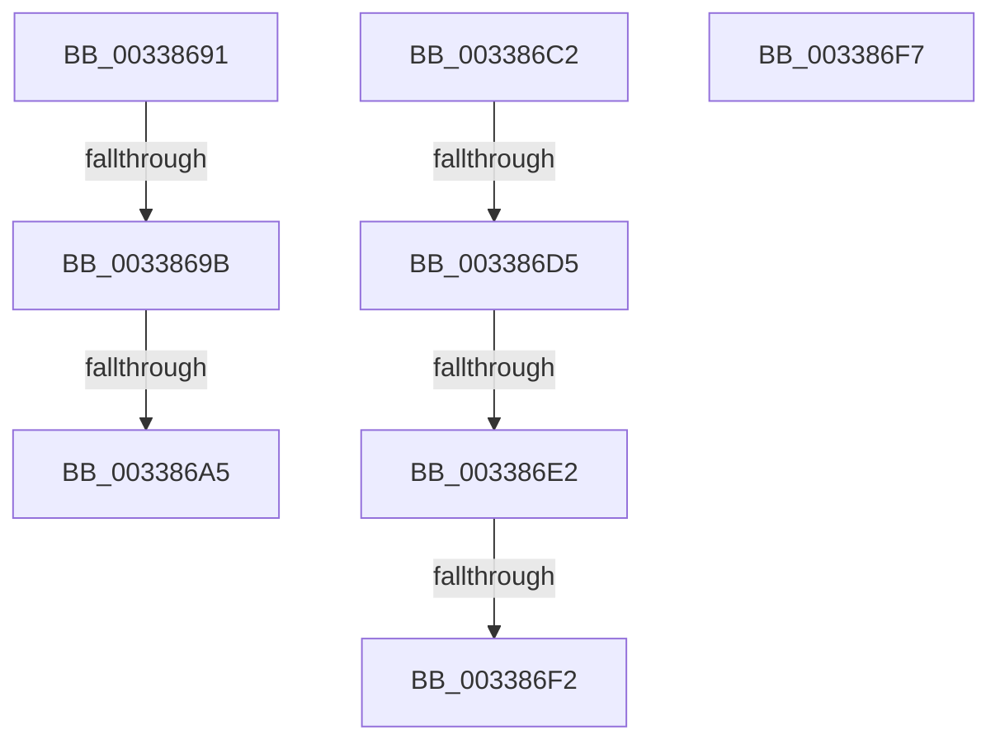

# sub_00338691

- RVA: `0x00338691`–`0x00338707` (길이 `118` bytes)
- VA: `0x0000000140338691`
- 실행 섹션: `.text`
- PDB 이름 있음: `아니요`; PDB Function 태그: `아니요`
- unwind 정보 RVA: `0x00076AC0`
- 디코드: `25`개 명령, `118/118` bytes 표시
- 미해석 바이트: `0` (있으면 어셈블리에 `.byte`로 보존)

> 이 문서는 커널 이미지의 기계어와 PDB 기호를 분석해 생성했습니다. 4번과 5번은 함수 원형과 자료형을 바이너리 사용 방식에서 추정한 C 해석이며 원본 소스 복구 결과는 아닙니다.

## 1. Dependencies

- 직접 호출 지점: **1**; 고유 호출 대상: **1**
- 직접 호출자로 확인된 함수: **0**
- RIP 상대 이미지 참조: **1**

### Outgoing calls
- `0x003386B8` → [MiLogKernelStackEvent](../4D/MiLogKernelStackEvent_function_004D6848.md) (function, `0x004D6848`)

### Direct callers
- 이 함수 시작 RVA로 연결되는 직접 call은 확인되지 않았습니다. 간접 호출은 완전히 역산할 수 없습니다.

### Static image references
- `0x003386E2` → RVA `0x00FC5000` (`ALMOSTRO`; read)

## 2. Other-region calls and transfers

- 다른 실행 섹션으로 향하는 call: **0**
- call이 아닌 외부 분기/꼬리 이동: **8**
  - `0x00338695` → [sub_00337DD2 + 0x1E7](Unknown_function_00337DD2.md) (`tail-transfer`)
  - `0x0033869F` → [sub_00337DD2 + 0x1E7](Unknown_function_00337DD2.md) (`tail-transfer`)
  - `0x003386BD` → [sub_00337DD2 + 0x1E7](Unknown_function_00337DD2.md) (`tail-transfer`)
  - `0x003386CF` → [sub_0033827F + 0x3CF](Unknown_function_0033827F.md) (`tail-transfer`)
  - `0x003386DC` → [sub_0033827F + 0x3CF](Unknown_function_0033827F.md) (`tail-transfer`)
  - `0x003386EC` → [sub_0033827F + 0x3CF](Unknown_function_0033827F.md) (`tail-transfer`)
  - `0x003386F2` → [sub_0033827F + 0x38C](Unknown_function_0033827F.md) (`tail-transfer`)
  - `0x00338702` → [sub_0033827F + 0xAA](Unknown_function_0033827F.md) (`tail-transfer`)

## 3. Assembly (complete function range)

```asm
00338691  40 F6 C5 08                     test bpl, 8
00338695  0F 84 1E F9 FF FF               je 0x140337fb9
0033869B  83 7F 04 05                     cmp dword ptr [rdi + 4], 5
0033869F  0F 85 14 F9 FF FF               jne 0x140337fb9
003386A5  41 C1 E1 0C                     shl r9d, 0xc
003386A9  49 8B CE                        mov rcx, r14
003386AC  41 8B C1                        mov eax, r9d
003386AF  45 8B C2                        mov r8d, r10d
003386B2  48 2B C8                        sub rcx, rax
003386B5  49 8B D5                        mov rdx, r13
003386B8  E8 8B E1 19 00                  call 0x1404d6848
003386BD  E9 F7 F8 FF FF                  jmp 0x140337fb9
003386C2  48 B8 00 00 00 00 00 80 FF FF   movabs rax, 0xffff800000000000
003386CC  48 3B D0                        cmp rdx, rax
003386CF  0F 82 79 FF FF FF               jb 0x14033864e
003386D5  49 8D 04 11                     lea rax, [r9 + rdx]
003386D9  48 3B C2                        cmp rax, rdx
003386DC  0F 82 6C FF FF FF               jb 0x14033864e
003386E2  0F B7 05 17 C9 C8 00            movzx eax, word ptr [rip + 0xc8c917]
003386E9  44 3B D8                        cmp r11d, eax
003386EC  0F 87 5C FF FF FF               ja 0x14033864e
003386F2  E9 14 FF FF FF                  jmp 0x14033860b
003386F7  4C 8B 94 24 08 01 00 00         mov r10, qword ptr [rsp + 0x108]
003386FF  49 8B CC                        mov rcx, r12
00338702  E9 22 FC FF FF                  jmp 0x140338329
```

## 4. C-style interpretation (structured pseudocode)

```c
__int64 __fastcall sub_00338691(__int64 a1, __int64 a2, __int64 a3, int a4)
{
    __int64 result;
    unsigned __int64 v_stack_p108;

    a4 = (unsigned int)((a4) << (12));
    a1 = (v_r14) - ((unsigned int)(a4));
    result = MiLogKernelStackEvent(a1, v_r13, (unsigned int)((unsigned int)(v_r10)), a4);
}
```

## 5. (Beta) C Style

```c
int64_t sub_00338691(int64_t Arg1, int64_t Arg2, int64_t Arg3, int32_t Arg4)
{
    int64_t result;
    uint64_t v_stack_p108;

    Arg4 = (uint32_t)((Arg4) << (12));
    Arg1 = (local_r14) - ((uint32_t)(Arg4));
    result = MiLogKernelStackEvent(Arg1, local_r13, (uint32_t)((uint32_t)(local_r10)), Arg4);
}
```

## 6. Execution-region graph

[열기: 2D/3D 그래프와 함수 탐색 컨트롤 패널](../../../control-panel.html?section=text&rva=0x00338691&view=graph)

- 2D 그래프는 위에서 아래로 흐르고, 3D 그래프는 빈 공간을 드래그해 회전합니다. Shift+드래그는 이동, 휠은 확대·축소, 함수 노드 선택은 대상 보고서 이동입니다.

### Static fallback


