# sub_00339916

- RVA: `0x00339916`–`0x00339CFE` (길이 `1,000` bytes)
- VA: `0x0000000140339916`
- 실행 섹션: `.text`
- PDB 이름 있음: `아니요`; PDB Function 태그: `아니요`
- unwind 정보 RVA: `0x00076B70`
- 디코드: `210`개 명령, `1,000/1,000` bytes 표시
- 미해석 바이트: `0` (있으면 어셈블리에 `.byte`로 보존)

> 이 문서는 커널 이미지의 기계어와 PDB 기호를 분석해 생성했습니다. 4번과 5번은 함수 원형과 자료형을 바이너리 사용 방식에서 추정한 C 해석이며 원본 소스 복구 결과는 아닙니다.

## 1. Dependencies

- 직접 호출 지점: **1**; 고유 호출 대상: **1**
- 직접 호출자로 확인된 함수: **0**
- RIP 상대 이미지 참조: **9**

### Outgoing calls
- `0x00339A71` → [MiFindSuitableLookasideReplacement](MiFindSuitableLookasideReplacement_function_0033A0C0.md) (function, `0x0033A0C0`)

### Direct callers
- 이 함수 시작 RVA로 연결되는 직접 call은 확인되지 않았습니다. 간접 호출은 완전히 역산할 수 없습니다.

### Static image references
- `0x00339955` → RVA `0x00E2DC28` (`.data`; read)
- `0x00339A90` → RVA `0x00E35C00` (`.data`; read)
- `0x00339B13` → RVA `0x00E3CBE6` (`.data`; read)
- `0x00339B35` → RVA `0x00E3D240` (`.data`; read)
- `0x00339B54` → RVA `0x00E30088` (`.data`; read)
- `0x00339B70` → RVA `0x00E2DBC0` (`.data`; read)
- `0x00339B77` → RVA `0x00E2DBC4` (`.data`; read)
- `0x00339B90` → RVA `0x00E2DC20` (`.data`; read)
- `0x00339BD8` → RVA `0x00E2DBC0` (`.data`; write)

## 2. Other-region calls and transfers

- 다른 실행 섹션으로 향하는 call: **0**
- call이 아닌 외부 분기/꼬리 이동: **15**
  - `0x00339944` → [sub_00339D47 + 0x60](Unknown_function_00339D47.md) (`tail-transfer`)
  - `0x00339961` → [sub_00339DE2 + 0x34](Unknown_function_00339DE2.md) (`tail-transfer`)
  - `0x00339994` → [sub_00339F68 + 0x6F](Unknown_function_00339F68.md) (`tail-transfer`)
  - `0x00339A00` → [sub_00339F68](Unknown_function_00339F68.md) (`tail-transfer`)
  - `0x00339B0D` → [sub_00339F68 + 0xAC](Unknown_function_00339F68.md) (`tail-transfer`)
  - `0x00339B1A` → [sub_0033A09C](Unknown_function_0033A09C.md) (`tail-transfer`)
  - `0x00339B46` → [sub_00339F68 + 0xA3](Unknown_function_00339F68.md) (`tail-transfer`)
  - `0x00339BAA` → [sub_00339CFE](Unknown_function_00339CFE.md) (`tail-transfer`)
  - `0x00339BC6` → [sub_00339DE2 + 0xD5](Unknown_function_00339DE2.md) (`tail-transfer`)
  - `0x00339BD2` → [sub_00339D47 + 0x76](Unknown_function_00339D47.md) (`tail-transfer`)
  - `0x00339BFB` → [sub_00339D47 + 0x4A](Unknown_function_00339D47.md) (`tail-transfer`)
  - `0x00339C18` → [sub_00339DE2](Unknown_function_00339DE2.md) (`tail-transfer`)
  - `0x00339C4F` → [sub_00339F68 + 0x33](Unknown_function_00339F68.md) (`tail-transfer`)
  - `0x00339C9A` → [sub_00339D47](Unknown_function_00339D47.md) (`tail-transfer`)
  - `0x00339CF9` → [MiReplaceStandbyLookaside + 0x93](MiReplaceStandbyLookaside_function_003397D0.md) (`tail-transfer`)

## 3. Assembly (complete function range)

```asm
00339916  48 89 9C 24 C8 00 00 00         mov qword ptr [rsp + 0xc8], rbx
0033991E  4C 89 B4 24 C0 00 00 00         mov qword ptr [rsp + 0xc0], r14
00339926  49 BE AB AA AA AA AA AA AA AA   movabs r14, 0xaaaaaaaaaaaaaaab
00339930  89 84 24 00 01 00 00            mov dword ptr [rsp + 0x100], eax
00339937  49 B8 30 00 00 00 00 DE FF FF   movabs r8, 0xffffde0000000030
00339941  F6 C1 08                        test cl, 8
00339944  0F 85 5D 04 00 00               jne 0x140339da7
0033994A  0F B6 9C 24 03 01 00 00         movzx ebx, byte ptr [rsp + 0x103]
00339952  83 E3 07                        and ebx, 7
00339955  48 83 3D CB 42 AF 00 00         cmp qword ptr [rip + 0xaf42cb], 0
0033995D  89 5C 24 6C                     mov dword ptr [rsp + 0x6c], ebx
00339961  0F 85 AF 04 00 00               jne 0x140339e16
00339967  45 32 DB                        xor r11b, r11b
0033996A  8B 44 24 68                     mov eax, dword ptr [rsp + 0x68]
0033996E  4C 69 C0 80 DF 00 00            imul r8, rax, 0xdf80
00339975  48 8B 44 24 50                  mov rax, qword ptr [rsp + 0x50]
0033997A  44 88 9C 24 00 01 00 00         mov byte ptr [rsp + 0x100], r11b
00339982  44 88 5C 24 70                  mov byte ptr [rsp + 0x70], r11b
00339987  44 89 6C 24 74                  mov dword ptr [rsp + 0x74], r13d
0033998C  4C 03 40 10                     add r8, qword ptr [rax + 0x10]
00339990  41 83 FD 09                     cmp r13d, 9
00339994  0F 8C 3D 06 00 00               jl 0x140339fd7
0033999A  41 0F B6 C3                     movzx eax, r11b
0033999E  44 8B D3                        mov r10d, ebx
003399A1  48 8D 0C C5 3B 00 00 00         lea rcx, [rax*8 + 0x3b]
003399A9  49 03 CA                        add rcx, r10
003399AC  48 6B C1 58                     imul rax, rcx, 0x58
003399B0  49 03 C0                        add rax, r8
003399B3  48 89 44 24 60                  mov qword ptr [rsp + 0x60], rax
003399B8  41 8B 41 20                     mov eax, dword ptr [r9 + 0x20]
003399BC  33 F6                           xor esi, esi
003399BE  41 8B 41 20                     mov eax, dword ptr [r9 + 0x20]
003399C2  8B 44 24 68                     mov eax, dword ptr [rsp + 0x68]
003399C6  48 8B 4C 24 50                  mov rcx, qword ptr [rsp + 0x50]
003399CB  4C 69 C0 80 DF 00 00            imul r8, rax, 0xdf80
003399D2  48 8D 51 10                     lea rdx, [rcx + 0x10]
003399D6  4C 89 54 24 38                  mov qword ptr [rsp + 0x38], r10
003399DB  4C 89 44 24 40                  mov qword ptr [rsp + 0x40], r8
003399E0  48 89 94 24 B0 00 00 00         mov qword ptr [rsp + 0xb0], rdx
003399E8  85 F6                           test esi, esi
003399EA  0F 84 E3 02 00 00               je 0x140339cd3
003399F0  83 FE 01                        cmp esi, 1
003399F3  0F 84 C4 02 00 00               je 0x140339cbd
003399F9  48 8B 12                        mov rdx, qword ptr [rdx]
003399FC  41 83 FD 09                     cmp r13d, 9
00339A00  0F 8C 62 05 00 00               jl 0x140339f68
00339A06  41 0F B6 C3                     movzx eax, r11b
00339A0A  4C 8D 34 C5 0D 00 00 00         lea r14, [rax*8 + 0xd]
00339A12  4D 03 F2                        add r14, r10
00339A15  49 C1 E6 09                     shl r14, 9
00339A19  4D 03 F0                        add r14, r8
00339A1C  4C 03 F2                        add r14, rdx
00339A1F  33 DB                           xor ebx, ebx
00339A21  49 8B CE                        mov rcx, r14
00339A24  48 8B 01                        mov rax, qword ptr [rcx]
00339A27  48 3B C7                        cmp rax, rdi
00339A2A  74 2C                           je 0x140339a58
00339A2C  FF C3                           inc ebx
00339A2E  48 83 C1 08                     add rcx, 8
00339A32  8B C3                           mov eax, ebx
00339A34  83 FB 40                        cmp ebx, 0x40
00339A37  72 EB                           jb 0x140339a24
00339A39  83 F8 40                        cmp eax, 0x40
00339A3C  75 1A                           jne 0x140339a58
00339A3E  FF C6                           inc esi
00339A40  83 FE 03                        cmp esi, 3
00339A43  0F 8D A0 02 00 00               jge 0x140339ce9
00339A49  48 8B 4C 24 50                  mov rcx, qword ptr [rsp + 0x50]
00339A4E  48 8B 94 24 B0 00 00 00         mov rdx, qword ptr [rsp + 0xb0]
00339A56  EB 90                           jmp 0x1403399e8
00339A58  49 83 FF FF                     cmp r15, -1
00339A5C  75 20                           jne 0x140339a7e
00339A5E  8B 84 24 18 01 00 00            mov eax, dword ptr [rsp + 0x118]
00339A65  44 8B C3                        mov r8d, ebx
00339A68  49 8B D6                        mov rdx, r14
00339A6B  89 44 24 20                     mov dword ptr [rsp + 0x20], eax
00339A6F  8B CE                           mov ecx, esi
00339A71  E8 4A 06 00 00                  call 0x14033a0c0
00339A76  85 C0                           test eax, eax
00339A78  0F 85 22 02 00 00               jne 0x140339ca0
00339A7E  4D 8B 04 DE                     mov r8, qword ptr [r14 + rbx*8]
00339A82  4D 89 3C DE                     mov qword ptr [r14 + rbx*8], r15
00339A86  49 83 F8 FF                     cmp r8, -1
00339A8A  0F 84 06 02 00 00               je 0x140339c96
00339A90  48 8B 15 69 C1 AF 00            mov rdx, qword ptr [rip + 0xafc169]
00339A97  4C 3B C2                        cmp r8, rdx
00339A9A  72 10                           jb 0x140339aac
00339A9C  48 8D 82 00 08 00 00            lea rax, [rdx + 0x800]
00339AA3  4C 3B C0                        cmp r8, rax
00339AA6  0F 82 EA 01 00 00               jb 0x140339c96
00339AAC  0F 57 C0                        xorps xmm0, xmm0
00339AAF  4F 8D 3C 40                     lea r15, [r8 + r8*2]
00339AB3  0F 57 C9                        xorps xmm1, xmm1
00339AB6  49 C1 E7 04                     shl r15, 4
00339ABA  F3 0F 7F 84 24 90 00 00 00      movdqu xmmword ptr [rsp + 0x90], xmm0
00339AC3  F3 0F 7F 8C 24 A0 00 00 00      movdqu xmmword ptr [rsp + 0xa0], xmm1
00339ACC  49 8B C4                        mov rax, r12
00339ACF  49 8B 0C 07                     mov rcx, qword ptr [r15 + rax]
00339AD3  49 C7 C5 F7 FF FF FF            mov r13, 0xfffffffffffffff7
00339ADA  48 0F BA E1 0A                  bt rcx, 0xa
00339ADF  49 BA 00 00 00 00 00 DE FF FF   movabs r10, 0xffffde0000000000
00339AE9  48 C7 C0 FF FF FF F7            mov rax, 0xfffffffff7ffffff
00339AF0  4C 0F 43 E8                     cmovae r13, rax
00339AF4  4C 23 E9                        and r13, rcx
00339AF7  49 8B C2                        mov rax, r10
00339AFA  4D 8D 34 07                     lea r14, [r15 + rax]
00339AFE  4C 3B C2                        cmp r8, rdx
00339B01  72 10                           jb 0x140339b13
00339B03  48 8D 82 00 08 00 00            lea rax, [rdx + 0x800]
00339B0A  4C 3B C0                        cmp r8, rax
00339B0D  0F 82 01 05 00 00               jb 0x14033a014
00339B13  80 3D CC 30 B0 00 00            cmp byte ptr [rip + 0xb030cc], 0
00339B1A  0F 84 7C 05 00 00               je 0x14033a09c
00339B20  48 B8 AB AA AA AA AA AA AA AA   movabs rax, 0xaaaaaaaaaaaaaaab
00339B2A  49 8B CF                        mov rcx, r15
00339B2D  48 C1 F9 04                     sar rcx, 4
00339B31  48 0F AF C8                     imul rcx, rax
00339B35  48 8B 05 04 37 B0 00            mov rax, qword ptr [rip + 0xb03704]
00339B3C  48 C1 E9 09                     shr rcx, 9
00339B40  0F B6 14 48                     movzx edx, byte ptr [rax + rcx*2]
00339B44  85 D2                           test edx, edx
00339B46  0F 85 BF 04 00 00               jne 0x14033a00b
00339B4C  44 8D 62 09                     lea r12d, [rdx + 9]
00339B50  49 8B 46 28                     mov rax, qword ptr [r14 + 0x28]
00339B54  48 8B 0D 2D 65 AF 00            mov rcx, qword ptr [rip + 0xaf652d]
00339B5B  48 C1 E8 2B                     shr rax, 0x2b
00339B5F  25 FF 03 00 00                  and eax, 0x3ff
00339B64  4C 89 B4 24 88 00 00 00         mov qword ptr [rsp + 0x88], r14
00339B6C  48 8B 14 C1                     mov rdx, qword ptr [rcx + rax*8]
00339B70  48 63 05 49 40 AF 00            movsxd rax, dword ptr [rip + 0xaf4049]
00339B77  8B 0D 47 40 AF 00               mov ecx, dword ptr [rip + 0xaf4047]
00339B7D  48 89 94 24 80 00 00 00         mov qword ptr [rsp + 0x80], rdx
00339B85  3B C1                           cmp eax, ecx
00339B87  77 1D                           ja 0x140339ba6
00339B89  4C 8B C8                        mov r9, rax
00339B8C  49 C1 E1 04                     shl r9, 4
00339B90  4C 03 0D 89 40 AF 00            add r9, qword ptr [rip + 0xaf4089]
00339B97  4D 3B 01                        cmp r8, qword ptr [r9]
00339B9A  72 0A                           jb 0x140339ba6
00339B9C  3B C1                           cmp eax, ecx
00339B9E  74 3E                           je 0x140339bde
00339BA0  4D 3B 41 10                     cmp r8, qword ptr [r9 + 0x10]
00339BA4  72 38                           jb 0x140339bde
00339BA6  33 C0                           xor eax, eax
00339BA8  3B C8                           cmp ecx, eax
00339BAA  0F 8C 4E 01 00 00               jl 0x140339cfe
00339BB0  8D 14 08                        lea edx, [rax + rcx]
00339BB3  D1 FA                           sar edx, 1
00339BB5  4C 63 CA                        movsxd r9, edx
00339BB8  49 C1 E1 04                     shl r9, 4
00339BBC  4C 03 0D 5D 40 AF 00            add r9, qword ptr [rip + 0xaf405d]
00339BC3  4D 3B 01                        cmp r8, qword ptr [r9]
00339BC6  0F 82 EB 02 00 00               jb 0x140339eb7
00339BCC  3B 15 F2 3F AF 00               cmp edx, dword ptr [rip + 0xaf3ff2]
00339BD2  0F 85 E5 01 00 00               jne 0x140339dbd
00339BD8  89 15 E2 3F AF 00               mov dword ptr [rip + 0xaf3fe2], edx
00339BDE  41 8B 41 08                     mov eax, dword ptr [r9 + 8]
00339BE2  89 84 24 98 00 00 00            mov dword ptr [rsp + 0x98], eax
00339BE9  41 8B 46 20                     mov eax, dword ptr [r14 + 0x20]
00339BED  41 8B 4E 20                     mov ecx, dword ptr [r14 + 0x20]
00339BF1  C1 E9 18                        shr ecx, 0x18
00339BF4  89 44 24 48                     mov dword ptr [rsp + 0x48], eax
00339BF8  F6 C1 08                        test cl, 8
00339BFB  0F 85 90 01 00 00               jne 0x140339d91
00339C01  0F B6 5C 24 4B                  movzx ebx, byte ptr [rsp + 0x4b]
00339C06  83 E3 07                        and ebx, 7
00339C09  48 83 3D 17 40 AF 00 00         cmp qword ptr [rip + 0xaf4017], 0
00339C11  89 9C 24 9C 00 00 00            mov dword ptr [rsp + 0x9c], ebx
00339C18  0F 85 C4 01 00 00               jne 0x140339de2
00339C1E  45 32 C0                        xor r8b, r8b
00339C21  8B 84 24 98 00 00 00            mov eax, dword ptr [rsp + 0x98]
00339C28  4C 69 C8 80 DF 00 00            imul r9, rax, 0xdf80
00339C2F  48 8B 84 24 80 00 00 00         mov rax, qword ptr [rsp + 0x80]
00339C37  44 88 84 24 A0 00 00 00         mov byte ptr [rsp + 0xa0], r8b
00339C3F  44 89 A4 24 A4 00 00 00         mov dword ptr [rsp + 0xa4], r12d
00339C47  4C 03 48 10                     add r9, qword ptr [rax + 0x10]
00339C4B  41 83 FC 09                     cmp r12d, 9
00339C4F  0F 8C 46 03 00 00               jl 0x140339f9b
00339C55  8B C3                           mov eax, ebx
00339C57  41 0F B6 C8                     movzx ecx, r8b
00339C5B  48 8D 0C CD 3B 00 00 00         lea rcx, [rcx*8 + 0x3b]
00339C63  48 03 C8                        add rcx, rax
00339C66  48 6B C1 58                     imul rax, rcx, 0x58
00339C6A  49 03 C1                        add rax, r9
00339C6D  48 89 84 24 90 00 00 00         mov qword ptr [rsp + 0x90], rax
00339C75  49 BC 10 00 00 00 00 DE FF FF   movabs r12, 0xffffde0000000010
00339C7F  49 8B C4                        mov rax, r12
00339C82  4D 89 2C 07                     mov qword ptr [r15 + rax], r13
00339C86  4C 8B BC 24 08 01 00 00         mov r15, qword ptr [rsp + 0x108]
00339C8E  44 8B AC 24 10 01 00 00         mov r13d, dword ptr [rsp + 0x110]
00339C96  49 83 FF FF                     cmp r15, -1
00339C9A  0F 85 A7 00 00 00               jne 0x140339d47
00339CA0  4C 8B 44 24 40                  mov r8, qword ptr [rsp + 0x40]
00339CA5  44 0F B6 9C 24 00 01 00 00      movzx r11d, byte ptr [rsp + 0x100]
00339CAE  4C 8B 54 24 38                  mov r10, qword ptr [rsp + 0x38]
00339CB3  4C 8B 4C 24 30                  mov r9, qword ptr [rsp + 0x30]
00339CB8  E9 81 FD FF FF                  jmp 0x140339a3e
00339CBD  4D 8B F2                        mov r14, r10
00339CC0  49 C1 E6 09                     shl r14, 9
00339CC4  49 81 C6 40 2E 00 00            add r14, 0x2e40
00339CCB  4C 03 F1                        add r14, rcx
00339CCE  E9 4C FD FF FF                  jmp 0x140339a1f
00339CD3  4D 8B F2                        mov r14, r10
00339CD6  49 C1 E6 09                     shl r14, 9
00339CDA  49 81 C6 40 1E 00 00            add r14, 0x1e40
00339CE1  4C 03 F1                        add r14, rcx
00339CE4  E9 36 FD FF FF                  jmp 0x140339a1f
00339CE9  48 8B 9C 24 C8 00 00 00         mov rbx, qword ptr [rsp + 0xc8]
00339CF1  4C 8B B4 24 C0 00 00 00         mov r14, qword ptr [rsp + 0xc0]
00339CF9  E9 65 FB FF FF                  jmp 0x140339863
```

## 4. C-style interpretation (structured pseudocode)

```c
__int64 __fastcall sub_00339916(unsigned __int8 a1, __int64 a2, __int64 a3, __int64 a4, __int64 a5, __int64 a6, __int64 a7, __int64 a8, __int64 a9, __int64 a10, __int64 a11, __int64 a12, unsigned int a13, __int64 a14, __int64 a15, __int64 a16, __int64 a17, __int64 a18, unsigned int a19, __int64 a20, __int64 a21, __int64 a22, __int64 a23, __int64 a24, __int64 a25, __int64 a26, __int64 a27, __int64 a28, __int64 a29, __int64 a30, __int64 a31, unsigned __int8 a32, __int64 a33, unsigned int a34, unsigned int a35)
{
    __int64 result;
    __int64 v_r11;
    __int64 v_r13;
    __int64 v_r14;
    __int64 v_r15;
    __int64 v_rbx;
    __int64 v_rsi;
    unsigned int v_stack_p100;
    unsigned __int8 v_stack_p103;
    unsigned int v_stack_p20;
    unsigned __int64 v_stack_p38;
    unsigned __int64 v_stack_p40;
    unsigned int v_stack_p48;
    unsigned __int8 v_stack_p4B;
    unsigned __int64 v_stack_p60;
    unsigned int v_stack_p6C;
    unsigned __int8 v_stack_p70;
    unsigned int v_stack_p74;
    unsigned __int64 v_stack_p80;
    unsigned __int64 v_stack_p88;
    unsigned __int64 v_stack_p90;
    unsigned int v_stack_p98;
    unsigned int v_stack_p9C;
    unsigned __int64 v_stack_pA0;
    unsigned int v_stack_pA4;
    unsigned __int64 v_stack_pB0;
    unsigned __int64 v_stack_pC0;
    unsigned __int64 v_stack_pC8;

    v_stack_pC8 = v_rbx;
    v_stack_pC0 = v_r14;
    v_stack_p100 = (unsigned int)(result);
    v_rbx = (unsigned int)((v_stack_p103) & (7));
    v_stack_p6C = (unsigned int)(v_rbx);
    v_r11 = 0;
    a3 = (a3) * ((unsigned int)(a13));
    v_stack_p100 = 0;
    v_stack_p70 = 0;
    v_stack_p74 = (unsigned int)(v_r13);
    a3 = (a3) + (*(unsigned __int64 *)(a10 + 16));
    a1 = (0 * 8 + 59) + ((unsigned int)((unsigned int)(v_rbx)));
    result = (0) * (a1);
    result = (result) + (a3);
    v_stack_p60 = result;
    v_rsi = 0;
    a3 = (a3) * ((unsigned int)(a13));
    v_stack_p38 = (unsigned int)((unsigned int)(v_rbx));
    v_stack_p40 = a3;
    v_stack_pB0 = a10 + 16;
loc_003399E8:
    if (0 == 0) goto loc_00339CD3;
    if (0 == 1) goto loc_00339CBD;
    v_r14 = (0 * 8 + 13) + ((unsigned int)((unsigned int)(v_rbx)));
    v_r14 = (v_r14) << (9);
    v_r14 = (v_r14) + (a3);
    v_r14 = (v_r14) + (*(unsigned __int64 *)(a10 + 16));
loc_00339A1F:
    v_rbx = 0;
loc_00339A24:
    if ((*(unsigned __int64 *)(v_r14)) == v_rdi) goto loc_00339A58;
    v_rbx = (unsigned int)((v_rbx) + 1);
    a1 = (v_r14) + (8);
    if (((unsigned int)(v_rbx)) < 64) goto loc_00339A24;
    if (((unsigned int)((unsigned int)((unsigned int)(v_rbx)))) != 64) goto loc_00339A58;
loc_00339A3E:
    v_rsi = (unsigned int)((v_rsi) + 1);
    if (((unsigned int)(v_rsi)) >= 3) goto loc_00339CE9;
    goto loc_003399E8;
loc_00339A58:
    if (v_r15 != -1) goto loc_00339A7E;
    v_stack_p20 = (unsigned int)((unsigned int)(a35));
    result = MiFindSuitableLookasideReplacement((unsigned int)((unsigned int)(v_rsi)), v_r14, (unsigned int)((unsigned int)(v_rbx)), a4);
    if ((unsigned int)(result) != 0) goto loc_00339CA0;
loc_00339A7E:
    *(unsigned __int64 *)(v_r14 + v_rbx * 8) = v_r15;
    if ((*(unsigned __int64 *)(v_r14 + v_rbx * 8)) == -1) goto loc_00339C96;
    if ((*(unsigned __int64 *)(v_r14 + v_rbx * 8)) < (*(unsigned __int64 *)(v_rip + 11518313))) goto loc_00339AAC;
    if ((*(unsigned __int64 *)(v_r14 + v_rbx * 8)) < (*(unsigned __int64 *)(v_rip + 11518313) + 2048)) goto loc_00339C96;
loc_00339AAC:
    v_r15 = (*(unsigned __int64 *)(v_r14 + v_rbx * 8) + *(unsigned __int64 *)(v_r14 + v_rbx * 8) * 2) << (4);
    v_stack_p90 = v_xmm0;
    v_stack_pA0 = v_xmm1;
    v_r13 = -9;
    if (condition_is_above_or_equal) { v_r13 = 0xFFFFFFFFF7FFFFFFULL; }
    v_r13 = (v_r13) & (*(unsigned __int64 *)(v_r15 + v_r12 * 1));
    if ((*(unsigned __int64 *)(v_r14 + v_rbx * 8)) < (*(unsigned __int64 *)(v_rip + 11518313))) goto loc_00339B13;
loc_00339B13:
    a1 = (v_r15) >> (4);
    a1 = (a1) * (*(unsigned __int64 *)(v_rip + 11518313) + 2048);
    a1 = (a1) >> (9);
    result = (*(unsigned __int64 *)(v_r15 + (unsigned int)((unsigned int)(v_rbx)) * 1 + 40)) >> (43);
    result = (unsigned int)((result) & (0x3FFULL));
    v_stack_p88 = v_r15 + (unsigned int)((unsigned int)(v_rbx)) * 1;
    v_stack_p80 = *(unsigned __int64 *)(*(unsigned __int64 *)(v_rip + 11494701) + result * 8);
    if (((unsigned int)((int)(*(unsigned int *)(v_rip + 11485257)))) > ((unsigned int)((unsigned int)(*(unsigned int *)(v_rip + 11485255))))) goto loc_00339BA6;
    a4 = ((int)(*(unsigned int *)(v_rip + 11485257))) << (4);
    a4 = (a4) + (*(unsigned __int64 *)(v_rip + 11485321));
    if ((*(unsigned __int64 *)(v_r14 + v_rbx * 8)) < (*(unsigned __int64 *)(a4))) goto loc_00339BA6;
    if (((unsigned int)((int)(*(unsigned int *)(v_rip + 11485257)))) == ((unsigned int)((unsigned int)(*(unsigned int *)(v_rip + 11485255))))) goto loc_00339BDE;
    if ((*(unsigned __int64 *)(v_r14 + v_rbx * 8)) < (*(unsigned __int64 *)(a4 + 16))) goto loc_00339BDE;
loc_00339BA6:
    result = 0;
    a2 = (unsigned int)((result + (unsigned int)(*(unsigned int *)(v_rip + 11485255)) * 1) >> (1));
    a4 = ((int)((unsigned int)(a2))) << (4);
    a4 = (a4) + (*(unsigned __int64 *)(v_rip + 11485277));
    *(unsigned int *)(v_rip + 11485154) = (unsigned int)(a2);
loc_00339BDE:
    v_stack_p98 = (unsigned int)((unsigned int)(*(unsigned int *)(a4 + 8)));
    a1 = (unsigned int)(((unsigned int)(*(unsigned int *)(v_r15 + (unsigned int)((unsigned int)(v_rbx)) * 1 + 32))) >> (24));
    v_stack_p48 = (unsigned int)((unsigned int)(*(unsigned int *)(v_r15 + (unsigned int)((unsigned int)(v_rbx)) * 1 + 32)));
    v_rbx = (unsigned int)((v_stack_p4B) & (7));
    v_stack_p9C = (unsigned int)(v_rbx);
    a3 = 0;
    a4 = (a4) * ((unsigned int)(a19));
    v_stack_pA0 = 0;
    v_stack_pA4 = (unsigned int)(*(unsigned __int8 *)(*(unsigned __int64 *)(v_rip + 11548420) + a1 * 2) + 9);
    a4 = (a4) + (*(unsigned __int64 *)(a16 + 16));
    a1 = (0 * 8 + 59) + ((unsigned int)((unsigned int)(v_rbx)));
    result = ((unsigned int)((unsigned int)(v_rbx))) * (a1);
    result = (result) + (a4);
    v_stack_p90 = result;
    *(unsigned __int64 *)(v_r15 + *(unsigned __int8 *)(*(unsigned __int64 *)(v_rip + 11548420) + a1 * 2) + 9 * 1) = v_r13;
loc_00339C96:
loc_00339CA0:
    goto loc_00339A3E;
loc_00339CBD:
    v_r14 = (a7) << (9);
    v_r14 = (v_r14) + (0x2E40ULL);
    v_r14 = (v_r14) + (a1);
    goto loc_00339A1F;
loc_00339CD3:
    v_r14 = (a7) << (9);
    v_r14 = (v_r14) + (0x1E40ULL);
    v_r14 = (v_r14) + (a1);
    goto loc_00339A1F;
loc_00339CE9:
}
```

## 5. (Beta) C Style

```c
int64_t sub_00339916(uint8_t Arg1, int64_t Arg2, int64_t Arg3, void *Arg4, uint64_t Arg5, int64_t Arg6, int64_t Arg7, int64_t Arg8, uint64_t Arg9, void *Arg10, uint64_t Arg11, uint64_t Arg12, uint32_t Arg13, uint64_t Arg14, uint64_t Arg15, void *Arg16, uint64_t Arg17, uint64_t Arg18, uint32_t Arg19, uint64_t Arg20, uint64_t Arg21, int64_t Arg22, uint64_t Arg23, int64_t Arg24, int64_t Arg25, uint64_t Arg26, uint64_t Arg27, uint64_t Arg28, uint64_t Arg29, uint64_t Arg30, uint64_t Arg31, uint8_t Arg32, int64_t Arg33, uint32_t Arg34, uint32_t Arg35)
{
    uint8_t *arg4 = (uint8_t *)Arg4;
    uint8_t *arg10 = (uint8_t *)Arg10;
    uint8_t *arg16 = (uint8_t *)Arg16;

    int64_t result;
    int64_t local_r11;
    int64_t local_r13;
    int64_t local_r14;
    int64_t local_r15;
    int64_t local_rbx;
    int64_t local_rsi;
    uint32_t v_stack_p100;
    uint8_t v_stack_p103;
    uint32_t v_stack_p20;
    uint64_t v_stack_p38;
    uint64_t v_stack_p40;
    uint32_t v_stack_p48;
    uint8_t v_stack_p4B;
    uint64_t v_stack_p60;
    uint32_t v_stack_p6C;
    uint8_t v_stack_p70;
    uint32_t v_stack_p74;
    uint64_t v_stack_p80;
    uint64_t v_stack_p88;
    uint64_t v_stack_p90;
    uint32_t v_stack_p98;
    uint32_t v_stack_p9C;
    uint64_t v_stack_pA0;
    uint32_t v_stack_pA4;
    uint64_t v_stack_pB0;
    uint64_t v_stack_pC0;
    uint64_t v_stack_pC8;

    v_stack_pC8 = local_rbx;
    v_stack_pC0 = local_r14;
    v_stack_p100 = (uint32_t)(result);
    local_rbx = (uint32_t)((v_stack_p103) & (7));
    v_stack_p6C = (uint32_t)(local_rbx);
    local_r11 = 0;
    Arg3 = (Arg3) * ((uint32_t)(Arg13));
    v_stack_p100 = 0;
    v_stack_p70 = 0;
    v_stack_p74 = (uint32_t)(local_r13);
    Arg3 = (Arg3) + (*(uint64_t *)(arg10 + 0x10));
    Arg1 = (0 * 8 + 59) + ((uint32_t)((uint32_t)(local_rbx)));
    result = (0) * (Arg1);
    result = (result) + (Arg3);
    v_stack_p60 = result;
    local_rsi = 0;
    Arg3 = (Arg3) * ((uint32_t)(Arg13));
    v_stack_p38 = (uint32_t)((uint32_t)(local_rbx));
    v_stack_p40 = Arg3;
    v_stack_pB0 = Arg10 + 16;
loc_003399E8:
    if (0 == 0) goto loc_00339CD3;
    if (0 == 1) goto loc_00339CBD;
    local_r14 = (0 * 8 + 13) + ((uint32_t)((uint32_t)(local_rbx)));
    local_r14 = (local_r14) << (9);
    local_r14 = (local_r14) + (Arg3);
    local_r14 = (local_r14) + (*(uint64_t *)(arg10 + 0x10));
loc_00339A1F:
    local_rbx = 0;
loc_00339A24:
    if ((*(uint64_t *)(local_r14)) == local_rdi) goto loc_00339A58;
    local_rbx = (uint32_t)((local_rbx) + 1);
    Arg1 = (local_r14) + (8);
    if (((uint32_t)(local_rbx)) < 64) goto loc_00339A24;
    if (((uint32_t)((uint32_t)((uint32_t)(local_rbx)))) != 64) goto loc_00339A58;
loc_00339A3E:
    local_rsi = (uint32_t)((local_rsi) + 1);
    if (((uint32_t)(local_rsi)) >= 3) goto loc_00339CE9;
    goto loc_003399E8;
loc_00339A58:
    if (local_r15 != -1) goto loc_00339A7E;
    v_stack_p20 = (uint32_t)((uint32_t)(Arg35));
    result = MiFindSuitableLookasideReplacement((uint32_t)((uint32_t)(local_rsi)), local_r14, (uint32_t)((uint32_t)(local_rbx)), Arg4);
    if ((uint32_t)(result) != 0) goto loc_00339CA0;
loc_00339A7E:
    *(uint64_t *)(local_r14 + local_rbx * 8) = local_r15;
    if ((*(uint64_t *)(local_r14 + local_rbx * 8)) == -1) goto loc_00339C96;
    if ((*(uint64_t *)(local_r14 + local_rbx * 8)) < (*(uint64_t *)(v_rip + 0xAFC169))) goto loc_00339AAC;
    if ((*(uint64_t *)(local_r14 + local_rbx * 8)) < (*(uint64_t *)(v_rip + 0xAFC169) + 2048)) goto loc_00339C96;
loc_00339AAC:
    local_r15 = (*(uint64_t *)(local_r14 + local_rbx * 8) + *(uint64_t *)(local_r14 + local_rbx * 8) * 2) << (4);
    v_stack_p90 = v_xmm0;
    v_stack_pA0 = v_xmm1;
    local_r13 = -9;
    if (condition_is_above_or_equal) { local_r13 = 0xFFFFFFFFF7FFFFFFULL; }
    local_r13 = (local_r13) & (*(uint64_t *)(local_r15 + local_r12 * 1));
    if ((*(uint64_t *)(local_r14 + local_rbx * 8)) < (*(uint64_t *)(v_rip + 0xAFC169))) goto loc_00339B13;
loc_00339B13:
    Arg1 = (local_r15) >> (4);
    Arg1 = (Arg1) * (*(uint64_t *)(v_rip + 0xAFC169) + 2048);
    Arg1 = (Arg1) >> (9);
    result = (*(uint64_t *)(local_r15 + (uint32_t)((uint32_t)(local_rbx)) * 1 + 0x28)) >> (43);
    result = (uint32_t)((result) & (0x3FFULL));
    v_stack_p88 = local_r15 + (uint32_t)((uint32_t)(local_rbx)) * 1;
    v_stack_p80 = *(uint64_t *)(*(uint64_t *)(v_rip + 0xAF652D) + result * 8);
    if (((uint32_t)((int32_t)(*(uint32_t *)(v_rip + 0xAF4049)))) > ((uint32_t)((uint32_t)(*(uint32_t *)(v_rip + 0xAF4047))))) goto loc_00339BA6;
    Arg4 = ((int32_t)(*(uint32_t *)(v_rip + 0xAF4049))) << (4);
    Arg4 = (Arg4) + (*(uint64_t *)(v_rip + 0xAF4089));
    if ((*(uint64_t *)(local_r14 + local_rbx * 8)) < (*(uint64_t *)(arg4))) goto loc_00339BA6;
    if (((uint32_t)((int32_t)(*(uint32_t *)(v_rip + 0xAF4049)))) == ((uint32_t)((uint32_t)(*(uint32_t *)(v_rip + 0xAF4047))))) goto loc_00339BDE;
    if ((*(uint64_t *)(local_r14 + local_rbx * 8)) < (*(uint64_t *)(arg4 + 0x10))) goto loc_00339BDE;
loc_00339BA6:
    result = 0;
    Arg2 = (uint32_t)((result + (uint32_t)(*(uint32_t *)(v_rip + 0xAF4047)) * 1) >> (1));
    Arg4 = ((int32_t)((uint32_t)(Arg2))) << (4);
    Arg4 = (Arg4) + (*(uint64_t *)(v_rip + 0xAF405D));
    *(uint32_t *)(v_rip + 0xAF3FE2) = (uint32_t)(Arg2);
loc_00339BDE:
    v_stack_p98 = (uint32_t)((uint32_t)(*(uint32_t *)(arg4 + 0x8)));
    Arg1 = (uint32_t)(((uint32_t)(*(uint32_t *)(local_r15 + (uint32_t)((uint32_t)(local_rbx)) * 1 + 0x20))) >> (24));
    v_stack_p48 = (uint32_t)((uint32_t)(*(uint32_t *)(local_r15 + (uint32_t)((uint32_t)(local_rbx)) * 1 + 0x20)));
    local_rbx = (uint32_t)((v_stack_p4B) & (7));
    v_stack_p9C = (uint32_t)(local_rbx);
    Arg3 = 0;
    Arg4 = (Arg4) * ((uint32_t)(Arg19));
    v_stack_pA0 = 0;
    v_stack_pA4 = (uint32_t)(*(uint8_t *)(*(uint64_t *)(v_rip + 0xB03704) + Arg1 * 2) + 9);
    Arg4 = (Arg4) + (*(uint64_t *)(arg16 + 0x10));
    Arg1 = (0 * 8 + 59) + ((uint32_t)((uint32_t)(local_rbx)));
    result = ((uint32_t)((uint32_t)(local_rbx))) * (Arg1);
    result = (result) + (Arg4);
    v_stack_p90 = result;
    *(uint64_t *)(local_r15 + *(uint8_t *)(*(uint64_t *)(v_rip + 0xB03704) + Arg1 * 2) + 0x9 * 1) = local_r13;
loc_00339C96:
loc_00339CA0:
    goto loc_00339A3E;
loc_00339CBD:
    local_r14 = (Arg7) << (9);
    local_r14 = (local_r14) + (0x2E40ULL);
    local_r14 = (local_r14) + (Arg1);
    goto loc_00339A1F;
loc_00339CD3:
    local_r14 = (Arg7) << (9);
    local_r14 = (local_r14) + (0x1E40ULL);
    local_r14 = (local_r14) + (Arg1);
    goto loc_00339A1F;
loc_00339CE9:
}
```

### 관측된 메모리 오프셋

구조체 형식이 확인되지 않은 접근은 인자 기준의 오프셋으로만 기록했습니다.

| 기준 인자 | 오프셋 표현 | 폭 (bit) | 접근 |
|---|---:|---:|---|
| `Arg4` | `+ 0x20` | `32` | `R` |
| `Arg10` | `+ 0x10` | `64` | `R` |
| `Arg16` | `+ 0x10` | `64` | `R` |

## 6. Execution-region graph

[열기: 2D/3D 그래프와 함수 탐색 컨트롤 패널](../../../control-panel.html?section=text&rva=0x00339916&view=graph)

- 2D 그래프는 위에서 아래로 흐르고, 3D 그래프는 빈 공간을 드래그해 회전합니다. Shift+드래그는 이동, 휠은 확대·축소, 함수 노드 선택은 대상 보고서 이동입니다.

### Static fallback

```mermaid
flowchart TD
  bb_00339916[BB_00339916]
  bb_0033994A[BB_0033994A]
  bb_00339967[BB_00339967]
  bb_0033999A[BB_0033999A]
  bb_003399E8[BB_003399E8]
  bb_003399F0[BB_003399F0]
  bb_003399F9[BB_003399F9]
  bb_00339A06[BB_00339A06]
  bb_00339A1F[BB_00339A1F]
  bb_00339A24[BB_00339A24]
  bb_00339A2C[BB_00339A2C]
  bb_00339A39[BB_00339A39]
  bb_00339A3E[BB_00339A3E]
  bb_00339A49[BB_00339A49]
  bb_00339A58[BB_00339A58]
  bb_00339A5E[BB_00339A5E]
  bb_00339A7E[BB_00339A7E]
  bb_00339A90[BB_00339A90]
  bb_00339A9C[BB_00339A9C]
  bb_00339AAC[BB_00339AAC]
  bb_00339B03[BB_00339B03]
  bb_00339B13[BB_00339B13]
  bb_00339B20[BB_00339B20]
  bb_00339B4C[BB_00339B4C]
  bb_00339B89[BB_00339B89]
  bb_00339B9C[BB_00339B9C]
  bb_00339BA0[BB_00339BA0]
  bb_00339BA6[BB_00339BA6]
  bb_00339BB0[BB_00339BB0]
  bb_00339BCC[BB_00339BCC]
  bb_00339BD8[BB_00339BD8]
  bb_00339BDE[BB_00339BDE]
  bb_00339C01[BB_00339C01]
  bb_00339C1E[BB_00339C1E]
  bb_00339C55[BB_00339C55]
  bb_00339C96[BB_00339C96]
  bb_00339CA0[BB_00339CA0]
  bb_00339CBD[BB_00339CBD]
  bb_00339CD3[BB_00339CD3]
  bb_00339CE9[BB_00339CE9]
  bb_00339916 -->|fallthrough| bb_0033994A
  bb_0033994A -->|fallthrough| bb_00339967
  bb_00339967 -->|fallthrough| bb_0033999A
  bb_0033999A -->|flow| bb_003399E8
  bb_003399E8 -->|branch| bb_00339CD3
  bb_003399E8 -->|fallthrough| bb_003399F0
  bb_003399F0 -->|branch| bb_00339CBD
  bb_003399F0 -->|fallthrough| bb_003399F9
  bb_003399F9 -->|fallthrough| bb_00339A06
  bb_00339A06 -->|flow| bb_00339A1F
  bb_00339A1F -->|flow| bb_00339A24
  bb_00339A24 -->|branch| bb_00339A58
  bb_00339A24 -->|fallthrough| bb_00339A2C
  bb_00339A2C -->|branch| bb_00339A24
  bb_00339A2C -->|fallthrough| bb_00339A39
  bb_00339A39 -->|branch| bb_00339A58
  bb_00339A39 -->|fallthrough| bb_00339A3E
  bb_00339A3E -->|branch| bb_00339CE9
  bb_00339A3E -->|fallthrough| bb_00339A49
  bb_00339A49 -->|branch| bb_003399E8
  bb_00339A58 -->|branch| bb_00339A7E
  bb_00339A58 -->|fallthrough| bb_00339A5E
  bb_00339A5E -->|branch| bb_00339CA0
  bb_00339A5E -->|fallthrough| bb_00339A7E
  bb_00339A7E -->|branch| bb_00339C96
  bb_00339A7E -->|fallthrough| bb_00339A90
  bb_00339A90 -->|branch| bb_00339AAC
  bb_00339A90 -->|fallthrough| bb_00339A9C
  bb_00339A9C -->|branch| bb_00339C96
  bb_00339A9C -->|fallthrough| bb_00339AAC
  bb_00339AAC -->|branch| bb_00339B13
  bb_00339AAC -->|fallthrough| bb_00339B03
  bb_00339B03 -->|fallthrough| bb_00339B13
  bb_00339B13 -->|fallthrough| bb_00339B20
  bb_00339B20 -->|fallthrough| bb_00339B4C
  bb_00339B4C -->|branch| bb_00339BA6
  bb_00339B4C -->|fallthrough| bb_00339B89
  bb_00339B89 -->|branch| bb_00339BA6
  bb_00339B89 -->|fallthrough| bb_00339B9C
  bb_00339B9C -->|branch| bb_00339BDE
  bb_00339B9C -->|fallthrough| bb_00339BA0
  bb_00339BA0 -->|branch| bb_00339BDE
  bb_00339BA0 -->|fallthrough| bb_00339BA6
  bb_00339BA6 -->|fallthrough| bb_00339BB0
  bb_00339BB0 -->|fallthrough| bb_00339BCC
  bb_00339BCC -->|fallthrough| bb_00339BD8
  bb_00339BD8 -->|flow| bb_00339BDE
  bb_00339BDE -->|fallthrough| bb_00339C01
  bb_00339C01 -->|fallthrough| bb_00339C1E
  bb_00339C1E -->|fallthrough| bb_00339C55
  bb_00339C55 -->|flow| bb_00339C96
  bb_00339C96 -->|fallthrough| bb_00339CA0
  bb_00339CA0 -->|branch| bb_00339A3E
  bb_00339CBD -->|branch| bb_00339A1F
  bb_00339CD3 -->|branch| bb_00339A1F
```


