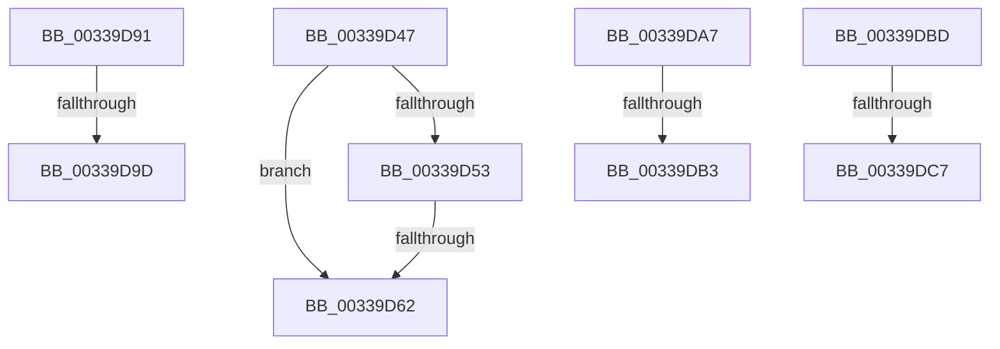

# sub_00339D47

- RVA: `0x00339D47`–`0x00339DCF` (길이 `136` bytes)
- VA: `0x0000000140339D47`
- 실행 섹션: `.text`
- PDB 이름 있음: `아니요`; PDB Function 태그: `아니요`
- unwind 정보 RVA: `0x00076BB0`
- 디코드: `32`개 명령, `136/136` bytes 표시
- 미해석 바이트: `0` (있으면 어셈블리에 `.byte`로 보존)

> 이 문서는 커널 이미지의 기계어와 PDB 기호를 분석해 생성했습니다. 4번과 5번은 함수 원형과 자료형을 바이너리 사용 방식에서 추정한 C 해석이며 원본 소스 복구 결과는 아닙니다.

## 1. Dependencies

- 직접 호출 지점: **0**; 고유 호출 대상: **0**
- 직접 호출자로 확인된 함수: **0**
- RIP 상대 이미지 참조: **1**

### Outgoing calls
- 직접 디코드된 call 명령이 없습니다.

### Direct callers
- 이 함수 시작 RVA로 연결되는 직접 call은 확인되지 않았습니다. 간접 호출은 완전히 역산할 수 없습니다.

### Static image references
- `0x00339D47` → RVA `0x00E35C00` (`.data`; read)

## 2. Other-region calls and transfers

- 다른 실행 섹션으로 향하는 call: **0**
- call이 아닌 외부 분기/꼬리 이동: **8**
  - `0x00339D5C` → [sub_00339916 + 0x38A](Unknown_function_00339916.md) (`tail-transfer`)
  - `0x00339D8C` → [sub_00339916 + 0x38A](Unknown_function_00339916.md) (`tail-transfer`)
  - `0x00339D97` → [sub_00339DE2 + 0x53](Unknown_function_00339DE2.md) (`tail-transfer`)
  - `0x00339DA2` → [sub_00339916 + 0x2F3](Unknown_function_00339916.md) (`tail-transfer`)
  - `0x00339DAD` → [sub_00339DE2 + 0xF6](Unknown_function_00339DE2.md) (`tail-transfer`)
  - `0x00339DB8` → [sub_00339916 + 0x3F](Unknown_function_00339916.md) (`tail-transfer`)
  - `0x00339DC1` → [sub_00339916 + 0x2C2](Unknown_function_00339916.md) (`tail-transfer`)
  - `0x00339DCA` → [sub_00339916 + 0x292](Unknown_function_00339916.md) (`tail-transfer`)

## 3. Assembly (complete function range)

```asm
00339D47  48 8B 05 B2 BE AF 00            mov rax, qword ptr [rip + 0xafbeb2]
00339D4E  4C 3B F8                        cmp r15, rax
00339D51  72 0F                           jb 0x140339d62
00339D53  48 05 00 08 00 00               add rax, 0x800
00339D59  4C 3B F8                        cmp r15, rax
00339D5C  0F 82 3E FF FF FF               jb 0x140339ca0
00339D62  4F 8D 04 7F                     lea r8, [r15 + r15*2]
00339D66  4D 03 C0                        add r8, r8
00339D69  49 8B C4                        mov rax, r12
00339D6C  4A 8B 14 C0                     mov rdx, qword ptr [rax + r8*8]
00339D70  B9 08 00 00 00                  mov ecx, 8
00339D75  48 0F BA E2 0A                  bt rdx, 0xa
00339D7A  B8 00 00 00 08                  mov eax, 0x8000000
00339D7F  0F 43 C8                        cmovae ecx, eax
00339D82  48 0B CA                        or rcx, rdx
00339D85  49 8B C4                        mov rax, r12
00339D88  4A 89 0C C0                     mov qword ptr [rax + r8*8], rcx
00339D8C  E9 0F FF FF FF                  jmp 0x140339ca0
00339D91  49 8B CA                        mov rcx, r10
00339D94  4C 3B F1                        cmp r14, rcx
00339D97  0F 83 98 00 00 00               jae 0x140339e35
00339D9D  BB 05 00 00 00                  mov ebx, 5
00339DA2  E9 62 FE FF FF                  jmp 0x140339c09
00339DA7  48 8B CE                        mov rcx, rsi
00339DAA  4C 3B C9                        cmp r9, rcx
00339DAD  0F 83 25 01 00 00               jae 0x140339ed8
00339DB3  BB 05 00 00 00                  mov ebx, 5
00339DB8  E9 98 FB FF FF                  jmp 0x140339955
00339DBD  4D 3B 41 10                     cmp r8, qword ptr [r9 + 0x10]
00339DC1  0F 82 11 FE FF FF               jb 0x140339bd8
00339DC7  8D 42 01                        lea eax, [rdx + 1]
00339DCA  E9 D9 FD FF FF                  jmp 0x140339ba8
```

## 4. C-style interpretation (structured pseudocode)

```c
__int64 __fastcall sub_00339D47(__int64 a1, __int64 a2, __int64 a3, __int64 a4)
{
    __int64 result;

    if (v_r15 < (*(unsigned __int64 *)(v_rip + 11517618))) goto loc_00339D62;
    result = (*(unsigned __int64 *)(v_rip + 11517618)) + (0x800ULL);
loc_00339D62:
    a3 = (v_r15 + v_r15 * 2) + (v_r15 + v_r15 * 2);
    a1 = 8;
    if (condition_is_above_or_equal) { a1 = (unsigned int)((unsigned int)(0x8000000ULL)); }
    a1 = (a1) | (*(unsigned __int64 *)(v_r12 + a3 * 8));
    *(unsigned __int64 *)(v_r12 + a3 * 8) = a1;
}
```

## 5. (Beta) C Style

```c
int64_t sub_00339D47(int64_t Arg1, int64_t Arg2, int64_t Arg3, int64_t Arg4)
{
    int64_t result;

    if (local_r15 < (*(uint64_t *)(v_rip + 0xAFBEB2))) goto loc_00339D62;
    result = (*(uint64_t *)(v_rip + 0xAFBEB2)) + (0x800ULL);
loc_00339D62:
    Arg3 = (local_r15 + local_r15 * 2) + (local_r15 + local_r15 * 2);
    Arg1 = 8;
    if (condition_is_above_or_equal) { Arg1 = (uint32_t)((uint32_t)(0x8000000ULL)); }
    Arg1 = (Arg1) | (*(uint64_t *)(local_r12 + Arg3 * 8));
    *(uint64_t *)(local_r12 + Arg3 * 8) = Arg1;
}
```

## 6. Execution-region graph

[열기: 2D/3D 그래프와 함수 탐색 컨트롤 패널](../../../control-panel.html?section=text&rva=0x00339D47&view=graph)

- 2D 그래프는 위에서 아래로 흐르고, 3D 그래프는 빈 공간을 드래그해 회전합니다. Shift+드래그는 이동, 휠은 확대·축소, 함수 노드 선택은 대상 보고서 이동입니다.

### Static fallback


