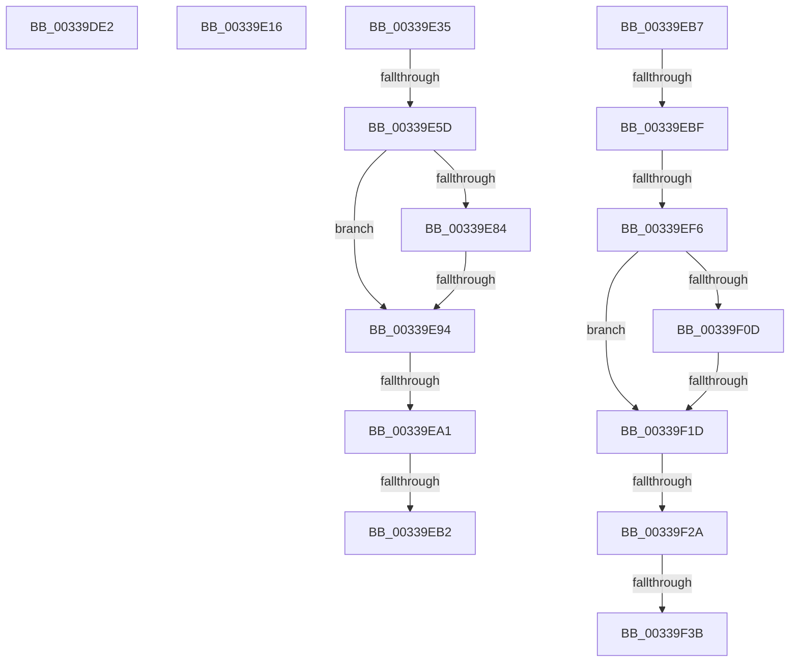

# sub_00339DE2

- RVA: `0x00339DE2`–`0x00339F40` (길이 `350` bytes)
- VA: `0x0000000140339DE2`
- 실행 섹션: `.text`
- PDB 이름 있음: `아니요`; PDB Function 태그: `아니요`
- unwind 정보 RVA: `0x00076BD8`
- 디코드: `78`개 명령, `350/350` bytes 표시
- 미해석 바이트: `0` (있으면 어셈블리에 `.byte`로 보존)

> 이 문서는 커널 이미지의 기계어와 PDB 기호를 분석해 생성했습니다. 4번과 5번은 함수 원형과 자료형을 바이너리 사용 방식에서 추정한 C 해석이며 원본 소스 복구 결과는 아닙니다.

## 1. Dependencies

- 직접 호출 지점: **5**; 고유 호출 대상: **3**
- 직접 호출자로 확인된 함수: **0**
- RIP 상대 이미지 참조: **2**

### Outgoing calls
- `0x00339DFD` → [MiSearchChannelTable](MiSearchChannelTable_function_0033BE24.md) (function, `0x0033BE24`)
- `0x00339E21` → [MiSearchChannelTable](MiSearchChannelTable_function_0033BE24.md) (function, `0x0033BE24`)
- `0x00339EA4` → [MiGetPfnSlabType](../28/MiGetPfnSlabType_function_0028E2D0.md) (function, `0x0028E2D0`)
- `0x00339ED2` → [KeBugCheckEx](../4F/KeBugCheckEx_function_004FD660.md) (function, `0x004FD660`)
- `0x00339F2D` → [MiGetPfnSlabType](../28/MiGetPfnSlabType_function_0028E2D0.md) (function, `0x0028E2D0`)

### Direct callers
- 이 함수 시작 RVA로 연결되는 직접 call은 확인되지 않았습니다. 간접 호출은 완전히 역산할 수 없습니다.

### Static image references
- `0x00339E35` → RVA `0x00E2DCE0` (`.data`; read)
- `0x00339E78` → RVA `0x00E35C00` (`.data`; read)

## 2. Other-region calls and transfers

- 다른 실행 섹션으로 향하는 call: **0**
- call이 아닌 외부 분기/꼬리 이동: **13**
  - `0x00339E11` → [sub_00339916 + 0x30B](Unknown_function_00339916.md) (`tail-transfer`)
  - `0x00339E30` → [sub_00339916 + 0x54](Unknown_function_00339916.md) (`tail-transfer`)
  - `0x00339E57` → [sub_00339D47 + 0x56](Unknown_function_00339D47.md) (`tail-transfer`)
  - `0x00339E8E` → [sub_00339D47 + 0x56](Unknown_function_00339D47.md) (`tail-transfer`)
  - `0x00339E9B` → [sub_00339916 + 0x2EB](Unknown_function_00339916.md) (`tail-transfer`)
  - `0x00339EAC` → [sub_00339916 + 0x2EB](Unknown_function_00339916.md) (`tail-transfer`)
  - `0x00339EB2` → [sub_00339D47 + 0x56](Unknown_function_00339D47.md) (`tail-transfer`)
  - `0x00339EB9` → [sub_0033A09C + 0xB](Unknown_function_0033A09C.md) (`tail-transfer`)
  - `0x00339EF0` → [sub_00339D47 + 0x6C](Unknown_function_00339D47.md) (`tail-transfer`)
  - `0x00339F17` → [sub_00339D47 + 0x6C](Unknown_function_00339D47.md) (`tail-transfer`)
  - `0x00339F24` → [sub_00339916 + 0x34](Unknown_function_00339916.md) (`tail-transfer`)
  - `0x00339F35` → [sub_00339916 + 0x34](Unknown_function_00339916.md) (`tail-transfer`)
  - `0x00339F3B` → [sub_00339D47 + 0x6C](Unknown_function_00339D47.md) (`tail-transfer`)

## 3. Assembly (complete function range)

```asm
00339DE2  49 8B C2                        mov rax, r10
00339DE5  49 8B CE                        mov rcx, r14
00339DE8  48 2B C8                        sub rcx, rax
00339DEB  48 B8 AB AA AA AA AA AA AA AA   movabs rax, 0xaaaaaaaaaaaaaaab
00339DF5  48 C1 F9 04                     sar rcx, 4
00339DF9  48 0F AF C8                     imul rcx, rax
00339DFD  E8 22 20 00 00                  call 0x14033be24
00339E02  49 BA 00 00 00 00 00 DE FF FF   movabs r10, 0xffffde0000000000
00339E0C  44 0F B6 40 0C                  movzx r8d, byte ptr [rax + 0xc]
00339E11  E9 0B FE FF FF                  jmp 0x140339c21
00339E16  49 C1 FA 04                     sar r10, 4
00339E1A  4D 0F AF D6                     imul r10, r14
00339E1E  49 8B CA                        mov rcx, r10
00339E21  E8 FE 1F 00 00                  call 0x14033be24
00339E26  4C 8B 4C 24 30                  mov r9, qword ptr [rsp + 0x30]
00339E2B  44 0F B6 58 0C                  movzx r11d, byte ptr [rax + 0xc]
00339E30  E9 35 FB FF FF                  jmp 0x14033996a
00339E35  48 8B 0D A4 3E AF 00            mov rcx, qword ptr [rip + 0xaf3ea4]
00339E3C  48 8D 14 49                     lea rdx, [rcx + rcx*2]
00339E40  48 B9 30 00 00 00 00 DE FF FF   movabs rcx, 0xffffde0000000030
00339E4A  48 C1 E2 04                     shl rdx, 4
00339E4E  48 8B C9                        mov rcx, rcx
00339E51  48 03 D1                        add rdx, rcx
00339E54  4C 3B F2                        cmp r14, rdx
00339E57  0F 83 40 FF FF FF               jae 0x140339d9d
00339E5D  49 8B CA                        mov rcx, r10
00339E60  49 8B D6                        mov rdx, r14
00339E63  48 2B D1                        sub rdx, rcx
00339E66  48 B9 AB AA AA AA AA AA AA AA   movabs rcx, 0xaaaaaaaaaaaaaaab
00339E70  48 C1 FA 04                     sar rdx, 4
00339E74  48 0F AF D1                     imul rdx, rcx
00339E78  48 8B 0D 81 BD AF 00            mov rcx, qword ptr [rip + 0xafbd81]
00339E7F  48 3B D1                        cmp rdx, rcx
00339E82  72 10                           jb 0x140339e94
00339E84  48 81 C1 00 08 00 00            add rcx, 0x800
00339E8B  48 3B D1                        cmp rdx, rcx
00339E8E  0F 82 09 FF FF FF               jb 0x140339d9d
00339E94  C1 E8 10                        shr eax, 0x10
00339E97  24 07                           and al, 7
00339E99  3C 06                           cmp al, 6
00339E9B  0F 84 60 FD FF FF               je 0x140339c01
00339EA1  49 8B CE                        mov rcx, r14
00339EA4  E8 27 44 F5 FF                  call 0x14028e2d0
00339EA9  83 F8 09                        cmp eax, 9
00339EAC  0F 85 4F FD FF FF               jne 0x140339c01
00339EB2  E9 E6 FE FF FF                  jmp 0x140339d9d
00339EB7  85 D2                           test edx, edx
00339EB9  0F 85 E8 01 00 00               jne 0x14033a0a7
00339EBF  BA 80 51 00 00                  mov edx, 0x5180
00339EC4  48 C7 44 24 20 00 00 00 00      mov qword ptr [rsp + 0x20], 0
00339ECD  B9 1A 00 00 00                  mov ecx, 0x1a
00339ED2  E8 89 37 1C 00                  call 0x1404fd660
00339ED7  CC                              int3
00339ED8  48 8B 0D 01 3E AF 00            mov rcx, qword ptr [rip + 0xaf3e01]
00339EDF  48 8D 14 49                     lea rdx, [rcx + rcx*2]
00339EE3  48 C1 E2 04                     shl rdx, 4
00339EE7  49 8B C8                        mov rcx, r8
00339EEA  48 03 D1                        add rdx, rcx
00339EED  4C 3B CA                        cmp r9, rdx
00339EF0  0F 83 BD FE FF FF               jae 0x140339db3
00339EF6  48 8B 0D 03 BD AF 00            mov rcx, qword ptr [rip + 0xafbd03]
00339EFD  49 8B D2                        mov rdx, r10
00339F00  48 C1 FA 04                     sar rdx, 4
00339F04  49 0F AF D6                     imul rdx, r14
00339F08  48 3B D1                        cmp rdx, rcx
00339F0B  72 10                           jb 0x140339f1d
00339F0D  48 81 C1 00 08 00 00            add rcx, 0x800
00339F14  48 3B D1                        cmp rdx, rcx
00339F17  0F 82 96 FE FF FF               jb 0x140339db3
00339F1D  C1 E8 10                        shr eax, 0x10
00339F20  24 07                           and al, 7
00339F22  3C 06                           cmp al, 6
00339F24  0F 84 20 FA FF FF               je 0x14033994a
00339F2A  49 8B C9                        mov rcx, r9
00339F2D  E8 9E 43 F5 FF                  call 0x14028e2d0
00339F32  83 F8 09                        cmp eax, 9
00339F35  0F 85 0F FA FF FF               jne 0x14033994a
00339F3B  E9 73 FE FF FF                  jmp 0x140339db3
```

## 4. C-style interpretation (structured pseudocode)

```c
__int64 __fastcall sub_00339DE2(void)
{
    __int64 result;
    unsigned __int64 v_stack_p20;
    unsigned __int64 v_stack_p30;

    a1 = (v_r14) - (v_r10);
    a1 = (a1) >> (4);
    a1 = (a1) * (v_r10);
    result = MiSearchChannelTable(a1, a2, a3, a4);
}
```

## 5. (Beta) C Style

```c
void sub_00339DE2(void)
{
    int64_t result;
    uint64_t v_stack_p20;
    uint64_t v_stack_p30;

    a1 = (local_r14) - (local_r10);
    a1 = (a1) >> (4);
    a1 = (a1) * (local_r10);
    result = MiSearchChannelTable(a1, a2, a3, a4);
}
```

## 6. Execution-region graph

[열기: 2D/3D 그래프와 함수 탐색 컨트롤 패널](../../../control-panel.html?section=text&rva=0x00339DE2&view=graph)

- 2D 그래프는 위에서 아래로 흐르고, 3D 그래프는 빈 공간을 드래그해 회전합니다. Shift+드래그는 이동, 휠은 확대·축소, 함수 노드 선택은 대상 보고서 이동입니다.

### Static fallback


