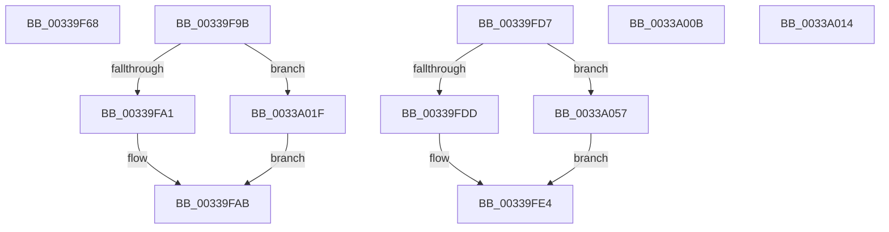

# sub_00339F68

- RVA: `0x00339F68`–`0x0033A084` (길이 `284` bytes)
- VA: `0x0000000140339F68`
- 실행 섹션: `.text`
- PDB 이름 있음: `아니요`; PDB Function 태그: `아니요`
- unwind 정보 RVA: `0x00076C00`
- 디코드: `63`개 명령, `284/284` bytes 표시
- 미해석 바이트: `0` (있으면 어셈블리에 `.byte`로 보존)

> 이 문서는 커널 이미지의 기계어와 PDB 기호를 분석해 생성했습니다. 4번과 5번은 함수 원형과 자료형을 바이너리 사용 방식에서 추정한 C 해석이며 원본 소스 복구 결과는 아닙니다.

## 1. Dependencies

- 직접 호출 지점: **0**; 고유 호출 대상: **0**
- 직접 호출자로 확인된 함수: **0**
- RIP 상대 이미지 참조: **1**

### Outgoing calls
- 직접 디코드된 call 명령이 없습니다.

### Direct callers
- 이 함수 시작 RVA로 연결되는 직접 call은 확인되지 않았습니다. 간접 호출은 완전히 역산할 수 없습니다.

### Static image references
- `0x0033A037` → RVA `0x00E3D240` (`.data`; read)

## 2. Other-region calls and transfers

- 다른 실행 섹션으로 향하는 call: **0**
- call이 아닌 외부 분기/꼬리 이동: **5**
  - `0x00339F96` → [sub_00339916 + 0x109](Unknown_function_00339916.md) (`tail-transfer`)
  - `0x00339FD2` → [sub_00339916 + 0x35F](Unknown_function_00339916.md) (`tail-transfer`)
  - `0x0033A006` → [sub_00339916 + 0xA2](Unknown_function_00339916.md) (`tail-transfer`)
  - `0x0033A00F` → [sub_00339916 + 0x23A](Unknown_function_00339916.md) (`tail-transfer`)
  - `0x0033A01A` → [sub_00339916 + 0x23A](Unknown_function_00339916.md) (`tail-transfer`)

## 3. Assembly (complete function range)

```asm
00339F68  0F B6 44 24 78                  movzx eax, byte ptr [rsp + 0x78]
00339F6D  33 C9                           xor ecx, ecx
00339F6F  41 83 FD 08                     cmp r13d, 8
00339F73  0F 44 C8                        cmove ecx, eax
00339F76  0F B6 C1                        movzx eax, cl
00339F79  4D 8D 34 C2                     lea r14, [r10 + rax*8]
00339F7D  49 63 C5                        movsxd rax, r13d
00339F80  48 69 C8 E8 00 00 00            imul rcx, rax, 0xe8
00339F87  49 C1 E6 09                     shl r14, 9
00339F8B  49 03 C8                        add rcx, r8
00339F8E  4C 03 B4 11 90 3D 00 00         add r14, qword ptr [rcx + rdx + 0x3d90]
00339F96  E9 84 FA FF FF                  jmp 0x140339a1f
00339F9B  41 83 FC 08                     cmp r12d, 8
00339F9F  74 7E                           je 0x14033a01f
00339FA1  C6 84 24 A8 00 00 00 00         mov byte ptr [rsp + 0xa8], 0
00339FA9  32 C9                           xor cl, cl
00339FAB  0F B6 C9                        movzx ecx, cl
00339FAE  8B C3                           mov eax, ebx
00339FB0  48 8D 0C C8                     lea rcx, [rax + rcx*8]
00339FB4  49 63 C4                        movsxd rax, r12d
00339FB7  48 6B D1 58                     imul rdx, rcx, 0x58
00339FBB  48 69 C8 E8 00 00 00            imul rcx, rax, 0xe8
00339FC2  4A 03 94 09 98 3D 00 00         add rdx, qword ptr [rcx + r9 + 0x3d98]
00339FCA  48 89 94 24 90 00 00 00         mov qword ptr [rsp + 0x90], rdx
00339FD2  E9 9E FC FF FF                  jmp 0x140339c75
00339FD7  41 83 FD 08                     cmp r13d, 8
00339FDB  74 7A                           je 0x14033a057
00339FDD  C6 44 24 78 00                  mov byte ptr [rsp + 0x78], 0
00339FE2  32 D2                           xor dl, dl
00339FE4  0F B6 C2                        movzx eax, dl
00339FE7  44 8B D3                        mov r10d, ebx
00339FEA  49 8D 0C C2                     lea rcx, [r10 + rax*8]
00339FEE  48 6B D1 58                     imul rdx, rcx, 0x58
00339FF2  49 69 CD E8 00 00 00            imul rcx, r13, 0xe8
00339FF9  4A 03 94 01 98 3D 00 00         add rdx, qword ptr [rcx + r8 + 0x3d98]
0033A001  48 89 54 24 60                  mov qword ptr [rsp + 0x60], rdx
0033A006  E9 AD F9 FF FF                  jmp 0x1403399b8
0033A00B  44 8D 62 FF                     lea r12d, [rdx - 1]
0033A00F  E9 3C FB FF FF                  jmp 0x140339b50
0033A014  41 BC 09 00 00 00               mov r12d, 9
0033A01A  E9 31 FB FF FF                  jmp 0x140339b50
0033A01F  49 8B C2                        mov rax, r10
0033A022  4C 2B F0                        sub r14, rax
0033A025  48 B8 AB AA AA AA AA AA AA AA   movabs rax, 0xaaaaaaaaaaaaaaab
0033A02F  49 C1 FE 04                     sar r14, 4
0033A033  4C 0F AF F0                     imul r14, rax
0033A037  48 8B 05 02 32 B0 00            mov rax, qword ptr [rip + 0xb03202]
0033A03E  49 C1 EE 09                     shr r14, 9
0033A042  42 0F B6 4C 70 01               movzx ecx, byte ptr [rax + r14*2 + 1]
0033A048  80 E1 7F                        and cl, 0x7f
0033A04B  88 8C 24 A8 00 00 00            mov byte ptr [rsp + 0xa8], cl
0033A052  E9 54 FF FF FF                  jmp 0x140339fab
0033A057  48 8B C6                        mov rax, rsi
0033A05A  49 8B C9                        mov rcx, r9
0033A05D  48 2B C8                        sub rcx, rax
0033A060  48 8B 05 D9 31 B0 00            mov rax, qword ptr [rip + 0xb031d9]
0033A067  48 C1 F9 04                     sar rcx, 4
0033A06B  49 0F AF CE                     imul rcx, r14
0033A06F  48 C1 E9 09                     shr rcx, 9
0033A073  0F B6 54 48 01                  movzx edx, byte ptr [rax + rcx*2 + 1]
0033A078  80 E2 7F                        and dl, 0x7f
0033A07B  88 54 24 78                     mov byte ptr [rsp + 0x78], dl
0033A07F  E9 60 FF FF FF                  jmp 0x140339fe4
```

## 4. C-style interpretation (structured pseudocode)

```c
__int64 __fastcall sub_00339F68(int a1, __int64 a2, __int64 a3, __int64 a4, __int64 a5, __int64 a6, __int64 a7, __int64 a8, __int64 a9, __int64 a10, __int64 a11, __int64 a12, __int64 a13, __int64 a14, unsigned __int8 a15)
{
    __int64 v_r14;
    unsigned __int64 v_stack_p60;
    unsigned __int8 v_stack_p78;
    unsigned __int64 v_stack_p90;
    unsigned __int8 v_stack_pA8;

    a1 = 0;
    if (((unsigned int)(v_r13)) == 8) { a1 = a15; }
    a1 = (a1) * ((int)((unsigned int)(v_r13)));
    v_r14 = (v_r10 + (unsigned __int8)(a1) * 8) << (9);
    a1 = (a1) + (a3);
    v_r14 = (v_r14) + (*(unsigned __int64 *)(a1 + a2 * 1 + 15760));
}
```

## 5. (Beta) C Style

```c
int64_t sub_00339F68(int32_t Arg1, int64_t Arg2, int64_t Arg3, int64_t Arg4, uint64_t Arg5, uint64_t Arg6, uint64_t Arg7, uint64_t Arg8, uint64_t Arg9, uint64_t Arg10, uint64_t Arg11, uint64_t Arg12, uint64_t Arg13, uint64_t Arg14, uint8_t Arg15)
{
    int64_t local_r14;
    uint64_t v_stack_p60;
    uint8_t v_stack_p78;
    uint64_t v_stack_p90;
    uint8_t v_stack_pA8;

    Arg1 = 0;
    if (((uint32_t)(local_r13)) == 8) { Arg1 = Arg15; }
    Arg1 = (Arg1) * ((int32_t)((uint32_t)(local_r13)));
    local_r14 = (local_r10 + (uint8_t)(Arg1) * 8) << (9);
    Arg1 = (Arg1) + (Arg3);
    local_r14 = (local_r14) + (*(uint64_t *)(Arg1 + Arg2 * 1 + 0x3D90));
}
```

## 6. Execution-region graph

[열기: 2D/3D 그래프와 함수 탐색 컨트롤 패널](../../../control-panel.html?section=text&rva=0x00339F68&view=graph)

- 2D 그래프는 위에서 아래로 흐르고, 3D 그래프는 빈 공간을 드래그해 회전합니다. Shift+드래그는 이동, 휠은 확대·축소, 함수 노드 선택은 대상 보고서 이동입니다.

### Static fallback


