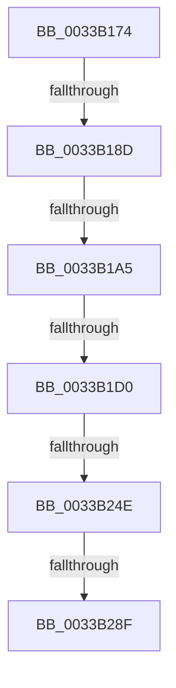

# sub_0033B174

- RVA: `0x0033B174`–`0x0033B2B6` (길이 `322` bytes)
- VA: `0x000000014033B174`
- 실행 섹션: `.text`
- PDB 이름 있음: `아니요`; PDB Function 태그: `아니요`
- unwind 정보 RVA: `0x00076C98`
- 디코드: `73`개 명령, `322/322` bytes 표시
- 미해석 바이트: `0` (있으면 어셈블리에 `.byte`로 보존)

> 이 문서는 커널 이미지의 기계어와 PDB 기호를 분석해 생성했습니다. 4번과 5번은 함수 원형과 자료형을 바이너리 사용 방식에서 추정한 C 해석이며 원본 소스 복구 결과는 아닙니다.

## 1. Dependencies

- 직접 호출 지점: **0**; 고유 호출 대상: **0**
- 직접 호출자로 확인된 함수: **0**
- RIP 상대 이미지 참조: **1**

### Outgoing calls
- 직접 디코드된 call 명령이 없습니다.

### Direct callers
- 이 함수 시작 RVA로 연결되는 직접 call은 확인되지 않았습니다. 간접 호출은 완전히 역산할 수 없습니다.

### Static image references
- `0x0033B193` → RVA `0x00E2DC28` (`.data`; read)

## 2. Other-region calls and transfers

- 다른 실행 섹션으로 향하는 call: **0**
- call이 아닌 외부 분기/꼬리 이동: **6**
  - `0x0033B187` → [sub_0033B390 + 0x1F](Unknown_function_0033B390.md) (`tail-transfer`)
  - `0x0033B19F` → [sub_0033B3D4](Unknown_function_0033B3D4.md) (`tail-transfer`)
  - `0x0033B1CA` → [sub_0033B497](Unknown_function_0033B497.md) (`tail-transfer`)
  - `0x0033B248` → [sub_0033B4EA](Unknown_function_0033B4EA.md) (`tail-transfer`)
  - `0x0033B289` → [sub_0033B390](Unknown_function_0033B390.md) (`tail-transfer`)
  - `0x0033B2B0` → [sub_0033B4CA](Unknown_function_0033B4CA.md) (`tail-transfer`)

## 3. Assembly (complete function range)

```asm
0033B174  48 89 9C 24 80 00 00 00         mov qword ptr [rsp + 0x80], rbx
0033B17C  8B 5E 20                        mov ebx, dword ptr [rsi + 0x20]
0033B17F  8B 46 20                        mov eax, dword ptr [rsi + 0x20]
0033B182  C1 E8 18                        shr eax, 0x18
0033B185  A8 08                           test al, 8
0033B187  0F 85 22 02 00 00               jne 0x14033b3af
0033B18D  C1 EB 18                        shr ebx, 0x18
0033B190  83 E3 07                        and ebx, 7
0033B193  48 83 3D 8D 2A AF 00 00         cmp qword ptr [rip + 0xaf2a8d], 0
0033B19B  89 5C 24 4C                     mov dword ptr [rsp + 0x4c], ebx
0033B19F  0F 85 2F 02 00 00               jne 0x14033b3d4
0033B1A5  45 32 C0                        xor r8b, r8b
0033B1A8  8B 44 24 48                     mov eax, dword ptr [rsp + 0x48]
0033B1AC  4C 69 C8 80 DF 00 00            imul r9, rax, 0xdf80
0033B1B3  48 8B 44 24 30                  mov rax, qword ptr [rsp + 0x30]
0033B1B8  44 88 44 24 50                  mov byte ptr [rsp + 0x50], r8b
0033B1BD  44 89 74 24 54                  mov dword ptr [rsp + 0x54], r14d
0033B1C2  4C 03 48 10                     add r9, qword ptr [rax + 0x10]
0033B1C6  41 83 FE 09                     cmp r14d, 9
0033B1CA  0F 8C C7 02 00 00               jl 0x14033b497
0033B1D0  8B C3                           mov eax, ebx
0033B1D2  41 0F B6 C8                     movzx ecx, r8b
0033B1D6  48 8D 0C CD 3B 00 00 00         lea rcx, [rcx*8 + 0x3b]
0033B1DE  48 03 C8                        add rcx, rax
0033B1E1  48 6B C1 58                     imul rax, rcx, 0x58
0033B1E5  49 03 C1                        add rax, r9
0033B1E8  48 89 44 24 40                  mov qword ptr [rsp + 0x40], rax
0033B1ED  4C 8B 47 28                     mov r8, qword ptr [rdi + 0x28]
0033B1F1  48 B8 00 00 00 00 00 00 80 0F   movabs rax, 0xf80000000000000
0033B1FB  4C 23 C0                        and r8, rax
0033B1FE  48 BB FF FF FF FF 3F 00 00 00   movabs rbx, 0x3fffffffff
0033B208  48 8B 07                        mov rax, qword ptr [rdi]
0033B20B  48 C1 E8 14                     shr rax, 0x14
0033B20F  4C 0B C0                        or r8, rax
0033B212  8B 47 24                        mov eax, dword ptr [rdi + 0x24]
0033B215  48 25 00 00 E0 FF               and rax, 0xffffffffffe00000
0033B21B  49 C1 E8 14                     shr r8, 0x14
0033B21F  48 C1 E0 03                     shl rax, 3
0033B223  4C 0B C0                        or r8, rax
0033B226  48 8B 47 18                     mov rax, qword ptr [rdi + 0x18]
0033B22A  44 8B 4F 24                     mov r9d, dword ptr [rdi + 0x24]
0033B22E  41 81 E1 FF FF 1F 00            and r9d, 0x1fffff
0033B235  48 C1 E8 28                     shr rax, 0x28
0033B239  49 C1 E1 13                     shl r9, 0x13
0033B23D  25 FF FF 07 00                  and eax, 0x7ffff
0033B242  4C 0B C8                        or r9, rax
0033B245  4C 3B C3                        cmp r8, rbx
0033B248  0F 84 9C 02 00 00               je 0x14033b4ea
0033B24E  4F 8D 14 40                     lea r10, [r8 + r8*2]
0033B252  49 C1 E2 04                     shl r10, 4
0033B256  49 8B C7                        mov rax, r15
0033B259  4C 03 D0                        add r10, rax
0033B25C  4D 8B D9                        mov r11, r9
0033B25F  49 C1 E3 28                     shl r11, 0x28
0033B263  48 BF FF FF FF FF FF 00 00 F8   movabs rdi, 0xf80000ffffffffff
0033B26D  49 8B CB                        mov rcx, r11
0033B270  49 8B 52 18                     mov rdx, qword ptr [r10 + 0x18]
0033B274  48 33 CA                        xor rcx, rdx
0033B277  48 8B C2                        mov rax, rdx
0033B27A  48 23 CF                        and rcx, rdi
0033B27D  49 33 CB                        xor rcx, r11
0033B280  F0 49 0F B1 4A 18               lock cmpxchg qword ptr [r10 + 0x18], rcx
0033B286  48 3B D0                        cmp rdx, rax
0033B289  0F 85 01 01 00 00               jne 0x14033b390
0033B28F  41 8B 42 24                     mov eax, dword ptr [r10 + 0x24]
0033B293  49 8B C9                        mov rcx, r9
0033B296  48 C1 E9 13                     shr rcx, 0x13
0033B29A  25 00 00 E0 FF                  and eax, 0xffe00000
0033B29F  0B C8                           or ecx, eax
0033B2A1  41 89 4A 24                     mov dword ptr [r10 + 0x24], ecx
0033B2A5  4C 3B CB                        cmp r9, rbx
0033B2A8  48 8B 9C 24 80 00 00 00         mov rbx, qword ptr [rsp + 0x80]
0033B2B0  0F 84 14 02 00 00               je 0x14033b4ca
```

## 4. C-style interpretation (structured pseudocode)

```c
__int64 __fastcall sub_0033B174(__int64 a1, __int64 a2, unsigned __int8 a3, __int64 a4, __int64 a5, __int64 a6, __int64 a7, __int64 a8, unsigned int a9, __int64 a10, __int64 a11, __int64 a12, __int64 a13, __int64 a14, __int64 a15, __int64 a16)
{
    __int64 result;
    __int64 v_r10;
    __int64 v_r11;
    __int64 v_rbx;
    unsigned __int64 v_stack_p40;
    unsigned int v_stack_p4C;
    unsigned __int8 v_stack_p50;
    unsigned int v_stack_p54;
    unsigned __int64 v_stack_p80;

    v_stack_p80 = v_rbx;
    result = (unsigned int)(((unsigned int)(*(unsigned int *)(v_rsi + 32))) >> (24));
    v_rbx = (unsigned int)(((unsigned int)(*(unsigned int *)(v_rsi + 32))) >> (24));
    v_rbx = (unsigned int)((v_rbx) & (7));
    v_stack_p4C = (unsigned int)(v_rbx);
    a3 = 0;
    a4 = (a4) * ((unsigned int)(a9));
    v_stack_p50 = 0;
    v_stack_p54 = (unsigned int)(v_r14);
    a4 = (a4) + (*(unsigned __int64 *)(a6 + 16));
    a1 = (0 * 8 + 59) + ((unsigned int)((unsigned int)(v_rbx)));
    result = ((unsigned int)((unsigned int)(v_rbx))) * (a1);
    result = (result) + (a4);
    v_stack_p40 = result;
    a3 = (*(unsigned __int64 *)(v_rdi + 40)) & (result);
    result = (*(unsigned __int64 *)(v_rdi)) >> (20);
    a3 = (a3) | (result);
    result = ((unsigned int)(*(unsigned int *)(v_rdi + 36))) & (0xFFFFFFFFFFE00000ULL);
    a3 = (a3) >> (20);
    result = (result) << (3);
    a3 = (a3) | (result);
    a4 = (unsigned int)(((unsigned int)(*(unsigned int *)(v_rdi + 36))) & (0x1FFFFFULL));
    result = (*(unsigned __int64 *)(v_rdi + 24)) >> (40);
    a4 = (a4) << (19);
    result = (unsigned int)((result) & (0x7FFFFULL));
    a4 = (a4) | (result);
    v_r10 = (a3 + a3 * 2) << (4);
    v_r10 = (v_r10) + (v_r15);
    v_r11 = (a4) << (40);
    a1 = (v_r11) ^ (*(unsigned __int64 *)(v_r10 + 24));
    a1 = (a1) & (v_rdi);
    a1 = (a1) ^ (v_r11);
    a1 = (a4) >> (19);
    result = (unsigned int)(((unsigned int)(*(unsigned int *)(v_r10 + 36))) & (0xFFE00000ULL));
    a1 = (unsigned int)((a1) | ((unsigned int)(result)));
    *(unsigned int *)(v_r10 + 36) = (unsigned int)(a1);
}
```

## 5. (Beta) C Style

```c
int64_t sub_0033B174(int64_t Arg1, int64_t Arg2, uint8_t Arg3, int64_t Arg4, uint64_t Arg5, void *Arg6, uint64_t Arg7, uint64_t Arg8, uint32_t Arg9, uint64_t Arg10, uint64_t Arg11, uint64_t Arg12, uint64_t Arg13, uint64_t Arg14, uint64_t Arg15, int64_t Arg16)
{
    uint8_t *arg6 = (uint8_t *)Arg6;

    int64_t result;
    int64_t local_r10;
    int64_t local_r11;
    int64_t local_rbx;
    uint64_t v_stack_p40;
    uint32_t v_stack_p4C;
    uint8_t v_stack_p50;
    uint32_t v_stack_p54;
    uint64_t v_stack_p80;

    v_stack_p80 = local_rbx;
    result = (uint32_t)(((uint32_t)(*(uint32_t *)(local_rsi + 0x20))) >> (24));
    local_rbx = (uint32_t)(((uint32_t)(*(uint32_t *)(local_rsi + 0x20))) >> (24));
    local_rbx = (uint32_t)((local_rbx) & (7));
    v_stack_p4C = (uint32_t)(local_rbx);
    Arg3 = 0;
    Arg4 = (Arg4) * ((uint32_t)(Arg9));
    v_stack_p50 = 0;
    v_stack_p54 = (uint32_t)(local_r14);
    Arg4 = (Arg4) + (*(uint64_t *)(arg6 + 0x10));
    Arg1 = (0 * 8 + 59) + ((uint32_t)((uint32_t)(local_rbx)));
    result = ((uint32_t)((uint32_t)(local_rbx))) * (Arg1);
    result = (result) + (Arg4);
    v_stack_p40 = result;
    Arg3 = (*(uint64_t *)(local_rdi + 0x28)) & (result);
    result = (*(uint64_t *)(local_rdi)) >> (20);
    Arg3 = (Arg3) | (result);
    result = ((uint32_t)(*(uint32_t *)(local_rdi + 0x24))) & (0xFFFFFFFFFFE00000ULL);
    Arg3 = (Arg3) >> (20);
    result = (result) << (3);
    Arg3 = (Arg3) | (result);
    Arg4 = (uint32_t)(((uint32_t)(*(uint32_t *)(local_rdi + 0x24))) & (0x1FFFFFULL));
    result = (*(uint64_t *)(local_rdi + 0x18)) >> (40);
    Arg4 = (Arg4) << (19);
    result = (uint32_t)((result) & (0x7FFFFULL));
    Arg4 = (Arg4) | (result);
    local_r10 = (Arg3 + Arg3 * 2) << (4);
    local_r10 = (local_r10) + (local_r15);
    local_r11 = (Arg4) << (40);
    Arg1 = (local_r11) ^ (*(uint64_t *)(local_r10 + 0x18));
    Arg1 = (Arg1) & (local_rdi);
    Arg1 = (Arg1) ^ (local_r11);
    Arg1 = (Arg4) >> (19);
    result = (uint32_t)(((uint32_t)(*(uint32_t *)(local_r10 + 0x24))) & (0xFFE00000ULL));
    Arg1 = (uint32_t)((Arg1) | ((uint32_t)(result)));
    *(uint32_t *)(local_r10 + 0x24) = (uint32_t)(Arg1);
}
```

### 관측된 메모리 오프셋

구조체 형식이 확인되지 않은 접근은 인자 기준의 오프셋으로만 기록했습니다.

| 기준 인자 | 오프셋 표현 | 폭 (bit) | 접근 |
|---|---:|---:|---|
| `Arg6` | `+ 0x10` | `64` | `R` |

## 6. Execution-region graph

[열기: 2D/3D 그래프와 함수 탐색 컨트롤 패널](../../../control-panel.html?section=text&rva=0x0033B174&view=graph)

- 2D 그래프는 위에서 아래로 흐르고, 3D 그래프는 빈 공간을 드래그해 회전합니다. Shift+드래그는 이동, 휠은 확대·축소, 함수 노드 선택은 대상 보고서 이동입니다.

### Static fallback


