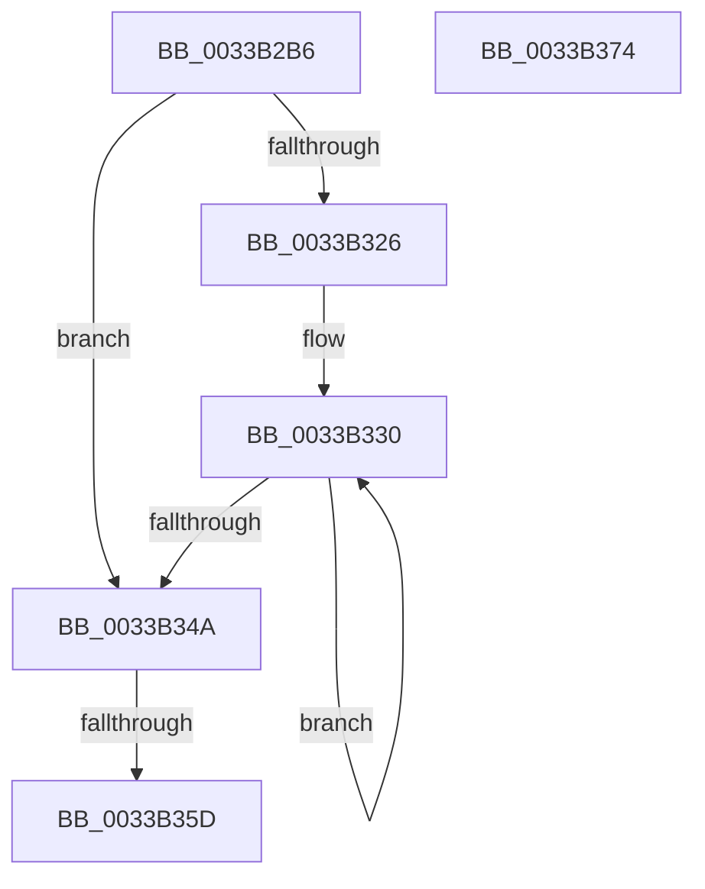

# sub_0033B2B6

- RVA: `0x0033B2B6`–`0x0033B390` (길이 `218` bytes)
- VA: `0x000000014033B2B6`
- 실행 섹션: `.text`
- PDB 이름 있음: `아니요`; PDB Function 태그: `아니요`
- unwind 정보 RVA: `0x00076CAC`
- 디코드: `57`개 명령, `218/218` bytes 표시
- 미해석 바이트: `0` (있으면 어셈블리에 `.byte`로 보존)

> 이 문서는 커널 이미지의 기계어와 PDB 기호를 분석해 생성했습니다. 4번과 5번은 함수 원형과 자료형을 바이너리 사용 방식에서 추정한 C 해석이며 원본 소스 복구 결과는 아닙니다.

## 1. Dependencies

- 직접 호출 지점: **1**; 고유 호출 대상: **1**
- 직접 호출자로 확인된 함수: **0**
- RIP 상대 이미지 참조: **0**

### Outgoing calls
- `0x0033B38A` → [KeBugCheckEx](../4F/KeBugCheckEx_function_004FD660.md) (function, `0x004FD660`)

### Direct callers
- 이 함수 시작 RVA로 연결되는 직접 call은 확인되지 않았습니다. 간접 호출은 완전히 역산할 수 없습니다.

### Static image references
- 디코드된 RIP-relative 메모리 참조가 없습니다.

## 2. Other-region calls and transfers

- 다른 실행 섹션으로 향하는 call: **0**
- call이 아닌 외부 분기/꼬리 이동: **1**
  - `0x0033B357` → [sub_0033B4CA + 0xE](Unknown_function_0033B4CA.md) (`tail-transfer`)

## 3. Assembly (complete function range)

```asm
0033B2B6  4F 8D 0C 49                     lea r9, [r9 + r9*2]
0033B2BA  49 C1 E1 04                     shl r9, 4
0033B2BE  49 8B C7                        mov rax, r15
0033B2C1  4C 03 C8                        add r9, rax
0033B2C4  49 BA FF FF FF FF FF FF 7F F0   movabs r10, 0xf07fffffffffffff
0033B2CE  48 B8 FF FF FF FF FF 00 00 00   movabs rax, 0xffffffffff
0033B2D8  49 8B 09                        mov rcx, qword ptr [r9]
0033B2DB  48 23 C8                        and rcx, rax
0033B2DE  49 8B C0                        mov rax, r8
0033B2E1  48 C1 E0 28                     shl rax, 0x28
0033B2E5  48 0B C8                        or rcx, rax
0033B2E8  41 8B 41 24                     mov eax, dword ptr [r9 + 0x24]
0033B2EC  49 89 09                        mov qword ptr [r9], rcx
0033B2EF  25 FF FF 1F 00                  and eax, 0x1fffff
0033B2F4  49 8B C8                        mov rcx, r8
0033B2F7  49 C1 E0 14                     shl r8, 0x14
0033B2FB  48 C1 E9 18                     shr rcx, 0x18
0033B2FF  C1 E1 15                        shl ecx, 0x15
0033B302  0B C8                           or ecx, eax
0033B304  41 89 49 24                     mov dword ptr [r9 + 0x24], ecx
0033B308  49 8B 51 28                     mov rdx, qword ptr [r9 + 0x28]
0033B30C  48 8B CA                        mov rcx, rdx
0033B30F  48 8B C2                        mov rax, rdx
0033B312  49 33 C8                        xor rcx, r8
0033B315  49 23 CA                        and rcx, r10
0033B318  49 33 C8                        xor rcx, r8
0033B31B  F0 49 0F B1 49 28               lock cmpxchg qword ptr [r9 + 0x28], rcx
0033B321  48 3B D0                        cmp rdx, rax
0033B324  74 24                           je 0x14033b34a
0033B326  66 66 0F 1F 84 00 00 00 00 00   nop word ptr [rax + rax]
0033B330  49 8B C8                        mov rcx, r8
0033B333  48 8B D0                        mov rdx, rax
0033B336  48 33 C8                        xor rcx, rax
0033B339  49 23 CA                        and rcx, r10
0033B33C  49 33 C8                        xor rcx, r8
0033B33F  F0 49 0F B1 49 28               lock cmpxchg qword ptr [r9 + 0x28], rcx
0033B345  48 3B D0                        cmp rdx, rax
0033B348  75 E6                           jne 0x14033b330
0033B34A  48 8B 44 24 40                  mov rax, qword ptr [rsp + 0x40]
0033B34F  F0 48 FF 08                     lock dec qword ptr [rax]
0033B353  41 83 FE 08                     cmp r14d, 8
0033B357  0F 84 7B 01 00 00               je 0x14033b4d8
0033B35D  4C 8D 5C 24 60                  lea r11, [rsp + 0x60]
0033B362  49 8B 73 28                     mov rsi, qword ptr [r11 + 0x28]
0033B366  49 8B 7B 30                     mov rdi, qword ptr [r11 + 0x30]
0033B36A  49 8B E3                        mov rsp, r11
0033B36D  41 5F                           pop r15
0033B36F  41 5E                           pop r14
0033B371  41 5C                           pop r12
0033B373  C3                              ret
0033B374  CC                              int3
0033B375  45 33 C9                        xor r9d, r9d
0033B378  48 C7 44 24 20 00 00 00 00      mov qword ptr [rsp + 0x20], 0
0033B381  BA 80 51 00 00                  mov edx, 0x5180
0033B386  41 8D 49 1A                     lea ecx, [r9 + 0x1a]
0033B38A  E8 D1 22 1C 00                  call 0x1404fd660
0033B38F  CC                              int3
```

## 4. C-style interpretation (structured pseudocode)

```c
__int64 __fastcall sub_0033B2B6(__int64 a1, __int64 a2, __int64 a3, __int64 a4, __int64 a5, __int64 a6, __int64 a7, __int64 a8, __int64 a9, __int64 a10, __int64 a11, __int64 a12)
{
    __int64 result;
    unsigned __int64 v_stack_p38;

    a4 = (a4 + a4 * 2) << (4);
    a4 = (a4) + (v_r15);
    a1 = (*(unsigned __int64 *)(a4)) & (v_r15);
    result = (a3) << (40);
    a1 = (a1) | (result);
    *(unsigned __int64 *)(a4) = a1;
    result = (unsigned int)(((unsigned int)(*(unsigned int *)(a4 + 36))) & (0x1FFFFFULL));
    a3 = (a3) << (20);
    a1 = (a3) >> (24);
    a1 = (unsigned int)((a1) << (21));
    a1 = (unsigned int)((a1) | ((unsigned int)(result)));
    *(unsigned int *)(a4 + 36) = (unsigned int)(a1);
    a1 = (*(unsigned __int64 *)(a4 + 40)) ^ (a3);
    a1 = (a1) & (v_r10);
    a1 = (a1) ^ (a3);
    if ((*(unsigned __int64 *)(a4 + 40)) == (*(unsigned __int64 *)(a4 + 40))) goto loc_0033B34A;
loc_0033B330:
    a1 = (a3) ^ (*(unsigned __int64 *)(a4 + 40));
    a1 = (a1) & (v_r10);
    a1 = (a1) ^ (a3);
    if ((*(unsigned __int64 *)(a4 + 40)) != (*(unsigned __int64 *)(a4 + 40))) goto loc_0033B330;
loc_0033B34A:
    return a8;
}
```

## 5. (Beta) C Style

```c
void *sub_0033B2B6(int64_t Arg1, int64_t Arg2, int64_t Arg3, void *Arg4, uint64_t Arg5, uint64_t Arg6, uint64_t Arg7, void *Arg8, uint64_t Arg9, uint64_t Arg10, uint64_t Arg11, int64_t Arg12)
{
    uint8_t *arg4 = (uint8_t *)Arg4;
    uint8_t *arg8 = (uint8_t *)Arg8;

    int64_t result;
    uint64_t v_stack_p38;

    Arg4 = (Arg4 + Arg4 * 2) << (4);
    Arg4 = (Arg4) + (local_r15);
    Arg1 = (*(uint64_t *)(arg4)) & (local_r15);
    result = (Arg3) << (40);
    Arg1 = (Arg1) | (result);
    *(uint64_t *)(arg4) = Arg1;
    result = (uint32_t)(((uint32_t)(*(uint32_t *)(arg4 + 0x24))) & (0x1FFFFFULL));
    Arg3 = (Arg3) << (20);
    Arg1 = (Arg3) >> (24);
    Arg1 = (uint32_t)((Arg1) << (21));
    Arg1 = (uint32_t)((Arg1) | ((uint32_t)(result)));
    *(uint32_t *)(arg4 + 0x24) = (uint32_t)(Arg1);
    Arg1 = (*(uint64_t *)(arg4 + 0x28)) ^ (Arg3);
    Arg1 = (Arg1) & (local_r10);
    Arg1 = (Arg1) ^ (Arg3);
    if ((*(uint64_t *)(arg4 + 0x28)) == (*(uint64_t *)(arg4 + 0x28))) goto loc_0033B34A;
loc_0033B330:
    Arg1 = (Arg3) ^ (*(uint64_t *)(arg4 + 0x28));
    Arg1 = (Arg1) & (local_r10);
    Arg1 = (Arg1) ^ (Arg3);
    if ((*(uint64_t *)(arg4 + 0x28)) != (*(uint64_t *)(arg4 + 0x28))) goto loc_0033B330;
loc_0033B34A:
    return Arg8;
}
```

### 관측된 메모리 오프셋

구조체 형식이 확인되지 않은 접근은 인자 기준의 오프셋으로만 기록했습니다.

| 기준 인자 | 오프셋 표현 | 폭 (bit) | 접근 |
|---|---:|---:|---|
| `Arg4` | `+ 0x0 + r9*2` | `64` | `R` |
| `Arg8` | `+ 0x0` | `64` | `R/W` |

## 6. Execution-region graph

[열기: 2D/3D 그래프와 함수 탐색 컨트롤 패널](../../../control-panel.html?section=text&rva=0x0033B2B6&view=graph)

- 2D 그래프는 위에서 아래로 흐르고, 3D 그래프는 빈 공간을 드래그해 회전합니다. Shift+드래그는 이동, 휠은 확대·축소, 함수 노드 선택은 대상 보고서 이동입니다.

### Static fallback


