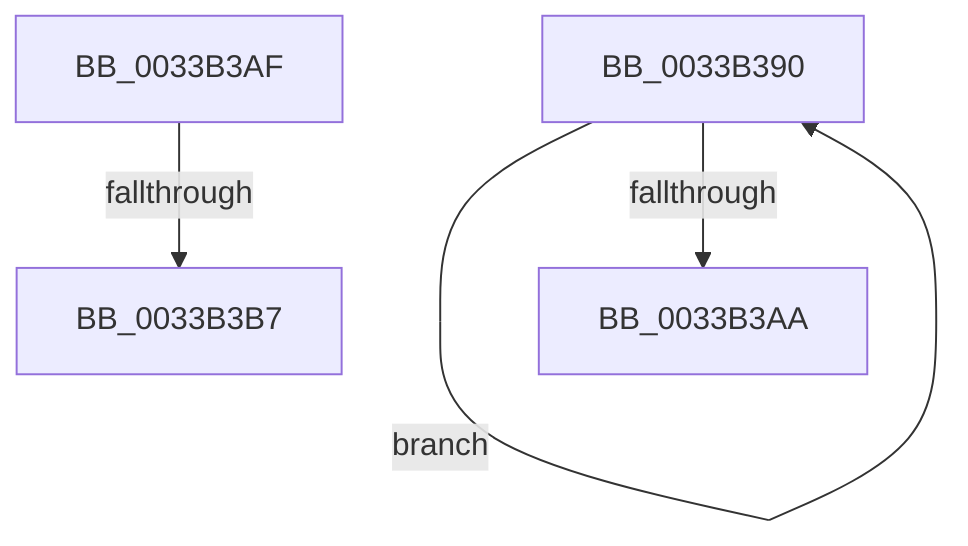

# sub_0033B390

- RVA: `0x0033B390`–`0x0033B3C1` (길이 `49` bytes)
- VA: `0x000000014033B390`
- 실행 섹션: `.text`
- PDB 이름 있음: `아니요`; PDB Function 태그: `아니요`
- unwind 정보 RVA: `0x00076CC0`
- 디코드: `14`개 명령, `49/49` bytes 표시
- 미해석 바이트: `0` (있으면 어셈블리에 `.byte`로 보존)

> 이 문서는 커널 이미지의 기계어와 PDB 기호를 분석해 생성했습니다. 4번과 5번은 함수 원형과 자료형을 바이너리 사용 방식에서 추정한 C 해석이며 원본 소스 복구 결과는 아닙니다.

## 1. Dependencies

- 직접 호출 지점: **0**; 고유 호출 대상: **0**
- 직접 호출자로 확인된 함수: **0**
- RIP 상대 이미지 참조: **0**

### Outgoing calls
- 직접 디코드된 call 명령이 없습니다.

### Direct callers
- 이 함수 시작 RVA로 연결되는 직접 call은 확인되지 않았습니다. 간접 호출은 완전히 역산할 수 없습니다.

### Static image references
- 디코드된 RIP-relative 메모리 참조가 없습니다.

## 2. Other-region calls and transfers

- 다른 실행 섹션으로 향하는 call: **0**
- call이 아닌 외부 분기/꼬리 이동: **3**
  - `0x0033B3AA` → [sub_0033B174 + 0x11B](Unknown_function_0033B174.md) (`tail-transfer`)
  - `0x0033B3B5` → [sub_0033B3D4 + 0x1A](Unknown_function_0033B3D4.md) (`tail-transfer`)
  - `0x0033B3BC` → [sub_0033B174 + 0x1F](Unknown_function_0033B174.md) (`tail-transfer`)

## 3. Assembly (complete function range)

```asm
0033B390  49 8B CB                        mov rcx, r11
0033B393  48 8B D0                        mov rdx, rax
0033B396  48 33 C8                        xor rcx, rax
0033B399  48 23 CF                        and rcx, rdi
0033B39C  49 33 CB                        xor rcx, r11
0033B39F  F0 49 0F B1 4A 18               lock cmpxchg qword ptr [r10 + 0x18], rcx
0033B3A5  48 3B D0                        cmp rdx, rax
0033B3A8  75 E6                           jne 0x14033b390
0033B3AA  E9 E0 FE FF FF                  jmp 0x14033b28f
0033B3AF  49 8B C7                        mov rax, r15
0033B3B2  48 3B F0                        cmp rsi, rax
0033B3B5  73 37                           jae 0x14033b3ee
0033B3B7  BB 05 00 00 00                  mov ebx, 5
0033B3BC  E9 D2 FD FF FF                  jmp 0x14033b193
```

## 4. C-style interpretation (structured pseudocode)

```c
__int64 __fastcall sub_0033B390(void)
{
    a1 = (v_r11) ^ (result);
    a1 = (a1) & (v_rdi);
    a1 = (a1) ^ (v_r11);
    if (result != result) goto loc_0033B390;
}
```

## 5. (Beta) C Style

```c
void sub_0033B390(void)
{
    a1 = (local_r11) ^ (result);
    a1 = (a1) & (local_rdi);
    a1 = (a1) ^ (local_r11);
    if (result != result) goto loc_0033B390;
}
```

## 6. Execution-region graph

[열기: 2D/3D 그래프와 함수 탐색 컨트롤 패널](../../../control-panel.html?section=text&rva=0x0033B390&view=graph)

- 2D 그래프는 위에서 아래로 흐르고, 3D 그래프는 빈 공간을 드래그해 회전합니다. Shift+드래그는 이동, 휠은 확대·축소, 함수 노드 선택은 대상 보고서 이동입니다.

### Static fallback


