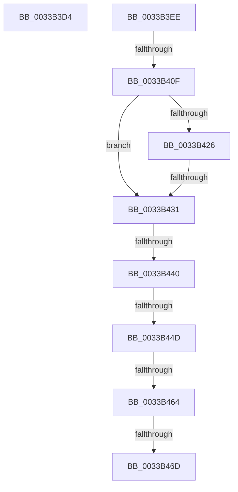

# sub_0033B3D4

- RVA: `0x0033B3D4`–`0x0033B472` (길이 `158` bytes)
- VA: `0x000000014033B3D4`
- 실행 섹션: `.text`
- PDB 이름 있음: `아니요`; PDB Function 태그: `아니요`
- unwind 정보 RVA: `0x00076CE4`
- 디코드: `37`개 명령, `158/158` bytes 표시
- 미해석 바이트: `0` (있으면 어셈블리에 `.byte`로 보존)

> 이 문서는 커널 이미지의 기계어와 PDB 기호를 분석해 생성했습니다. 4번과 5번은 함수 원형과 자료형을 바이너리 사용 방식에서 추정한 C 해석이며 원본 소스 복구 결과는 아닙니다.

## 1. Dependencies

- 직접 호출 지점: **1**; 고유 호출 대상: **1**
- 직접 호출자로 확인된 함수: **0**
- RIP 상대 이미지 참조: **4**

### Outgoing calls
- `0x0033B3DF` → [MiSearchChannelTable](MiSearchChannelTable_function_0033BE24.md) (function, `0x0033BE24`)

### Direct callers
- 이 함수 시작 RVA로 연결되는 직접 call은 확인되지 않았습니다. 간접 호출은 완전히 역산할 수 없습니다.

### Static image references
- `0x0033B3EE` → RVA `0x00E2DCE0` (`.data`; read)
- `0x0033B40F` → RVA `0x00E35C00` (`.data`; read)
- `0x0033B440` → RVA `0x00E3CBE6` (`.data`; read)
- `0x0033B44D` → RVA `0x00E3D240` (`.data`; read)

## 2. Other-region calls and transfers

- 다른 실행 섹션으로 향하는 call: **0**
- call이 아닌 외부 분기/꼬리 이동: **8**
  - `0x0033B3E9` → [sub_0033B174 + 0x34](Unknown_function_0033B174.md) (`tail-transfer`)
  - `0x0033B40D` → [sub_0033B390 + 0x27](Unknown_function_0033B390.md) (`tail-transfer`)
  - `0x0033B42F` → [sub_0033B390 + 0x27](Unknown_function_0033B390.md) (`tail-transfer`)
  - `0x0033B43A` → [sub_0033B174 + 0x19](Unknown_function_0033B174.md) (`tail-transfer`)
  - `0x0033B447` → [sub_0033B390 + 0x27](Unknown_function_0033B390.md) (`tail-transfer`)
  - `0x0033B45E` → [sub_0033B390 + 0x27](Unknown_function_0033B390.md) (`tail-transfer`)
  - `0x0033B467` → [sub_0033B174 + 0x19](Unknown_function_0033B174.md) (`tail-transfer`)
  - `0x0033B46D` → [sub_0033B390 + 0x27](Unknown_function_0033B390.md) (`tail-transfer`)

## 3. Assembly (complete function range)

```asm
0033B3D4  49 C1 FA 04                     sar r10, 4
0033B3D8  4D 0F AF D4                     imul r10, r12
0033B3DC  49 8B CA                        mov rcx, r10
0033B3DF  E8 40 0A 00 00                  call 0x14033be24
0033B3E4  44 0F B6 40 0C                  movzx r8d, byte ptr [rax + 0xc]
0033B3E9  E9 BA FD FF FF                  jmp 0x14033b1a8
0033B3EE  48 8B 05 EB 28 AF 00            mov rax, qword ptr [rip + 0xaf28eb]
0033B3F5  48 8D 0C 40                     lea rcx, [rax + rax*2]
0033B3F9  48 C1 E1 04                     shl rcx, 4
0033B3FD  48 B8 30 00 00 00 00 DE FF FF   movabs rax, 0xffffde0000000030
0033B407  48 03 C8                        add rcx, rax
0033B40A  48 3B F1                        cmp rsi, rcx
0033B40D  73 A8                           jae 0x14033b3b7
0033B40F  48 8B 05 EA A7 AF 00            mov rax, qword ptr [rip + 0xafa7ea]
0033B416  49 8B CA                        mov rcx, r10
0033B419  48 C1 F9 04                     sar rcx, 4
0033B41D  49 0F AF CC                     imul rcx, r12
0033B421  48 3B C8                        cmp rcx, rax
0033B424  72 0B                           jb 0x14033b431
0033B426  48 05 00 08 00 00               add rax, 0x800
0033B42C  48 3B C8                        cmp rcx, rax
0033B42F  72 86                           jb 0x14033b3b7
0033B431  8B C3                           mov eax, ebx
0033B433  C1 E8 10                        shr eax, 0x10
0033B436  24 07                           and al, 7
0033B438  3C 06                           cmp al, 6
0033B43A  0F 84 4D FD FF FF               je 0x14033b18d
0033B440  80 3D 9F 17 B0 00 00            cmp byte ptr [rip + 0xb0179f], 0
0033B447  0F 84 6A FF FF FF               je 0x14033b3b7
0033B44D  48 8B 05 EC 1D B0 00            mov rax, qword ptr [rip + 0xb01dec]
0033B454  48 C1 E9 09                     shr rcx, 9
0033B458  0F B6 14 48                     movzx edx, byte ptr [rax + rcx*2]
0033B45C  85 D2                           test edx, edx
0033B45E  0F 84 53 FF FF FF               je 0x14033b3b7
0033B464  83 FA 0A                        cmp edx, 0xa
0033B467  0F 85 20 FD FF FF               jne 0x14033b18d
0033B46D  E9 45 FF FF FF                  jmp 0x14033b3b7
```

## 4. C-style interpretation (structured pseudocode)

```c
__int64 __fastcall sub_0033B3D4(void)
{
    __int64 result;
    __int64 v_r10;

    v_r10 = (v_r10) >> (4);
    v_r10 = (v_r10) * (v_r12);
    result = MiSearchChannelTable(v_r10, a2, a3, a4);
}
```

## 5. (Beta) C Style

```c
void sub_0033B3D4(void)
{
    int64_t result;
    int64_t local_r10;

    local_r10 = (local_r10) >> (4);
    local_r10 = (local_r10) * (local_r12);
    result = MiSearchChannelTable(local_r10, a2, a3, a4);
}
```

## 6. Execution-region graph

[열기: 2D/3D 그래프와 함수 탐색 컨트롤 패널](../../../control-panel.html?section=text&rva=0x0033B3D4&view=graph)

- 2D 그래프는 위에서 아래로 흐르고, 3D 그래프는 빈 공간을 드래그해 회전합니다. Shift+드래그는 이동, 휠은 확대·축소, 함수 노드 선택은 대상 보고서 이동입니다.

### Static fallback


