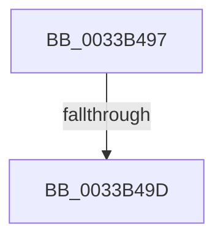

# sub_0033B497

- RVA: `0x0033B497`–`0x0033B4CA` (길이 `51` bytes)
- VA: `0x000000014033B497`
- 실행 섹션: `.text`
- PDB 이름 있음: `아니요`; PDB Function 태그: `아니요`
- unwind 정보 RVA: `0x00076D08`
- 디코드: `12`개 명령, `51/51` bytes 표시
- 미해석 바이트: `0` (있으면 어셈블리에 `.byte`로 보존)

> 이 문서는 커널 이미지의 기계어와 PDB 기호를 분석해 생성했습니다. 4번과 5번은 함수 원형과 자료형을 바이너리 사용 방식에서 추정한 C 해석이며 원본 소스 복구 결과는 아닙니다.

## 1. Dependencies

- 직접 호출 지점: **0**; 고유 호출 대상: **0**
- 직접 호출자로 확인된 함수: **0**
- RIP 상대 이미지 참조: **0**

### Outgoing calls
- 직접 디코드된 call 명령이 없습니다.

### Direct callers
- 이 함수 시작 RVA로 연결되는 직접 call은 확인되지 않았습니다. 간접 호출은 완전히 역산할 수 없습니다.

### Static image references
- 디코드된 RIP-relative 메모리 참조가 없습니다.

## 2. Other-region calls and transfers

- 다른 실행 섹션으로 향하는 call: **0**
- call이 아닌 외부 분기/꼬리 이동: **2**
  - `0x0033B49B` → [sub_0033B4EA + 0xE](Unknown_function_0033B4EA.md) (`tail-transfer`)
  - `0x0033B4C5` → [sub_0033B174 + 0x79](Unknown_function_0033B174.md) (`tail-transfer`)

## 3. Assembly (complete function range)

```asm
0033B497  41 83 FE 08                     cmp r14d, 8
0033B49B  74 5B                           je 0x14033b4f8
0033B49D  C6 44 24 58 00                  mov byte ptr [rsp + 0x58], 0
0033B4A2  32 C9                           xor cl, cl
0033B4A4  0F B6 C9                        movzx ecx, cl
0033B4A7  8B C3                           mov eax, ebx
0033B4A9  48 8D 0C C8                     lea rcx, [rax + rcx*8]
0033B4AD  48 6B D1 58                     imul rdx, rcx, 0x58
0033B4B1  49 69 CE E8 00 00 00            imul rcx, r14, 0xe8
0033B4B8  4A 03 94 09 98 3D 00 00         add rdx, qword ptr [rcx + r9 + 0x3d98]
0033B4C0  48 89 54 24 40                  mov qword ptr [rsp + 0x40], rdx
0033B4C5  E9 23 FD FF FF                  jmp 0x14033b1ed
```

## 4. C-style interpretation (structured pseudocode)

```c
__int64 __fastcall sub_0033B497(unsigned __int8 a1, __int64 a2, __int64 a3, __int64 a4)
{
    unsigned __int64 v_stack_p40;
    unsigned __int8 v_stack_p58;

    v_stack_p58 = 0;
    a1 = 0;
    a2 = (a2) * ((unsigned int)((unsigned int)(v_rbx)) + 0 * 8);
    a1 = ((unsigned int)((unsigned int)(v_rbx)) + 0 * 8) * (v_r14);
    a2 = (a2) + (*(unsigned __int64 *)(a1 + a4 * 1 + 15768));
    v_stack_p40 = a2;
}
```

## 5. (Beta) C Style

```c
int64_t sub_0033B497(uint8_t Arg1, int64_t Arg2, int64_t Arg3, int64_t Arg4)
{
    uint64_t v_stack_p40;
    uint8_t v_stack_p58;

    v_stack_p58 = 0;
    Arg1 = 0;
    Arg2 = (Arg2) * ((uint32_t)((uint32_t)(local_rbx)) + 0 * 8);
    Arg1 = ((uint32_t)((uint32_t)(local_rbx)) + 0 * 8) * (local_r14);
    Arg2 = (Arg2) + (*(uint64_t *)(Arg1 + Arg4 * 1 + 0x3D98));
    v_stack_p40 = Arg2;
}
```

## 6. Execution-region graph

[열기: 2D/3D 그래프와 함수 탐색 컨트롤 패널](../../../control-panel.html?section=text&rva=0x0033B497&view=graph)

- 2D 그래프는 위에서 아래로 흐르고, 3D 그래프는 빈 공간을 드래그해 회전합니다. Shift+드래그는 이동, 휠은 확대·축소, 함수 노드 선택은 대상 보고서 이동입니다.

### Static fallback


