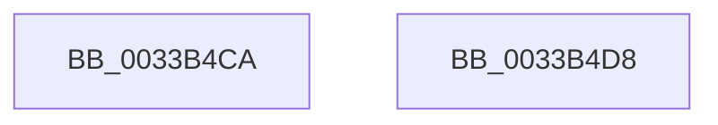

# sub_0033B4CA

- RVA: `0x0033B4CA`–`0x0033B4EA` (길이 `32` bytes)
- VA: `0x000000014033B4CA`
- 실행 섹션: `.text`
- PDB 이름 있음: `아니요`; PDB Function 태그: `아니요`
- unwind 정보 RVA: `0x00076D1C`
- 디코드: `6`개 명령, `32/32` bytes 표시
- 미해석 바이트: `0` (있으면 어셈블리에 `.byte`로 보존)

> 이 문서는 커널 이미지의 기계어와 PDB 기호를 분석해 생성했습니다. 4번과 5번은 함수 원형과 자료형을 바이너리 사용 방식에서 추정한 C 해석이며 원본 소스 복구 결과는 아닙니다.

## 1. Dependencies

- 직접 호출 지점: **0**; 고유 호출 대상: **0**
- 직접 호출자로 확인된 함수: **0**
- RIP 상대 이미지 참조: **0**

### Outgoing calls
- 직접 디코드된 call 명령이 없습니다.

### Direct callers
- 이 함수 시작 RVA로 연결되는 직접 call은 확인되지 않았습니다. 간접 호출은 완전히 역산할 수 없습니다.

### Static image references
- 디코드된 RIP-relative 메모리 참조가 없습니다.

## 2. Other-region calls and transfers

- 다른 실행 섹션으로 향하는 call: **0**
- call이 아닌 외부 분기/꼬리 이동: **2**
  - `0x0033B4D3` → [sub_0033B2B6 + 0x94](Unknown_function_0033B2B6.md) (`tail-transfer`)
  - `0x0033B4E5` → [sub_0033B2B6 + 0xA7](Unknown_function_0033B2B6.md) (`tail-transfer`)

## 3. Assembly (complete function range)

```asm
0033B4CA  48 8B 44 24 40                  mov rax, qword ptr [rsp + 0x40]
0033B4CF  4C 89 40 10                     mov qword ptr [rax + 0x10], r8
0033B4D3  E9 72 FE FF FF                  jmp 0x14033b34a
0033B4D8  48 8B 44 24 30                  mov rax, qword ptr [rsp + 0x30]
0033B4DD  F0 48 FF 88 80 47 00 00         lock dec qword ptr [rax + 0x4780]
0033B4E5  E9 73 FE FF FF                  jmp 0x14033b35d
```

## 4. C-style interpretation (structured pseudocode)

```c
__int64 __fastcall sub_0033B4CA(__int64 a1, __int64 a2, __int64 a3, __int64 a4, __int64 a5, __int64 a6, __int64 a7, __int64 a8)
{
    unsigned __int64 v_stack_p30;

    *(unsigned __int64 *)(a8 + 16) = a3;
}
```

## 5. (Beta) C Style

```c
int64_t sub_0033B4CA(int64_t Arg1, int64_t Arg2, int64_t Arg3, int64_t Arg4, uint64_t Arg5, uint64_t Arg6, uint64_t Arg7, void *Arg8)
{
    uint8_t *arg8 = (uint8_t *)Arg8;

    uint64_t v_stack_p30;

    *(uint64_t *)(arg8 + 0x10) = Arg3;
}
```

### 관측된 메모리 오프셋

구조체 형식이 확인되지 않은 접근은 인자 기준의 오프셋으로만 기록했습니다.

| 기준 인자 | 오프셋 표현 | 폭 (bit) | 접근 |
|---|---:|---:|---|
| `Arg8` | `+ 0x10` | `64` | `W` |

## 6. Execution-region graph

[열기: 2D/3D 그래프와 함수 탐색 컨트롤 패널](../../../control-panel.html?section=text&rva=0x0033B4CA&view=graph)

- 2D 그래프는 위에서 아래로 흐르고, 3D 그래프는 빈 공간을 드래그해 회전합니다. Shift+드래그는 이동, 휠은 확대·축소, 함수 노드 선택은 대상 보고서 이동입니다.

### Static fallback


