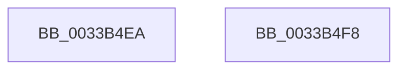

# sub_0033B4EA

- RVA: `0x0033B4EA`–`0x0033B51F` (길이 `53` bytes)
- VA: `0x000000014033B4EA`
- 실행 섹션: `.text`
- PDB 이름 있음: `아니요`; PDB Function 태그: `아니요`
- unwind 정보 RVA: `0x00076D2C`
- 디코드: `13`개 명령, `53/53` bytes 표시
- 미해석 바이트: `0` (있으면 어셈블리에 `.byte`로 보존)

> 이 문서는 커널 이미지의 기계어와 PDB 기호를 분석해 생성했습니다. 4번과 5번은 함수 원형과 자료형을 바이너리 사용 방식에서 추정한 C 해석이며 원본 소스 복구 결과는 아닙니다.

## 1. Dependencies

- 직접 호출 지점: **0**; 고유 호출 대상: **0**
- 직접 호출자로 확인된 함수: **0**
- RIP 상대 이미지 참조: **1**

### Outgoing calls
- 직접 디코드된 call 명령이 없습니다.

### Direct callers
- 이 함수 시작 RVA로 연결되는 직접 call은 확인되지 않았습니다. 간접 호출은 완전히 역산할 수 없습니다.

### Static image references
- `0x0033B4FE` → RVA `0x00E3D240` (`.data`; read)

## 2. Other-region calls and transfers

- 다른 실행 섹션으로 향하는 call: **0**
- call이 아닌 외부 분기/꼬리 이동: **2**
  - `0x0033B4F3` → [sub_0033B174 + 0x131](Unknown_function_0033B174.md) (`tail-transfer`)
  - `0x0033B51D` → [sub_0033B497 + 0xD](Unknown_function_0033B497.md) (`tail-transfer`)

## 3. Assembly (complete function range)

```asm
0033B4EA  48 8B 44 24 40                  mov rax, qword ptr [rsp + 0x40]
0033B4EF  4C 89 48 18                     mov qword ptr [rax + 0x18], r9
0033B4F3  E9 AD FD FF FF                  jmp 0x14033b2a5
0033B4F8  49 8B C7                        mov rax, r15
0033B4FB  48 2B F0                        sub rsi, rax
0033B4FE  48 8B 05 3B 1D B0 00            mov rax, qword ptr [rip + 0xb01d3b]
0033B505  48 C1 FE 04                     sar rsi, 4
0033B509  49 0F AF F4                     imul rsi, r12
0033B50D  48 C1 EE 09                     shr rsi, 9
0033B511  0F B6 4C 70 01                  movzx ecx, byte ptr [rax + rsi*2 + 1]
0033B516  80 E1 7F                        and cl, 0x7f
0033B519  88 4C 24 58                     mov byte ptr [rsp + 0x58], cl
0033B51D  EB 85                           jmp 0x14033b4a4
```

## 4. C-style interpretation (structured pseudocode)

```c
__int64 __fastcall sub_0033B4EA(__int64 a1, __int64 a2, __int64 a3, __int64 a4, __int64 a5, __int64 a6, __int64 a7, __int64 a8)
{
    unsigned __int8 v_stack_p58;

    *(unsigned __int64 *)(a8 + 24) = a4;
}
```

## 5. (Beta) C Style

```c
int64_t sub_0033B4EA(int64_t Arg1, int64_t Arg2, int64_t Arg3, int64_t Arg4, uint64_t Arg5, uint64_t Arg6, uint64_t Arg7, void *Arg8)
{
    uint8_t *arg8 = (uint8_t *)Arg8;

    uint8_t v_stack_p58;

    *(uint64_t *)(arg8 + 0x18) = Arg4;
}
```

### 관측된 메모리 오프셋

구조체 형식이 확인되지 않은 접근은 인자 기준의 오프셋으로만 기록했습니다.

| 기준 인자 | 오프셋 표현 | 폭 (bit) | 접근 |
|---|---:|---:|---|
| `Arg8` | `+ 0x18` | `64` | `W` |

## 6. Execution-region graph

[열기: 2D/3D 그래프와 함수 탐색 컨트롤 패널](../../../control-panel.html?section=text&rva=0x0033B4EA&view=graph)

- 2D 그래프는 위에서 아래로 흐르고, 3D 그래프는 빈 공간을 드래그해 회전합니다. Shift+드래그는 이동, 휠은 확대·축소, 함수 노드 선택은 대상 보고서 이동입니다.

### Static fallback


