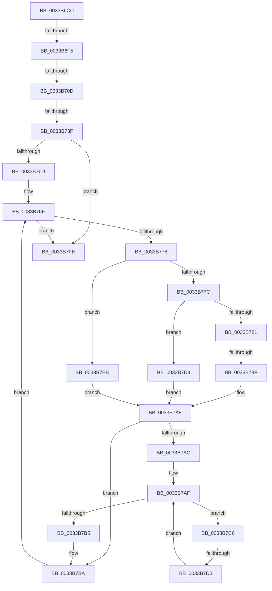

# sub_0033B6CC

- RVA: `0x0033B6CC`–`0x0033B833` (길이 `359` bytes)
- VA: `0x000000014033B6CC`
- 실행 섹션: `.text`
- PDB 이름 있음: `아니요`; PDB Function 태그: `아니요`
- unwind 정보 RVA: `0x00076D5C`
- 디코드: `85`개 명령, `359/359` bytes 표시
- 미해석 바이트: `0` (있으면 어셈블리에 `.byte`로 보존)

> 이 문서는 커널 이미지의 기계어와 PDB 기호를 분석해 생성했습니다. 4번과 5번은 함수 원형과 자료형을 바이너리 사용 방식에서 추정한 C 해석이며 원본 소스 복구 결과는 아닙니다.

## 1. Dependencies

- 직접 호출 지점: **0**; 고유 호출 대상: **0**
- 직접 호출자로 확인된 함수: **0**
- RIP 상대 이미지 참조: **1**

### Outgoing calls
- 직접 디코드된 call 명령이 없습니다.

### Direct callers
- 이 함수 시작 RVA로 연결되는 직접 call은 확인되지 않았습니다. 간접 호출은 완전히 역산할 수 없습니다.

### Static image references
- `0x0033B6FB` → RVA `0x00E2DC28` (`.data`; read)

## 2. Other-region calls and transfers

- 다른 실행 섹션으로 향하는 call: **0**
- call이 아닌 외부 분기/꼬리 이동: **5**
  - `0x0033B6EF` → [sub_0033B8B3](Unknown_function_0033B8B3.md) (`tail-transfer`)
  - `0x0033B707` → [sub_0033B8D8](Unknown_function_0033B8D8.md) (`tail-transfer`)
  - `0x0033B739` → [sub_0033B9B4 + 0x38](Unknown_function_0033B9B4.md) (`tail-transfer`)
  - `0x0033B789` → [sub_0033B9B4](Unknown_function_0033B9B4.md) (`tail-transfer`)
  - `0x0033B7CD` → [sub_0033B864](Unknown_function_0033B864.md) (`tail-transfer`)

## 3. Assembly (complete function range)

```asm
0033B6CC  48 89 7C 24 78                  mov qword ptr [rsp + 0x78], rdi
0033B6D1  8B 7E 20                        mov edi, dword ptr [rsi + 0x20]
0033B6D4  89 44 24 48                     mov dword ptr [rsp + 0x48], eax
0033B6D8  8B 46 20                        mov eax, dword ptr [rsi + 0x20]
0033B6DB  4C 89 64 24 70                  mov qword ptr [rsp + 0x70], r12
0033B6E0  C1 E8 18                        shr eax, 0x18
0033B6E3  4C 89 6C 24 68                  mov qword ptr [rsp + 0x68], r13
0033B6E8  4C 89 7C 24 60                  mov qword ptr [rsp + 0x60], r15
0033B6ED  A8 08                           test al, 8
0033B6EF  0F 85 BE 01 00 00               jne 0x14033b8b3
0033B6F5  C1 EF 18                        shr edi, 0x18
0033B6F8  83 E7 07                        and edi, 7
0033B6FB  48 83 3D 25 25 AF 00 00         cmp qword ptr [rip + 0xaf2525], 0
0033B703  89 7C 24 4C                     mov dword ptr [rsp + 0x4c], edi
0033B707  0F 85 CB 01 00 00               jne 0x14033b8d8
0033B70D  45 32 FF                        xor r15b, r15b
0033B710  8B 44 24 48                     mov eax, dword ptr [rsp + 0x48]
0033B714  4C 8B 54 24 30                  mov r10, qword ptr [rsp + 0x30]
0033B719  4D 8B 42 10                     mov r8, qword ptr [r10 + 0x10]
0033B71D  4D 8D 62 10                     lea r12, [r10 + 0x10]
0033B721  4C 69 E8 80 DF 00 00            imul r13, rax, 0xdf80
0033B728  44 88 7C 24 50                  mov byte ptr [rsp + 0x50], r15b
0033B72D  4D 03 C5                        add r8, r13
0033B730  44 89 4C 24 54                  mov dword ptr [rsp + 0x54], r9d
0033B735  41 83 F9 09                     cmp r9d, 9
0033B739  0F 8C AD 02 00 00               jl 0x14033b9ec
0033B73F  41 0F B6 C7                     movzx eax, r15b
0033B743  44 8B DF                        mov r11d, edi
0033B746  48 8D 0C C5 3B 00 00 00         lea rcx, [rax*8 + 0x3b]
0033B74E  49 03 CB                        add rcx, r11
0033B751  48 6B C1 58                     imul rax, rcx, 0x58
0033B755  49 03 C0                        add rax, r8
0033B758  48 89 44 24 40                  mov qword ptr [rsp + 0x40], rax
0033B75D  8B BC 24 A8 00 00 00            mov edi, dword ptr [rsp + 0xa8]
0033B764  83 FF 03                        cmp edi, 3
0033B767  0F 84 91 00 00 00               je 0x14033b7fe
0033B76D  33 C0                           xor eax, eax
0033B76F  83 F8 03                        cmp eax, 3
0033B772  0F 8D 86 00 00 00               jge 0x14033b7fe
0033B778  85 C0                           test eax, eax
0033B77A  74 6F                           je 0x14033b7eb
0033B77C  83 F8 01                        cmp eax, 1
0033B77F  74 57                           je 0x14033b7d8
0033B781  4D 8B 04 24                     mov r8, qword ptr [r12]
0033B785  41 83 F9 09                     cmp r9d, 9
0033B789  0F 8C 25 02 00 00               jl 0x14033b9b4
0033B78F  41 0F B6 CF                     movzx ecx, r15b
0033B793  4C 8D 0C CD 0D 00 00 00         lea r9, [rcx*8 + 0xd]
0033B79B  4D 03 CB                        add r9, r11
0033B79E  49 C1 E1 09                     shl r9, 9
0033B7A2  4D 03 C8                        add r9, r8
0033B7A5  4D 03 CD                        add r9, r13
0033B7A8  3B C7                           cmp eax, edi
0033B7AA  74 0E                           je 0x14033b7ba
0033B7AC  45 33 C0                        xor r8d, r8d
0033B7AF  41 83 F8 40                     cmp r8d, 0x40
0033B7B3  72 11                           jb 0x14033b7c6
0033B7B5  4C 8B 54 24 30                  mov r10, qword ptr [rsp + 0x30]
0033B7BA  44 8B 8C 24 B8 00 00 00         mov r9d, dword ptr [rsp + 0xb8]
0033B7C2  FF C0                           inc eax
0033B7C4  EB A9                           jmp 0x14033b76f
0033B7C6  4B 8B 14 C1                     mov rdx, qword ptr [r9 + r8*8]
0033B7CA  48 3B DA                        cmp rbx, rdx
0033B7CD  0F 84 91 00 00 00               je 0x14033b864
0033B7D3  41 FF C0                        inc r8d
0033B7D6  EB D7                           jmp 0x14033b7af
0033B7D8  4D 8B CB                        mov r9, r11
0033B7DB  49 C1 E1 09                     shl r9, 9
0033B7DF  49 81 C1 40 2E 00 00            add r9, 0x2e40
0033B7E6  4D 03 CA                        add r9, r10
0033B7E9  EB BD                           jmp 0x14033b7a8
0033B7EB  4D 8B CB                        mov r9, r11
0033B7EE  49 C1 E1 09                     shl r9, 9
0033B7F2  49 81 C1 40 1E 00 00            add r9, 0x1e40
0033B7F9  4D 03 CA                        add r9, r10
0033B7FC  EB AA                           jmp 0x14033b7a8
0033B7FE  49 BA 10 00 00 00 00 DE FF FF   movabs r10, 0xffffde0000000010
0033B808  49 8B C2                        mov rax, r10
0033B80B  48 8B 8C 24 A0 00 00 00         mov rcx, qword ptr [rsp + 0xa0]
0033B813  48 8B 94 24 B0 00 00 00         mov rdx, qword ptr [rsp + 0xb0]
0033B81B  48 89 14 01                     mov qword ptr [rcx + rax], rdx
0033B81F  4C 8B 6C 24 68                  mov r13, qword ptr [rsp + 0x68]
0033B824  4C 8B 64 24 70                  mov r12, qword ptr [rsp + 0x70]
0033B829  48 8B 7C 24 78                  mov rdi, qword ptr [rsp + 0x78]
0033B82E  4C 8B 7C 24 60                  mov r15, qword ptr [rsp + 0x60]
```

## 4. C-style interpretation (structured pseudocode)

```c
__int64 __fastcall sub_0033B6CC(__int64 a1, __int64 a2, __int64 a3, int a4, __int64 a5, __int64 a6, __int64 a7, __int64 a8, unsigned int a9, __int64 a10, __int64 a11, __int64 a12, __int64 a13, __int64 a14, __int64 a15, __int64 a16, __int64 a17, __int64 a18, __int64 a19, __int64 a20, unsigned int a21, __int64 a22, unsigned int a23)
{
    __int64 result;
    __int64 v_r13;
    __int64 v_r15;
    __int64 v_rdi;
    unsigned __int64 v_stack_p40;
    unsigned int v_stack_p48;
    unsigned int v_stack_p4C;
    unsigned __int8 v_stack_p50;
    unsigned int v_stack_p54;
    unsigned __int64 v_stack_p60;
    unsigned __int64 v_stack_p68;
    unsigned __int64 v_stack_p70;
    unsigned __int64 v_stack_p78;

    v_stack_p78 = v_rdi;
    v_stack_p48 = (unsigned int)(result);
    v_stack_p70 = v_r12;
    result = (unsigned int)(((unsigned int)(*(unsigned int *)(v_rsi + 32))) >> (24));
    v_stack_p68 = v_r13;
    v_stack_p60 = v_r15;
    v_rdi = (unsigned int)(((unsigned int)(*(unsigned int *)(v_rsi + 32))) >> (24));
    v_rdi = (unsigned int)((v_rdi) & (7));
    v_stack_p4C = (unsigned int)(v_rdi);
    v_r15 = 0;
    v_r13 = (v_r13) * ((unsigned int)(a9));
    v_stack_p50 = 0;
    a3 = (*(unsigned __int64 *)(a6 + 16)) + (v_r13);
    v_stack_p54 = a4;
    a1 = (0 * 8 + 59) + ((unsigned int)((unsigned int)(v_rdi)));
    result = (0) * (a1);
    result = (result) + (a3);
    v_stack_p40 = result;
    if (((unsigned int)((unsigned int)(a21))) == 3) goto loc_0033B7FE;
    result = 0;
loc_0033B76F:
    if (0 >= 3) goto loc_0033B7FE;
    if (0 == 0) goto loc_0033B7EB;
    if (0 == 1) goto loc_0033B7D8;
    a4 = (0 * 8 + 13) + ((unsigned int)((unsigned int)(v_rdi)));
    a4 = (a4) << (9);
    a4 = (a4) + (*(unsigned __int64 *)(a6 + 16));
    a4 = (a4) + (v_r13);
loc_0033B7A8:
    if (0 == ((unsigned int)((unsigned int)(a21)))) goto loc_0033B7BA;
    a3 = 0;
loc_0033B7AF:
    if (0 < 64) goto loc_0033B7C6;
loc_0033B7BA:
    result = (unsigned int)((result) + 1);
    goto loc_0033B76F;
loc_0033B7C6:
    a3 = (unsigned int)((a3) + 1);
    goto loc_0033B7AF;
loc_0033B7D8:
    a4 = ((unsigned int)((unsigned int)(v_rdi))) << (9);
    a4 = (a4) + (0x2E40ULL);
    a4 = (a4) + (a6);
    goto loc_0033B7A8;
loc_0033B7EB:
    a4 = ((unsigned int)((unsigned int)(v_rdi))) << (9);
    a4 = (a4) + (0x1E40ULL);
    a4 = (a4) + (a6);
    goto loc_0033B7A8;
loc_0033B7FE:
    *(unsigned __int64 *)(a20 + a6 * 1) = a22;
    return a6;
}
```

## 5. (Beta) C Style

```c
void *sub_0033B6CC(int64_t Arg1, int64_t Arg2, int64_t Arg3, int32_t Arg4, uint64_t Arg5, void *Arg6, uint64_t Arg7, uint64_t Arg8, uint32_t Arg9, uint64_t Arg10, uint64_t Arg11, int64_t Arg12, int64_t Arg13, int64_t Arg14, int64_t Arg15, uint64_t Arg16, uint64_t Arg17, uint64_t Arg18, uint64_t Arg19, void *Arg20, uint32_t Arg21, int64_t Arg22, uint32_t Arg23)
{
    uint8_t *arg6 = (uint8_t *)Arg6;
    uint8_t *arg20 = (uint8_t *)Arg20;

    int64_t result;
    int64_t local_r13;
    int64_t local_r15;
    int64_t local_rdi;
    uint64_t v_stack_p40;
    uint32_t v_stack_p48;
    uint32_t v_stack_p4C;
    uint8_t v_stack_p50;
    uint32_t v_stack_p54;
    uint64_t v_stack_p60;
    uint64_t v_stack_p68;
    uint64_t v_stack_p70;
    uint64_t v_stack_p78;

    v_stack_p78 = local_rdi;
    v_stack_p48 = (uint32_t)(result);
    v_stack_p70 = local_r12;
    result = (uint32_t)(((uint32_t)(*(uint32_t *)(local_rsi + 0x20))) >> (24));
    v_stack_p68 = local_r13;
    v_stack_p60 = local_r15;
    local_rdi = (uint32_t)(((uint32_t)(*(uint32_t *)(local_rsi + 0x20))) >> (24));
    local_rdi = (uint32_t)((local_rdi) & (7));
    v_stack_p4C = (uint32_t)(local_rdi);
    local_r15 = 0;
    local_r13 = (local_r13) * ((uint32_t)(Arg9));
    v_stack_p50 = 0;
    Arg3 = (*(uint64_t *)(arg6 + 0x10)) + (local_r13);
    v_stack_p54 = Arg4;
    Arg1 = (0 * 8 + 59) + ((uint32_t)((uint32_t)(local_rdi)));
    result = (0) * (Arg1);
    result = (result) + (Arg3);
    v_stack_p40 = result;
    if (((uint32_t)((uint32_t)(Arg21))) == 3) goto loc_0033B7FE;
    result = 0;
loc_0033B76F:
    if (0 >= 3) goto loc_0033B7FE;
    if (0 == 0) goto loc_0033B7EB;
    if (0 == 1) goto loc_0033B7D8;
    Arg4 = (0 * 8 + 13) + ((uint32_t)((uint32_t)(local_rdi)));
    Arg4 = (Arg4) << (9);
    Arg4 = (Arg4) + (*(uint64_t *)(arg6 + 0x10));
    Arg4 = (Arg4) + (local_r13);
loc_0033B7A8:
    if (0 == ((uint32_t)((uint32_t)(Arg21)))) goto loc_0033B7BA;
    Arg3 = 0;
loc_0033B7AF:
    if (0 < 64) goto loc_0033B7C6;
loc_0033B7BA:
    result = (uint32_t)((result) + 1);
    goto loc_0033B76F;
loc_0033B7C6:
    Arg3 = (uint32_t)((Arg3) + 1);
    goto loc_0033B7AF;
loc_0033B7D8:
    Arg4 = ((uint32_t)((uint32_t)(local_rdi))) << (9);
    Arg4 = (Arg4) + (0x2E40ULL);
    Arg4 = (Arg4) + (Arg6);
    goto loc_0033B7A8;
loc_0033B7EB:
    Arg4 = ((uint32_t)((uint32_t)(local_rdi))) << (9);
    Arg4 = (Arg4) + (0x1E40ULL);
    Arg4 = (Arg4) + (Arg6);
    goto loc_0033B7A8;
loc_0033B7FE:
    *(uint64_t *)(arg20 + arg6 * 1) = Arg22;
    return Arg6;
}
```

### 관측된 메모리 오프셋

구조체 형식이 확인되지 않은 접근은 인자 기준의 오프셋으로만 기록했습니다.

| 기준 인자 | 오프셋 표현 | 폭 (bit) | 접근 |
|---|---:|---:|---|
| `Arg6` | `+ 0x0` | `64` | `R` |
| `Arg6` | `+ 0x10` | `64` | `R` |
| `Arg20` | `+ 0x0 + rax*1` | `64` | `W` |

## 6. Execution-region graph

[열기: 2D/3D 그래프와 함수 탐색 컨트롤 패널](../../../control-panel.html?section=text&rva=0x0033B6CC&view=graph)

- 2D 그래프는 위에서 아래로 흐르고, 3D 그래프는 빈 공간을 드래그해 회전합니다. Shift+드래그는 이동, 휠은 확대·축소, 함수 노드 선택은 대상 보고서 이동입니다.

### Static fallback


