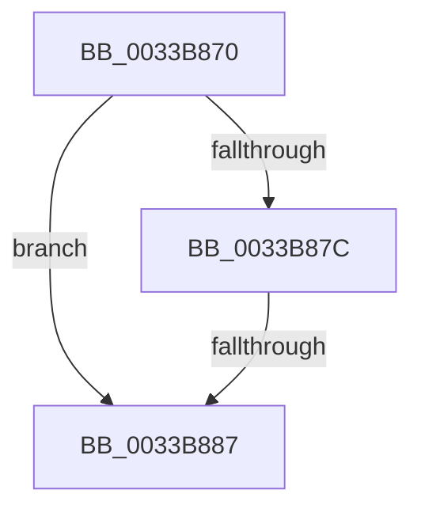

# sub_0033B870

- RVA: `0x0033B870`–`0x0033B8B3` (길이 `67` bytes)
- VA: `0x000000014033B870`
- 실행 섹션: `.text`
- PDB 이름 있음: `아니요`; PDB Function 태그: `아니요`
- unwind 정보 RVA: `0x00076DB0`
- 디코드: `18`개 명령, `67/67` bytes 표시
- 미해석 바이트: `0` (있으면 어셈블리에 `.byte`로 보존)

> 이 문서는 커널 이미지의 기계어와 PDB 기호를 분석해 생성했습니다. 4번과 5번은 함수 원형과 자료형을 바이너리 사용 방식에서 추정한 C 해석이며 원본 소스 복구 결과는 아닙니다.

## 1. Dependencies

- 직접 호출 지점: **0**; 고유 호출 대상: **0**
- 직접 호출자로 확인된 함수: **0**
- RIP 상대 이미지 참조: **1**

### Outgoing calls
- 직접 디코드된 call 명령이 없습니다.

### Direct callers
- 이 함수 시작 RVA로 연결되는 직접 call은 확인되지 않았습니다. 간접 호출은 완전히 역산할 수 없습니다.

### Static image references
- `0x0033B870` → RVA `0x00E35C00` (`.data`; read)

## 2. Other-region calls and transfers

- 다른 실행 섹션으로 향하는 call: **0**
- call이 아닌 외부 분기/꼬리 이동: **2**
  - `0x0033B885` → [sub_0033B833 + 0x6](Unknown_function_0033B833.md) (`tail-transfer`)
  - `0x0033B8B1` → [sub_0033B833 + 0x6](Unknown_function_0033B833.md) (`tail-transfer`)

## 3. Assembly (complete function range)

```asm
0033B870  48 8B 05 89 A3 AF 00            mov rax, qword ptr [rip + 0xafa389]
0033B877  4C 3B F0                        cmp r14, rax
0033B87A  72 0B                           jb 0x14033b887
0033B87C  48 05 00 08 00 00               add rax, 0x800
0033B882  4C 3B F0                        cmp r14, rax
0033B885  72 B2                           jb 0x14033b839
0033B887  4F 8D 04 76                     lea r8, [r14 + r14*2]
0033B88B  4D 03 C0                        add r8, r8
0033B88E  49 8B C2                        mov rax, r10
0033B891  4A 8B 14 C0                     mov rdx, qword ptr [rax + r8*8]
0033B895  B9 08 00 00 00                  mov ecx, 8
0033B89A  48 0F BA E2 0A                  bt rdx, 0xa
0033B89F  B8 00 00 00 08                  mov eax, 0x8000000
0033B8A4  0F 43 C8                        cmovae ecx, eax
0033B8A7  48 0B CA                        or rcx, rdx
0033B8AA  49 8B C2                        mov rax, r10
0033B8AD  4A 89 0C C0                     mov qword ptr [rax + r8*8], rcx
0033B8B1  EB 86                           jmp 0x14033b839
```

## 4. C-style interpretation (structured pseudocode)

```c
__int64 __fastcall sub_0033B870(void)
{
    __int64 result;

    if (v_r14 < (*(unsigned __int64 *)(v_rip + 11510665))) goto loc_0033B887;
    result = (*(unsigned __int64 *)(v_rip + 11510665)) + (0x800ULL);
loc_0033B887:
    a3 = (v_r14 + v_r14 * 2) + (v_r14 + v_r14 * 2);
    a1 = 8;
    if (condition_is_above_or_equal) { a1 = (unsigned int)((unsigned int)(0x8000000ULL)); }
    a1 = (a1) | (*(unsigned __int64 *)(v_r10 + a3 * 8));
    *(unsigned __int64 *)(v_r10 + a3 * 8) = a1;
}
```

## 5. (Beta) C Style

```c
void sub_0033B870(void)
{
    int64_t result;

    if (local_r14 < (*(uint64_t *)(v_rip + 0xAFA389))) goto loc_0033B887;
    result = (*(uint64_t *)(v_rip + 0xAFA389)) + (0x800ULL);
loc_0033B887:
    a3 = (local_r14 + local_r14 * 2) + (local_r14 + local_r14 * 2);
    a1 = 8;
    if (condition_is_above_or_equal) { a1 = (uint32_t)((uint32_t)(0x8000000ULL)); }
    a1 = (a1) | (*(uint64_t *)(local_r10 + a3 * 8));
    *(uint64_t *)(local_r10 + a3 * 8) = a1;
}
```

## 6. Execution-region graph

[열기: 2D/3D 그래프와 함수 탐색 컨트롤 패널](../../../control-panel.html?section=text&rva=0x0033B870&view=graph)

- 2D 그래프는 위에서 아래로 흐르고, 3D 그래프는 빈 공간을 드래그해 회전합니다. Shift+드래그는 이동, 휠은 확대·축소, 함수 노드 선택은 대상 보고서 이동입니다.

### Static fallback


