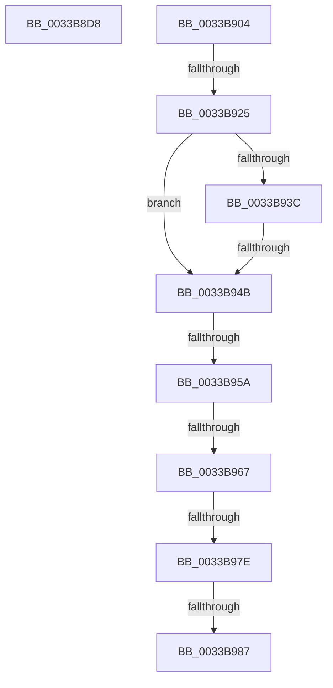

# sub_0033B8D8

- RVA: `0x0033B8D8`–`0x0033B98C` (길이 `180` bytes)
- VA: `0x000000014033B8D8`
- 실행 섹션: `.text`
- PDB 이름 있음: `아니요`; PDB Function 태그: `아니요`
- unwind 정보 RVA: `0x00076DF0`
- 디코드: `39`개 명령, `180/180` bytes 표시
- 미해석 바이트: `0` (있으면 어셈블리에 `.byte`로 보존)

> 이 문서는 커널 이미지의 기계어와 PDB 기호를 분석해 생성했습니다. 4번과 5번은 함수 원형과 자료형을 바이너리 사용 방식에서 추정한 C 해석이며 원본 소스 복구 결과는 아닙니다.

## 1. Dependencies

- 직접 호출 지점: **1**; 고유 호출 대상: **1**
- 직접 호출자로 확인된 함수: **0**
- RIP 상대 이미지 참조: **4**

### Outgoing calls
- `0x0033B8E3` → [MiSearchChannelTable](MiSearchChannelTable_function_0033BE24.md) (function, `0x0033BE24`)

### Direct callers
- 이 함수 시작 RVA로 연결되는 직접 call은 확인되지 않았습니다. 간접 호출은 완전히 역산할 수 없습니다.

### Static image references
- `0x0033B904` → RVA `0x00E2DCE0` (`.data`; read)
- `0x0033B925` → RVA `0x00E35C00` (`.data`; read)
- `0x0033B95A` → RVA `0x00E3CBE6` (`.data`; read)
- `0x0033B967` → RVA `0x00E3D240` (`.data`; read)

## 2. Other-region calls and transfers

- 다른 실행 섹션으로 향하는 call: **0**
- call이 아닌 외부 분기/꼬리 이동: **8**
  - `0x0033B8FF` → [sub_0033B6CC + 0x44](Unknown_function_0033B6CC.md) (`tail-transfer`)
  - `0x0033B923` → [sub_0033B8B3 + 0x8](Unknown_function_0033B8B3.md) (`tail-transfer`)
  - `0x0033B945` → [sub_0033B8B3 + 0x8](Unknown_function_0033B8B3.md) (`tail-transfer`)
  - `0x0033B954` → [sub_0033B6CC + 0x29](Unknown_function_0033B6CC.md) (`tail-transfer`)
  - `0x0033B961` → [sub_0033B8B3 + 0x8](Unknown_function_0033B8B3.md) (`tail-transfer`)
  - `0x0033B978` → [sub_0033B8B3 + 0x8](Unknown_function_0033B8B3.md) (`tail-transfer`)
  - `0x0033B981` → [sub_0033B6CC + 0x29](Unknown_function_0033B6CC.md) (`tail-transfer`)
  - `0x0033B987` → [sub_0033B8B3 + 0x8](Unknown_function_0033B8B3.md) (`tail-transfer`)

## 3. Assembly (complete function range)

```asm
0033B8D8  49 8B C8                        mov rcx, r8
0033B8DB  48 C1 F9 04                     sar rcx, 4
0033B8DF  49 0F AF CA                     imul rcx, r10
0033B8E3  E8 3C 05 00 00                  call 0x14033be24
0033B8E8  44 8B 8C 24 B8 00 00 00         mov r9d, dword ptr [rsp + 0xb8]
0033B8F0  49 BB 00 00 00 00 00 DE FF FF   movabs r11, 0xffffde0000000000
0033B8FA  44 0F B6 78 0C                  movzx r15d, byte ptr [rax + 0xc]
0033B8FF  E9 0C FE FF FF                  jmp 0x14033b710
0033B904  48 8B 05 D5 23 AF 00            mov rax, qword ptr [rip + 0xaf23d5]
0033B90B  48 8D 0C 40                     lea rcx, [rax + rax*2]
0033B90F  48 C1 E1 04                     shl rcx, 4
0033B913  48 B8 30 00 00 00 00 DE FF FF   movabs rax, 0xffffde0000000030
0033B91D  48 03 C8                        add rcx, rax
0033B920  48 3B F1                        cmp rsi, rcx
0033B923  73 96                           jae 0x14033b8bb
0033B925  48 8B 05 D4 A2 AF 00            mov rax, qword ptr [rip + 0xafa2d4]
0033B92C  49 8B C8                        mov rcx, r8
0033B92F  48 C1 F9 04                     sar rcx, 4
0033B933  49 0F AF CA                     imul rcx, r10
0033B937  48 3B C8                        cmp rcx, rax
0033B93A  72 0F                           jb 0x14033b94b
0033B93C  48 05 00 08 00 00               add rax, 0x800
0033B942  48 3B C8                        cmp rcx, rax
0033B945  0F 82 70 FF FF FF               jb 0x14033b8bb
0033B94B  8B C7                           mov eax, edi
0033B94D  C1 E8 10                        shr eax, 0x10
0033B950  24 07                           and al, 7
0033B952  3C 06                           cmp al, 6
0033B954  0F 84 9B FD FF FF               je 0x14033b6f5
0033B95A  80 3D 85 12 B0 00 00            cmp byte ptr [rip + 0xb01285], 0
0033B961  0F 84 54 FF FF FF               je 0x14033b8bb
0033B967  48 8B 05 D2 18 B0 00            mov rax, qword ptr [rip + 0xb018d2]
0033B96E  48 C1 E9 09                     shr rcx, 9
0033B972  0F B6 14 48                     movzx edx, byte ptr [rax + rcx*2]
0033B976  85 D2                           test edx, edx
0033B978  0F 84 3D FF FF FF               je 0x14033b8bb
0033B97E  83 FA 0A                        cmp edx, 0xa
0033B981  0F 85 6E FD FF FF               jne 0x14033b6f5
0033B987  E9 2F FF FF FF                  jmp 0x14033b8bb
```

## 4. C-style interpretation (structured pseudocode)

```c
__int64 __fastcall sub_0033B8D8(__int64 a1, __int64 a2, __int64 a3, __int64 a4, __int64 a5, __int64 a6, __int64 a7, __int64 a8, __int64 a9, __int64 a10, __int64 a11, __int64 a12, __int64 a13, __int64 a14, __int64 a15, __int64 a16, __int64 a17, __int64 a18, __int64 a19, __int64 a20, __int64 a21, __int64 a22, unsigned int a23)
{
    __int64 result;

    a1 = (a3) >> (4);
    a1 = (a1) * (v_r10);
    result = MiSearchChannelTable(a1, a2, a3, a4);
}
```

## 5. (Beta) C Style

```c
int64_t sub_0033B8D8(int64_t Arg1, int64_t Arg2, int64_t Arg3, int64_t Arg4, uint64_t Arg5, uint64_t Arg6, uint64_t Arg7, uint64_t Arg8, uint64_t Arg9, uint64_t Arg10, uint64_t Arg11, uint64_t Arg12, uint64_t Arg13, uint64_t Arg14, uint64_t Arg15, uint64_t Arg16, uint64_t Arg17, uint64_t Arg18, uint64_t Arg19, uint64_t Arg20, uint64_t Arg21, uint64_t Arg22, uint32_t Arg23)
{
    int64_t result;

    Arg1 = (Arg3) >> (4);
    Arg1 = (Arg1) * (local_r10);
    result = MiSearchChannelTable(Arg1, Arg2, Arg3, Arg4);
}
```

## 6. Execution-region graph

[열기: 2D/3D 그래프와 함수 탐색 컨트롤 패널](../../../control-panel.html?section=text&rva=0x0033B8D8&view=graph)

- 2D 그래프는 위에서 아래로 흐르고, 3D 그래프는 빈 공간을 드래그해 회전합니다. Shift+드래그는 이동, 휠은 확대·축소, 함수 노드 선택은 대상 보고서 이동입니다.

### Static fallback


