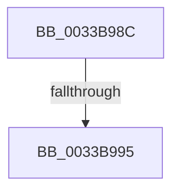

# sub_0033B98C

- RVA: `0x0033B98C`–`0x0033B9B4` (길이 `40` bytes)
- VA: `0x000000014033B98C`
- 실행 섹션: `.text`
- PDB 이름 있음: `아니요`; PDB Function 태그: `아니요`
- unwind 정보 RVA: `0x00076E10`
- 디코드: `9`개 명령, `40/40` bytes 표시
- 미해석 바이트: `0` (있으면 어셈블리에 `.byte`로 보존)

> 이 문서는 커널 이미지의 기계어와 PDB 기호를 분석해 생성했습니다. 4번과 5번은 함수 원형과 자료형을 바이너리 사용 방식에서 추정한 C 해석이며 원본 소스 복구 결과는 아닙니다.

## 1. Dependencies

- 직접 호출 지점: **1**; 고유 호출 대상: **1**
- 직접 호출자로 확인된 함수: **0**
- RIP 상대 이미지 참조: **0**

### Outgoing calls
- `0x0033B9AE` → [KeBugCheckEx](../4F/KeBugCheckEx_function_004FD660.md) (function, `0x004FD660`)

### Direct callers
- 이 함수 시작 RVA로 연결되는 직접 call은 확인되지 않았습니다. 간접 호출은 완전히 역산할 수 없습니다.

### Static image references
- 디코드된 RIP-relative 메모리 참조가 없습니다.

## 2. Other-region calls and transfers

- 다른 실행 섹션으로 향하는 call: **0**
- call이 아닌 외부 분기/꼬리 이동: **1**
  - `0x0033B98F` → [sub_0033BA68 + 0xB](Unknown_function_0033BA68.md) (`tail-transfer`)

## 3. Assembly (complete function range)

```asm
0033B98C  45 85 C0                        test r8d, r8d
0033B98F  0F 85 DE 00 00 00               jne 0x14033ba73
0033B995  4C 8B C8                        mov r9, rax
0033B998  48 C7 44 24 20 00 00 00 00      mov qword ptr [rsp + 0x20], 0
0033B9A1  4C 8B C3                        mov r8, rbx
0033B9A4  BA 80 51 00 00                  mov edx, 0x5180
0033B9A9  B9 1A 00 00 00                  mov ecx, 0x1a
0033B9AE  E8 AD 1C 1C 00                  call 0x1404fd660
0033B9B3  CC                              int3
```

## 4. C-style interpretation (structured pseudocode)

```c
__int64 __fastcall sub_0033B98C(__int64 a1, __int64 a2, int a3)
{
    __int64 result;
    unsigned __int64 v_stack_p20;

    v_stack_p20 = 0;
    result = KeBugCheckEx(26, (unsigned int)(0x5180ULL), v_rbx, result);
    return result;
}
```

## 5. (Beta) C Style

```c
int64_t sub_0033B98C(int64_t Arg1, int64_t Arg2, int32_t Arg3)
{
    int64_t result;
    uint64_t v_stack_p20;

    v_stack_p20 = 0;
    result = KeBugCheckEx(26, (uint32_t)(0x5180ULL), local_rbx, result);
    return result;
}
```

## 6. Execution-region graph

[열기: 2D/3D 그래프와 함수 탐색 컨트롤 패널](../../../control-panel.html?section=text&rva=0x0033B98C&view=graph)

- 2D 그래프는 위에서 아래로 흐르고, 3D 그래프는 빈 공간을 드래그해 회전합니다. Shift+드래그는 이동, 휠은 확대·축소, 함수 노드 선택은 대상 보고서 이동입니다.

### Static fallback


