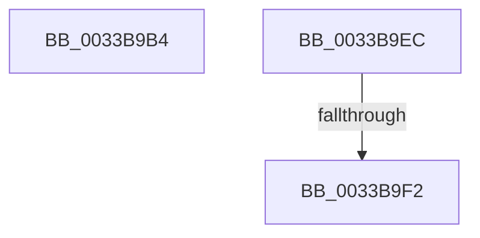

# sub_0033B9B4

- RVA: `0x0033B9B4`–`0x0033BA23` (길이 `111` bytes)
- VA: `0x000000014033B9B4`
- 실행 섹션: `.text`
- PDB 이름 있음: `아니요`; PDB Function 태그: `아니요`
- unwind 정보 RVA: `0x00076E20`
- 디코드: `25`개 명령, `111/111` bytes 표시
- 미해석 바이트: `0` (있으면 어셈블리에 `.byte`로 보존)

> 이 문서는 커널 이미지의 기계어와 PDB 기호를 분석해 생성했습니다. 4번과 5번은 함수 원형과 자료형을 바이너리 사용 방식에서 추정한 C 해석이며 원본 소스 복구 결과는 아닙니다.

## 1. Dependencies

- 직접 호출 지점: **0**; 고유 호출 대상: **0**
- 직접 호출자로 확인된 함수: **0**
- RIP 상대 이미지 참조: **0**

### Outgoing calls
- 직접 디코드된 call 명령이 없습니다.

### Direct callers
- 이 함수 시작 RVA로 연결되는 직접 call은 확인되지 않았습니다. 간접 호출은 완전히 역산할 수 없습니다.

### Static image references
- 디코드된 RIP-relative 메모리 참조가 없습니다.

## 2. Other-region calls and transfers

- 다른 실행 섹션으로 향하는 call: **0**
- call이 아닌 외부 분기/꼬리 이동: **3**
  - `0x0033B9E7` → [sub_0033B6CC + 0xDC](Unknown_function_0033B6CC.md) (`tail-transfer`)
  - `0x0033B9F0` → [sub_0033BA37](Unknown_function_0033BA37.md) (`tail-transfer`)
  - `0x0033BA1E` → [sub_0033B6CC + 0x91](Unknown_function_0033B6CC.md) (`tail-transfer`)

## 3. Assembly (complete function range)

```asm
0033B9B4  0F B6 4C 24 58                  movzx ecx, byte ptr [rsp + 0x58]
0033B9B9  33 D2                           xor edx, edx
0033B9BB  41 83 F9 08                     cmp r9d, 8
0033B9BF  0F 44 D1                        cmove edx, ecx
0033B9C2  0F B6 CA                        movzx ecx, dl
0033B9C5  4D 8D 0C CB                     lea r9, [r11 + rcx*8]
0033B9C9  48 63 8C 24 B8 00 00 00         movsxd rcx, dword ptr [rsp + 0xb8]
0033B9D1  48 69 D1 E8 00 00 00            imul rdx, rcx, 0xe8
0033B9D8  49 C1 E1 09                     shl r9, 9
0033B9DC  49 03 D0                        add rdx, r8
0033B9DF  4E 03 8C 2A 90 3D 00 00         add r9, qword ptr [rdx + r13 + 0x3d90]
0033B9E7  E9 BC FD FF FF                  jmp 0x14033b7a8
0033B9EC  41 83 F9 08                     cmp r9d, 8
0033B9F0  74 45                           je 0x14033ba37
0033B9F2  C6 44 24 58 00                  mov byte ptr [rsp + 0x58], 0
0033B9F7  32 C9                           xor cl, cl
0033B9F9  0F B6 C1                        movzx eax, cl
0033B9FC  44 8B DF                        mov r11d, edi
0033B9FF  49 8D 0C C3                     lea rcx, [r11 + rax*8]
0033BA03  49 63 C1                        movsxd rax, r9d
0033BA06  48 6B D1 58                     imul rdx, rcx, 0x58
0033BA0A  48 69 C8 E8 00 00 00            imul rcx, rax, 0xe8
0033BA11  4A 03 94 01 98 3D 00 00         add rdx, qword ptr [rcx + r8 + 0x3d98]
0033BA19  48 89 54 24 40                  mov qword ptr [rsp + 0x40], rdx
0033BA1E  E9 3A FD FF FF                  jmp 0x14033b75d
```

## 4. C-style interpretation (structured pseudocode)

```c
__int64 __fastcall sub_0033B9B4(__int64 a1, int a2, __int64 a3, int a4, __int64 a5, __int64 a6, __int64 a7, __int64 a8, __int64 a9, __int64 a10, unsigned __int8 a11, __int64 a12, __int64 a13, __int64 a14, __int64 a15, __int64 a16, __int64 a17, __int64 a18, __int64 a19, __int64 a20, __int64 a21, __int64 a22, unsigned int a23)
{
    unsigned __int64 v_stack_p40;
    unsigned __int8 v_stack_p58;

    a2 = 0;
    if (a4 == 8) { a2 = a11; }
    a2 = (a2) * ((int)(a23));
    a4 = (v_r11 + (unsigned __int8)(a2) * 8) << (9);
    a2 = (a2) + (a3);
    a4 = (a4) + (*(unsigned __int64 *)(a2 + v_r13 * 1 + 15760));
}
```

## 5. (Beta) C Style

```c
int64_t sub_0033B9B4(int64_t Arg1, int32_t Arg2, int64_t Arg3, int32_t Arg4, uint64_t Arg5, uint64_t Arg6, uint64_t Arg7, uint64_t Arg8, uint64_t Arg9, uint64_t Arg10, uint8_t Arg11, uint64_t Arg12, uint64_t Arg13, uint64_t Arg14, uint64_t Arg15, uint64_t Arg16, uint64_t Arg17, uint64_t Arg18, uint64_t Arg19, uint64_t Arg20, uint64_t Arg21, uint64_t Arg22, uint32_t Arg23)
{
    uint64_t v_stack_p40;
    uint8_t v_stack_p58;

    Arg2 = 0;
    if (Arg4 == 8) { Arg2 = Arg11; }
    Arg2 = (Arg2) * ((int32_t)(Arg23));
    Arg4 = (local_r11 + (uint8_t)(Arg2) * 8) << (9);
    Arg2 = (Arg2) + (Arg3);
    Arg4 = (Arg4) + (*(uint64_t *)(Arg2 + local_r13 * 1 + 0x3D90));
}
```

## 6. Execution-region graph

[열기: 2D/3D 그래프와 함수 탐색 컨트롤 패널](../../../control-panel.html?section=text&rva=0x0033B9B4&view=graph)

- 2D 그래프는 위에서 아래로 흐르고, 3D 그래프는 빈 공간을 드래그해 회전합니다. Shift+드래그는 이동, 휠은 확대·축소, 함수 노드 선택은 대상 보고서 이동입니다.

### Static fallback


