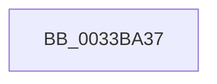

# sub_0033BA37

- RVA: `0x0033BA37`–`0x0033BA68` (길이 `49` bytes)
- VA: `0x000000014033BA37`
- 실행 섹션: `.text`
- PDB 이름 있음: `아니요`; PDB Function 태그: `아니요`
- unwind 정보 RVA: `0x00076E50`
- 디코드: `11`개 명령, `49/49` bytes 표시
- 미해석 바이트: `0` (있으면 어셈블리에 `.byte`로 보존)

> 이 문서는 커널 이미지의 기계어와 PDB 기호를 분석해 생성했습니다. 4번과 5번은 함수 원형과 자료형을 바이너리 사용 방식에서 추정한 C 해석이며 원본 소스 복구 결과는 아닙니다.

## 1. Dependencies

- 직접 호출 지점: **0**; 고유 호출 대상: **0**
- 직접 호출자로 확인된 함수: **0**
- RIP 상대 이미지 참조: **1**

### Outgoing calls
- 직접 디코드된 call 명령이 없습니다.

### Direct callers
- 이 함수 시작 RVA로 연결되는 직접 call은 확인되지 않았습니다. 간접 호출은 완전히 역산할 수 없습니다.

### Static image references
- `0x0033BA4F` → RVA `0x00E3D240` (`.data`; read)

## 2. Other-region calls and transfers

- 다른 실행 섹션으로 향하는 call: **0**
- call이 아닌 외부 분기/꼬리 이동: **1**
  - `0x0033BA66` → [sub_0033B9B4 + 0x45](Unknown_function_0033B9B4.md) (`tail-transfer`)

## 3. Assembly (complete function range)

```asm
0033BA37  49 8B C3                        mov rax, r11
0033BA3A  48 2B F0                        sub rsi, rax
0033BA3D  48 B8 AB AA AA AA AA AA AA AA   movabs rax, 0xaaaaaaaaaaaaaaab
0033BA47  48 C1 FE 04                     sar rsi, 4
0033BA4B  48 0F AF F0                     imul rsi, rax
0033BA4F  48 8B 05 EA 17 B0 00            mov rax, qword ptr [rip + 0xb017ea]
0033BA56  48 C1 EE 09                     shr rsi, 9
0033BA5A  0F B6 4C 70 01                  movzx ecx, byte ptr [rax + rsi*2 + 1]
0033BA5F  80 E1 7F                        and cl, 0x7f
0033BA62  88 4C 24 58                     mov byte ptr [rsp + 0x58], cl
0033BA66  EB 91                           jmp 0x14033b9f9
```

## 4. C-style interpretation (structured pseudocode)

```c
__int64 __fastcall sub_0033BA37(void)
{
    __int64 v_rsi;
    unsigned __int8 v_stack_p58;

    v_rsi = (v_rsi) - (v_r11);
    v_rsi = (v_rsi) >> (4);
    v_rsi = (v_rsi) * (v_r11);
    v_rsi = (v_rsi) >> (9);
    a1 = (unsigned __int8)((*(unsigned __int8 *)(*(unsigned __int64 *)(v_rip + 11540458) + v_rsi * 2 + 1)) & (127));
    v_stack_p58 = (unsigned __int8)(a1);
}
```

## 5. (Beta) C Style

```c
void sub_0033BA37(void)
{
    int64_t local_rsi;
    uint8_t v_stack_p58;

    local_rsi = (local_rsi) - (local_r11);
    local_rsi = (local_rsi) >> (4);
    local_rsi = (local_rsi) * (local_r11);
    local_rsi = (local_rsi) >> (9);
    a1 = (uint8_t)((*(uint8_t *)(*(uint64_t *)(v_rip + 0xB017EA) + local_rsi * 2 + 0x1)) & (127));
    v_stack_p58 = (uint8_t)(a1);
}
```

## 6. Execution-region graph

[열기: 2D/3D 그래프와 함수 탐색 컨트롤 패널](../../../control-panel.html?section=text&rva=0x0033BA37&view=graph)

- 2D 그래프는 위에서 아래로 흐르고, 3D 그래프는 빈 공간을 드래그해 회전합니다. Shift+드래그는 이동, 휠은 확대·축소, 함수 노드 선택은 대상 보고서 이동입니다.

### Static fallback


