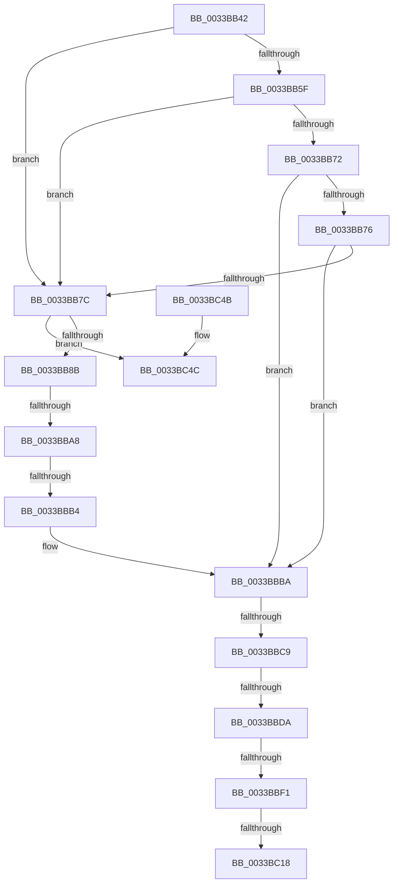

# sub_0033BB42

- RVA: `0x0033BB42`–`0x0033BC63` (길이 `289` bytes)
- VA: `0x000000014033BB42`
- 실행 섹션: `.text`
- PDB 이름 있음: `아니요`; PDB Function 태그: `아니요`
- unwind 정보 RVA: `0x00076EA4`
- 디코드: `75`개 명령, `289/289` bytes 표시
- 미해석 바이트: `0` (있으면 어셈블리에 `.byte`로 보존)

> 이 문서는 커널 이미지의 기계어와 PDB 기호를 분석해 생성했습니다. 4번과 5번은 함수 원형과 자료형을 바이너리 사용 방식에서 추정한 C 해석이며 원본 소스 복구 결과는 아닙니다.

## 1. Dependencies

- 직접 호출 지점: **1**; 고유 호출 대상: **1**
- 직접 호출자로 확인된 함수: **0**
- RIP 상대 이미지 참조: **5**

### Outgoing calls
- `0x0033BC5D` → [KeBugCheckEx](../4F/KeBugCheckEx_function_004FD660.md) (function, `0x004FD660`)

### Direct callers
- 이 함수 시작 RVA로 연결되는 직접 call은 확인되지 않았습니다. 간접 호출은 완전히 역산할 수 없습니다.

### Static image references
- `0x0033BB4E` → RVA `0x00E2DBC0` (`.data`; read)
- `0x0033BB55` → RVA `0x00E2DBC4` (`.data`; read)
- `0x0033BB66` → RVA `0x00E2DC20` (`.data`; read)
- `0x0033BBB4` → RVA `0x00E2DBC0` (`.data`; write)
- `0x0033BBE3` → RVA `0x00E2DC28` (`.data`; read)

## 2. Other-region calls and transfers

- 다른 실행 섹션으로 향하는 call: **0**
- call이 아닌 외부 분기/꼬리 이동: **6**
  - `0x0033BBA2` → [sub_0033BCB7 + 0xC6](Unknown_function_0033BCB7.md) (`tail-transfer`)
  - `0x0033BBAE` → [sub_0033BCB7 + 0x12](Unknown_function_0033BCB7.md) (`tail-transfer`)
  - `0x0033BBC3` → [sub_0033BCB7 + 0x116](Unknown_function_0033BCB7.md) (`tail-transfer`)
  - `0x0033BBD4` → [sub_0033BCB7](Unknown_function_0033BCB7.md) (`tail-transfer`)
  - `0x0033BBEB` → [sub_0033BCB7 + 0x25](Unknown_function_0033BCB7.md) (`tail-transfer`)
  - `0x0033BC12` → [sub_0033BCB7 + 0xE6](Unknown_function_0033BCB7.md) (`tail-transfer`)

## 3. Assembly (complete function range)

```asm
0033BB42  4C 89 74 24 50                  mov qword ptr [rsp + 0x50], r14
0033BB47  48 8B 14 C1                     mov rdx, qword ptr [rcx + rax*8]
0033BB4B  49 89 11                        mov qword ptr [r9], rdx
0033BB4E  48 63 0D 6B 20 AF 00            movsxd rcx, dword ptr [rip + 0xaf206b]
0033BB55  8B 15 69 20 AF 00               mov edx, dword ptr [rip + 0xaf2069]
0033BB5B  3B CA                           cmp ecx, edx
0033BB5D  77 1D                           ja 0x14033bb7c
0033BB5F  48 8B C1                        mov rax, rcx
0033BB62  48 C1 E0 04                     shl rax, 4
0033BB66  48 03 05 B3 20 AF 00            add rax, qword ptr [rip + 0xaf20b3]
0033BB6D  4C 3B 00                        cmp r8, qword ptr [rax]
0033BB70  72 0A                           jb 0x14033bb7c
0033BB72  3B CA                           cmp ecx, edx
0033BB74  74 44                           je 0x14033bbba
0033BB76  4C 3B 40 10                     cmp r8, qword ptr [rax + 0x10]
0033BB7A  72 3E                           jb 0x14033bbba
0033BB7C  45 33 F6                        xor r14d, r14d
0033BB7F  45 8B CE                        mov r9d, r14d
0033BB82  41 3B D1                        cmp edx, r9d
0033BB85  0F 8C C1 00 00 00               jl 0x14033bc4c
0033BB8B  41 8D 0C 11                     lea ecx, [r9 + rdx]
0033BB8F  D1 F9                           sar ecx, 1
0033BB91  48 63 C1                        movsxd rax, ecx
0033BB94  48 C1 E0 04                     shl rax, 4
0033BB98  48 03 05 81 20 AF 00            add rax, qword ptr [rip + 0xaf2081]
0033BB9F  4C 3B 00                        cmp r8, qword ptr [rax]
0033BBA2  0F 82 D5 01 00 00               jb 0x14033bd7d
0033BBA8  3B 0D 16 20 AF 00               cmp ecx, dword ptr [rip + 0xaf2016]
0033BBAE  0F 85 15 01 00 00               jne 0x14033bcc9
0033BBB4  89 0D 06 20 AF 00               mov dword ptr [rip + 0xaf2006], ecx
0033BBBA  8B 48 08                        mov ecx, dword ptr [rax + 8]
0033BBBD  89 4B 18                        mov dword ptr [rbx + 0x18], ecx
0033BBC0  4D 85 DB                        test r11, r11
0033BBC3  0F 85 04 02 00 00               jne 0x14033bdcd
0033BBC9  8B 57 20                        mov edx, dword ptr [rdi + 0x20]
0033BBCC  8B 47 20                        mov eax, dword ptr [rdi + 0x20]
0033BBCF  C1 E8 18                        shr eax, 0x18
0033BBD2  A8 08                           test al, 8
0033BBD4  0F 85 DD 00 00 00               jne 0x14033bcb7
0033BBDA  C1 EA 18                        shr edx, 0x18
0033BBDD  83 E2 07                        and edx, 7
0033BBE0  89 53 1C                        mov dword ptr [rbx + 0x1c], edx
0033BBE3  48 83 3D 3D 20 AF 00 00         cmp qword ptr [rip + 0xaf203d], 0
0033BBEB  0F 85 EB 00 00 00               jne 0x14033bcdc
0033BBF1  45 32 C0                        xor r8b, r8b
0033BBF4  8B 43 18                        mov eax, dword ptr [rbx + 0x18]
0033BBF7  8B 53 1C                        mov edx, dword ptr [rbx + 0x1c]
0033BBFA  4C 69 C8 80 DF 00 00            imul r9, rax, 0xdf80
0033BC01  48 8B 03                        mov rax, qword ptr [rbx]
0033BC04  44 88 43 20                     mov byte ptr [rbx + 0x20], r8b
0033BC08  89 73 24                        mov dword ptr [rbx + 0x24], esi
0033BC0B  4C 03 48 10                     add r9, qword ptr [rax + 0x10]
0033BC0F  83 FE 09                        cmp esi, 9
0033BC12  0F 8C 85 01 00 00               jl 0x14033bd9d
0033BC18  41 0F B6 C8                     movzx ecx, r8b
0033BC1C  48 8D 0C CD 3B 00 00 00         lea rcx, [rcx*8 + 0x3b]
0033BC24  48 03 CA                        add rcx, rdx
0033BC27  48 6B C1 58                     imul rax, rcx, 0x58
0033BC2B  49 03 C1                        add rax, r9
0033BC2E  48 89 43 10                     mov qword ptr [rbx + 0x10], rax
0033BC32  4C 8B 74 24 50                  mov r14, qword ptr [rsp + 0x50]
0033BC37  48 8B 5C 24 58                  mov rbx, qword ptr [rsp + 0x58]
0033BC3C  48 8B 74 24 60                  mov rsi, qword ptr [rsp + 0x60]
0033BC41  48 83 C4 30                     add rsp, 0x30
0033BC45  41 5F                           pop r15
0033BC47  41 5C                           pop r12
0033BC49  5F                              pop rdi
0033BC4A  C3                              ret
0033BC4B  CC                              int3
0033BC4C  45 33 C9                        xor r9d, r9d
0033BC4F  4C 89 74 24 20                  mov qword ptr [rsp + 0x20], r14
0033BC54  BA 80 51 00 00                  mov edx, 0x5180
0033BC59  41 8D 49 1A                     lea ecx, [r9 + 0x1a]
0033BC5D  E8 FE 19 1C 00                  call 0x1404fd660
0033BC62  CC                              int3
```

## 4. C-style interpretation (structured pseudocode)

```c
__int64 __fastcall sub_0033BB42(__int64 a1, __int64 a2, __int64 a3, __int64 a4, __int64 a5, __int64 a6, __int64 a7, __int64 a8, __int64 a9, __int64 a10, __int64 a11, __int64 a12)
{
    __int64 result;
    __int64 v_r14;
    __int64 v_rsp;
    unsigned __int64 v_stack_p50;
    unsigned __int64 v_stack_p68;

    v_stack_p50 = v_r14;
    *(unsigned __int64 *)(a4) = *(unsigned __int64 *)(a1 + result * 8);
    if (((unsigned int)((int)(*(unsigned int *)(v_rip + 11477099)))) > ((unsigned int)((unsigned int)(*(unsigned int *)(v_rip + 11477097))))) goto loc_0033BB7C;
    result = ((int)(*(unsigned int *)(v_rip + 11477099))) << (4);
    result = (result) + (*(unsigned __int64 *)(v_rip + 11477171));
    if (a3 < (*(unsigned __int64 *)(result))) goto loc_0033BB7C;
    if (((unsigned int)((int)(*(unsigned int *)(v_rip + 11477099)))) == ((unsigned int)((unsigned int)(*(unsigned int *)(v_rip + 11477097))))) goto loc_0033BBBA;
    if (a3 < (*(unsigned __int64 *)(result + 16))) goto loc_0033BBBA;
loc_0033BB7C:
    v_r14 = 0;
    if (((unsigned int)((unsigned int)(*(unsigned int *)(v_rip + 11477097)))) < 0) goto loc_0033BC4C;
    a1 = (unsigned int)((0 + (unsigned int)(*(unsigned int *)(v_rip + 11477097)) * 1) >> (1));
    result = ((int)((unsigned int)(a1))) << (4);
    result = (result) + (*(unsigned __int64 *)(v_rip + 11477121));
    *(unsigned int *)(v_rip + 11476998) = (unsigned int)(a1);
loc_0033BBBA:
    *(unsigned int *)(v_rbx + 24) = (unsigned int)((unsigned int)(*(unsigned int *)(result + 8)));
    result = (unsigned int)(((unsigned int)(*(unsigned int *)(v_rdi + 32))) >> (24));
    a2 = (unsigned int)(((unsigned int)(*(unsigned int *)(v_rdi + 32))) >> (24));
    a2 = (unsigned int)((a2) & (7));
    *(unsigned int *)(v_rbx + 28) = (unsigned int)(a2);
    a3 = 0;
    a4 = (0) * ((unsigned int)(*(unsigned int *)(v_rbx + 24)));
    *(unsigned __int8 *)(v_rbx + 32) = 0;
    *(unsigned int *)(v_rbx + 36) = (unsigned int)(v_rsi);
    a4 = (a4) + (*(unsigned __int64 *)(*(unsigned __int64 *)(v_rbx) + 16));
    a1 = (0 * 8 + 59) + ((unsigned int)(*(unsigned int *)(v_rbx + 28)));
    result = (*(unsigned __int64 *)(v_rbx)) * (a1);
    result = (result) + (a4);
    *(unsigned __int64 *)(v_rbx + 16) = result;
    v_rsp = (v_rsp) + (48);
    return result;
loc_0033BC4C:
    a4 = 0;
    v_stack_p68 = a10;
    result = KeBugCheckEx(a4 + 26, (unsigned int)(0x5180ULL), a3, a4);
    return result;
}
```

## 5. (Beta) C Style

```c
int64_t sub_0033BB42(void *Arg1, int64_t Arg2, int64_t Arg3, void *Arg4, uint64_t Arg5, uint64_t Arg6, uint64_t Arg7, uint64_t Arg8, uint64_t Arg9, int64_t Arg10, int64_t Arg11, int64_t Arg12)
{
    uint8_t *arg1 = (uint8_t *)Arg1;
    uint8_t *arg4 = (uint8_t *)Arg4;

    int64_t result;
    int64_t local_r14;
    int64_t local_rsp;
    uint64_t v_stack_p50;
    uint64_t v_stack_p68;

    v_stack_p50 = local_r14;
    *(uint64_t *)(arg4) = *(uint64_t *)(arg1 + result * 8);
    if (((uint32_t)((int32_t)(*(uint32_t *)(v_rip + 0xAF206B)))) > ((uint32_t)((uint32_t)(*(uint32_t *)(v_rip + 0xAF2069))))) goto loc_0033BB7C;
    result = ((int32_t)(*(uint32_t *)(v_rip + 0xAF206B))) << (4);
    result = (result) + (*(uint64_t *)(v_rip + 0xAF20B3));
    if (Arg3 < (*(uint64_t *)(result))) goto loc_0033BB7C;
    if (((uint32_t)((int32_t)(*(uint32_t *)(v_rip + 0xAF206B)))) == ((uint32_t)((uint32_t)(*(uint32_t *)(v_rip + 0xAF2069))))) goto loc_0033BBBA;
    if (Arg3 < (*(uint64_t *)(result + 0x10))) goto loc_0033BBBA;
loc_0033BB7C:
    local_r14 = 0;
    if (((uint32_t)((uint32_t)(*(uint32_t *)(v_rip + 0xAF2069)))) < 0) goto loc_0033BC4C;
    Arg1 = (uint32_t)((0 + (uint32_t)(*(uint32_t *)(v_rip + 0xAF2069)) * 1) >> (1));
    result = ((int32_t)((uint32_t)(Arg1))) << (4);
    result = (result) + (*(uint64_t *)(v_rip + 0xAF2081));
    *(uint32_t *)(v_rip + 0xAF2006) = (uint32_t)(Arg1);
loc_0033BBBA:
    *(uint32_t *)(local_rbx + 0x18) = (uint32_t)((uint32_t)(*(uint32_t *)(result + 0x8)));
    result = (uint32_t)(((uint32_t)(*(uint32_t *)(local_rdi + 0x20))) >> (24));
    Arg2 = (uint32_t)(((uint32_t)(*(uint32_t *)(local_rdi + 0x20))) >> (24));
    Arg2 = (uint32_t)((Arg2) & (7));
    *(uint32_t *)(local_rbx + 0x1C) = (uint32_t)(Arg2);
    Arg3 = 0;
    Arg4 = (0) * ((uint32_t)(*(uint32_t *)(local_rbx + 0x18)));
    *(uint8_t *)(local_rbx + 0x20) = 0;
    *(uint32_t *)(local_rbx + 0x24) = (uint32_t)(local_rsi);
    Arg4 = (Arg4) + (*(uint64_t *)(*(uint64_t *)(local_rbx) + 0x10));
    Arg1 = (0 * 8 + 59) + ((uint32_t)(*(uint32_t *)(local_rbx + 0x1C)));
    result = (*(uint64_t *)(local_rbx)) * (Arg1);
    result = (result) + (Arg4);
    *(uint64_t *)(local_rbx + 0x10) = result;
    local_rsp = (local_rsp) + (48);
    return result;
loc_0033BC4C:
    Arg4 = 0;
    v_stack_p68 = Arg10;
    result = KeBugCheckEx(Arg4 + 26, (uint32_t)(0x5180ULL), Arg3, Arg4);
    return result;
}
```

### 관측된 메모리 오프셋

구조체 형식이 확인되지 않은 접근은 인자 기준의 오프셋으로만 기록했습니다.

| 기준 인자 | 오프셋 표현 | 폭 (bit) | 접근 |
|---|---:|---:|---|
| `Arg1` | `+ 0x0 + rax*8` | `64` | `R` |
| `Arg4` | `+ 0x0` | `64` | `W` |

## 6. Execution-region graph

[열기: 2D/3D 그래프와 함수 탐색 컨트롤 패널](../../../control-panel.html?section=text&rva=0x0033BB42&view=graph)

- 2D 그래프는 위에서 아래로 흐르고, 3D 그래프는 빈 공간을 드래그해 회전합니다. Shift+드래그는 이동, 휠은 확대·축소, 함수 노드 선택은 대상 보고서 이동입니다.

### Static fallback


