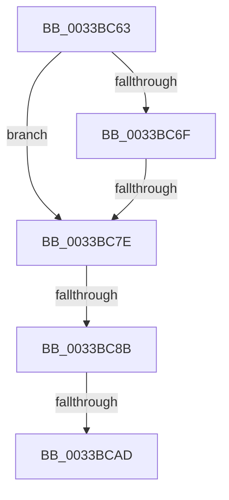

# sub_0033BC63

- RVA: `0x0033BC63`–`0x0033BCB7` (길이 `84` bytes)
- VA: `0x000000014033BC63`
- 실행 섹션: `.text`
- PDB 이름 있음: `아니요`; PDB Function 태그: `아니요`
- unwind 정보 RVA: `0x00076EBC`
- 디코드: `18`개 명령, `84/84` bytes 표시
- 미해석 바이트: `0` (있으면 어셈블리에 `.byte`로 보존)

> 이 문서는 커널 이미지의 기계어와 PDB 기호를 분석해 생성했습니다. 4번과 5번은 함수 원형과 자료형을 바이너리 사용 방식에서 추정한 C 해석이며 원본 소스 복구 결과는 아닙니다.

## 1. Dependencies

- 직접 호출 지점: **0**; 고유 호출 대상: **0**
- 직접 호출자로 확인된 함수: **0**
- RIP 상대 이미지 참조: **3**

### Outgoing calls
- 직접 디코드된 call 명령이 없습니다.

### Direct callers
- 이 함수 시작 RVA로 연결되는 직접 call은 확인되지 않았습니다. 간접 호출은 완전히 역산할 수 없습니다.

### Static image references
- `0x0033BC63` → RVA `0x00E35C00` (`.data`; read)
- `0x0033BC7E` → RVA `0x00E3CBE6` (`.data`; read)
- `0x0033BC8B` → RVA `0x00E3D240` (`.data`; read)

## 2. Other-region calls and transfers

- 다른 실행 섹션으로 향하는 call: **0**
- call이 아닌 외부 분기/꼬리 이동: **4**
  - `0x0033BC78` → [sub_0033BDD7 + 0x7](Unknown_function_0033BDD7.md) (`tail-transfer`)
  - `0x0033BC85` → [sub_0033BE0B](Unknown_function_0033BE0B.md) (`tail-transfer`)
  - `0x0033BCA7` → [sub_0033BDD7](Unknown_function_0033BDD7.md) (`tail-transfer`)
  - `0x0033BCB2` → [MiPfnToStandbyLookaside + 0x4A](MiPfnToStandbyLookaside_function_0033BAE0.md) (`tail-transfer`)

## 3. Assembly (complete function range)

```asm
0033BC63  48 8B 05 96 9F AF 00            mov rax, qword ptr [rip + 0xaf9f96]
0033BC6A  4C 3B C0                        cmp r8, rax
0033BC6D  72 0F                           jb 0x14033bc7e
0033BC6F  48 05 00 08 00 00               add rax, 0x800
0033BC75  4C 3B C0                        cmp r8, rax
0033BC78  0F 82 60 01 00 00               jb 0x14033bdde
0033BC7E  80 3D 61 0F B0 00 00            cmp byte ptr [rip + 0xb00f61], 0
0033BC85  0F 84 80 01 00 00               je 0x14033be0b
0033BC8B  48 8B 05 AE 15 B0 00            mov rax, qword ptr [rip + 0xb015ae]
0033BC92  49 8B CA                        mov rcx, r10
0033BC95  48 C1 F9 04                     sar rcx, 4
0033BC99  49 0F AF CC                     imul rcx, r12
0033BC9D  48 C1 E9 09                     shr rcx, 9
0033BCA1  0F B6 34 48                     movzx esi, byte ptr [rax + rcx*2]
0033BCA5  85 F6                           test esi, esi
0033BCA7  0F 85 2A 01 00 00               jne 0x14033bdd7
0033BCAD  BE 09 00 00 00                  mov esi, 9
0033BCB2  E9 73 FE FF FF                  jmp 0x14033bb2a
```

## 4. C-style interpretation (structured pseudocode)

```c
__int64 __fastcall sub_0033BC63(__int64 a1, __int64 a2, __int64 a3)
{
    __int64 result;

    if (a3 < (*(unsigned __int64 *)(v_rip + 11509654))) goto loc_0033BC7E;
    result = (*(unsigned __int64 *)(v_rip + 11509654)) + (0x800ULL);
loc_0033BC7E:
    a1 = (v_r10) >> (4);
    a1 = (a1) * (v_r12);
    a1 = (a1) >> (9);
}
```

## 5. (Beta) C Style

```c
int64_t sub_0033BC63(int64_t Arg1, int64_t Arg2, int64_t Arg3)
{
    int64_t result;

    if (Arg3 < (*(uint64_t *)(v_rip + 0xAF9F96))) goto loc_0033BC7E;
    result = (*(uint64_t *)(v_rip + 0xAF9F96)) + (0x800ULL);
loc_0033BC7E:
    Arg1 = (local_r10) >> (4);
    Arg1 = (Arg1) * (local_r12);
    Arg1 = (Arg1) >> (9);
}
```

## 6. Execution-region graph

[열기: 2D/3D 그래프와 함수 탐색 컨트롤 패널](../../../control-panel.html?section=text&rva=0x0033BC63&view=graph)

- 2D 그래프는 위에서 아래로 흐르고, 3D 그래프는 빈 공간을 드래그해 회전합니다. Shift+드래그는 이동, 휠은 확대·축소, 함수 노드 선택은 대상 보고서 이동입니다.

### Static fallback


