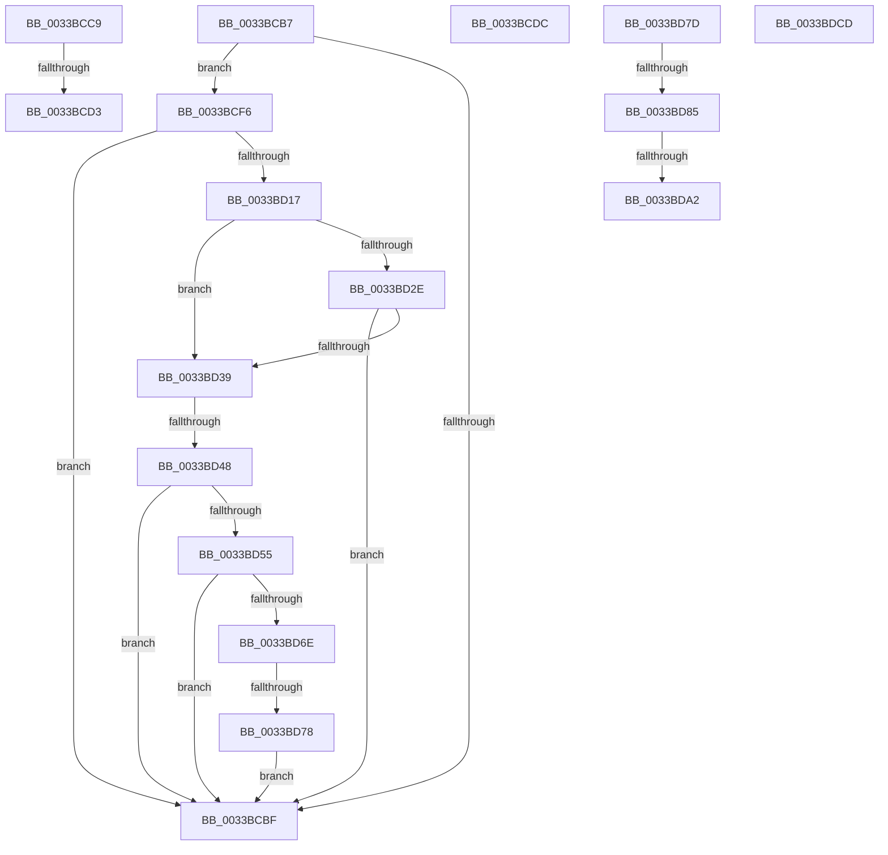

# sub_0033BCB7

- RVA: `0x0033BCB7`–`0x0033BDD7` (길이 `288` bytes)
- VA: `0x000000014033BCB7`
- 실행 섹션: `.text`
- PDB 이름 있음: `아니요`; PDB Function 태그: `아니요`
- unwind 정보 RVA: `0x00076ECC`
- 디코드: `68`개 명령, `288/288` bytes 표시
- 미해석 바이트: `0` (있으면 어셈블리에 `.byte`로 보존)

> 이 문서는 커널 이미지의 기계어와 PDB 기호를 분석해 생성했습니다. 4번과 5번은 함수 원형과 자료형을 바이너리 사용 방식에서 추정한 C 해석이며 원본 소스 복구 결과는 아닙니다.

## 1. Dependencies

- 직접 호출 지점: **2**; 고유 호출 대상: **2**
- 직접 호출자로 확인된 함수: **0**
- RIP 상대 이미지 참조: **4**

### Outgoing calls
- `0x0033BCE7` → [MiSearchChannelTable](MiSearchChannelTable_function_0033BE24.md) (function, `0x0033BE24`)
- `0x0033BD97` → [KeBugCheckEx](../4F/KeBugCheckEx_function_004FD660.md) (function, `0x004FD660`)

### Direct callers
- 이 함수 시작 RVA로 연결되는 직접 call은 확인되지 않았습니다. 간접 호출은 완전히 역산할 수 없습니다.

### Static image references
- `0x0033BCF6` → RVA `0x00E2DCE0` (`.data`; read)
- `0x0033BD17` → RVA `0x00E35C00` (`.data`; read)
- `0x0033BD48` → RVA `0x00E3CBE6` (`.data`; read)
- `0x0033BD55` → RVA `0x00E3D240` (`.data`; read)

## 2. Other-region calls and transfers

- 다른 실행 섹션으로 향하는 call: **0**
- call이 아닌 외부 분기/꼬리 이동: **10**
  - `0x0033BCC4` → [sub_0033BB42 + 0x9E](Unknown_function_0033BB42.md) (`tail-transfer`)
  - `0x0033BCCD` → [sub_0033BB42 + 0x72](Unknown_function_0033BB42.md) (`tail-transfer`)
  - `0x0033BCD7` → [sub_0033BB42 + 0x40](Unknown_function_0033BB42.md) (`tail-transfer`)
  - `0x0033BCF1` → [sub_0033BB42 + 0xB2](Unknown_function_0033BB42.md) (`tail-transfer`)
  - `0x0033BD42` → [sub_0033BB42 + 0x98](Unknown_function_0033BB42.md) (`tail-transfer`)
  - `0x0033BD72` → [sub_0033BB42 + 0x98](Unknown_function_0033BB42.md) (`tail-transfer`)
  - `0x0033BD7F` → [sub_0033BE15](Unknown_function_0033BE15.md) (`tail-transfer`)
  - `0x0033BDA0` → [sub_0033BDE8](Unknown_function_0033BDE8.md) (`tail-transfer`)
  - `0x0033BDC8` → [sub_0033BB42 + 0xF0](Unknown_function_0033BB42.md) (`tail-transfer`)
  - `0x0033BDD2` → [sub_0033BB42 + 0x9E](Unknown_function_0033BB42.md) (`tail-transfer`)

## 3. Assembly (complete function range)

```asm
0033BCB7  49 8B C7                        mov rax, r15
0033BCBA  48 3B F8                        cmp rdi, rax
0033BCBD  73 37                           jae 0x14033bcf6
0033BCBF  BA 05 00 00 00                  mov edx, 5
0033BCC4  E9 17 FF FF FF                  jmp 0x14033bbe0
0033BCC9  4C 3B 40 10                     cmp r8, qword ptr [rax + 0x10]
0033BCCD  0F 82 E1 FE FF FF               jb 0x14033bbb4
0033BCD3  44 8D 49 01                     lea r9d, [rcx + 1]
0033BCD7  E9 A6 FE FF FF                  jmp 0x14033bb82
0033BCDC  49 C1 FA 04                     sar r10, 4
0033BCE0  4D 0F AF D4                     imul r10, r12
0033BCE4  49 8B CA                        mov rcx, r10
0033BCE7  E8 38 01 00 00                  call 0x14033be24
0033BCEC  44 0F B6 40 0C                  movzx r8d, byte ptr [rax + 0xc]
0033BCF1  E9 FE FE FF FF                  jmp 0x14033bbf4
0033BCF6  48 8B 05 E3 1F AF 00            mov rax, qword ptr [rip + 0xaf1fe3]
0033BCFD  48 8D 0C 40                     lea rcx, [rax + rax*2]
0033BD01  48 C1 E1 04                     shl rcx, 4
0033BD05  48 B8 30 00 00 00 00 DE FF FF   movabs rax, 0xffffde0000000030
0033BD0F  48 03 C8                        add rcx, rax
0033BD12  48 3B F9                        cmp rdi, rcx
0033BD15  73 A8                           jae 0x14033bcbf
0033BD17  48 8B 05 E2 9E AF 00            mov rax, qword ptr [rip + 0xaf9ee2]
0033BD1E  49 8B CA                        mov rcx, r10
0033BD21  48 C1 F9 04                     sar rcx, 4
0033BD25  49 0F AF CC                     imul rcx, r12
0033BD29  48 3B C8                        cmp rcx, rax
0033BD2C  72 0B                           jb 0x14033bd39
0033BD2E  48 05 00 08 00 00               add rax, 0x800
0033BD34  48 3B C8                        cmp rcx, rax
0033BD37  72 86                           jb 0x14033bcbf
0033BD39  8B C2                           mov eax, edx
0033BD3B  C1 E8 10                        shr eax, 0x10
0033BD3E  24 07                           and al, 7
0033BD40  3C 06                           cmp al, 6
0033BD42  0F 84 92 FE FF FF               je 0x14033bbda
0033BD48  80 3D 97 0E B0 00 00            cmp byte ptr [rip + 0xb00e97], 0
0033BD4F  0F 84 6A FF FF FF               je 0x14033bcbf
0033BD55  48 8B 05 E4 14 B0 00            mov rax, qword ptr [rip + 0xb014e4]
0033BD5C  48 C1 E9 09                     shr rcx, 9
0033BD60  44 0F B6 04 48                  movzx r8d, byte ptr [rax + rcx*2]
0033BD65  45 85 C0                        test r8d, r8d
0033BD68  0F 84 51 FF FF FF               je 0x14033bcbf
0033BD6E  41 83 F8 0A                     cmp r8d, 0xa
0033BD72  0F 85 62 FE FF FF               jne 0x14033bbda
0033BD78  E9 42 FF FF FF                  jmp 0x14033bcbf
0033BD7D  85 C9                           test ecx, ecx
0033BD7F  0F 85 90 00 00 00               jne 0x14033be15
0033BD85  4C 8B C8                        mov r9, rax
0033BD88  4C 89 74 24 20                  mov qword ptr [rsp + 0x20], r14
0033BD8D  BA 80 51 00 00                  mov edx, 0x5180
0033BD92  B9 1A 00 00 00                  mov ecx, 0x1a
0033BD97  E8 C4 18 1C 00                  call 0x1404fd660
0033BD9C  CC                              int3
0033BD9D  83 FE 08                        cmp esi, 8
0033BDA0  74 46                           je 0x14033bde8
0033BDA2  32 C9                           xor cl, cl
0033BDA4  88 4B 28                        mov byte ptr [rbx + 0x28], cl
0033BDA7  0F B6 C9                        movzx ecx, cl
0033BDAA  48 63 C6                        movsxd rax, esi
0033BDAD  48 8D 0C CA                     lea rcx, [rdx + rcx*8]
0033BDB1  48 6B D1 58                     imul rdx, rcx, 0x58
0033BDB5  48 69 C8 E8 00 00 00            imul rcx, rax, 0xe8
0033BDBC  4A 03 94 09 98 3D 00 00         add rdx, qword ptr [rcx + r9 + 0x3d98]
0033BDC4  48 89 53 10                     mov qword ptr [rbx + 0x10], rdx
0033BDC8  E9 65 FE FF FF                  jmp 0x14033bc32
0033BDCD  BA 05 00 00 00                  mov edx, 5
0033BDD2  E9 09 FE FF FF                  jmp 0x14033bbe0
```

## 4. C-style interpretation (structured pseudocode)

```c
__int64 __fastcall sub_0033BCB7(__int64 a1, __int64 a2, __int64 a3)
{
    __int64 result;
    unsigned __int64 v_stack_p20;

    if (v_rdi >= v_r15) goto loc_0033BCF6;
loc_0033BCBF:
loc_0033BCF6:
    a1 = (*(unsigned __int64 *)(v_rip + 11476963) + *(unsigned __int64 *)(v_rip + 11476963) * 2) << (4);
    a1 = (a1) + (*(unsigned __int64 *)(v_rip + 11476963));
    if (v_rdi >= a1) goto loc_0033BCBF;
    a1 = (v_r10) >> (4);
    a1 = (a1) * (v_r12);
    if (a1 < (*(unsigned __int64 *)(v_rip + 11509474))) goto loc_0033BD39;
    result = (*(unsigned __int64 *)(v_rip + 11509474)) + (0x800ULL);
    if (a1 < result) goto loc_0033BCBF;
loc_0033BD39:
    result = (unsigned int)((5) >> (16));
    result = (unsigned __int8)((result) & (7));
    if ((*(unsigned __int8 *)(v_rip + 11538071)) == 0) goto loc_0033BCBF;
    a1 = (a1) >> (9);
    if ((unsigned int)(*(unsigned __int8 *)(*(unsigned __int64 *)(v_rip + 11539684) + a1 * 2)) == 0) goto loc_0033BCBF;
    goto loc_0033BCBF;
}
```

## 5. (Beta) C Style

```c
int64_t sub_0033BCB7(int64_t Arg1, int64_t Arg2, int64_t Arg3)
{
    int64_t result;
    uint64_t v_stack_p20;

    if (local_rdi >= local_r15) goto loc_0033BCF6;
loc_0033BCBF:
loc_0033BCF6:
    Arg1 = (*(uint64_t *)(v_rip + 0xAF1FE3) + *(uint64_t *)(v_rip + 0xAF1FE3) * 2) << (4);
    Arg1 = (Arg1) + (*(uint64_t *)(v_rip + 0xAF1FE3));
    if (local_rdi >= Arg1) goto loc_0033BCBF;
    Arg1 = (local_r10) >> (4);
    Arg1 = (Arg1) * (local_r12);
    if (Arg1 < (*(uint64_t *)(v_rip + 0xAF9EE2))) goto loc_0033BD39;
    result = (*(uint64_t *)(v_rip + 0xAF9EE2)) + (0x800ULL);
    if (Arg1 < result) goto loc_0033BCBF;
loc_0033BD39:
    result = (uint32_t)((5) >> (16));
    result = (uint8_t)((result) & (7));
    if ((*(uint8_t *)(v_rip + 0xB00E97)) == 0) goto loc_0033BCBF;
    Arg1 = (Arg1) >> (9);
    if ((uint32_t)(*(uint8_t *)(*(uint64_t *)(v_rip + 0xB014E4) + Arg1 * 2)) == 0) goto loc_0033BCBF;
    goto loc_0033BCBF;
}
```

## 6. Execution-region graph

[열기: 2D/3D 그래프와 함수 탐색 컨트롤 패널](../../../control-panel.html?section=text&rva=0x0033BCB7&view=graph)

- 2D 그래프는 위에서 아래로 흐르고, 3D 그래프는 빈 공간을 드래그해 회전합니다. Shift+드래그는 이동, 휠은 확대·축소, 함수 노드 선택은 대상 보고서 이동입니다.

### Static fallback


