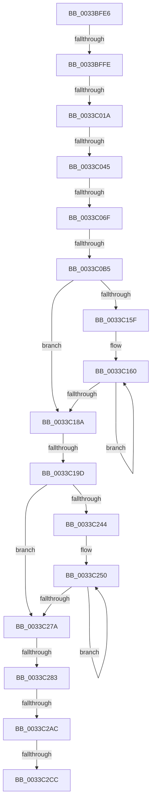

# sub_0033BFE6

- RVA: `0x0033BFE6`–`0x0033C2ED` (길이 `775` bytes)
- VA: `0x000000014033BFE6`
- 실행 섹션: `.text`
- PDB 이름 있음: `아니요`; PDB Function 태그: `아니요`
- unwind 정보 RVA: `0x00076F4C`
- 디코드: `173`개 명령, `775/775` bytes 표시
- 미해석 바이트: `0` (있으면 어셈블리에 `.byte`로 보존)

> 이 문서는 커널 이미지의 기계어와 PDB 기호를 분석해 생성했습니다. 4번과 5번은 함수 원형과 자료형을 바이너리 사용 방식에서 추정한 C 해석이며 원본 소스 복구 결과는 아닙니다.

## 1. Dependencies

- 직접 호출 지점: **0**; 고유 호출 대상: **0**
- 직접 호출자로 확인된 함수: **0**
- RIP 상대 이미지 참조: **1**

### Outgoing calls
- 직접 디코드된 call 명령이 없습니다.

### Direct callers
- 이 함수 시작 RVA로 연결되는 직접 call은 확인되지 않았습니다. 간접 호출은 완전히 역산할 수 없습니다.

### Static image references
- `0x0033C009` → RVA `0x00E2DC28` (`.data`; read)

## 2. Other-region calls and transfers

- 다른 실행 섹션으로 향하는 call: **0**
- call이 아닌 외부 분기/꼬리 이동: **9**
  - `0x0033BFF8` → [sub_0033C310 + 0x4F](Unknown_function_0033C310.md) (`tail-transfer`)
  - `0x0033C014` → [sub_0033C384](Unknown_function_0033C384.md) (`tail-transfer`)
  - `0x0033C03F` → [sub_0033C441 + 0x148](Unknown_function_0033C441.md) (`tail-transfer`)
  - `0x0033C069` → [sub_0033C441](Unknown_function_0033C441.md) (`tail-transfer`)
  - `0x0033C0AF` → [sub_0033C310](Unknown_function_0033C310.md) (`tail-transfer`)
  - `0x0033C197` → [sub_0033C441 + 0x2BC](Unknown_function_0033C441.md) (`tail-transfer`)
  - `0x0033C27D` → [sub_0033C441 + 0xD6](Unknown_function_0033C441.md) (`tail-transfer`)
  - `0x0033C2A6` → [sub_0033C310 + 0x30](Unknown_function_0033C310.md) (`tail-transfer`)
  - `0x0033C2C6` → [sub_0033C441 + 0xE4](Unknown_function_0033C441.md) (`tail-transfer`)

## 3. Assembly (complete function range)

```asm
0033BFE6  48 89 B4 24 58 01 00 00         mov qword ptr [rsp + 0x158], rsi
0033BFEE  89 84 24 50 01 00 00            mov dword ptr [rsp + 0x150], eax
0033BFF5  F6 C1 08                        test cl, 8
0033BFF8  0F 85 61 03 00 00               jne 0x14033c35f
0033BFFE  0F B6 B4 24 53 01 00 00         movzx esi, byte ptr [rsp + 0x153]
0033C006  83 E6 07                        and esi, 7
0033C009  4C 39 2D 18 1C AF 00            cmp qword ptr [rip + 0xaf1c18], r13
0033C010  89 74 24 4C                     mov dword ptr [rsp + 0x4c], esi
0033C014  0F 85 6A 03 00 00               jne 0x14033c384
0033C01A  45 32 C0                        xor r8b, r8b
0033C01D  8B 44 24 48                     mov eax, dword ptr [rsp + 0x48]
0033C021  4C 69 C8 80 DF 00 00            imul r9, rax, 0xdf80
0033C028  48 8B 44 24 30                  mov rax, qword ptr [rsp + 0x30]
0033C02D  44 88 44 24 50                  mov byte ptr [rsp + 0x50], r8b
0033C032  44 89 64 24 54                  mov dword ptr [rsp + 0x54], r12d
0033C037  4C 03 48 10                     add r9, qword ptr [rax + 0x10]
0033C03B  41 83 FC 09                     cmp r12d, 9
0033C03F  0F 8C 44 05 00 00               jl 0x14033c589
0033C045  41 0F B6 C8                     movzx ecx, r8b
0033C049  8B C6                           mov eax, esi
0033C04B  48 8D 0C CD 3B 00 00 00         lea rcx, [rcx*8 + 0x3b]
0033C053  48 03 C8                        add rcx, rax
0033C056  48 6B D1 58                     imul rdx, rcx, 0x58
0033C05A  49 03 D1                        add rdx, r9
0033C05D  48 89 54 24 40                  mov qword ptr [rsp + 0x40], rdx
0033C062  F0 48 FF 02                     lock inc qword ptr [rdx]
0033C066  4D 85 F6                        test r14, r14
0033C069  0F 84 D2 03 00 00               je 0x14033c441
0033C06F  48 8B 57 18                     mov rdx, qword ptr [rdi + 0x18]
0033C073  48 BE FF FF FF FF FF 00 00 F8   movabs rsi, 0xf80000ffffffffff
0033C07D  4D 8B 7E 38                     mov r15, qword ptr [r14 + 0x38]
0033C081  48 8B CA                        mov rcx, rdx
0033C084  4D 8B 6E 50                     mov r13, qword ptr [r14 + 0x50]
0033C088  4D 8B DF                        mov r11, r15
0033C08B  4D 8B 56 58                     mov r10, qword ptr [r14 + 0x58]
0033C08F  48 8B C2                        mov rax, rdx
0033C092  4D 8B 4E 40                     mov r9, qword ptr [r14 + 0x40]
0033C096  49 C1 E3 28                     shl r11, 0x28
0033C09A  49 33 CB                        xor rcx, r11
0033C09D  48 23 CE                        and rcx, rsi
0033C0A0  49 33 CB                        xor rcx, r11
0033C0A3  F0 48 0F B1 4F 18               lock cmpxchg qword ptr [rdi + 0x18], rcx
0033C0A9  4C 8B C0                        mov r8, rax
0033C0AC  48 3B D0                        cmp rdx, rax
0033C0AF  0F 85 5B 02 00 00               jne 0x14033c310
0033C0B5  48 8B 0F                        mov rcx, qword ptr [rdi]
0033C0B8  0F 57 C0                        xorps xmm0, xmm0
0033C0BB  49 BE FF FF FF FF FF 00 00 00   movabs r14, 0xffffffffff
0033C0C5  48 C7 44 24 60 00 00 00 00      mov qword ptr [rsp + 0x60], 0
0033C0CE  49 23 CE                        and rcx, r14
0033C0D1  49 8B C5                        mov rax, r13
0033C0D4  48 C1 E0 28                     shl rax, 0x28
0033C0D8  4D 8B C5                        mov r8, r13
0033C0DB  48 0B C8                        or rcx, rax
0033C0DE  49 C1 E0 14                     shl r8, 0x14
0033C0E2  48 89 0F                        mov qword ptr [rdi], rcx
0033C0E5  49 8B C7                        mov rax, r15
0033C0E8  48 C1 E8 13                     shr rax, 0x13
0033C0EC  49 8B CD                        mov rcx, r13
0033C0EF  48 C1 E9 18                     shr rcx, 0x18
0033C0F3  25 FF FF 1F 00                  and eax, 0x1fffff
0033C0F8  C1 E1 15                        shl ecx, 0x15
0033C0FB  49 BB FF FF FF FF FF FF 7F F0   movabs r11, 0xf07fffffffffffff
0033C105  0B C8                           or ecx, eax
0033C107  0F 57 C9                        xorps xmm1, xmm1
0033C10A  89 4F 24                        mov dword ptr [rdi + 0x24], ecx
0033C10D  48 8B 57 28                     mov rdx, qword ptr [rdi + 0x28]
0033C111  48 8B CA                        mov rcx, rdx
0033C114  48 89 94 24 88 00 00 00         mov qword ptr [rsp + 0x88], rdx
0033C11C  49 33 C8                        xor rcx, r8
0033C11F  48 8B C2                        mov rax, rdx
0033C122  49 23 CB                        and rcx, r11
0033C125  49 33 C8                        xor rcx, r8
0033C128  F3 0F 7F 44 24 68               movdqu xmmword ptr [rsp + 0x68], xmm0
0033C12E  F3 0F 7F 4C 24 78               movdqu xmmword ptr [rsp + 0x78], xmm1
0033C134  0F 11 84 24 90 00 00 00         movups xmmword ptr [rsp + 0x90], xmm0
0033C13C  0F 11 84 24 A0 00 00 00         movups xmmword ptr [rsp + 0xa0], xmm0
0033C144  0F 11 84 24 B0 00 00 00         movups xmmword ptr [rsp + 0xb0], xmm0
0033C14C  F0 48 0F B1 4F 28               lock cmpxchg qword ptr [rdi + 0x28], rcx
0033C152  48 89 84 24 B8 00 00 00         mov qword ptr [rsp + 0xb8], rax
0033C15A  48 3B D0                        cmp rdx, rax
0033C15D  74 2B                           je 0x14033c18a
0033C15F  90                              nop
0033C160  48 8B C8                        mov rcx, rax
0033C163  48 89 84 24 88 00 00 00         mov qword ptr [rsp + 0x88], rax
0033C16B  49 33 C8                        xor rcx, r8
0033C16E  48 8B D0                        mov rdx, rax
0033C171  49 23 CB                        and rcx, r11
0033C174  49 33 C8                        xor rcx, r8
0033C177  F0 48 0F B1 4F 28               lock cmpxchg qword ptr [rdi + 0x28], rcx
0033C17D  48 89 84 24 B8 00 00 00         mov qword ptr [rsp + 0xb8], rax
0033C185  48 3B D0                        cmp rdx, rax
0033C188  75 D6                           jne 0x14033c160
0033C18A  49 BB FF FF FF FF 3F 00 00 00   movabs r11, 0x3fffffffff
0033C194  4D 3B FB                        cmp r15, r11
0033C197  0F 84 60 05 00 00               je 0x14033c6fd
0033C19D  49 8B 09                        mov rcx, qword ptr [r9]
0033C1A0  0F 57 C0                        xorps xmm0, xmm0
0033C1A3  49 23 CE                        and rcx, r14
0033C1A6  48 C7 84 24 C0 00 00 00 00 00 00 00  mov qword ptr [rsp + 0xc0], 0
0033C1B2  48 8B C3                        mov rax, rbx
0033C1B5  4C 8B C3                        mov r8, rbx
0033C1B8  48 C1 E0 28                     shl rax, 0x28
0033C1BC  48 BF FF FF FF FF FF FF 7F F0   movabs rdi, 0xf07fffffffffffff
0033C1C6  48 0B C8                        or rcx, rax
0033C1C9  49 C1 E0 14                     shl r8, 0x14
0033C1CD  41 8B 41 24                     mov eax, dword ptr [r9 + 0x24]
0033C1D1  0F 57 C9                        xorps xmm1, xmm1
0033C1D4  49 89 09                        mov qword ptr [r9], rcx
0033C1D7  25 FF FF 1F 00                  and eax, 0x1fffff
0033C1DC  48 8B CB                        mov rcx, rbx
0033C1DF  48 C1 E9 18                     shr rcx, 0x18
0033C1E3  C1 E1 15                        shl ecx, 0x15
0033C1E6  0B C8                           or ecx, eax
0033C1E8  41 89 49 24                     mov dword ptr [r9 + 0x24], ecx
0033C1EC  49 8B 51 28                     mov rdx, qword ptr [r9 + 0x28]
0033C1F0  48 8B CA                        mov rcx, rdx
0033C1F3  48 89 94 24 E8 00 00 00         mov qword ptr [rsp + 0xe8], rdx
0033C1FB  49 33 C8                        xor rcx, r8
0033C1FE  48 8B C2                        mov rax, rdx
0033C201  48 23 CF                        and rcx, rdi
0033C204  49 33 C8                        xor rcx, r8
0033C207  F3 0F 7F 84 24 C8 00 00 00      movdqu xmmword ptr [rsp + 0xc8], xmm0
0033C210  F3 0F 7F 8C 24 D8 00 00 00      movdqu xmmword ptr [rsp + 0xd8], xmm1
0033C219  0F 11 84 24 F0 00 00 00         movups xmmword ptr [rsp + 0xf0], xmm0
0033C221  0F 11 84 24 00 01 00 00         movups xmmword ptr [rsp + 0x100], xmm0
0033C229  0F 11 84 24 10 01 00 00         movups xmmword ptr [rsp + 0x110], xmm0
0033C231  F0 49 0F B1 49 28               lock cmpxchg qword ptr [r9 + 0x28], rcx
0033C237  48 89 84 24 18 01 00 00         mov qword ptr [rsp + 0x118], rax
0033C23F  48 3B D0                        cmp rdx, rax
0033C242  74 36                           je 0x14033c27a
0033C244  0F 1F 40 00                     nop dword ptr [rax]
0033C248  0F 1F 84 00 00 00 00 00         nop dword ptr [rax + rax]
0033C250  48 8B C8                        mov rcx, rax
0033C253  48 89 84 24 E8 00 00 00         mov qword ptr [rsp + 0xe8], rax
0033C25B  49 33 C8                        xor rcx, r8
0033C25E  48 8B D0                        mov rdx, rax
0033C261  48 23 CF                        and rcx, rdi
0033C264  49 33 C8                        xor rcx, r8
0033C267  F0 49 0F B1 49 28               lock cmpxchg qword ptr [r9 + 0x28], rcx
0033C26D  48 89 84 24 18 01 00 00         mov qword ptr [rsp + 0x118], rax
0033C275  48 3B D0                        cmp rdx, rax
0033C278  75 D6                           jne 0x14033c250
0033C27A  4D 3B EB                        cmp r13, r11
0033C27D  0F 84 94 02 00 00               je 0x14033c517
0033C283  49 8B 52 18                     mov rdx, qword ptr [r10 + 0x18]
0033C287  4C 8B C3                        mov r8, rbx
0033C28A  49 C1 E0 28                     shl r8, 0x28
0033C28E  48 8B CA                        mov rcx, rdx
0033C291  49 33 C8                        xor rcx, r8
0033C294  48 8B C2                        mov rax, rdx
0033C297  48 23 CE                        and rcx, rsi
0033C29A  49 33 C8                        xor rcx, r8
0033C29D  F0 49 0F B1 4A 18               lock cmpxchg qword ptr [r10 + 0x18], rcx
0033C2A3  48 3B D0                        cmp rdx, rax
0033C2A6  0F 85 94 00 00 00               jne 0x14033c340
0033C2AC  41 8B 42 24                     mov eax, dword ptr [r10 + 0x24]
0033C2B0  48 C1 EB 13                     shr rbx, 0x13
0033C2B4  33 D8                           xor ebx, eax
0033C2B6  81 E3 FF FF 1F 00               and ebx, 0x1fffff
0033C2BC  33 D8                           xor ebx, eax
0033C2BE  41 89 5A 24                     mov dword ptr [r10 + 0x24], ebx
0033C2C2  41 83 FC 09                     cmp r12d, 9
0033C2C6  0F 8C 59 02 00 00               jl 0x14033c525
0033C2CC  48 8B B4 24 58 01 00 00         mov rsi, qword ptr [rsp + 0x158]
0033C2D4  48 8B 9C 24 60 01 00 00         mov rbx, qword ptr [rsp + 0x160]
0033C2DC  48 81 C4 20 01 00 00            add rsp, 0x120
0033C2E3  41 5F                           pop r15
0033C2E5  41 5E                           pop r14
0033C2E7  41 5D                           pop r13
0033C2E9  41 5C                           pop r12
0033C2EB  5F                              pop rdi
0033C2EC  C3                              ret
```

## 4. C-style interpretation (structured pseudocode)

```c
__int64 __fastcall sub_0033BFE6(unsigned __int8 a1, __int64 a2, unsigned __int8 a3, __int64 a4, __int64 a5, __int64 a6, __int64 a7, __int64 a8, unsigned int a9, __int64 a10, __int64 a11, __int64 a12, __int64 a13, __int64 a14, __int64 a15, __int64 a16, __int64 a17, __int64 a18, __int64 a19, __int64 a20, __int64 a21, __int64 a22, __int64 a23, __int64 a24, __int64 a25, __int64 a26, __int64 a27, __int64 a28, __int64 a29, __int64 a30, __int64 a31, __int64 a32, __int64 a33, __int64 a34, __int64 a35, __int64 a36, __int64 a37, __int64 a38, __int64 a39, __int64 a40, __int64 a41, __int64 a42, __int64 a43, __int64 a44)
{
    __int64 result;
    __int64 v_r11;
    __int64 v_rbx;
    __int64 v_rsi;
    __int64 v_rsp;
    unsigned __int64 v_stack_p118;
    unsigned int v_stack_p150;
    unsigned __int8 v_stack_p153;
    unsigned __int64 v_stack_p158;
    unsigned __int64 v_stack_p40;
    unsigned int v_stack_p4C;
    unsigned __int8 v_stack_p50;
    unsigned int v_stack_p54;
    unsigned __int64 v_stack_p60;
    unsigned __int64 v_stack_p68;
    unsigned __int64 v_stack_p78;
    unsigned __int64 v_stack_p88;
    unsigned __int64 v_stack_pB8;
    unsigned __int64 v_stack_pC0;
    unsigned __int64 v_stack_pC8;
    unsigned __int64 v_stack_pD8;
    unsigned __int64 v_stack_pE8;

    v_stack_p158 = v_rsi;
    v_stack_p150 = (unsigned int)(result);
    v_rsi = (unsigned int)((v_stack_p153) & (7));
    v_stack_p4C = (unsigned int)(v_rsi);
    a3 = 0;
    a4 = (a4) * ((unsigned int)(a9));
    v_stack_p50 = 0;
    v_stack_p54 = (unsigned int)(v_r12);
    a4 = (a4) + (*(unsigned __int64 *)(a6 + 16));
    a1 = (0 * 8 + 59) + ((unsigned int)((unsigned int)(v_rsi)));
    a2 = (a2) * (a1);
    a2 = (a2) + (a4);
    v_stack_p40 = a2;
    v_r11 = (*(unsigned __int64 *)(v_r14 + 56)) << (40);
    a1 = (*(unsigned __int64 *)(v_rdi + 24)) ^ (v_r11);
    a1 = (a1) & (v_rsi);
    a1 = (a1) ^ (v_r11);
    v_stack_p60 = 0;
    a1 = (*(unsigned __int64 *)(v_rdi)) & (v_r14);
    result = (*(unsigned __int64 *)(v_r14 + 80)) << (40);
    a1 = (a1) | (result);
    a3 = (*(unsigned __int64 *)(v_r14 + 80)) << (20);
    *(unsigned __int64 *)(v_rdi) = a1;
    result = (*(unsigned __int64 *)(v_r14 + 56)) >> (19);
    a1 = (*(unsigned __int64 *)(v_r14 + 80)) >> (24);
    result = (unsigned int)((result) & (0x1FFFFFULL));
    a1 = (unsigned int)((a1) << (21));
    a1 = (unsigned int)((a1) | ((unsigned int)(result)));
    *(unsigned int *)(v_rdi + 36) = a1;
    v_stack_p88 = *(unsigned __int64 *)(v_rdi + 40);
    a1 = (*(unsigned __int64 *)(v_rdi + 40)) ^ (a3);
    a1 = (a1) & (v_r11);
    a1 = (a1) ^ (a3);
    v_stack_p68 = v_xmm0;
    v_stack_p78 = v_xmm1;
    a18 = v_xmm0;
    a20 = v_xmm0;
    a22 = v_xmm0;
    v_stack_pB8 = *(unsigned __int64 *)(v_rdi + 40);
    if ((*(unsigned __int64 *)(v_rdi + 40)) == (*(unsigned __int64 *)(v_rdi + 40))) goto loc_0033C18A;
loc_0033C160:
    v_stack_p88 = *(unsigned __int64 *)(v_rdi + 40);
    a1 = (*(unsigned __int64 *)(v_rdi + 40)) ^ (a3);
    a1 = (a1) & (v_r11);
    a1 = (a1) ^ (a3);
    v_stack_pB8 = *(unsigned __int64 *)(v_rdi + 40);
    if ((*(unsigned __int64 *)(v_rdi + 40)) != (*(unsigned __int64 *)(v_rdi + 40))) goto loc_0033C160;
loc_0033C18A:
    a1 = (*(unsigned __int64 *)(*(unsigned __int64 *)(v_r14 + 64))) & (v_r14);
    v_stack_pC0 = 0;
    result = (v_rbx) << (40);
    a1 = (a1) | (result);
    a3 = (v_rbx) << (20);
    *(unsigned __int64 *)(*(unsigned __int64 *)(v_r14 + 64)) = a1;
    result = (unsigned int)(((unsigned int)(*(unsigned int *)(*(unsigned __int64 *)(v_r14 + 64) + 36))) & (0x1FFFFFULL));
    a1 = (v_rbx) >> (24);
    a1 = (unsigned int)((a1) << (21));
    a1 = (unsigned int)((a1) | ((unsigned int)(result)));
    *(unsigned int *)(*(unsigned __int64 *)(v_r14 + 64) + 36) = a1;
    v_stack_pE8 = *(unsigned __int64 *)(*(unsigned __int64 *)(v_r14 + 64) + 40);
    a1 = (*(unsigned __int64 *)(*(unsigned __int64 *)(v_r14 + 64) + 40)) ^ (a3);
    a1 = (a1) & (v_rdi);
    a1 = (a1) ^ (a3);
    v_stack_pC8 = v_xmm0;
    v_stack_pD8 = v_xmm1;
    a30 = v_xmm0;
    a32 = v_xmm0;
    a34 = v_xmm0;
    v_stack_p118 = *(unsigned __int64 *)(*(unsigned __int64 *)(v_r14 + 64) + 40);
    if ((*(unsigned __int64 *)(*(unsigned __int64 *)(v_r14 + 64) + 40)) == (*(unsigned __int64 *)(*(unsigned __int64 *)(v_r14 + 64) + 40))) goto loc_0033C27A;
loc_0033C250:
    v_stack_pE8 = *(unsigned __int64 *)(*(unsigned __int64 *)(v_r14 + 64) + 40);
    a1 = (*(unsigned __int64 *)(*(unsigned __int64 *)(v_r14 + 64) + 40)) ^ (a3);
    a1 = (a1) & (v_rdi);
    a1 = (a1) ^ (a3);
    v_stack_p118 = *(unsigned __int64 *)(*(unsigned __int64 *)(v_r14 + 64) + 40);
    if ((*(unsigned __int64 *)(*(unsigned __int64 *)(v_r14 + 64) + 40)) != (*(unsigned __int64 *)(*(unsigned __int64 *)(v_r14 + 64) + 40))) goto loc_0033C250;
loc_0033C27A:
    a3 = (v_rbx) << (40);
    a1 = (*(unsigned __int64 *)(*(unsigned __int64 *)(v_r14 + 88) + 24)) ^ (a3);
    a1 = (a1) & (v_rsi);
    a1 = (a1) ^ (a3);
    v_rbx = (v_rbx) >> (19);
    v_rbx = (unsigned int)((v_rbx) ^ ((unsigned int)((unsigned int)(*(unsigned int *)(*(unsigned __int64 *)(v_r14 + 88) + 36)))));
    v_rbx = (unsigned int)((v_rbx) & (0x1FFFFFULL));
    v_rbx = (unsigned int)((v_rbx) ^ ((unsigned int)((unsigned int)(*(unsigned int *)(*(unsigned __int64 *)(v_r14 + 88) + 36)))));
    *(unsigned int *)(*(unsigned __int64 *)(v_r14 + 88) + 36) = (unsigned int)(v_rbx);
    v_rsp = (v_rsp) + (288);
    return (unsigned int)(*(unsigned int *)(*(unsigned __int64 *)(v_r14 + 88) + 36));
}
```

## 5. (Beta) C Style

```c
int64_t sub_0033BFE6(uint8_t Arg1, void *Arg2, uint8_t Arg3, int64_t Arg4, uint64_t Arg5, void *Arg6, uint64_t Arg7, uint64_t Arg8, uint32_t Arg9, uint64_t Arg10, uint64_t Arg11, uint64_t Arg12, uint64_t Arg13, uint64_t Arg14, uint64_t Arg15, uint64_t Arg16, uint64_t Arg17, int64_t Arg18, uint64_t Arg19, int64_t Arg20, uint64_t Arg21, int64_t Arg22, uint64_t Arg23, uint64_t Arg24, uint64_t Arg25, uint64_t Arg26, uint64_t Arg27, uint64_t Arg28, uint64_t Arg29, int64_t Arg30, uint64_t Arg31, int64_t Arg32, uint64_t Arg33, int64_t Arg34, uint64_t Arg35, uint64_t Arg36, uint64_t Arg37, uint64_t Arg38, uint64_t Arg39, uint64_t Arg40, uint64_t Arg41, uint64_t Arg42, int64_t Arg43, int64_t Arg44)
{
    uint8_t *arg2 = (uint8_t *)Arg2;
    uint8_t *arg6 = (uint8_t *)Arg6;

    int64_t result;
    int64_t local_r11;
    int64_t local_rbx;
    int64_t local_rsi;
    int64_t local_rsp;
    uint64_t v_stack_p118;
    uint32_t v_stack_p150;
    uint8_t v_stack_p153;
    uint64_t v_stack_p158;
    uint64_t v_stack_p40;
    uint32_t v_stack_p4C;
    uint8_t v_stack_p50;
    uint32_t v_stack_p54;
    uint64_t v_stack_p60;
    uint64_t v_stack_p68;
    uint64_t v_stack_p78;
    uint64_t v_stack_p88;
    uint64_t v_stack_pB8;
    uint64_t v_stack_pC0;
    uint64_t v_stack_pC8;
    uint64_t v_stack_pD8;
    uint64_t v_stack_pE8;

    v_stack_p158 = local_rsi;
    v_stack_p150 = (uint32_t)(result);
    local_rsi = (uint32_t)((v_stack_p153) & (7));
    v_stack_p4C = (uint32_t)(local_rsi);
    Arg3 = 0;
    Arg4 = (Arg4) * ((uint32_t)(Arg9));
    v_stack_p50 = 0;
    v_stack_p54 = (uint32_t)(local_r12);
    Arg4 = (Arg4) + (*(uint64_t *)(arg6 + 0x10));
    Arg1 = (0 * 8 + 59) + ((uint32_t)((uint32_t)(local_rsi)));
    Arg2 = (Arg2) * (Arg1);
    Arg2 = (Arg2) + (Arg4);
    v_stack_p40 = Arg2;
    local_r11 = (*(uint64_t *)(local_r14 + 0x38)) << (40);
    Arg1 = (*(uint64_t *)(local_rdi + 0x18)) ^ (local_r11);
    Arg1 = (Arg1) & (local_rsi);
    Arg1 = (Arg1) ^ (local_r11);
    v_stack_p60 = 0;
    Arg1 = (*(uint64_t *)(local_rdi)) & (local_r14);
    result = (*(uint64_t *)(local_r14 + 0x50)) << (40);
    Arg1 = (Arg1) | (result);
    Arg3 = (*(uint64_t *)(local_r14 + 0x50)) << (20);
    *(uint64_t *)(local_rdi) = Arg1;
    result = (*(uint64_t *)(local_r14 + 0x38)) >> (19);
    Arg1 = (*(uint64_t *)(local_r14 + 0x50)) >> (24);
    result = (uint32_t)((result) & (0x1FFFFFULL));
    Arg1 = (uint32_t)((Arg1) << (21));
    Arg1 = (uint32_t)((Arg1) | ((uint32_t)(result)));
    *(uint32_t *)(local_rdi + 0x24) = Arg1;
    v_stack_p88 = *(uint64_t *)(local_rdi + 0x28);
    Arg1 = (*(uint64_t *)(local_rdi + 0x28)) ^ (Arg3);
    Arg1 = (Arg1) & (local_r11);
    Arg1 = (Arg1) ^ (Arg3);
    v_stack_p68 = v_xmm0;
    v_stack_p78 = v_xmm1;
    Arg18 = v_xmm0;
    Arg20 = v_xmm0;
    Arg22 = v_xmm0;
    v_stack_pB8 = *(uint64_t *)(local_rdi + 0x28);
    if ((*(uint64_t *)(local_rdi + 0x28)) == (*(uint64_t *)(local_rdi + 0x28))) goto loc_0033C18A;
loc_0033C160:
    v_stack_p88 = *(uint64_t *)(local_rdi + 0x28);
    Arg1 = (*(uint64_t *)(local_rdi + 0x28)) ^ (Arg3);
    Arg1 = (Arg1) & (local_r11);
    Arg1 = (Arg1) ^ (Arg3);
    v_stack_pB8 = *(uint64_t *)(local_rdi + 0x28);
    if ((*(uint64_t *)(local_rdi + 0x28)) != (*(uint64_t *)(local_rdi + 0x28))) goto loc_0033C160;
loc_0033C18A:
    Arg1 = (*(uint64_t *)(*(uint64_t *)(local_r14 + 0x40))) & (local_r14);
    v_stack_pC0 = 0;
    result = (local_rbx) << (40);
    Arg1 = (Arg1) | (result);
    Arg3 = (local_rbx) << (20);
    *(uint64_t *)(*(uint64_t *)(local_r14 + 0x40)) = Arg1;
    result = (uint32_t)(((uint32_t)(*(uint32_t *)(*(uint64_t *)(local_r14 + 0x40) + 0x24))) & (0x1FFFFFULL));
    Arg1 = (local_rbx) >> (24);
    Arg1 = (uint32_t)((Arg1) << (21));
    Arg1 = (uint32_t)((Arg1) | ((uint32_t)(result)));
    *(uint32_t *)(*(uint64_t *)(local_r14 + 0x40) + 0x24) = Arg1;
    v_stack_pE8 = *(uint64_t *)(*(uint64_t *)(local_r14 + 0x40) + 0x28);
    Arg1 = (*(uint64_t *)(*(uint64_t *)(local_r14 + 0x40) + 0x28)) ^ (Arg3);
    Arg1 = (Arg1) & (local_rdi);
    Arg1 = (Arg1) ^ (Arg3);
    v_stack_pC8 = v_xmm0;
    v_stack_pD8 = v_xmm1;
    Arg30 = v_xmm0;
    Arg32 = v_xmm0;
    Arg34 = v_xmm0;
    v_stack_p118 = *(uint64_t *)(*(uint64_t *)(local_r14 + 0x40) + 0x28);
    if ((*(uint64_t *)(*(uint64_t *)(local_r14 + 0x40) + 0x28)) == (*(uint64_t *)(*(uint64_t *)(local_r14 + 0x40) + 0x28))) goto loc_0033C27A;
loc_0033C250:
    v_stack_pE8 = *(uint64_t *)(*(uint64_t *)(local_r14 + 0x40) + 0x28);
    Arg1 = (*(uint64_t *)(*(uint64_t *)(local_r14 + 0x40) + 0x28)) ^ (Arg3);
    Arg1 = (Arg1) & (local_rdi);
    Arg1 = (Arg1) ^ (Arg3);
    v_stack_p118 = *(uint64_t *)(*(uint64_t *)(local_r14 + 0x40) + 0x28);
    if ((*(uint64_t *)(*(uint64_t *)(local_r14 + 0x40) + 0x28)) != (*(uint64_t *)(*(uint64_t *)(local_r14 + 0x40) + 0x28))) goto loc_0033C250;
loc_0033C27A:
    Arg3 = (local_rbx) << (40);
    Arg1 = (*(uint64_t *)(*(uint64_t *)(local_r14 + 0x58) + 0x18)) ^ (Arg3);
    Arg1 = (Arg1) & (local_rsi);
    Arg1 = (Arg1) ^ (Arg3);
    local_rbx = (local_rbx) >> (19);
    local_rbx = (uint32_t)((local_rbx) ^ ((uint32_t)((uint32_t)(*(uint32_t *)(*(uint64_t *)(local_r14 + 0x58) + 0x24)))));
    local_rbx = (uint32_t)((local_rbx) & (0x1FFFFFULL));
    local_rbx = (uint32_t)((local_rbx) ^ ((uint32_t)((uint32_t)(*(uint32_t *)(*(uint64_t *)(local_r14 + 0x58) + 0x24)))));
    *(uint32_t *)(*(uint64_t *)(local_r14 + 0x58) + 0x24) = (uint32_t)(local_rbx);
    local_rsp = (local_rsp) + (288);
    return (uint32_t)(*(uint32_t *)(*(uint64_t *)(local_r14 + 0x58) + 0x24));
}
```

### 관측된 메모리 오프셋

구조체 형식이 확인되지 않은 접근은 인자 기준의 오프셋으로만 기록했습니다.

| 기준 인자 | 오프셋 표현 | 폭 (bit) | 접근 |
|---|---:|---:|---|
| `Arg2` | `+ 0x0` | `64` | `R/W` |
| `Arg6` | `+ 0x10` | `64` | `R` |

## 6. Execution-region graph

[열기: 2D/3D 그래프와 함수 탐색 컨트롤 패널](../../../control-panel.html?section=text&rva=0x0033BFE6&view=graph)

- 2D 그래프는 위에서 아래로 흐르고, 3D 그래프는 빈 공간을 드래그해 회전합니다. Shift+드래그는 이동, 휠은 확대·축소, 함수 노드 선택은 대상 보고서 이동입니다.

### Static fallback


