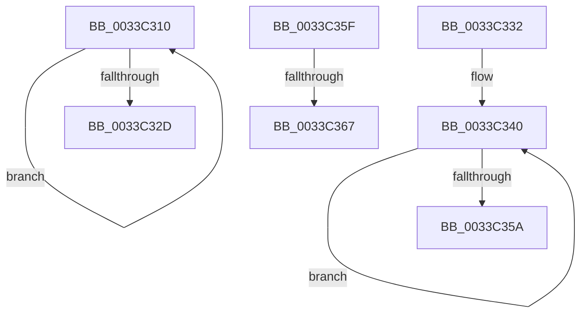

# sub_0033C310

- RVA: `0x0033C310`–`0x0033C371` (길이 `97` bytes)
- VA: `0x000000014033C310`
- 실행 섹션: `.text`
- PDB 이름 있음: `아니요`; PDB Function 태그: `아니요`
- unwind 정보 RVA: `0x00076F74`
- 디코드: `26`개 명령, `97/97` bytes 표시
- 미해석 바이트: `0` (있으면 어셈블리에 `.byte`로 보존)

> 이 문서는 커널 이미지의 기계어와 PDB 기호를 분석해 생성했습니다. 4번과 5번은 함수 원형과 자료형을 바이너리 사용 방식에서 추정한 C 해석이며 원본 소스 복구 결과는 아닙니다.

## 1. Dependencies

- 직접 호출 지점: **0**; 고유 호출 대상: **0**
- 직접 호출자로 확인된 함수: **0**
- RIP 상대 이미지 참조: **0**

### Outgoing calls
- 직접 디코드된 call 명령이 없습니다.

### Direct callers
- 이 함수 시작 RVA로 연결되는 직접 call은 확인되지 않았습니다. 간접 호출은 완전히 역산할 수 없습니다.

### Static image references
- 디코드된 RIP-relative 메모리 참조가 없습니다.

## 2. Other-region calls and transfers

- 다른 실행 섹션으로 향하는 call: **0**
- call이 아닌 외부 분기/꼬리 이동: **4**
  - `0x0033C32D` → [sub_0033BFE6 + 0xCF](Unknown_function_0033BFE6.md) (`tail-transfer`)
  - `0x0033C35A` → [sub_0033BFE6 + 0x2C6](Unknown_function_0033BFE6.md) (`tail-transfer`)
  - `0x0033C365` → [sub_0033C384 + 0x2E](Unknown_function_0033C384.md) (`tail-transfer`)
  - `0x0033C36C` → [sub_0033BFE6 + 0x23](Unknown_function_0033BFE6.md) (`tail-transfer`)

## 3. Assembly (complete function range)

```asm
0033C310  49 8B C8                        mov rcx, r8
0033C313  4D 33 C3                        xor r8, r11
0033C316  4C 23 C6                        and r8, rsi
0033C319  48 8B C1                        mov rax, rcx
0033C31C  4D 33 C3                        xor r8, r11
0033C31F  F0 4C 0F B1 47 18               lock cmpxchg qword ptr [rdi + 0x18], r8
0033C325  4C 8B C0                        mov r8, rax
0033C328  48 3B C8                        cmp rcx, rax
0033C32B  75 E3                           jne 0x14033c310
0033C32D  E9 83 FD FF FF                  jmp 0x14033c0b5
0033C332  0F 1F 40 00                     nop dword ptr [rax]
0033C336  66 66 0F 1F 84 00 00 00 00 00   nop word ptr [rax + rax]
0033C340  49 8B C8                        mov rcx, r8
0033C343  48 8B D0                        mov rdx, rax
0033C346  48 33 C8                        xor rcx, rax
0033C349  48 23 CE                        and rcx, rsi
0033C34C  49 33 C8                        xor rcx, r8
0033C34F  F0 49 0F B1 4A 18               lock cmpxchg qword ptr [r10 + 0x18], rcx
0033C355  48 3B D0                        cmp rdx, rax
0033C358  75 E6                           jne 0x14033c340
0033C35A  E9 4D FF FF FF                  jmp 0x14033c2ac
0033C35F  49 8B CA                        mov rcx, r10
0033C362  4C 3B F9                        cmp r15, rcx
0033C365  73 4B                           jae 0x14033c3b2
0033C367  BE 05 00 00 00                  mov esi, 5
0033C36C  E9 98 FC FF FF                  jmp 0x14033c009
```

## 4. C-style interpretation (structured pseudocode)

```c
__int64 __fastcall sub_0033C310(__int64 a1, __int64 a2, __int64 a3)
{
    a3 = (a3) ^ (v_r11);
    a3 = (a3) & (v_rsi);
    a3 = (a3) ^ (v_r11);
    if (a3 != a3) goto loc_0033C310;
}
```

## 5. (Beta) C Style

```c
int64_t sub_0033C310(int64_t Arg1, int64_t Arg2, int64_t Arg3)
{
    Arg3 = (Arg3) ^ (local_r11);
    Arg3 = (Arg3) & (local_rsi);
    Arg3 = (Arg3) ^ (local_r11);
    if (Arg3 != Arg3) goto loc_0033C310;
}
```

## 6. Execution-region graph

[열기: 2D/3D 그래프와 함수 탐색 컨트롤 패널](../../../control-panel.html?section=text&rva=0x0033C310&view=graph)

- 2D 그래프는 위에서 아래로 흐르고, 3D 그래프는 빈 공간을 드래그해 회전합니다. Shift+드래그는 이동, 휠은 확대·축소, 함수 노드 선택은 대상 보고서 이동입니다.

### Static fallback


