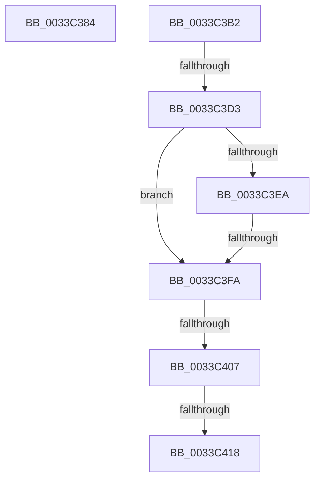

# sub_0033C384

- RVA: `0x0033C384`–`0x0033C41D` (길이 `153` bytes)
- VA: `0x000000014033C384`
- 실행 섹션: `.text`
- PDB 이름 있음: `아니요`; PDB Function 태그: `아니요`
- unwind 정보 RVA: `0x00076F98`
- 디코드: `33`개 명령, `153/153` bytes 표시
- 미해석 바이트: `0` (있으면 어셈블리에 `.byte`로 보존)

> 이 문서는 커널 이미지의 기계어와 PDB 기호를 분석해 생성했습니다. 4번과 5번은 함수 원형과 자료형을 바이너리 사용 방식에서 추정한 C 해석이며 원본 소스 복구 결과는 아닙니다.

## 1. Dependencies

- 직접 호출 지점: **2**; 고유 호출 대상: **2**
- 직접 호출자로 확인된 함수: **0**
- RIP 상대 이미지 참조: **2**

### Outgoing calls
- `0x0033C38F` → [MiSearchChannelTable](MiSearchChannelTable_function_0033BE24.md) (function, `0x0033BE24`)
- `0x0033C40A` → [MiGetPfnSlabType](../28/MiGetPfnSlabType_function_0028E2D0.md) (function, `0x0028E2D0`)

### Direct callers
- 이 함수 시작 RVA로 연결되는 직접 call은 확인되지 않았습니다. 간접 호출은 완전히 역산할 수 없습니다.

### Static image references
- `0x0033C3B2` → RVA `0x00E2DCE0` (`.data`; read)
- `0x0033C3D3` → RVA `0x00E35C00` (`.data`; read)

## 2. Other-region calls and transfers

- 다른 실행 섹션으로 향하는 call: **0**
- call이 아닌 외부 분기/꼬리 이동: **6**
  - `0x0033C3AD` → [sub_0033BFE6 + 0x37](Unknown_function_0033BFE6.md) (`tail-transfer`)
  - `0x0033C3D1` → [sub_0033C310 + 0x57](Unknown_function_0033C310.md) (`tail-transfer`)
  - `0x0033C3F4` → [sub_0033C310 + 0x57](Unknown_function_0033C310.md) (`tail-transfer`)
  - `0x0033C401` → [sub_0033BFE6 + 0x18](Unknown_function_0033BFE6.md) (`tail-transfer`)
  - `0x0033C412` → [sub_0033BFE6 + 0x18](Unknown_function_0033BFE6.md) (`tail-transfer`)
  - `0x0033C418` → [sub_0033C310 + 0x57](Unknown_function_0033C310.md) (`tail-transfer`)

## 3. Assembly (complete function range)

```asm
0033C384  49 C1 F9 04                     sar r9, 4
0033C388  4D 0F AF CB                     imul r9, r11
0033C38C  49 8B C9                        mov rcx, r9
0033C38F  E8 90 FA FF FF                  call 0x14033be24
0033C394  49 BA 00 00 00 00 00 DE FF FF   movabs r10, 0xffffde0000000000
0033C39E  49 BB AB AA AA AA AA AA AA AA   movabs r11, 0xaaaaaaaaaaaaaaab
0033C3A8  44 0F B6 40 0C                  movzx r8d, byte ptr [rax + 0xc]
0033C3AD  E9 6B FC FF FF                  jmp 0x14033c01d
0033C3B2  48 8B 0D 27 19 AF 00            mov rcx, qword ptr [rip + 0xaf1927]
0033C3B9  48 8D 14 49                     lea rdx, [rcx + rcx*2]
0033C3BD  48 C1 E2 04                     shl rdx, 4
0033C3C1  48 B9 30 00 00 00 00 DE FF FF   movabs rcx, 0xffffde0000000030
0033C3CB  48 03 D1                        add rdx, rcx
0033C3CE  4C 3B FA                        cmp r15, rdx
0033C3D1  73 94                           jae 0x14033c367
0033C3D3  48 8B 0D 26 98 AF 00            mov rcx, qword ptr [rip + 0xaf9826]
0033C3DA  49 8B D1                        mov rdx, r9
0033C3DD  48 C1 FA 04                     sar rdx, 4
0033C3E1  49 0F AF D3                     imul rdx, r11
0033C3E5  48 3B D1                        cmp rdx, rcx
0033C3E8  72 10                           jb 0x14033c3fa
0033C3EA  48 81 C1 00 08 00 00            add rcx, 0x800
0033C3F1  48 3B D1                        cmp rdx, rcx
0033C3F4  0F 82 6D FF FF FF               jb 0x14033c367
0033C3FA  C1 E8 10                        shr eax, 0x10
0033C3FD  24 07                           and al, 7
0033C3FF  3C 06                           cmp al, 6
0033C401  0F 84 F7 FB FF FF               je 0x14033bffe
0033C407  49 8B CF                        mov rcx, r15
0033C40A  E8 C1 1E F5 FF                  call 0x14028e2d0
0033C40F  83 F8 09                        cmp eax, 9
0033C412  0F 85 E6 FB FF FF               jne 0x14033bffe
0033C418  E9 4A FF FF FF                  jmp 0x14033c367
```

## 4. C-style interpretation (structured pseudocode)

```c
__int64 __fastcall sub_0033C384(__int64 a1, __int64 a2, __int64 a3, __int64 a4)
{
    __int64 result;

    a4 = (a4) >> (4);
    a4 = (a4) * (v_r11);
    result = MiSearchChannelTable(a4, a2, a3, a4);
}
```

## 5. (Beta) C Style

```c
int64_t sub_0033C384(int64_t Arg1, int64_t Arg2, int64_t Arg3, int64_t Arg4)
{
    int64_t result;

    Arg4 = (Arg4) >> (4);
    Arg4 = (Arg4) * (local_r11);
    result = MiSearchChannelTable(Arg4, Arg2, Arg3, Arg4);
}
```

## 6. Execution-region graph

[열기: 2D/3D 그래프와 함수 탐색 컨트롤 패널](../../../control-panel.html?section=text&rva=0x0033C384&view=graph)

- 2D 그래프는 위에서 아래로 흐르고, 3D 그래프는 빈 공간을 드래그해 회전합니다. Shift+드래그는 이동, 휠은 확대·축소, 함수 노드 선택은 대상 보고서 이동입니다.

### Static fallback


