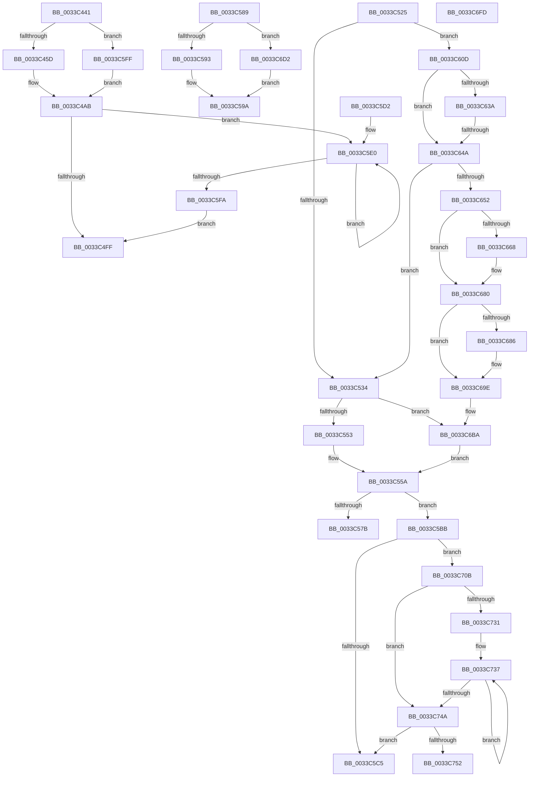

# sub_0033C441

- RVA: `0x0033C441`–`0x0033C757` (길이 `790` bytes)
- VA: `0x000000014033C441`
- 실행 섹션: `.text`
- PDB 이름 있음: `아니요`; PDB Function 태그: `아니요`
- unwind 정보 RVA: `0x00076FBC`
- 디코드: `188`개 명령, `790/790` bytes 표시
- 미해석 바이트: `0` (있으면 어셈블리에 `.byte`로 보존)

> 이 문서는 커널 이미지의 기계어와 PDB 기호를 분석해 생성했습니다. 4번과 5번은 함수 원형과 자료형을 바이너리 사용 방식에서 추정한 C 해석이며 원본 소스 복구 결과는 아닙니다.

## 1. Dependencies

- 직접 호출 지점: **6**; 고유 호출 대상: **4**
- 직접 호출자로 확인된 함수: **0**
- RIP 상대 이미지 참조: **1**

### Outgoing calls
- `0x0033C4A6` → [MiSetPfnNodeFlinkHigh](../40/MiSetPfnNodeFlinkHigh_function_0040ED40.md) (function, `0x0040ED40`)
- `0x0033C4C7` → [MiSetPfnNodeFlinkHigh](../40/MiSetPfnNodeFlinkHigh_function_0040ED40.md) (function, `0x0040ED40`)
- `0x0033C65E` → [ExAcquireSpinLockExclusiveAtDpcLevel](../24/ExAcquireSpinLockExclusiveAtDpcLevel_function_00248E80.md) (function, `0x00248E80`)
- `0x0033C674` → [KeSetEvent](KeSetEvent_function_0033F310.md) (function, `0x0033F310`)
- `0x0033C692` → [KeSetEvent](KeSetEvent_function_0033F310.md) (function, `0x0033F310`)
- `0x0033C6A5` → [ExReleaseSpinLockExclusiveFromDpcLevel](../24/ExReleaseSpinLockExclusiveFromDpcLevel_function_002497E0.md) (function, `0x002497E0`)

### Direct callers
- 이 함수 시작 RVA로 연결되는 직접 call은 확인되지 않았습니다. 간접 호출은 완전히 역산할 수 없습니다.

### Static image references
- `0x0033C6D8` → RVA `0x00E3D240` (`.data`; read)

## 2. Other-region calls and transfers

- 다른 실행 섹션으로 향하는 call: **0**
- call이 아닌 외부 분기/꼬리 이동: **7**
  - `0x0033C520` → [sub_0033BFE6 + 0x2DC](Unknown_function_0033BFE6.md) (`tail-transfer`)
  - `0x0033C584` → [sub_0033BFE6 + 0x2E6](Unknown_function_0033BFE6.md) (`tail-transfer`)
  - `0x0033C5B6` → [sub_0033BFE6 + 0x77](Unknown_function_0033BFE6.md) (`tail-transfer`)
  - `0x0033C5CD` → [sub_0033BFE6 + 0x2E6](Unknown_function_0033BFE6.md) (`tail-transfer`)
  - `0x0033C644` → [sub_0033C760](Unknown_function_0033C760.md) (`tail-transfer`)
  - `0x0033C706` → [sub_0033BFE6 + 0x294](Unknown_function_0033BFE6.md) (`tail-transfer`)
  - `0x0033C752` → [sub_0033BFE6 + 0x2E6](Unknown_function_0033BFE6.md) (`tail-transfer`)

## 3. Assembly (complete function range)

```asm
0033C441  48 8B 44 24 40                  mov rax, qword ptr [rsp + 0x40]
0033C446  49 BB FF FF FF FF 3F 00 00 00   movabs r11, 0x3fffffffff
0033C450  4C 8B 70 18                     mov r14, qword ptr [rax + 0x18]
0033C454  4D 3B F3                        cmp r14, r11
0033C457  0F 84 A2 01 00 00               je 0x14033c5ff
0033C45D  4B 8D 0C 76                     lea rcx, [r14 + r14*2]
0033C461  48 C1 E1 04                     shl rcx, 4
0033C465  49 8B C2                        mov rax, r10
0033C468  48 03 C8                        add rcx, rax
0033C46B  48 B8 FF FF FF FF FF 00 00 00   movabs rax, 0xffffffffff
0033C475  48 8B 11                        mov rdx, qword ptr [rcx]
0033C478  48 23 D0                        and rdx, rax
0033C47B  48 8B C3                        mov rax, rbx
0033C47E  48 C1 E0 28                     shl rax, 0x28
0033C482  48 0B D0                        or rdx, rax
0033C485  8B 41 24                        mov eax, dword ptr [rcx + 0x24]
0033C488  48 89 11                        mov qword ptr [rcx], rdx
0033C48B  25 FF FF 1F 00                  and eax, 0x1fffff
0033C490  48 8B D3                        mov rdx, rbx
0033C493  48 C1 EA 18                     shr rdx, 0x18
0033C497  C1 E2 15                        shl edx, 0x15
0033C49A  0B D0                           or edx, eax
0033C49C  89 51 24                        mov dword ptr [rcx + 0x24], edx
0033C49F  48 8B D3                        mov rdx, rbx
0033C4A2  48 C1 EA 23                     shr rdx, 0x23
0033C4A6  E8 95 28 0D 00                  call 0x14040ed40
0033C4AB  81 4F 24 00 00 E0 FF            or dword ptr [rdi + 0x24], 0xffe00000
0033C4B2  48 B8 00 00 00 00 00 FF FF FF   movabs rax, 0xffffff0000000000
0033C4BC  48 09 07                        or qword ptr [rdi], rax
0033C4BF  BA 07 00 00 00                  mov edx, 7
0033C4C4  48 8B CF                        mov rcx, rdi
0033C4C7  E8 74 28 0D 00                  call 0x14040ed40
0033C4CC  48 8B 57 18                     mov rdx, qword ptr [rdi + 0x18]
0033C4D0  4D 8B C6                        mov r8, r14
0033C4D3  49 C1 E0 28                     shl r8, 0x28
0033C4D7  48 8B CA                        mov rcx, rdx
0033C4DA  49 33 C8                        xor rcx, r8
0033C4DD  48 BE FF FF FF FF FF 00 00 F8   movabs rsi, 0xf80000ffffffffff
0033C4E7  48 23 CE                        and rcx, rsi
0033C4EA  48 8B C2                        mov rax, rdx
0033C4ED  49 33 C8                        xor rcx, r8
0033C4F0  F0 48 0F B1 4F 18               lock cmpxchg qword ptr [rdi + 0x18], rcx
0033C4F6  48 3B D0                        cmp rdx, rax
0033C4F9  0F 85 E1 00 00 00               jne 0x14033c5e0
0033C4FF  8B 47 24                        mov eax, dword ptr [rdi + 0x24]
0033C502  49 C1 EE 13                     shr r14, 0x13
0033C506  44 33 F0                        xor r14d, eax
0033C509  41 81 E6 FF FF 1F 00            and r14d, 0x1fffff
0033C510  44 33 F0                        xor r14d, eax
0033C513  44 89 77 24                     mov dword ptr [rdi + 0x24], r14d
0033C517  48 8B 44 24 40                  mov rax, qword ptr [rsp + 0x40]
0033C51C  48 89 58 18                     mov qword ptr [rax + 0x18], rbx
0033C520  E9 9D FD FF FF                  jmp 0x14033c2c2
0033C525  BF 01 00 00 00                  mov edi, 1
0033C52A  41 83 FC 08                     cmp r12d, 8
0033C52E  0F 84 D9 00 00 00               je 0x14033c60d
0033C534  8B 44 24 48                     mov eax, dword ptr [rsp + 0x48]
0033C538  90                              nop
0033C539  48 69 C8 80 DF 00 00            imul rcx, rax, 0xdf80
0033C540  48 8B 44 24 30                  mov rax, qword ptr [rsp + 0x30]
0033C545  48 03 48 10                     add rcx, qword ptr [rax + 0x10]
0033C549  41 83 FC 08                     cmp r12d, 8
0033C54D  0F 84 67 01 00 00               je 0x14033c6ba
0033C553  48 8D 81 A0 DE 00 00            lea rax, [rcx + 0xdea0]
0033C55A  48 8B 00                        mov rax, qword ptr [rax]
0033C55D  8B CF                           mov ecx, edi
0033C55F  45 8B C4                        mov r8d, r12d
0033C562  41 83 E0 1F                     and r8d, 0x1f
0033C566  41 8B D4                        mov edx, r12d
0033C569  48 C1 EA 05                     shr rdx, 5
0033C56D  4C 8D 0C 90                     lea r9, [rax + rdx*4]
0033C571  49 8D 40 01                     lea rax, [r8 + 1]
0033C575  48 83 F8 20                     cmp rax, 0x20
0033C579  77 40                           ja 0x14033c5bb
0033C57B  41 8B C8                        mov ecx, r8d
0033C57E  D3 E7                           shl edi, cl
0033C580  F0 41 09 39                     lock or dword ptr [r9], edi
0033C584  E9 43 FD FF FF                  jmp 0x14033c2cc
0033C589  41 83 FC 08                     cmp r12d, 8
0033C58D  0F 84 3F 01 00 00               je 0x14033c6d2
0033C593  44 88 6C 24 58                  mov byte ptr [rsp + 0x58], r13b
0033C598  32 C9                           xor cl, cl
0033C59A  0F B6 C9                        movzx ecx, cl
0033C59D  8B C6                           mov eax, esi
0033C59F  48 8D 0C C8                     lea rcx, [rax + rcx*8]
0033C5A3  48 6B D1 58                     imul rdx, rcx, 0x58
0033C5A7  49 69 CC E8 00 00 00            imul rcx, r12, 0xe8
0033C5AE  4A 03 94 09 98 3D 00 00         add rdx, qword ptr [rcx + r9 + 0x3d98]
0033C5B6  E9 A2 FA FF FF                  jmp 0x14033c05d
0033C5BB  41 83 E4 1F                     and r12d, 0x1f
0033C5BF  0F 85 46 01 00 00               jne 0x14033c70b
0033C5C5  D3 E7                           shl edi, cl
0033C5C7  FF CF                           dec edi
0033C5C9  F0 41 09 39                     lock or dword ptr [r9], edi
0033C5CD  E9 FA FC FF FF                  jmp 0x14033c2cc
0033C5D2  0F 1F 40 00                     nop dword ptr [rax]
0033C5D6  66 66 0F 1F 84 00 00 00 00 00   nop word ptr [rax + rax]
0033C5E0  49 8B C8                        mov rcx, r8
0033C5E3  48 8B D0                        mov rdx, rax
0033C5E6  48 33 C8                        xor rcx, rax
0033C5E9  48 23 CE                        and rcx, rsi
0033C5EC  49 33 C8                        xor rcx, r8
0033C5EF  F0 48 0F B1 4F 18               lock cmpxchg qword ptr [rdi + 0x18], rcx
0033C5F5  48 3B D0                        cmp rdx, rax
0033C5F8  75 E6                           jne 0x14033c5e0
0033C5FA  E9 00 FF FF FF                  jmp 0x14033c4ff
0033C5FF  48 8B 44 24 40                  mov rax, qword ptr [rsp + 0x40]
0033C604  48 89 58 10                     mov qword ptr [rax + 0x10], rbx
0033C608  E9 9E FE FF FF                  jmp 0x14033c4ab
0033C60D  48 8B 44 24 30                  mov rax, qword ptr [rsp + 0x30]
0033C612  48 8B CF                        mov rcx, rdi
0033C615  F0 48 0F C1 88 80 47 00 00      lock xadd qword ptr [rax + 0x4780], rcx
0033C61E  48 FF C1                        inc rcx
0033C621  41 BD 00 00 00 00               mov r13d, 0
0033C627  48 2B CF                        sub rcx, rdi
0033C62A  41 0F 94 C5                     sete r13b
0033C62E  41 8B F5                        mov esi, r13d
0033C631  48 81 F9 20 04 00 00            cmp rcx, 0x420
0033C638  7D 10                           jge 0x14033c64a
0033C63A  48 8D 41 01                     lea rax, [rcx + 1]
0033C63E  48 3D 20 04 00 00               cmp rax, 0x420
0033C644  0F 8D 16 01 00 00               jge 0x14033c760
0033C64A  85 F6                           test esi, esi
0033C64C  0F 84 E2 FE FF FF               je 0x14033c534
0033C652  4C 8B 74 24 30                  mov r14, qword ptr [rsp + 0x30]
0033C657  49 8D 8E 40 3F 00 00            lea rcx, [r14 + 0x3f40]
0033C65E  E8 1D C8 F0 FF                  call 0x140248e80
0033C663  40 84 F7                        test dil, sil
0033C666  74 18                           je 0x14033c680
0033C668  45 33 C0                        xor r8d, r8d
0033C66B  49 8D 8E 88 47 00 00            lea rcx, [r14 + 0x4788]
0033C672  33 D2                           xor edx, edx
0033C674  E8 97 2C 00 00                  call 0x14033f310
0033C679  41 FF 86 A0 47 00 00            inc dword ptr [r14 + 0x47a0]
0033C680  40 F6 C6 02                     test sil, 2
0033C684  74 18                           je 0x14033c69e
0033C686  45 33 C0                        xor r8d, r8d
0033C689  49 8D 8E A8 47 00 00            lea rcx, [r14 + 0x47a8]
0033C690  33 D2                           xor edx, edx
0033C692  E8 79 2C 00 00                  call 0x14033f310
0033C697  41 FF 86 C0 47 00 00            inc dword ptr [r14 + 0x47c0]
0033C69E  49 8D 8E 40 3F 00 00            lea rcx, [r14 + 0x3f40]
0033C6A5  E8 36 D1 F0 FF                  call 0x1402497e0
0033C6AA  8B 44 24 48                     mov eax, dword ptr [rsp + 0x48]
0033C6AE  90                              nop
0033C6AF  48 69 C8 80 DF 00 00            imul rcx, rax, 0xdf80
0033C6B6  49 03 4E 10                     add rcx, qword ptr [r14 + 0x10]
0033C6BA  48 8B 81 B0 DE 00 00            mov rax, qword ptr [rcx + 0xdeb0]
0033C6C1  44 0F B6 64 24 58               movzx r12d, byte ptr [rsp + 0x58]
0033C6C7  48 05 F8 CA 04 00               add rax, 0x4caf8
0033C6CD  E9 88 FE FF FF                  jmp 0x14033c55a
0033C6D2  49 8B C2                        mov rax, r10
0033C6D5  4C 2B F8                        sub r15, rax
0033C6D8  48 8B 05 61 0B B0 00            mov rax, qword ptr [rip + 0xb00b61]
0033C6DF  49 C1 FF 04                     sar r15, 4
0033C6E3  4D 0F AF FB                     imul r15, r11
0033C6E7  49 C1 EF 09                     shr r15, 9
0033C6EB  42 0F B6 4C 78 01               movzx ecx, byte ptr [rax + r15*2 + 1]
0033C6F1  80 E1 7F                        and cl, 0x7f
0033C6F4  88 4C 24 58                     mov byte ptr [rsp + 0x58], cl
0033C6F8  E9 9D FE FF FF                  jmp 0x14033c59a
0033C6FD  48 8B 44 24 40                  mov rax, qword ptr [rsp + 0x40]
0033C702  48 89 58 10                     mov qword ptr [rax + 0x10], rbx
0033C706  E9 6F FB FF FF                  jmp 0x14033c27a
0033C70B  BA 20 00 00 00                  mov edx, 0x20
0033C710  8B C7                           mov eax, edi
0033C712  41 2B D4                        sub edx, r12d
0033C715  8B CA                           mov ecx, edx
0033C717  D3 E0                           shl eax, cl
0033C719  49 8B C8                        mov rcx, r8
0033C71C  FF C8                           dec eax
0033C71E  D3 E0                           shl eax, cl
0033C720  F0 41 09 01                     lock or dword ptr [r9], eax
0033C724  8B CF                           mov ecx, edi
0033C726  49 83 C1 04                     add r9, 4
0033C72A  2B CA                           sub ecx, edx
0033C72C  83 F9 20                        cmp ecx, 0x20
0033C72F  72 19                           jb 0x14033c74a
0033C731  8B C1                           mov eax, ecx
0033C733  48 C1 E8 05                     shr rax, 5
0033C737  41 C7 01 FF FF FF FF            mov dword ptr [r9], 0xffffffff
0033C73E  83 C1 E0                        add ecx, -0x20
0033C741  49 83 C1 04                     add r9, 4
0033C745  48 2B C7                        sub rax, rdi
0033C748  75 ED                           jne 0x14033c737
0033C74A  85 C9                           test ecx, ecx
0033C74C  0F 85 73 FE FF FF               jne 0x14033c5c5
0033C752  E9 75 FB FF FF                  jmp 0x14033c2cc
```

## 4. C-style interpretation (structured pseudocode)

```c
__int64 __fastcall sub_0033C441(__int64 a1, __int64 a2, __int64 a3, __int64 a4, __int64 a5, __int64 a6, __int64 a7, __int64 a8)
{
    __int64 result;
    __int64 v_r14;
    unsigned __int64 v_stack_p30;
    unsigned __int64 v_stack_p40;
    unsigned int v_stack_p48;
    unsigned __int8 v_stack_p58;

    if ((*(unsigned __int64 *)(a8 + 24)) == v_r11) goto loc_0033C5FF;
    a1 = (*(unsigned __int64 *)(a8 + 24) + *(unsigned __int64 *)(a8 + 24) * 2) << (4);
    a1 = (a1) + (v_r10);
    a2 = (*(unsigned __int64 *)(a1)) & (v_r10);
    result = (v_rbx) << (40);
    a2 = (a2) | (result);
    *(unsigned __int64 *)(a1) = a2;
    result = (unsigned int)(((unsigned int)(*(unsigned int *)(a1 + 36))) & (0x1FFFFFULL));
    a2 = (v_rbx) >> (24);
    a2 = (unsigned int)((a2) << (21));
    a2 = (unsigned int)((a2) | ((unsigned int)(result)));
    *(unsigned int *)(a1 + 36) = (unsigned int)(a2);
    a2 = (v_rbx) >> (35);
    result = MiSetPfnNodeFlinkHigh(a1, a2, a3, a4);
loc_0033C4AB:
    result = MiSetPfnNodeFlinkHigh(v_rdi, 7, a3, a4);
    a3 = (*(unsigned __int64 *)(a8 + 24)) << (40);
    a1 = (*(unsigned __int64 *)(v_rdi + 24)) ^ (a3);
    a1 = (a1) & (v_rsi);
    a1 = (a1) ^ (a3);
    if ((*(unsigned __int64 *)(v_rdi + 24)) != (*(unsigned __int64 *)(v_rdi + 24))) goto loc_0033C5E0;
loc_0033C4FF:
    v_r14 = (*(unsigned __int64 *)(a8 + 24)) >> (19);
    v_r14 = (unsigned int)((v_r14) ^ ((unsigned int)((unsigned int)(*(unsigned int *)(v_rdi + 36)))));
    v_r14 = (unsigned int)((v_r14) & (0x1FFFFFULL));
    v_r14 = (unsigned int)((v_r14) ^ ((unsigned int)((unsigned int)(*(unsigned int *)(v_rdi + 36)))));
    *(unsigned int *)(v_rdi + 36) = (unsigned int)(v_r14);
    *(unsigned __int64 *)(a8 + 24) = v_rbx;
loc_0033C5E0:
    a1 = (a3) ^ (a8);
    a1 = (a1) & (v_rsi);
    a1 = (a1) ^ (a3);
    if (a8 != a8) goto loc_0033C5E0;
    goto loc_0033C4FF;
loc_0033C5FF:
    *(unsigned __int64 *)(a8 + 16) = v_rbx;
    goto loc_0033C4AB;
}
```

## 5. (Beta) C Style

```c
int64_t sub_0033C441(int64_t Arg1, int64_t Arg2, int64_t Arg3, int64_t Arg4, uint64_t Arg5, uint64_t Arg6, uint64_t Arg7, void *Arg8)
{
    uint8_t *arg8 = (uint8_t *)Arg8;

    int64_t result;
    int64_t local_r14;
    uint64_t v_stack_p30;
    uint64_t v_stack_p40;
    uint32_t v_stack_p48;
    uint8_t v_stack_p58;

    if ((*(uint64_t *)(arg8 + 0x18)) == local_r11) goto loc_0033C5FF;
    Arg1 = (*(uint64_t *)(arg8 + 0x18) + *(uint64_t *)(arg8 + 0x18) * 2) << (4);
    Arg1 = (Arg1) + (local_r10);
    Arg2 = (*(uint64_t *)(Arg1)) & (local_r10);
    result = (local_rbx) << (40);
    Arg2 = (Arg2) | (result);
    *(uint64_t *)(Arg1) = Arg2;
    result = (uint32_t)(((uint32_t)(*(uint32_t *)(Arg1 + 0x24))) & (0x1FFFFFULL));
    Arg2 = (local_rbx) >> (24);
    Arg2 = (uint32_t)((Arg2) << (21));
    Arg2 = (uint32_t)((Arg2) | ((uint32_t)(result)));
    *(uint32_t *)(Arg1 + 0x24) = (uint32_t)(Arg2);
    Arg2 = (local_rbx) >> (35);
    result = MiSetPfnNodeFlinkHigh(Arg1, Arg2, Arg3, Arg4);
loc_0033C4AB:
    result = MiSetPfnNodeFlinkHigh(local_rdi, 7, Arg3, Arg4);
    Arg3 = (*(uint64_t *)(arg8 + 0x18)) << (40);
    Arg1 = (*(uint64_t *)(local_rdi + 0x18)) ^ (Arg3);
    Arg1 = (Arg1) & (local_rsi);
    Arg1 = (Arg1) ^ (Arg3);
    if ((*(uint64_t *)(local_rdi + 0x18)) != (*(uint64_t *)(local_rdi + 0x18))) goto loc_0033C5E0;
loc_0033C4FF:
    local_r14 = (*(uint64_t *)(arg8 + 0x18)) >> (19);
    local_r14 = (uint32_t)((local_r14) ^ ((uint32_t)((uint32_t)(*(uint32_t *)(local_rdi + 0x24)))));
    local_r14 = (uint32_t)((local_r14) & (0x1FFFFFULL));
    local_r14 = (uint32_t)((local_r14) ^ ((uint32_t)((uint32_t)(*(uint32_t *)(local_rdi + 0x24)))));
    *(uint32_t *)(local_rdi + 0x24) = (uint32_t)(local_r14);
    *(uint64_t *)(arg8 + 0x18) = local_rbx;
loc_0033C5E0:
    Arg1 = (Arg3) ^ (Arg8);
    Arg1 = (Arg1) & (local_rsi);
    Arg1 = (Arg1) ^ (Arg3);
    if (Arg8 != Arg8) goto loc_0033C5E0;
    goto loc_0033C4FF;
loc_0033C5FF:
    *(uint64_t *)(arg8 + 0x10) = local_rbx;
    goto loc_0033C4AB;
}
```

### 관측된 메모리 오프셋

구조체 형식이 확인되지 않은 접근은 인자 기준의 오프셋으로만 기록했습니다.

| 기준 인자 | 오프셋 표현 | 폭 (bit) | 접근 |
|---|---:|---:|---|
| `Arg8` | `+ 0x10` | `64` | `W` |
| `Arg8` | `+ 0x18` | `64` | `R` |
| `Arg8` | `+ 0x18` | `64` | `W` |

## 6. Execution-region graph

[열기: 2D/3D 그래프와 함수 탐색 컨트롤 패널](../../../control-panel.html?section=text&rva=0x0033C441&view=graph)

- 2D 그래프는 위에서 아래로 흐르고, 3D 그래프는 빈 공간을 드래그해 회전합니다. Shift+드래그는 이동, 휠은 확대·축소, 함수 노드 선택은 대상 보고서 이동입니다.

### Static fallback


