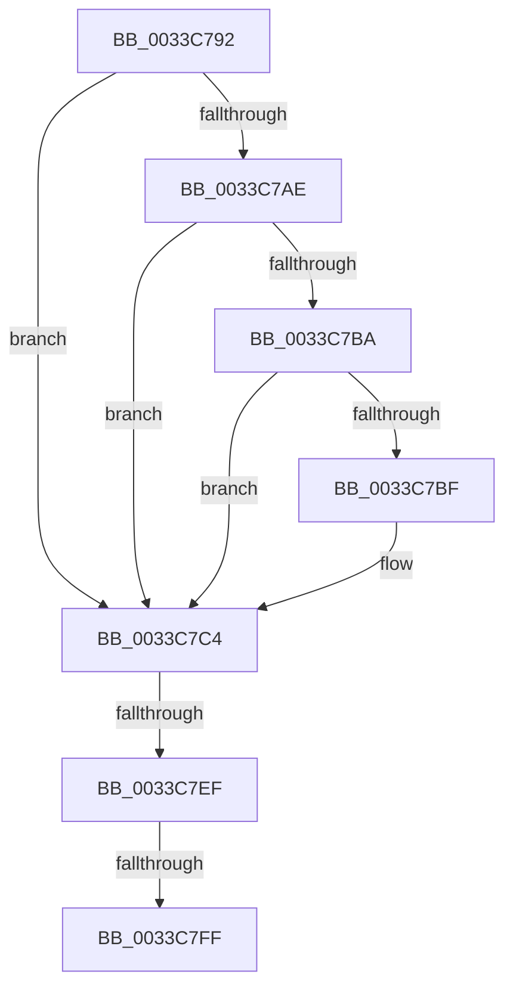

# sub_0033C792

- RVA: `0x0033C792`–`0x0033C802` (길이 `112` bytes)
- VA: `0x000000014033C792`
- 실행 섹션: `.text`
- PDB 이름 있음: `아니요`; PDB Function 태그: `아니요`
- unwind 정보 RVA: `0x00076FFC`
- 디코드: `26`개 명령, `112/112` bytes 표시
- 미해석 바이트: `0` (있으면 어셈블리에 `.byte`로 보존)

> 이 문서는 커널 이미지의 기계어와 PDB 기호를 분석해 생성했습니다. 4번과 5번은 함수 원형과 자료형을 바이너리 사용 방식에서 추정한 C 해석이며 원본 소스 복구 결과는 아닙니다.

## 1. Dependencies

- 직접 호출 지점: **0**; 고유 호출 대상: **0**
- 직접 호출자로 확인된 함수: **0**
- RIP 상대 이미지 참조: **0**

### Outgoing calls
- 직접 디코드된 call 명령이 없습니다.

### Direct callers
- 이 함수 시작 RVA로 연결되는 직접 call은 확인되지 않았습니다. 간접 호출은 완전히 역산할 수 없습니다.

### Static image references
- 디코드된 RIP-relative 메모리 참조가 없습니다.

## 2. Other-region calls and transfers

- 다른 실행 섹션으로 향하는 call: **0**
- call이 아닌 외부 분기/꼬리 이동: **2**
  - `0x0033C7E9` → [sub_0033C8D9](Unknown_function_0033C8D9.md) (`tail-transfer`)
  - `0x0033C7F9` → [sub_0033C8D9](Unknown_function_0033C8D9.md) (`tail-transfer`)

## 3. Assembly (complete function range)

```asm
0033C792  48 89 74 24 38                  mov qword ptr [rsp + 0x38], rsi
0033C797  48 23 D0                        and rdx, rax
0033C79A  48 89 7C 24 40                  mov qword ptr [rsp + 0x40], rdi
0033C79F  4C 23 D0                        and r10, rax
0033C7A2  33 FF                           xor edi, edi
0033C7A4  4C 89 74 24 20                  mov qword ptr [rsp + 0x20], r14
0033C7A9  4C 3B D1                        cmp r10, rcx
0033C7AC  72 16                           jb 0x14033c7c4
0033C7AE  48 8D 81 00 08 00 00            lea rax, [rcx + 0x800]
0033C7B5  4C 3B D0                        cmp r10, rax
0033C7B8  73 0A                           jae 0x14033c7c4
0033C7BA  49 3B D2                        cmp rdx, r10
0033C7BD  75 05                           jne 0x14033c7c4
0033C7BF  BF 01 00 00 00                  mov edi, 1
0033C7C4  4F 8D 1C 52                     lea r11, [r10 + r10*2]
0033C7C8  48 BE 00 00 00 00 00 DE FF FF   movabs rsi, 0xffffde0000000000
0033C7D2  49 C1 E3 04                     shl r11, 4
0033C7D6  48 8B C6                        mov rax, rsi
0033C7D9  4C 03 D8                        add r11, rax
0033C7DC  49 BE 00 00 00 00 00 FF FF FF   movabs r14, 0xffffff0000000000
0033C7E6  4C 3B D1                        cmp r10, rcx
0033C7E9  0F 82 EA 00 00 00               jb 0x14033c8d9
0033C7EF  48 8D 81 00 08 00 00            lea rax, [rcx + 0x800]
0033C7F6  4C 3B D0                        cmp r10, rax
0033C7F9  0F 83 DA 00 00 00               jae 0x14033c8d9
0033C7FF  4C 8B C2                        mov r8, rdx
```

## 4. C-style interpretation (structured pseudocode)

```c
__int64 __fastcall sub_0033C792(__int64 a1, __int64 a2)
{
    __int64 v_r10;
    __int64 v_r11;
    __int64 v_rdi;
    unsigned __int64 v_stack_p20;
    unsigned __int64 v_stack_p38;
    unsigned __int64 v_stack_p40;

    v_stack_p38 = v_rsi;
    a2 = (a2) & (result);
    v_stack_p40 = v_rdi;
    v_r10 = (v_r10) & (result);
    v_rdi = 0;
    v_stack_p20 = v_r14;
    if (v_r10 < a1) goto loc_0033C7C4;
    if (v_r10 >= (a1 + 2048)) goto loc_0033C7C4;
    if (a2 == v_r10) {
        v_rdi = 1;
    }
    v_r11 = (v_r10 + v_r10 * 2) << (4);
    v_r11 = (v_r11) + (v_rsi);
    return a1 + 2048;
}
```

## 5. (Beta) C Style

```c
void *sub_0033C792(void *Arg1, int64_t Arg2)
{
    uint8_t *arg1 = (uint8_t *)Arg1;

    int64_t local_r10;
    int64_t local_r11;
    int64_t local_rdi;
    uint64_t v_stack_p20;
    uint64_t v_stack_p38;
    uint64_t v_stack_p40;

    v_stack_p38 = local_rsi;
    Arg2 = (Arg2) & (result);
    v_stack_p40 = local_rdi;
    local_r10 = (local_r10) & (result);
    local_rdi = 0;
    v_stack_p20 = local_r14;
    if (local_r10 < Arg1) goto loc_0033C7C4;
    if (local_r10 >= (Arg1 + 2048)) goto loc_0033C7C4;
    if (Arg2 == local_r10) {
        local_rdi = 1;
    }
    local_r11 = (local_r10 + local_r10 * 2) << (4);
    local_r11 = (local_r11) + (local_rsi);
    return Arg1 + 2048;
}
```

### 관측된 메모리 오프셋

구조체 형식이 확인되지 않은 접근은 인자 기준의 오프셋으로만 기록했습니다.

| 기준 인자 | 오프셋 표현 | 폭 (bit) | 접근 |
|---|---:|---:|---|
| `Arg1` | `+ 0x800` | `64` | `R` |

## 6. Execution-region graph

[열기: 2D/3D 그래프와 함수 탐색 컨트롤 패널](../../../control-panel.html?section=text&rva=0x0033C792&view=graph)

- 2D 그래프는 위에서 아래로 흐르고, 3D 그래프는 빈 공간을 드래그해 회전합니다. Shift+드래그는 이동, 휠은 확대·축소, 함수 노드 선택은 대상 보고서 이동입니다.

### Static fallback


