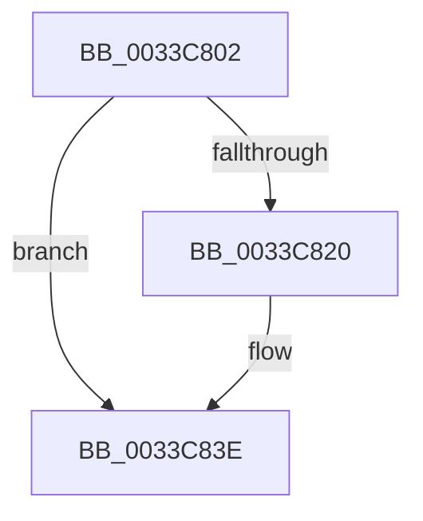

# sub_0033C802

- RVA: `0x0033C802`–`0x0033C847` (길이 `69` bytes)
- VA: `0x000000014033C802`
- 실행 섹션: `.text`
- PDB 이름 있음: `아니요`; PDB Function 태그: `아니요`
- unwind 정보 RVA: `0x00077018`
- 디코드: `16`개 명령, `69/69` bytes 표시
- 미해석 바이트: `0` (있으면 어셈블리에 `.byte`로 보존)

> 이 문서는 커널 이미지의 기계어와 PDB 기호를 분석해 생성했습니다. 4번과 5번은 함수 원형과 자료형을 바이너리 사용 방식에서 추정한 C 해석이며 원본 소스 복구 결과는 아닙니다.

## 1. Dependencies

- 직접 호출 지점: **0**; 고유 호출 대상: **0**
- 직접 호출자로 확인된 함수: **0**
- RIP 상대 이미지 참조: **1**

### Outgoing calls
- 직접 디코드된 call 명령이 없습니다.

### Direct callers
- 이 함수 시작 RVA로 연결되는 직접 call은 확인되지 않았습니다. 간접 호출은 완전히 역산할 수 없습니다.

### Static image references
- `0x0033C807` → RVA `0x00E2DC80` (`.data`; read)

## 2. Other-region calls and transfers

- 다른 실행 섹션으로 향하는 call: **0**
- 별도 외부 분기/꼬리 이동을 확인하지 못했습니다.

## 3. Assembly (complete function range)

```asm
0033C802  48 89 5C 24 30                  mov qword ptr [rsp + 0x30], rbx
0033C807  48 8B 1D 72 14 AF 00            mov rbx, qword ptr [rip + 0xaf1472]
0033C80E  49 C1 E0 0C                     shl r8, 0xc
0033C812  49 8B C0                        mov rax, r8
0033C815  48 0D 80 08 00 00               or rax, 0x880
0033C81B  48 85 DB                        test rbx, rbx
0033C81E  74 1E                           je 0x14033c83e
0033C820  49 8B C8                        mov rcx, r8
0033C823  49 81 C8 90 08 00 00            or r8, 0x890
0033C82A  48 0B CB                        or rcx, rbx
0033C82D  48 81 C9 80 08 00 00            or rcx, 0x880
0033C834  48 85 D8                        test rax, rbx
0033C837  4C 0F 44 C1                     cmove r8, rcx
0033C83B  49 8B C0                        mov rax, r8
0033C83E  48 8B 5C 24 30                  mov rbx, qword ptr [rsp + 0x30]
0033C843  49 89 43 10                     mov qword ptr [r11 + 0x10], rax
```

## 4. C-style interpretation (structured pseudocode)

```c
__int64 __fastcall sub_0033C802(__int64 a1, __int64 a2, __int64 a3, __int64 a4, __int64 a5, __int64 a6)
{
    __int64 result;
    unsigned __int64 v_stack_p30;

    v_stack_p30 = v_rbx;
    a3 = (a3) << (12);
    result = (a3) | (0x880ULL);
    if (*(unsigned __int64 *)(v_rip + 11474034) != 0) {
        a1 = a3;
        a3 = (a3) | (0x890ULL);
        a1 = (a1) | (*(unsigned __int64 *)(v_rip + 11474034));
        a1 = (a1) | (0x880ULL);
        if (((result) & (*(unsigned __int64 *)(v_rip + 11474034))) == 0) { a3 = a1; }
        result = a3;
    }
    *(unsigned __int64 *)(v_r11 + 16) = result;
    return result;
}
```

## 5. (Beta) C Style

```c
int64_t sub_0033C802(int64_t Arg1, int64_t Arg2, int64_t Arg3, int64_t Arg4, uint64_t Arg5, int64_t Arg6)
{
    int64_t result;
    uint64_t v_stack_p30;

    v_stack_p30 = local_rbx;
    Arg3 = (Arg3) << (12);
    result = (Arg3) | (0x880ULL);
    if (*(uint64_t *)(v_rip + 0xAF1472) != 0) {
        Arg1 = Arg3;
        Arg3 = (Arg3) | (0x890ULL);
        Arg1 = (Arg1) | (*(uint64_t *)(v_rip + 0xAF1472));
        Arg1 = (Arg1) | (0x880ULL);
        if (((result) & (*(uint64_t *)(v_rip + 0xAF1472))) == 0) { Arg3 = Arg1; }
        result = Arg3;
    }
    *(uint64_t *)(local_r11 + 0x10) = result;
    return result;
}
```

## 6. Execution-region graph

[열기: 2D/3D 그래프와 함수 탐색 컨트롤 패널](../../../control-panel.html?section=text&rva=0x0033C802&view=graph)

- 2D 그래프는 위에서 아래로 흐르고, 3D 그래프는 빈 공간을 드래그해 회전합니다. Shift+드래그는 이동, 휠은 확대·축소, 함수 노드 선택은 대상 보고서 이동입니다.

### Static fallback


