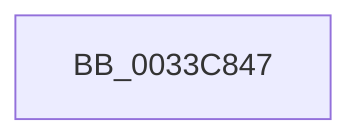

# sub_0033C847

- RVA: `0x0033C847`–`0x0033C866` (길이 `31` bytes)
- VA: `0x000000014033C847`
- 실행 섹션: `.text`
- PDB 이름 있음: `아니요`; PDB Function 태그: `아니요`
- unwind 정보 RVA: `0x0007702C`
- 디코드: `8`개 명령, `31/31` bytes 표시
- 미해석 바이트: `0` (있으면 어셈블리에 `.byte`로 보존)

> 이 문서는 커널 이미지의 기계어와 PDB 기호를 분석해 생성했습니다. 4번과 5번은 함수 원형과 자료형을 바이너리 사용 방식에서 추정한 C 해석이며 원본 소스 복구 결과는 아닙니다.

## 1. Dependencies

- 직접 호출 지점: **0**; 고유 호출 대상: **0**
- 직접 호출자로 확인된 함수: **0**
- RIP 상대 이미지 참조: **1**

### Outgoing calls
- 직접 디코드된 call 명령이 없습니다.

### Direct callers
- 이 함수 시작 RVA로 연결되는 직접 call은 확인되지 않았습니다. 간접 호출은 완전히 역산할 수 없습니다.

### Static image references
- `0x0033C85A` → RVA `0x00E35C00` (`.data`; read)

## 2. Other-region calls and transfers

- 다른 실행 섹션으로 향하는 call: **0**
- call이 아닌 외부 분기/꼬리 이동: **1**
  - `0x0033C864` → [sub_0033C866 + 0xB](Unknown_function_0033C866.md) (`tail-transfer`)

## 3. Assembly (complete function range)

```asm
0033C847  4C 8D 1C 52                     lea r11, [rdx + rdx*2]
0033C84B  49 C1 E3 04                     shl r11, 4
0033C84F  48 8B C6                        mov rax, rsi
0033C852  48 8B 74 24 38                  mov rsi, qword ptr [rsp + 0x38]
0033C857  4C 03 D8                        add r11, rax
0033C85A  48 8B 05 9F 93 AF 00            mov rax, qword ptr [rip + 0xaf939f]
0033C861  48 3B D0                        cmp rdx, rax
0033C864  72 0B                           jb 0x14033c871
```

## 4. C-style interpretation (structured pseudocode)

```c
__int64 __fastcall sub_0033C847(__int64 a1, __int64 a2, __int64 a3, __int64 a4, __int64 a5, __int64 a6, __int64 a7)
{
    __int64 v_r11;

    v_r11 = (a2 + a2 * 2) << (4);
    v_r11 = (v_r11) + (v_rsi);
}
```

## 5. (Beta) C Style

```c
int64_t sub_0033C847(int64_t Arg1, void *Arg2, int64_t Arg3, int64_t Arg4, uint64_t Arg5, uint64_t Arg6, int64_t Arg7)
{
    uint8_t *arg2 = (uint8_t *)Arg2;

    int64_t local_r11;

    local_r11 = (Arg2 + Arg2 * 2) << (4);
    local_r11 = (local_r11) + (local_rsi);
}
```

### 관측된 메모리 오프셋

구조체 형식이 확인되지 않은 접근은 인자 기준의 오프셋으로만 기록했습니다.

| 기준 인자 | 오프셋 표현 | 폭 (bit) | 접근 |
|---|---:|---:|---|
| `Arg2` | `+ 0x0 + rdx*2` | `64` | `R` |

## 6. Execution-region graph

[열기: 2D/3D 그래프와 함수 탐색 컨트롤 패널](../../../control-panel.html?section=text&rva=0x0033C847&view=graph)

- 2D 그래프는 위에서 아래로 흐르고, 3D 그래프는 빈 공간을 드래그해 회전합니다. Shift+드래그는 이동, 휠은 확대·축소, 함수 노드 선택은 대상 보고서 이동입니다.

### Static fallback


