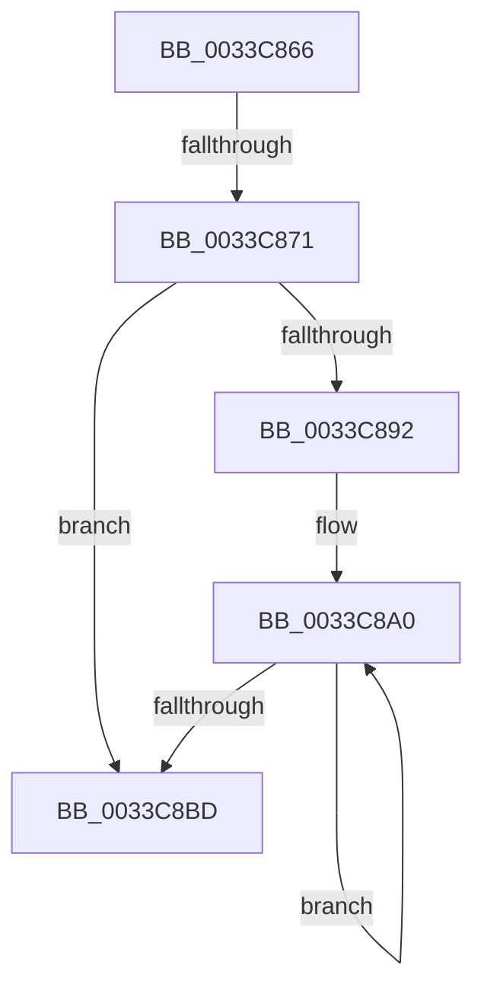

# sub_0033C866

- RVA: `0x0033C866`–`0x0033C8CB` (길이 `101` bytes)
- VA: `0x000000014033C866`
- 실행 섹션: `.text`
- PDB 이름 있음: `아니요`; PDB Function 태그: `아니요`
- unwind 정보 RVA: `0x0007703C`
- 디코드: `28`개 명령, `101/101` bytes 표시
- 미해석 바이트: `0` (있으면 어셈블리에 `.byte`로 보존)

> 이 문서는 커널 이미지의 기계어와 PDB 기호를 분석해 생성했습니다. 4번과 5번은 함수 원형과 자료형을 바이너리 사용 방식에서 추정한 C 해석이며 원본 소스 복구 결과는 아닙니다.

## 1. Dependencies

- 직접 호출 지점: **0**; 고유 호출 대상: **0**
- 직접 호출자로 확인된 함수: **0**
- RIP 상대 이미지 참조: **0**

### Outgoing calls
- 직접 디코드된 call 명령이 없습니다.

### Direct callers
- 이 함수 시작 RVA로 연결되는 직접 call은 확인되지 않았습니다. 간접 호출은 완전히 역산할 수 없습니다.

### Static image references
- 디코드된 RIP-relative 메모리 참조가 없습니다.

## 2. Other-region calls and transfers

- 다른 실행 섹션으로 향하는 call: **0**
- call이 아닌 외부 분기/꼬리 이동: **2**
  - `0x0033C86F` → [sub_0033C8F0](Unknown_function_0033C8F0.md) (`tail-transfer`)
  - `0x0033C8C9` → [sub_0033C8CB + 0x8](Unknown_function_0033C8CB.md) (`tail-transfer`)

## 3. Assembly (complete function range)

```asm
0033C866  48 05 00 08 00 00               add rax, 0x800
0033C86C  48 3B D0                        cmp rdx, rax
0033C86F  72 7F                           jb 0x14033c8f0
0033C871  49 8B 53 18                     mov rdx, qword ptr [r11 + 0x18]
0033C875  48 8B CA                        mov rcx, rdx
0033C878  48 8B C2                        mov rax, rdx
0033C87B  49 33 C9                        xor rcx, r9
0033C87E  49 23 CE                        and rcx, r14
0033C881  49 33 C9                        xor rcx, r9
0033C884  F0 49 0F B1 4B 18               lock cmpxchg qword ptr [r11 + 0x18], rcx
0033C88A  4C 8B C0                        mov r8, rax
0033C88D  48 3B D0                        cmp rdx, rax
0033C890  74 2B                           je 0x14033c8bd
0033C892  0F 1F 40 00                     nop dword ptr [rax]
0033C896  66 66 0F 1F 84 00 00 00 00 00   nop word ptr [rax + rax]
0033C8A0  49 8B D0                        mov rdx, r8
0033C8A3  4D 33 C1                        xor r8, r9
0033C8A6  4D 23 C6                        and r8, r14
0033C8A9  48 8B C2                        mov rax, rdx
0033C8AC  4D 33 C1                        xor r8, r9
0033C8AF  F0 4D 0F B1 43 18               lock cmpxchg qword ptr [r11 + 0x18], r8
0033C8B5  4C 8B C0                        mov r8, rax
0033C8B8  48 3B D0                        cmp rdx, rax
0033C8BB  75 E3                           jne 0x14033c8a0
0033C8BD  4C 8B 74 24 20                  mov r14, qword ptr [rsp + 0x20]
0033C8C2  85 FF                           test edi, edi
0033C8C4  48 8B 7C 24 40                  mov rdi, qword ptr [rsp + 0x40]
0033C8C9  74 08                           je 0x14033c8d3
```

## 4. C-style interpretation (structured pseudocode)

```c
__int64 __fastcall sub_0033C866(__int64 a1, __int64 a2, __int64 a3, __int64 a4, __int64 a5, __int64 a6, __int64 a7, __int64 a8)
{
    __int64 result;
    unsigned __int64 v_stack_p20;

    result = (result) + (0x800ULL);
    a1 = (*(unsigned __int64 *)(v_r11 + 24)) ^ (a4);
    a1 = (a1) & (v_r14);
    a1 = (a1) ^ (a4);
    if ((*(unsigned __int64 *)(v_r11 + 24)) == (*(unsigned __int64 *)(v_r11 + 24))) goto loc_0033C8BD;
loc_0033C8A0:
    a3 = (*(unsigned __int64 *)(v_r11 + 24)) ^ (a4);
    a3 = (a3) & (v_r14);
    a3 = (a3) ^ (a4);
    if ((*(unsigned __int64 *)(v_r11 + 24)) != (*(unsigned __int64 *)(v_r11 + 24))) goto loc_0033C8A0;
loc_0033C8BD:
}
```

## 5. (Beta) C Style

```c
int64_t sub_0033C866(int64_t Arg1, int64_t Arg2, int64_t Arg3, int64_t Arg4, uint64_t Arg5, uint64_t Arg6, uint64_t Arg7, int64_t Arg8)
{
    int64_t result;
    uint64_t v_stack_p20;

    result = (result) + (0x800ULL);
    Arg1 = (*(uint64_t *)(local_r11 + 0x18)) ^ (Arg4);
    Arg1 = (Arg1) & (local_r14);
    Arg1 = (Arg1) ^ (Arg4);
    if ((*(uint64_t *)(local_r11 + 0x18)) == (*(uint64_t *)(local_r11 + 0x18))) goto loc_0033C8BD;
loc_0033C8A0:
    Arg3 = (*(uint64_t *)(local_r11 + 0x18)) ^ (Arg4);
    Arg3 = (Arg3) & (local_r14);
    Arg3 = (Arg3) ^ (Arg4);
    if ((*(uint64_t *)(local_r11 + 0x18)) != (*(uint64_t *)(local_r11 + 0x18))) goto loc_0033C8A0;
loc_0033C8BD:
}
```

## 6. Execution-region graph

[열기: 2D/3D 그래프와 함수 탐색 컨트롤 패널](../../../control-panel.html?section=text&rva=0x0033C866&view=graph)

- 2D 그래프는 위에서 아래로 흐르고, 3D 그래프는 빈 공간을 드래그해 회전합니다. Shift+드래그는 이동, 휠은 확대·축소, 함수 노드 선택은 대상 보고서 이동입니다.

### Static fallback


