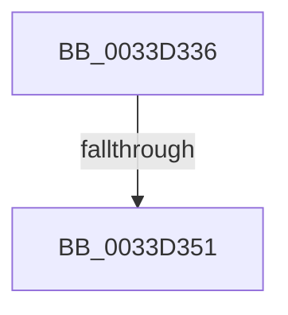

# sub_0033D336

- RVA: `0x0033D336`–`0x0033D365` (길이 `47` bytes)
- VA: `0x000000014033D336`
- 실행 섹션: `.text`
- PDB 이름 있음: `아니요`; PDB Function 태그: `아니요`
- unwind 정보 RVA: `0x000770C4`
- 디코드: `12`개 명령, `47/47` bytes 표시
- 미해석 바이트: `0` (있으면 어셈블리에 `.byte`로 보존)

> 이 문서는 커널 이미지의 기계어와 PDB 기호를 분석해 생성했습니다. 4번과 5번은 함수 원형과 자료형을 바이너리 사용 방식에서 추정한 C 해석이며 원본 소스 복구 결과는 아닙니다.

## 1. Dependencies

- 직접 호출 지점: **0**; 고유 호출 대상: **0**
- 직접 호출자로 확인된 함수: **0**
- RIP 상대 이미지 참조: **0**

### Outgoing calls
- 직접 디코드된 call 명령이 없습니다.

### Direct callers
- 이 함수 시작 RVA로 연결되는 직접 call은 확인되지 않았습니다. 간접 호출은 완전히 역산할 수 없습니다.

### Static image references
- 디코드된 RIP-relative 메모리 참조가 없습니다.

## 2. Other-region calls and transfers

- 다른 실행 섹션으로 향하는 call: **0**
- call이 아닌 외부 분기/꼬리 이동: **2**
  - `0x0033D34F` → [sub_0033D37A](Unknown_function_0033D37A.md) (`tail-transfer`)
  - `0x0033D363` → [sub_0033D365 + 0xE](Unknown_function_0033D365.md) (`tail-transfer`)

## 3. Assembly (complete function range)

```asm
0033D336  48 89 5C 24 50                  mov qword ptr [rsp + 0x50], rbx
0033D33B  48 8B F9                        mov rdi, rcx
0033D33E  48 89 74 24 68                  mov qword ptr [rsp + 0x68], rsi
0033D343  48 8B F2                        mov rsi, rdx
0033D346  BB FF FF FF FF                  mov ebx, 0xffffffff
0033D34B  41 83 F8 78                     cmp r8d, 0x78
0033D34F  74 29                           je 0x14033d37a
0033D351  F0 0F C1 5F 04                  lock xadd dword ptr [rdi + 4], ebx
0033D356  48 8B 74 24 68                  mov rsi, qword ptr [rsp + 0x68]
0033D35B  83 FB 01                        cmp ebx, 1
0033D35E  48 8B 5C 24 50                  mov rbx, qword ptr [rsp + 0x50]
0033D363  75 0E                           jne 0x14033d373
```

## 4. C-style interpretation (structured pseudocode)

```c
void __fastcall sub_0033D336(__int64 a1, __int64 a2, int a3, __int64 a4, __int64 a5, __int64 a6, __int64 a7, __int64 a8, __int64 a9, __int64 a10, __int64 a11, __int64 a12, __int64 a13)
{
    unsigned __int64 v_stack_p50;
    unsigned __int64 v_stack_p68;

    v_stack_p50 = v_rbx;
    v_stack_p68 = v_rsi;
}
```

## 5. (Beta) C Style

```c
void sub_0033D336(void *Arg1, int64_t Arg2, int32_t Arg3, int64_t Arg4, uint64_t Arg5, uint64_t Arg6, uint64_t Arg7, uint64_t Arg8, uint64_t Arg9, int64_t Arg10, uint64_t Arg11, uint64_t Arg12, int64_t Arg13)
{
    uint8_t *arg1 = (uint8_t *)Arg1;

    uint64_t v_stack_p50;
    uint64_t v_stack_p68;

    v_stack_p50 = local_rbx;
    v_stack_p68 = local_rsi;
}
```

### 관측된 메모리 오프셋

구조체 형식이 확인되지 않은 접근은 인자 기준의 오프셋으로만 기록했습니다.

| 기준 인자 | 오프셋 표현 | 폭 (bit) | 접근 |
|---|---:|---:|---|
| `Arg1` | `+ 0x4` | `32` | `R/W` |

## 6. Execution-region graph

[열기: 2D/3D 그래프와 함수 탐색 컨트롤 패널](../../../control-panel.html?section=text&rva=0x0033D336&view=graph)

- 2D 그래프는 위에서 아래로 흐르고, 3D 그래프는 빈 공간을 드래그해 회전합니다. Shift+드래그는 이동, 휠은 확대·축소, 함수 노드 선택은 대상 보고서 이동입니다.

### Static fallback


